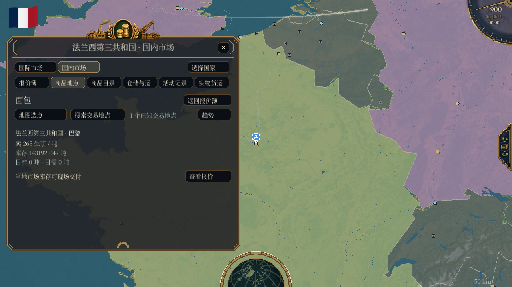
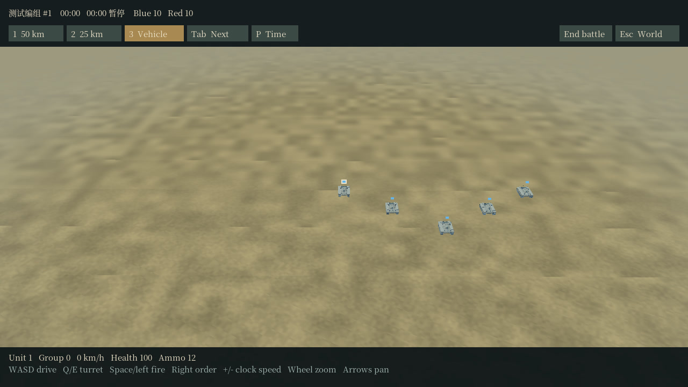

# WWO

WWO 是一款从 **1900 年** 开始的历史沙盒。选一座城市和一种出身，从找工作、买口粮开始。你可以留在当地生活，也可以搭车去另一座城市，换一份工作或经营商号。

[Windows 预览](https://github.com/ryoumiyahayato/wwo/releases/tag/global-transport-1900-20261121) · [启动与地图资源](docs/BUILD_AND_RECOVERY.md)

## 从人物开始

可在法国、英国、德国、俄国、清帝国或日本开局。序章中的年龄、出身和教育会影响人物能做的事。在巴黎，可以读工坊的招聘公告，也可以请教师代读，再凭口述消息应聘。签约后完成班次，按班次结算工资。买到的面包会进入库存，供日常消耗。

## 旅行、贸易与经营

在地理、政治、经济和军事地图间切换，查看地形、疆界、市场和线路。可以查人口与历史资料，买票旅行，到站后登记迁居。商号可以接单、采购和发运货物。客运与货运使用同一路网。人物、货物和在途行程随存档恢复。

## 装甲演习

从法国军事地图的 25 或 50 公里方格进入装甲演习。可以从上方观察全场，也可以切到车辆视角操控。退出战场后，进行中的演习会在世界时间推进时继续。返回原方格可查看战果。

## 项目资料

WWO 仍在开发。截图来自开发版，Windows 阶段预览需要配套地图资源。

[游戏实现与覆盖范围](docs/RUST_HOST_RUNTIME_REVIEW.md) · [源码构建与恢复](docs/BUILD_AND_RECOVERY.md) · [更新记录](CHANGELOG.md)
