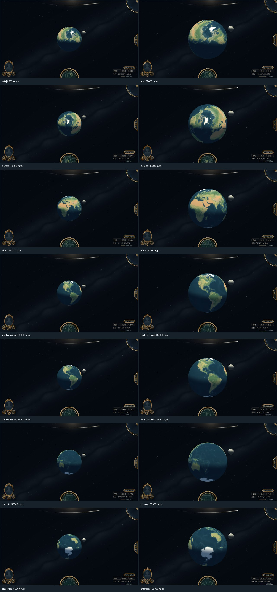
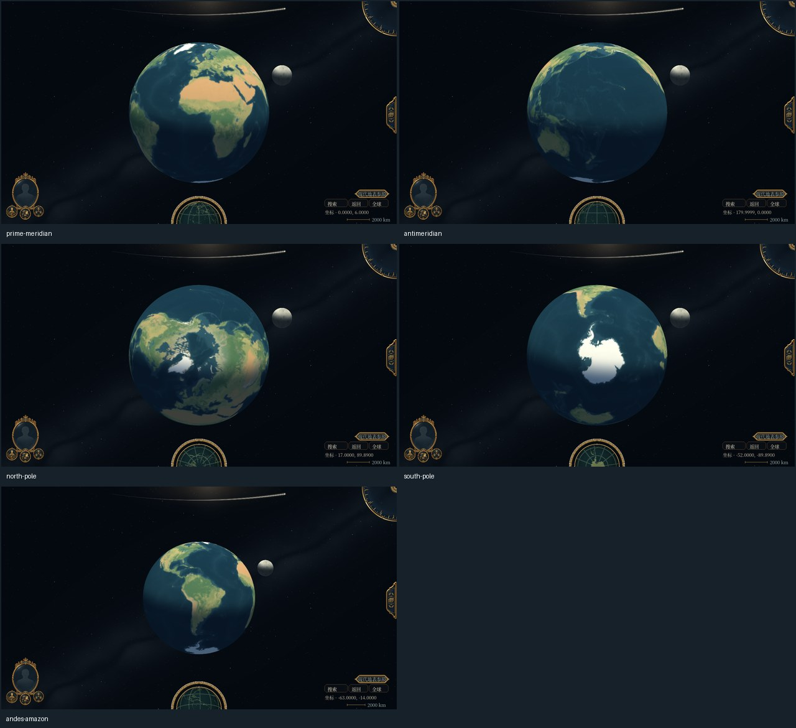

# Z0 全球地貌骨架验收

复用私有 Release 的 [0.qpk](https://github.com/ryoumiyahayato/wwo/releases/download/terrain-surface-20261115/0.qpk)，264,033 字节。两张基础页持续驻留 GPU。Z0 未改生成规则或渲染代码。正式版本保留当前地貌，用户视觉验收待确认。

## 全球数据和固定 Z0

2×1 全球索引完整。两张瓦片全部解码高程和 BC7。两条共享边分别位于 0° 和 180° 经线，高程及重叠 BC7 块检查通过。共检查 8,712 个 BC7 块。Z0 只有一行，无对角交点。两页覆盖南北极，8 位 RGBA 的极点填充最大差为 1、2、2、1。名义赤道采样约 78.3 公里。

随机种子 `2026111600`。七洲两档和五项专项共 19 张实际 Rust/wgpu 截图，所有地表中心点均使用权重 1 的 Z0。北美和南美各只有一张符合陆地条件的候选页，使用相同瓦片及各自独立机位。0° 跨陆海、180° 太平洋回绕和两极未见明显硬缝、缺块或镜像错位。安第斯至亚马孙可作大陆尺度识别。小河与小岛超出本层可靠判读尺度。永久浮冰架仍有共享来源缺项。

| 洲 | Z/X/Y | 经度，纬度 | 米／像素 |
| --- | --- | --- | --- |
| 亚洲 | 0/0/0 | −169.8037，66.0052 | 55,000 / 35,000 |
| 欧洲 | 0/0/0 | −24.0170，64.8317 | 55,000 / 35,000 |
| 非洲 | 0/1/0 | 51.1432，10.6204 | 55,000 / 35,000 |
| 北美洲 | 0/0/0 | −83.5756，8.4450 | 55,000 / 35,000 |
| 南美洲 | 0/0/0 | −80.9162，−1.0655 | 55,000 / 35,000 |
| 大洋洲 | 0/0/0 | −179.8977，−16.4365 | 55,000 / 35,000 |
| 南极洲 | 0/1/0 | 102.5999，−65.8710 | 55,000 / 35,000 |

## 固定层连续操作与相邻层回归

固定 Z0 在反经线以 19,000–28,000 米／像素平移、缩放和旋转 40 帧。有效中心点 27 帧使用西页，13 帧使用东页，全部权重 1。标准 1280×720 滚轮最大约 29,040 米／像素。超出该范围的 Z0↔Z1 过渡使用现有离屏观察定位，56,000→39,000→56,000 米／像素实际走完 Z0→Z1→Z0。 [Z1 动态验收](RUST_TERRAIN_Z1_SKELETON.md)

同一最终地貌运行时对 Z3/Z4、Z4/Z5、Z5/Z6、Z6/Z7 各追加 106 帧相邻层局部回归。四条路径均进入两侧目标层并返回，地表取样点的层级权重最大空间差均为 0。使用同一全球资源，无整层重解码或再生成。

[固定层反经线连续实拍](https://github.com/ryoumiyahayato/wwo/releases/download/terrain-surface-20261115/z0-skeleton-zoom.mp4) · [取景、逐帧状态和正式游戏回执](https://github.com/ryoumiyahayato/wwo/releases/download/terrain-surface-20261115/z0-skeleton-frames.json.gz)

## 正式游戏局部回归

独立暂停会话，无窗口焦点。RTX 3050 Laptop Vulkan，1280×720。使用最终 Release 构建验证地理、政治、经济、军事四种地图，28,000→15,900 米／像素滚轮和连续交互均正常。对比 Z4 阶段构建，地理操作帧时中位数/P95 为 6.939/7.458→6.948/7.394 毫秒，选中页就绪均为 0.38 秒。运行末工作集约 249→284 MiB，专用显存约 258→258 MiB。地表来源保持现代标注。沿用 [候选归档](https://github.com/ryoumiyahayato/wwo/releases/tag/terrain-surface-20261115) 和 [原版本回退](https://github.com/ryoumiyahayato/wwo/releases/tag/rust-native-windows-20261115)。
