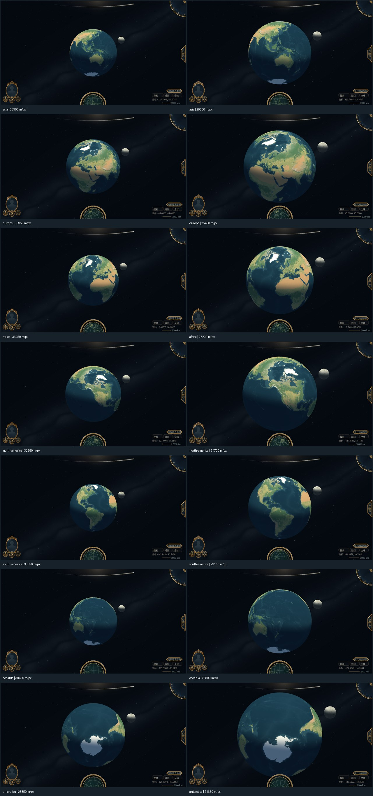
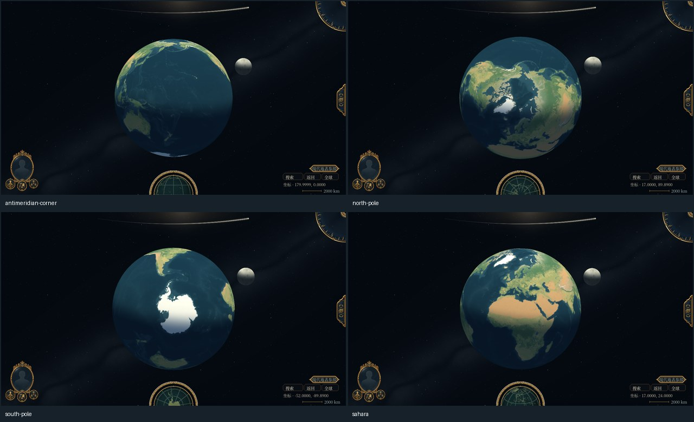
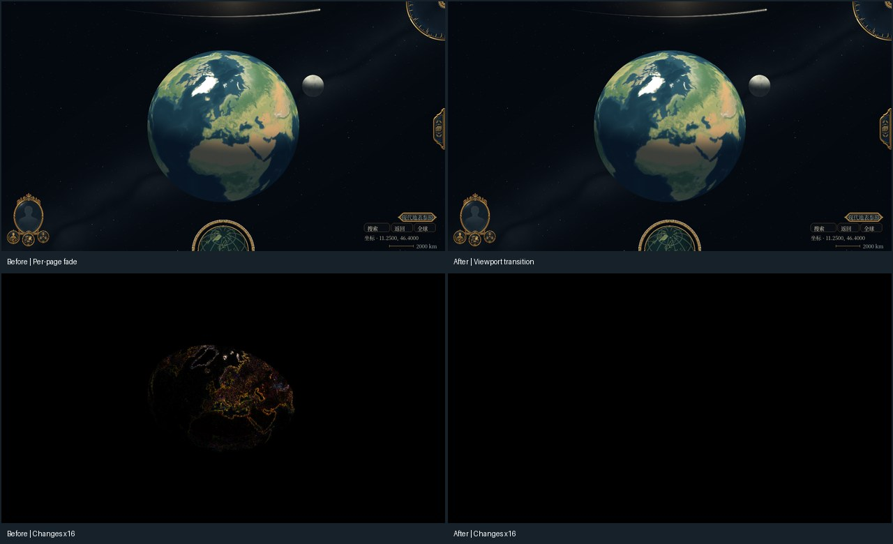

# Z1 全球地貌骨架验收

复用私有 Release [1.qpk](https://github.com/ryoumiyahayato/wwo/releases/download/terrain-surface-20261115/1.qpk)，998,311 字节。正式版本保留当前资源。用户视觉验收待确认。

## 全球数据与固定层

4×2 全球索引完整。8 张瓦片全部解码高程和 BC7，检查 12 条共享边、8 组对角交点和 34,848 个有效 BC7 块。共享边高程差为 0 米，Z0 父层简化高程最大差 0.75 米。南北极高程填充一致，8 位 RGBA 填充最大差依次为 1、2、1、1。名义赤道采样约 39.1 公里。

随机种子 `2026111601`。用 Natural Earth 1:110m 陆地和洲界筛选候选，1:10m 核对机位。七洲两档及四项专项共 18 张 Rust/wgpu 离屏截图。每帧位于球体上的中心诊断点只绘制 Z1，权重为 1。反经线与赤道交点、两极及撒哈拉取景未见明显硬接缝。固定 Z1 在反经线连续平移、缩放、旋转 28 帧均使用 Z1。

| 洲 | Z/X/Y | 经度，纬度 | 米／像素 |
| --- | --- | --- | --- |
| 亚洲 | 1/3/1 | 123.7993，−10.3747 | 38,900 / 29,200 |
| 欧洲 | 1/2/0 | 45.0000，45.0000 | 33,950 / 25,450 |
| 非洲 | 1/1/0 | −9.2599，32.5769 | 36,250 / 27,200 |
| 北美洲 | 1/0/0 | −127.8981，50.1141 | 32,950 / 24,700 |
| 南美洲 | 1/1/0 | −61.8458，10.7409 | 38,850 / 29,150 |
| 大洋洲 | 1/0/1 | −179.9348，−16.5108 | 38,400 / 28,800 |
| 南极洲 | 1/0/1 | −126.5272，−73.2683 | 28,850 / 21,650 |

## Z0/Z1 与 Z1/Z2 动态切换

在阿尔卑斯以离屏定位建立 56,000 米／像素 Z0，再用实际滚轮进入 1280×720 的滚轮上限 29,040 米／像素。两版各取 81 帧。基线第 9 至 11 帧的同倍率颜色差集中在先就绪的区域。候选让整幅留在 Z0，等 Z1 可见页就绪后才同步混合。Z0 仍用两张常驻基础纹理。

玩家滚轮上限以外的 Z0↔Z1 往返另用离屏观察定位完成。56,000→39,000→56,000 米／像素共 86 帧，实际绘制 Z0 28 帧、Z1 48 帧、Z0 10 帧，中途无重复回退。常规 Z1↔Z2 28,000→15,900→28,000 米／像素的 80 帧滚轮回归保持原绘制层序列。

[连续实际 GPU 录像](https://github.com/ryoumiyahayato/wwo/releases/download/terrain-surface-20261115/z1-skeleton-zoom.mp4) · [取景与逐帧状态](https://github.com/ryoumiyahayato/wwo/releases/download/terrain-surface-20261115/z1-skeleton-frames.json.gz)
