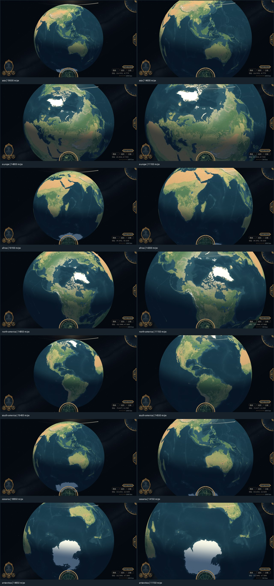
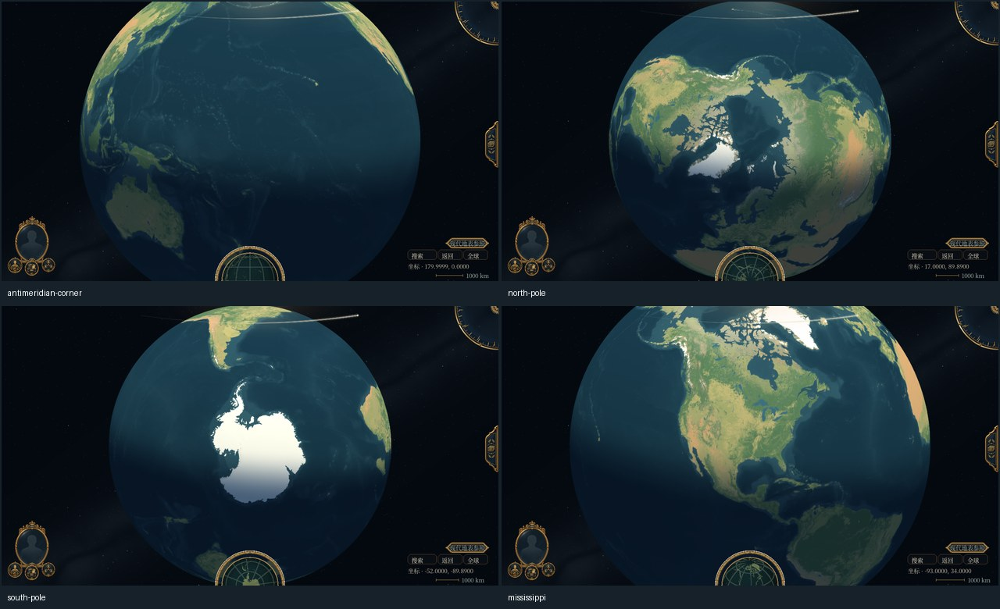
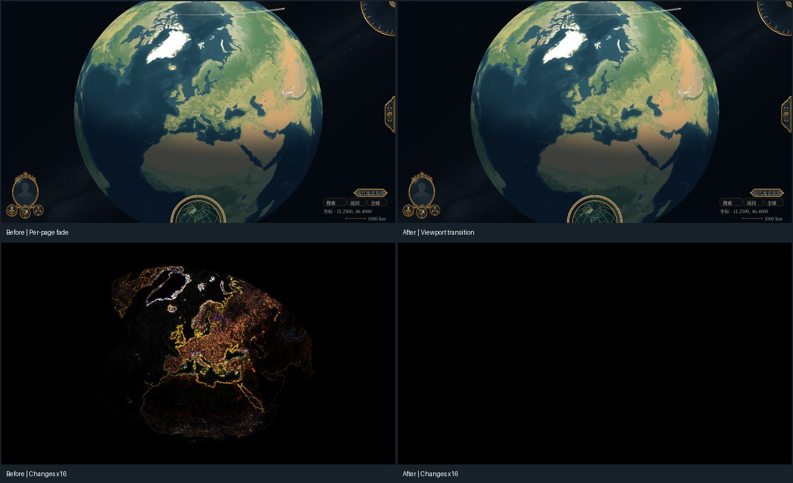

# Z2 全球地貌骨架验收

复用 [2.qpk](https://github.com/ryoumiyahayato/wwo/releases/download/terrain-surface-20261115/2.qpk)，3,736,802 字节。正式资源保留当前版本。用户视觉验收待确认。

## 全球数据和固定 Z2

8×4 全球索引完整。32 张瓦片全部解码高程和 BC7，检查 56 条共享边、48 组对角交点和 139,392 个有效 BC7 块。共享边高程差为 0，Z1 父层简化高程最大差 0.75 米。两极高程填充一致，8 位 RGBA 填充最大差为 2、2、2、1。名义赤道采样约 19.6 公里。

按 Natural Earth 陆地和洲界抽样，冻结种子 `2026111602`。七洲两档和四项专项共 18 帧，46 个地表采样只绘制 Z2，权重为 1。亚洲和大洋洲抽中同一瓦片，分别采用独立机位。反经线与赤道四角、两极、密西西比与墨西哥湾岸专项未见明显硬接缝。河槽、礁体等低于本层采样间距的细节按数据尺度登记。

| 洲 | Z/X/Y | 经度，纬度 | 米／像素 |
| --- | --- | --- | --- |
| 亚洲 | 2/6/2 | 114.5553，−8.7779 | 19,500 / 14,600 |
| 欧洲 | 2/5/0 | 65.3144，67.7525 | 14,800 / 11,100 |
| 非洲 | 2/5/2 | 49.3592，−18.4240 | 19,100 / 14,300 |
| 北美洲 | 2/1/0 | −112.5000，67.5000 | 14,850 / 11,150 |
| 南美洲 | 2/2/1 | −70.0177，12.1989 | 19,400 / 14,550 |
| 大洋洲 | 2/6/2 | 113.6513，−22.5650 | 18,850 / 14,150 |
| 南极洲 | 2/6/3 | 112.5000，−67.5000 | 14,850 / 11,150 |

## 动态切换与相邻层回归

28,000→15,750 米／像素阿尔卑斯冷缓存重放各 80 帧。在第 13 帧，基线已经有 Z2 权重为 1 的区域和仍为 Z1 的区域。尼罗河慢速输入也复现空间权重差 1。Z2 接入已有整幅混合后两条路径的空间权重差均为 0。

暖缓存 65 帧的快速滚轮叠加平移和旋转，实际绘制由原来的 Z2→Z1→Z2→Z1→Z2 变为一次 Z2→Z1→Z2。Z2/Z3 的 98 帧缩放回归保持相同绘制层序列。再次复跑 Z4 的 6,200 米／像素路径，188 张可见页无缺页，权重保持 94.28%，额外粗层预取使用低优先级位置。使用 Vulkan 后台离屏回执，游戏模式局部回归见 [Z3 验收](RUST_TERRAIN_Z3_SKELETON.md)。

[连续实拍录像](https://github.com/ryoumiyahayato/wwo/releases/download/terrain-surface-20261115/z2-skeleton-zoom.mp4) · [逐帧状态、倍率与自动读取回执](https://github.com/ryoumiyahayato/wwo/releases/download/terrain-surface-20261115/z2-skeleton-frames.json.gz)
