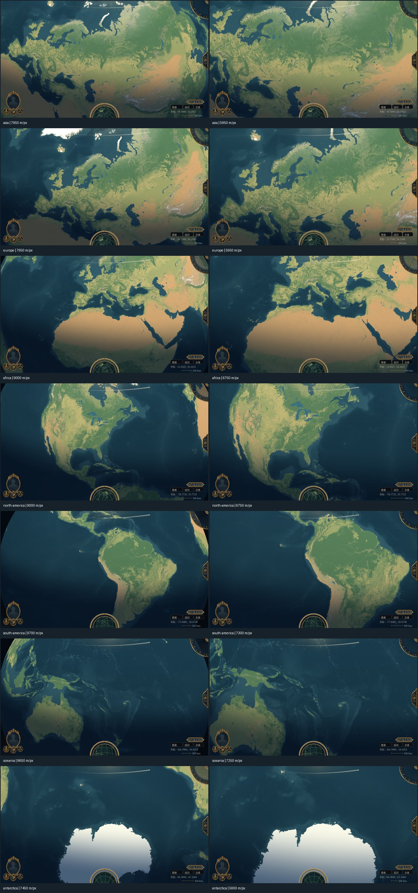
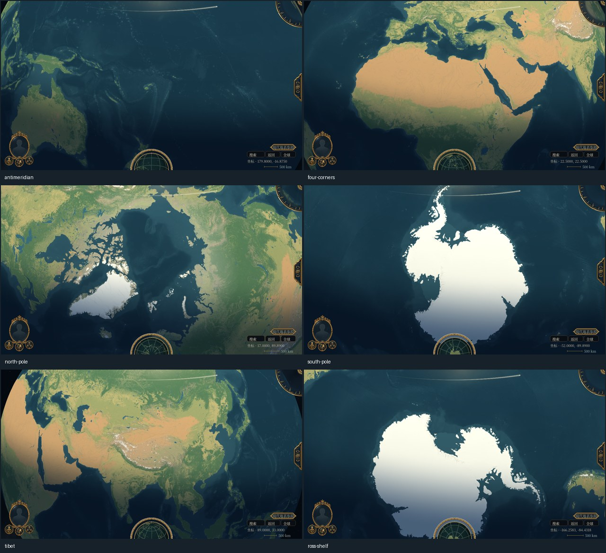
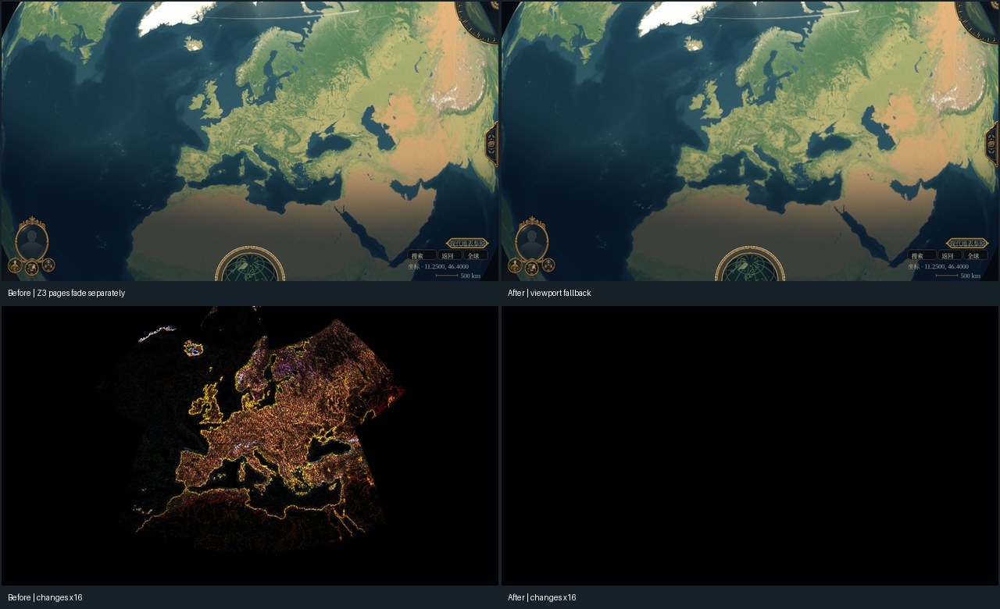

# Z3 全球地貌骨架验收

复用私有 Release 的完整 [3.qpk](https://github.com/ryoumiyahayato/wwo/releases/download/terrain-surface-20261115/3.qpk)，13,567,925 字节。正式版本未提升。用户视觉验收待确认。

## 全球数据与固定层

16×8 全球索引完整。128 张瓦片全部解码高程和 BC7。240 条共享边、224 组对角交点和 557,568 个 BC7 块检查通过，含经度回绕。共享边高程差为 0 米。Z2 简化高程最大差 0.75 米。南北各 16 张极区页高程填充有效，8 位 RGBA 极点填充最大差为 2、2、1、1。名义采样 316.4 角秒，赤道约 9.8 公里。

随机种子 `2026111603`。Natural Earth 1:110m 陆地和洲界筛选候选，排除 PR #142 的七洲历史随机瓦片。用 1:10m 陆地校准机位。七洲两档及六项专项均用 Rust/wgpu 真实固定 Z3 离屏渲染。斐济反经线、撒哈拉四角和极区未见明显硬缝。固定 Z3 在斐济连续平移、缩放、旋转 40 帧，地球上的采样始终为 Z3。

| 洲 | Z/X/Y | 经度，纬度 | 米／像素 |
| --- | --- | --- | --- |
| 亚洲 | 3/10/1 | 59.5000，56.2927 | 7,950 / 5,950 |
| 欧洲 | 3/9/1 | 33.7500，56.2500 | 7,950 / 5,950 |
| 非洲 | 3/8/2 | 11.0527，33.6125 | 9,000 / 6,750 |
| 北美洲 | 3/4/2 | −78.7725，33.7721 | 9,000 / 6,750 |
| 南美洲 | 3/4/4 | −77.8485，−10.6738 | 9,700 / 7,300 |
| 大洋洲 | 3/15/4 | 166.5984，−14.6253 | 9,650 / 7,250 |
| 南极洲 | 3/11/6 | 84.3850，−67.1404 | 7,450 / 5,600 |

## Z2/Z3 动态切换及 Z3/Z4 回归

相同机位及输入的阿尔卑斯冷缓存重放各 101 帧。9,200 米／像素第 16 帧的基线 Z3 权重为 0、0.349、1，产生分片锐度差。接入已有整幅机制后，所有地表采样的空间权重差为 0。可见页未就绪时继续整幅显示 Z2。

只启用整幅混合的中间候选在斐济快速平移缩放中出现 6 次单帧回到 Z2，每次有一张新页进入视野时还未就绪。正式候选在 256 页资源中用剩余位置保留最多 168 张 Z1–Z3 粗层页，可见页和常规预取环仍优先。斐济原输入 104 帧全程实际绘制 Z3，缺页为 0。撒哈拉慢速重放 119 帧，过渡无空间权重差。阿尔卑斯从 Z2 经 Z3/Z4 回到 Z2 共 107 帧，消除了原输入额外的单帧 Z2 回退，Z4 的整幅混合继续生效。

[真实连续录像](https://github.com/ryoumiyahayato/wwo/releases/download/terrain-surface-20261115/z3-skeleton-zoom.mp4) · [取景参数、逐帧状态与正式游戏回执](https://github.com/ryoumiyahayato/wwo/releases/download/terrain-surface-20261115/z3-skeleton-frames.json.gz)

## 正式游戏局部回归

后台独立暂停会话，1280×720 RTX 3050 Laptop Vulkan。地理、政治、经济、军事四种地图均完成 14,400→9,200 米／像素及连续滚轮、平移操作。地理地图操作帧时中位数/P95 从 6.938/7.382 变为 6.938/7.405 毫秒。冷缓存全部选中页就绪从 0.88 增至 0.98 秒，含新增预取。运行末工作集约 249→257 MiB，专用显存约 254→258 MiB。全程无窗口焦点。

## 后续精修

Z3 保留现代来源标注。小河、小湖、细窄礁体和岛链受约 9.8 公里采样约束。共享地表来源中缺少永久浮冰架标记的问题延续至 Z3，已在罗斯冰架旧机位留图。候选沿用 [共享归档](https://github.com/ryoumiyahayato/wwo/releases/tag/terrain-surface-20261115)，保留 [原正式版本](https://github.com/ryoumiyahayato/wwo/releases/tag/rust-native-windows-20261115)。
