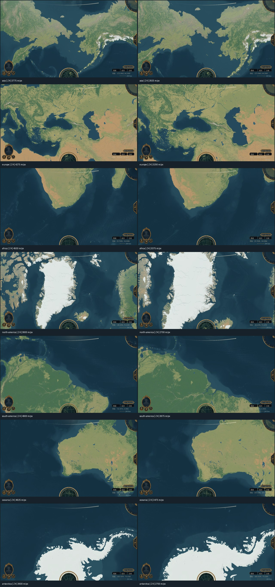
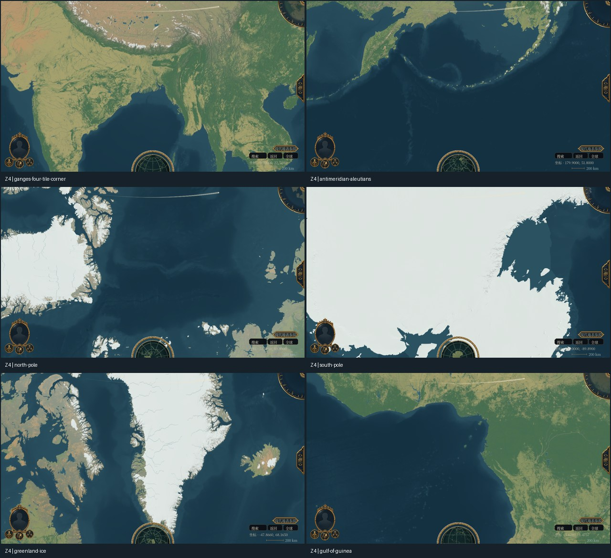
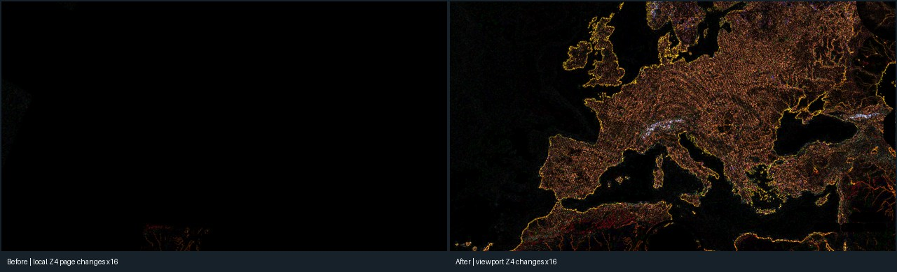
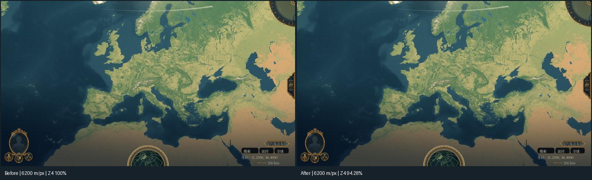

# Z4 全球地貌骨架验收

复用私有 Release 的完整 [4.qpk](https://github.com/ryoumiyahayato/wwo/releases/download/terrain-surface-20261115/4.qpk)，47,292,368 字节。正式版本提升与本次技术验收分开。用户视觉验收待确认。

## 全球数据与固定层

全球 32×16 索引完整。512 张瓦片全部解码高程与 BC7，实际检查 992 条共享边、960 组对角交点和 2,230,272 个 BC7 块。共享边高程差为 0 米。对 Z3 父层的简化高程最大差 0.75 米。南北各 32 个极区瓦片高程一致，极点 8 位 RGBA 压缩边距最大差依次为 2、2、2、1。名义采样为 158.2 角秒，赤道约 4.9 公里。

七洲随机取景的坐标在出图前冻结。20 张真实 Rust/wgpu 离屏帧的 180 个诊断点均使用权重 1 的 Z4，无缺页或父层回退。固定 Z4 在恒河四角取景连续平移、缩放、旋转 40 帧。恒河水系与岸线连续。阿留申反经线和南北极取景未见明显硬接缝。海陆、区域山脉、平原和主河网可辨。

| 洲 | Z/X/Y | 经度，纬度 | 米／像素 |
| --- | --- | --- | --- |
| 亚洲 | 4/0/2 | −173.1063，64.2410 | 3,775 / 2,825 |
| 欧洲 | 4/19/4 | 39.9100，43.4415 | 4,275 / 3,200 |
| 非洲 | 4/18/11 | 25.7028，−34.0286 | 4,500 / 3,375 |
| 北美洲 | 4/13/1 | −28.1250，73.1250 | 3,600 / 2,700 |
| 南美洲 | 4/11/7 | −51.3373，4.3016 | 4,900 / 3,675 |
| 大洋洲 | 4/26/10 | 118.1250，−28.1250 | 4,625 / 3,475 |
| 南极洲 | 4/6/14 | −103.3159，−73.1310 | 3,600 / 2,700 |

## 动态 LOD 与页预算

Z3/Z4 在冷缓存复现逐页淡入。阿尔卑斯 4,650 米／像素第 13 帧九点的 Z4 权重从 0.149 到 1.0，同一帧出现不同清晰度区域。复用整幅同步机制后九点均为 0.303。阿尔卑斯、尼罗河重放各 89 帧，旧版九点最大空间差为 1，修复后为 0。暖缓存太平洋快速缩放和恒河 Z4↔Z5 连续回归均保持统一权重。

旧报告中的 6,200 米／像素阿尔卑斯正射机位已按原位置和同样输入复测。视口共 188 张，加入预取环后共 262 张。256 页预算优先装满可见区域，仍保留 94.28% 的 Z4 整幅权重，旧版在该帧为 100%。区域视图的 5,200→6,200 米／像素复测有 154 张可见页，含预取共 209 张，全幅保持 Z4。视口本身超预算时仍统一使用完整父层。

[真实连续录像](https://github.com/ryoumiyahayato/wwo/releases/download/terrain-surface-20261115/z4-skeleton-zoom.mp4) · [取景、连续逐帧状态和正式游戏回执](https://github.com/ryoumiyahayato/wwo/releases/download/terrain-surface-20261115/z4-skeleton-frames.json.gz)

## 正式游戏局部回归

RTX 3050 Laptop Vulkan，1280×720。后台启动独立暂停会话，实测未获得窗口焦点。地理、政治、经济、军事地图均完成 9,200→4,240 米／像素滚轮测试。地理地图连续操作帧时中位数/P95 为 6.940/7.366 → 6.936/7.373 毫秒。空缓存从 Z3 滚动至 Z4 就绪为 0.86 → 0.48 秒。运行末工作集约 319 → 375 MiB，专用显存约 434 → 419 MiB。结果限于本机这段输入。

## 后续精修

罗斯冰架与威德尔海侧已知浮冰架仍被绘为蓝水，沿用 Z5 已确认的共享地表源数据问题。格陵兰冰面线状水文及几内亚湾外海细纹已留图，逐段地理来源和季节待核。WorldCover 等地表源按现代参考记录。

候选库及预置索引沿用 [地貌归档](https://github.com/ryoumiyahayato/wwo/releases/tag/terrain-surface-20261115)。[上一个正式运行时归档](https://github.com/ryoumiyahayato/wwo/releases/tag/rust-native-windows-20261115)保留。
