# Z5 全球地貌骨架验收

资源为 [`worldcrs84quad-15s-v2/5.qpk`](https://github.com/ryoumiyahayato/wwo/releases/download/terrain-surface-20261115/5.qpk)，158,679,511 字节。实测用同一私有 Release 恢复的候选库。QPK 复用。正式版本提升与本次技术验收分开，用户视觉验收待确认。

## 全球数据与固定 Z5

逐页解压高程和 BC7，实际解码 2,048 张 264×264 RGBA 纹理。64×32 全球索引完整。4,032 条共享边和 3,968 组对角相邻边距检查通过，含经度回绕。8,921,088 个 BC7 块均有有效模式。共享高程无差值，Z4 父层简化高程最大差 1 米。南北各 64 个极区页的高程一致，极点压缩填充的 8 位 RGBA 最大差为 2、3、2、1。

Z5 采样为约 79.10 角秒，赤道南北约 2.44 公里。海陆、主要山地和平原、主河网、地表颜色及阴影在取景尺度可辨。低于本层采样间距的小河槽和礁体属于数据尺度限制。WorldCover、水体与河网按现代参考登记。

### 七大洲取景

冻结种子 `2026111605`，CPython 3.12.15 的 MT19937。候选池按 Natural Earth 1:110m 陆地和洲界等概率抽取，排除两轮历史瓦片。三个沿海机位用 1:10m 陆地数据在原瓦片内定位。所有 21 张实拍含固定专项，189 个九点采样均使用权重 1 的实际 Z5 页，未报告缺页、父层或焦点。两档图从左到右为区域、近景。完整坐标和采样记录在 [回执](https://github.com/ryoumiyahayato/wwo/releases/download/terrain-surface-20261115/z5-skeleton-frames.json.gz)。

| 洲 | 中心 Z/X/Y | WGS84 经度，纬度 | 米／像素 |
| --- | --- | --- | --- |
| 亚洲 | 5/49/5 | 98.43750，59.06250 | 1,950 / 1,460 |
| 欧洲 | 5/32/8 | 2.81250，42.18750 | 2,155 / 1,615 |
| 非洲 | 5/39/17 | 40.41563，−10.29694 | 2,430 / 1,820 |
| 北美洲 | 5/11/6 | −115.31250，53.43750 | 2,015 / 1,510 |
| 南美洲 | 5/19/25 | −70.30218，−53.43429 | 2,015 / 1,510 |
| 大洋洲 | 5/57/16 | 143.33585，−3.39558 | 2,450 / 1,840 |
| 南极洲 | 5/33/31 | 8.43750，−87.18750 | 1,735 / 1,300 |

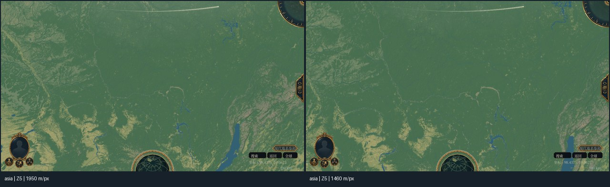
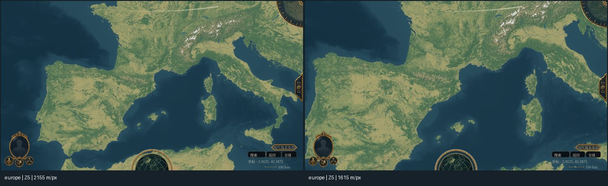
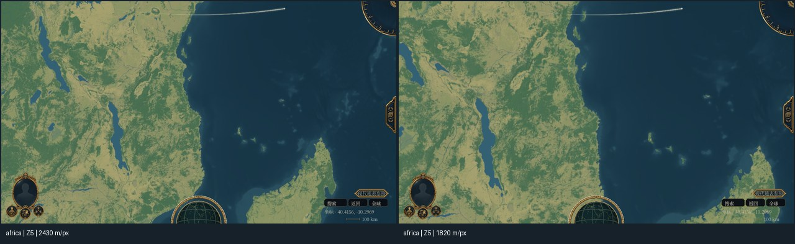
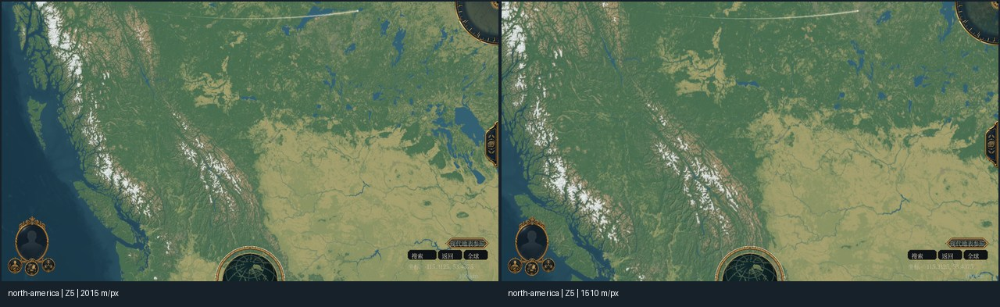
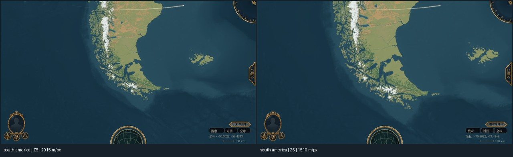
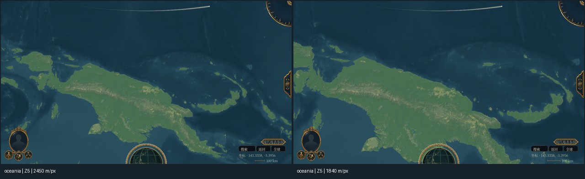
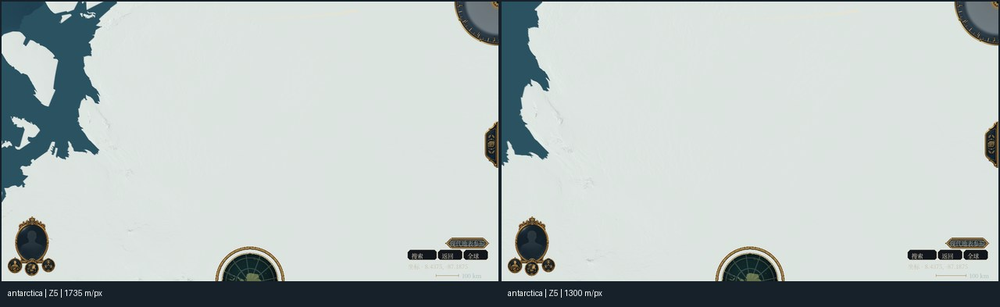

### 同层接缝与边界

扎格罗斯四角、斐济 180° 经线、两极及多瑙河三角洲均实际绘制 Z5。固定层在阿尔卑斯和斐济连续平移、改变倍率并旋转，各 42 帧。九点均为纯 Z5。画面复核未见硬接缝或矩形。

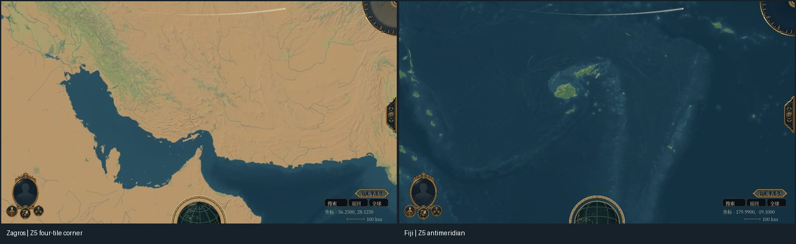
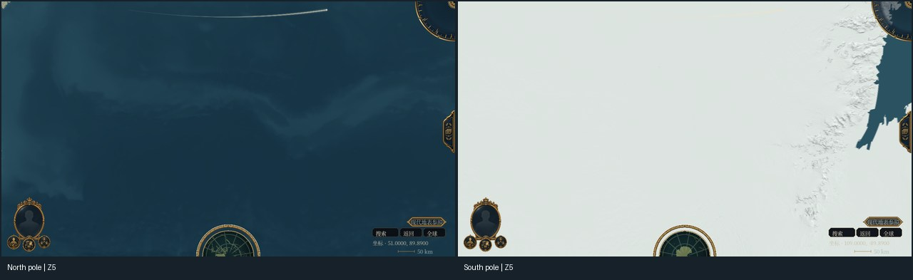

## 动态 LOD

Z4/Z5 冷加载在阿尔卑斯固定 2,120 米／像素复现拼贴。基线第 16 帧中央 Z5 权重约 96%，八个外围点为纯 Z4。第 19 帧 Z5 权重空间差为 1。候选接入现有整幅过渡，等 Z5 可见页和父级准备后同步混合。阿尔卑斯和尼罗河用相同输入各对照 106 帧，候选九点 Z5 权重空间差为 0。着色器按绝对层级读取权重，CPU 回执使用同一规则。

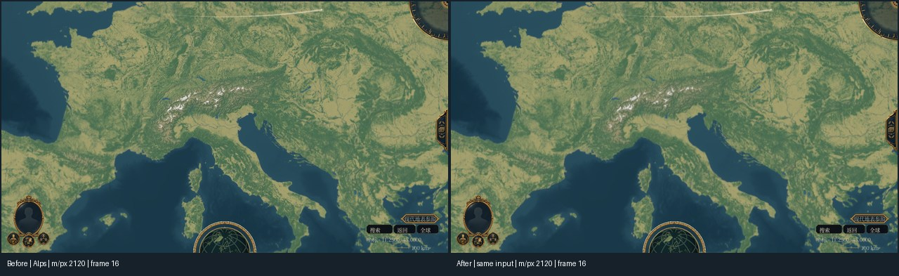
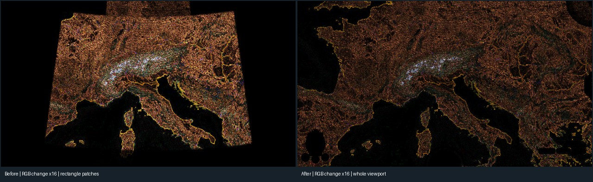

普通滚轮、快速往返、阈值滞回带、斐济平移加缩放都留有连续 Vulkan 帧。预热宽视口后，阿尔卑斯 2,880–3,150 米／像素的带内往返 56 帧均保留 Z5，权重随倍率连续变化。斐济暖视口完成 Z4→纯 Z5→Z4。冷视口尚有缺页时保持整幅父层。

目标 Z6 时，Z5 的额外预取排在视口和普通预取之后，仍用 256 页。阿尔卑斯达到纯 Z6 后单帧拉至 1,940 米／像素，直接显示完整 Z5。冷缓存由 4,600 跳至 1,060 米／像素的 5 帧同时混合 Z4、Z5、Z6，九点各帧权重一致，第 30 帧稳定纯 Z6。Z6/Z7 小范围接口回归达到纯 Z7，并在快速拉远回到完整 Z6。

**高纬容量。** 北纬 89.5° 的 1,700→1,750 米／像素实拍，视口页需求由 244 到 271。在目标层仍为 Z5 时，超预算帧整幅采用 Z4。本路线接近极地时，普通预取圈亦压低 Z5 同步权重。该处保留作缓存精修。滑动中缺页采用整幅回退。

[同输入修复前后录像](https://github.com/ryoumiyahayato/wwo/releases/download/terrain-surface-20261115/z5-zoom-comparison.mp4) · [连续滚轮、经线平移和父子层录像](https://github.com/ryoumiyahayato/wwo/releases/download/terrain-surface-20261115/z5-continuous-zoom.mp4)

## 正式 Rust 游戏

干净 Release 版在同一台 RTX 3050 Laptop GPU，以 1280×720 Vulkan 后台验证。地理、政治、经济和军事专题均实际进入并滚轮缩放、拖动。使用独立的暂停测试档案。四种地图正常显示，窗口无焦点。

| 指标 | PR #145 地理基线 | Z5 候选 |
| --- | ---: | ---: |
| 冷路径 Z5 就绪 | 0.62 秒 | 0.50 秒 |
| 地理交互出帧间隔，中位数 / P95 | 6.96 / 7.38 毫秒 | 6.95 / 7.39 毫秒 |
| 交互后进程工作集 | 325 MiB | 370–372 MiB |
| 交互后专用显存 WDDM 采样 | 471 MiB | 450–466 MiB |

四专题交互 P95 为 7.27–7.39 毫秒。工作集为测试结束的单点读数，地理私有提交量约 760→746 MiB。图集仍为 256 页。当前采样未见帧间隔回退。正式游戏替换由用户确认。

## 数据疑点与后续精修

撒哈拉断续细蓝线的季节性仍待实地资料核对。马斯克林外海的细色带留作来源与材质对照，现有截图未证明是页接缝。它们不触发全球 QPK 重生成。

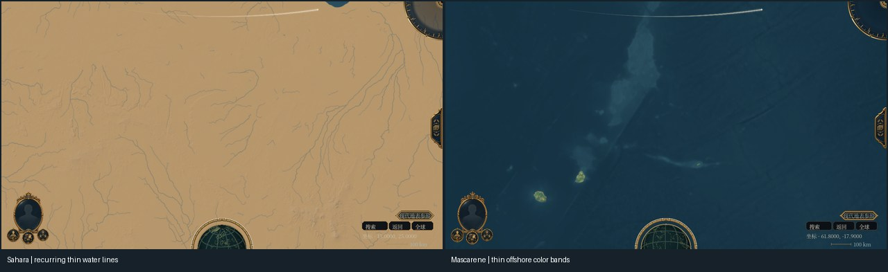

[候选索引](https://github.com/ryoumiyahayato/wwo/releases/download/terrain-surface-20261115/index.json) · [私有正式回退归档](https://github.com/ryoumiyahayato/wwo/releases/tag/rust-native-windows-20261115)
