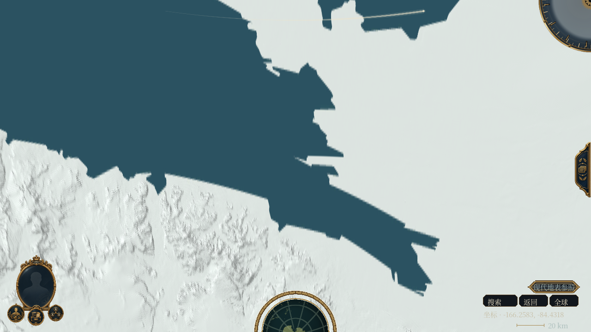
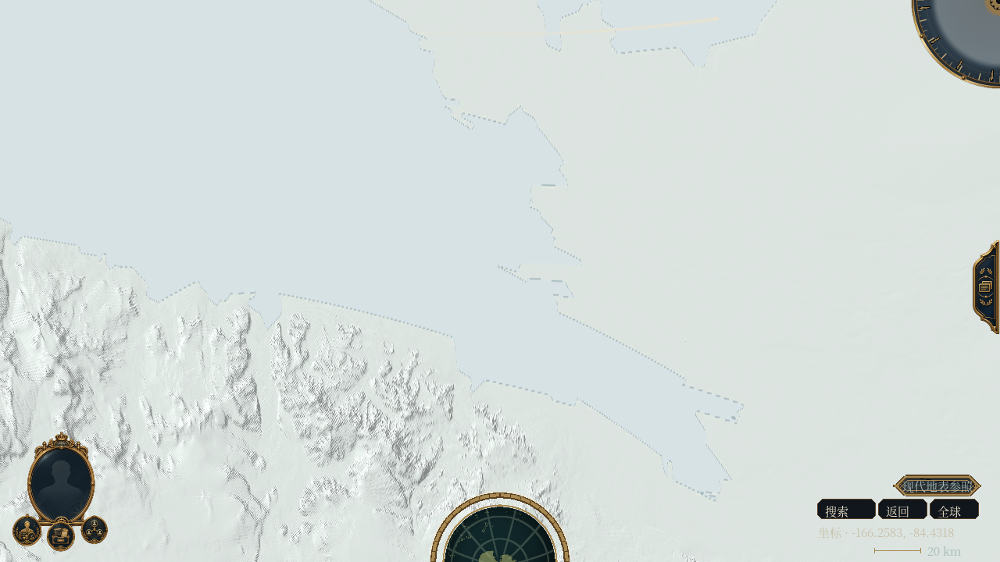
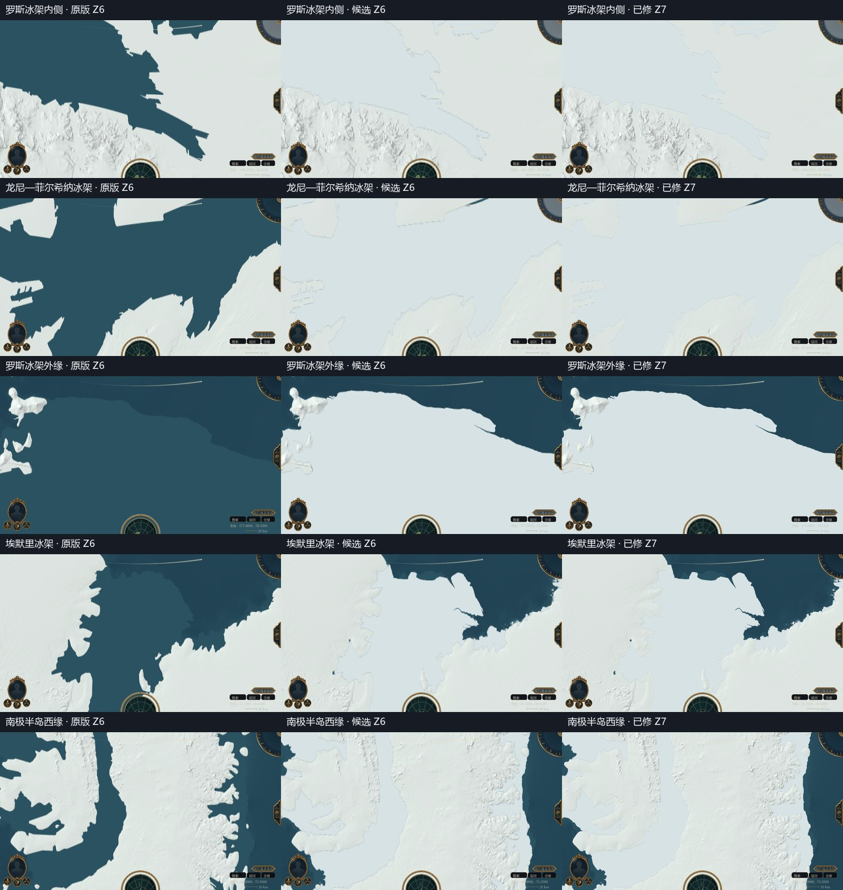
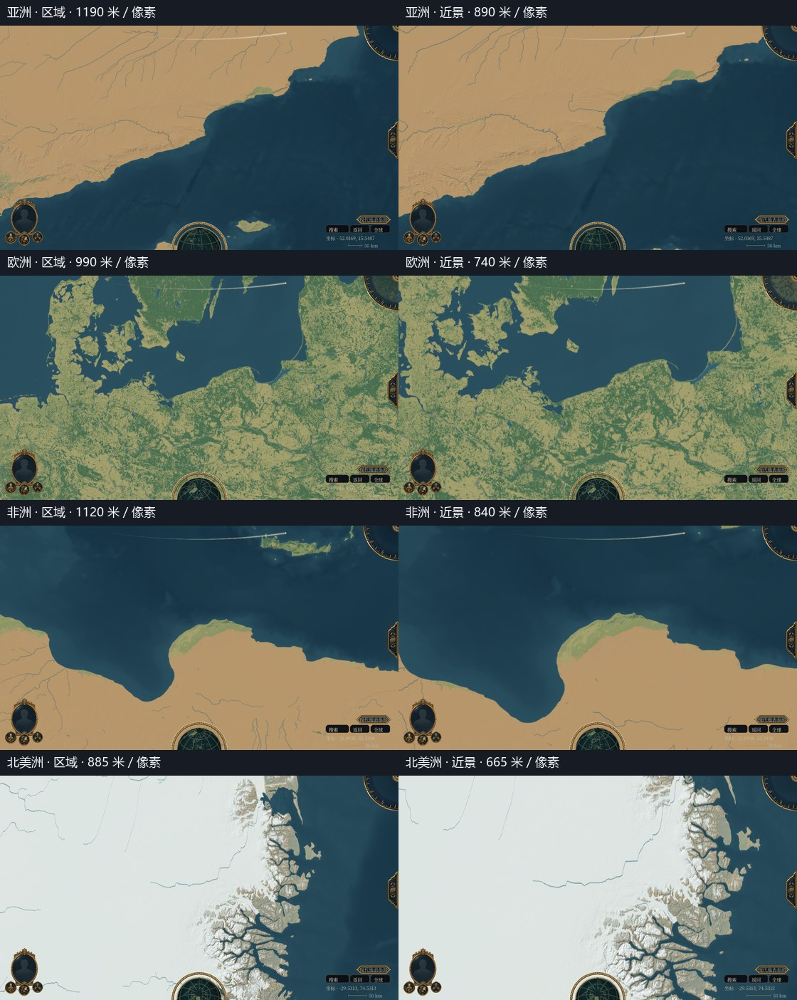
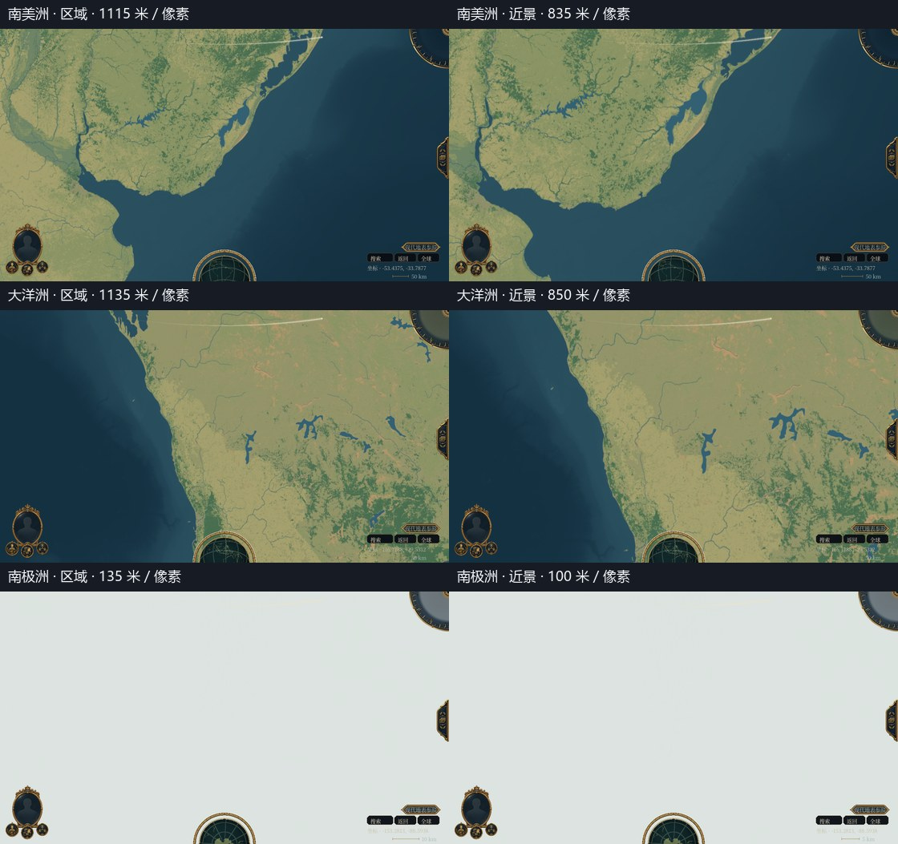
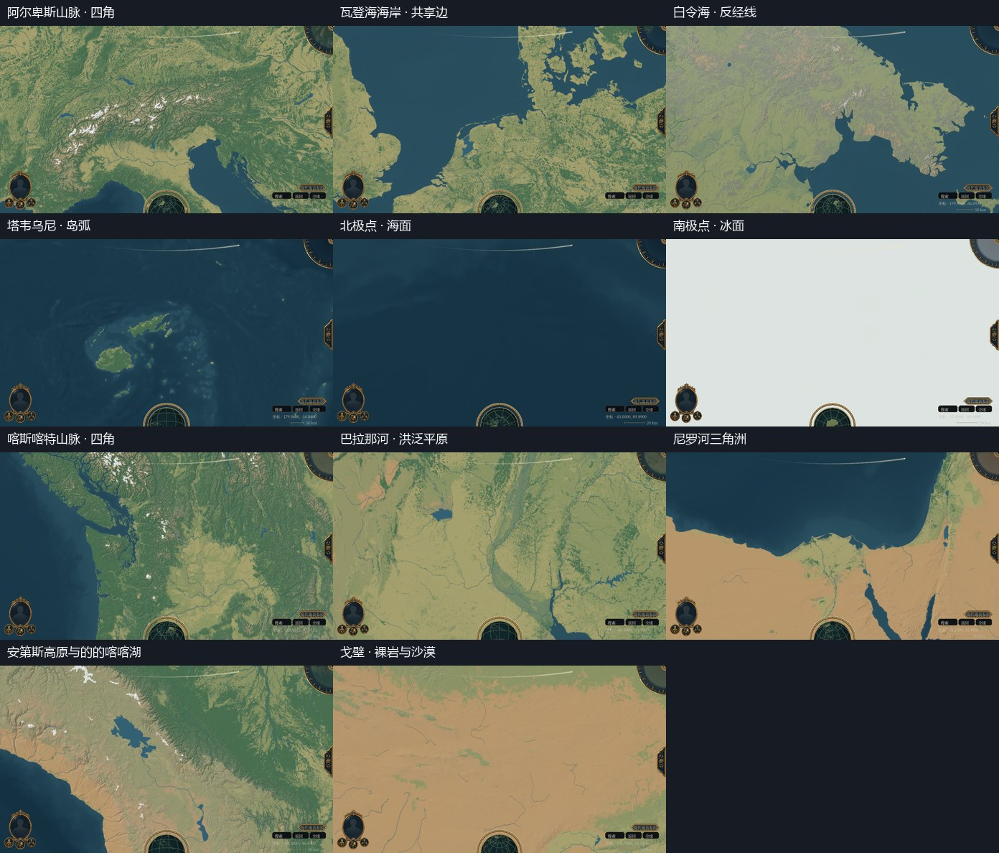
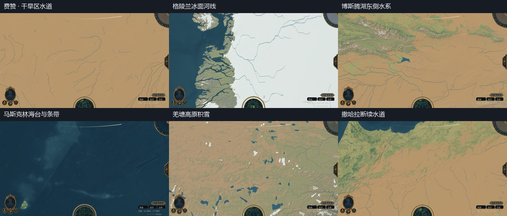
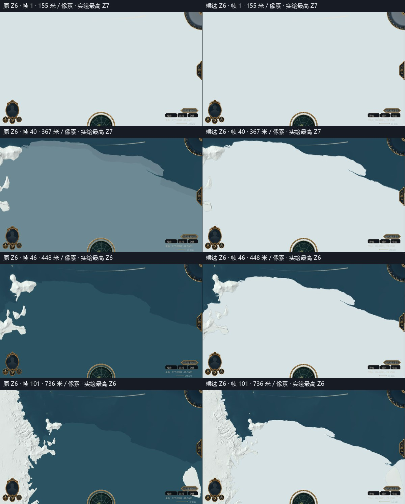
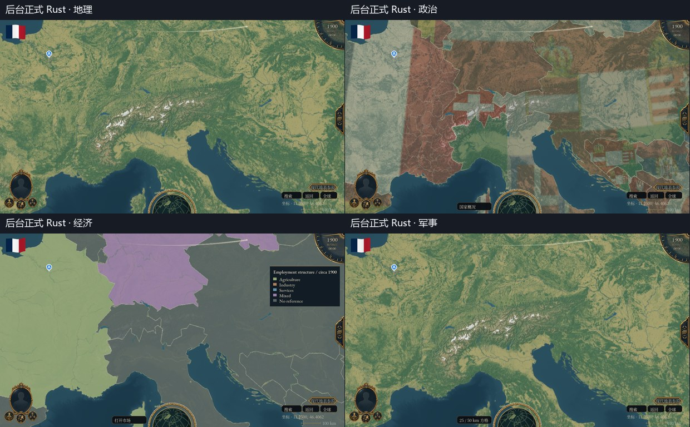

# Z6 全球地貌第二阶段

基线为 [PR #152](https://github.com/ryoumiyahayato/wwo/pull/152)。取景使用同一个正式 Rust/wgpu/Vulkan 宿主。对照库均使用已修复的 Z7，仅替换 Z6。候选仍为 `worldcrs84quad-15s-v2`，采样格式为 256×256 有效像素、每边填充 4 像素。正式资源仍按原版本启动。用户视觉验收待确认。

## 发现的问题与实际改动

原 Z6 把罗斯、龙尼—菲尔希纳、埃默里等浮冰架绘成海水。向下混合时，已修复 Z7 的冰面会逐渐变蓝。四个机位均落在 SCAR ADD 7.13 冰架多边形内。按 EPSG:3031 的同一套冰架、冰舌、陆地及冰隆规则和 2×2 子像素采样处理全球 Z6。沿用 Z7 冰雪材料，接地线仍以陆地和冰隆面的水域覆盖为约束。冰架边界来自现代观测。 [SCAR ADD 数据目录](https://data.bas.ac.uk/items/e74543c0-4c4e-4b41-aa33-5bb2f67df389/index.html) · [中分辨率图层](https://services7.arcgis.com/tPxy1hrFDhJfZ0Mf/ArcGIS/rest/services/Medium_resolution_vector_polygons_of_the_Antarctic_coastline/FeatureServer/1)

首次试制保留了无法原样编码 alpha 的 BC7 块，罗斯接地线因此残留块状蓝斑。候选改用按原分区、索引和插值权重拟合 RGB 端点，保留物理水域端点。逐块解码确认 alpha 不变。原始压缩高程帧直接复制，海深与河网拓扑沿用原库。Z7 的命令参数和编码路径与 PR #152 相同。 [BC7 格式规范](https://learn.microsoft.com/en-us/windows/win32/direct3d11/bc7-format-mode-reference)

完整候选为 509,298,195 字节。292 张瓦片的颜色帧发生变化，27,903 个含重复填充的 BC7 块以原 alpha 重新拟合。8,192 张瓦片全部读取并解压。高程压缩帧逐字节一致。变更颜色帧解码后的水域覆盖 alpha 逐像素一致，其余颜色帧逐字节一致。16,256 条共享边、16,128 组对角关系、反经线重叠及两端极区高程填充均通过。同层高程差为 0 米，Z5 父层最大约简差为 0.75 米。

罗斯冰架内侧初版的深蓝色块状残留在最终候选中明显减轻。接地线在高倍率仍可见较轻微的混合像素。外缘仍能辨认冰架与开阔海水，独立岛屿和接地线形态保留。

罗斯冰架 340 米／像素，左列原 Z6、中列候选 Z6、右列修复后 Z7。下方为未经缩放的三张原图。

| 原 Z6 | 候选 Z6 | PR #152 Z7 |
| --- | --- | --- |
|  |  |  |



## 地理与画面

Z6 南北采样间距为 39.55078125 角秒，约 1.22 公里。15 角秒 SRTM15+ V2.5.5 提供高程与海深，海深格网兼有船测与卫星推算。Natural Earth 用于海岸和主要湖泊，HydroRIVERS 用于现代汇流网络，WorldCover 2021 用于现代地表覆盖。1900 年的地表覆盖、冰架位置、季节水文仍需要独立历史来源。分辨率以下的支流和礁体保留资料缺口。 [SRTM15+ V2.5.5](https://portal.opentopography.org/datasetMetadata?otCollectionID=OT.122019.4326.1) · [Natural Earth 1:10m](https://www.naturalearthdata.com/downloads/10m-physical-vectors/) · [HydroRIVERS](https://www.hydrosheds.org/products/hydrorivers) · [ESA WorldCover 2021](https://esa-worldcover.org/en/data-access)

| 专项 | 位置 | 实拍与来源核对 |
| --- | --- | --- |
| 格陵兰冰面蓝线 | −47.866°, 68.165° | 蓝线仍可见。野外与卫星记录证实格陵兰冰面存在季节融水网络。现有资料不足以确认画面中每条引线的位置和流期。 [格陵兰冰面融水观测](https://pmc.ncbi.nlm.nih.gov/articles/PMC4313838/) |
| 撒哈拉、费赞 | −0.703125°, 33.046875°；13.6915°, 25.982° | 可见断续水系。流域地貌和长期平均径流可支持部分水道，缺少逐段常流水证据。 [费赞古水文研究](https://pure.royalholloway.ac.uk/files/31376205/Drake_etal_AuthorAcceptedManuscript.pdf) |
| 博斯腾湖 | 88.4°, 41.94° | 现代研究确认开都河主入流和季节补水。孤立线段与 1900 年河湖边界仍待核实。 [博斯腾湖水文观测](https://www.nature.com/articles/s41598-018-27466-2) |
| 马斯克林测深条带 | 61.8°, −17.9° | 海底斜带仍可见。SRTM15+ 现有资料不足以逐条确认真实海脊或测线伪影，保留原高程。 [SRTM15+ 来源说明](https://portal.opentopography.org/datasetMetadata?otCollectionID=OT.122019.4326.1) |
| 羌塘与极点 | 89°, 33°；北纬及南纬 89.89° | 羌塘高原和零散积雪可辨，雪斑需和现代分类及实际冰川范围逐处比对。极点放射细纹纳入同机位复核，根因不足以改高程。 |

七洲抽样种子为 `2026111626`。截图前冻结名单，以 Natural Earth 洲界和陆地构建样本池。经纬度、精确页号和两档倍率见 [冻结名单](https://github.com/ryoumiyahayato/wwo/releases/download/terrain-surface-20261115/z6-detail-sample-plan.json)，实际绘制页及回退见 [逐帧记录](https://github.com/ryoumiyahayato/wwo/releases/download/terrain-surface-20261115/z6-detail-frames.json.gz)。

| 样本 | 中心经度、纬度 | 两档实绘中心页 | 区域／近景，米／像素 | 观察 |
| --- | --- | --- | --- | --- |
| 亚洲 | 52.016938°, 15.548651° | 6/82/26 | 1190／890 | 也门东部干旱海岸、谷线和外海 |
| 欧洲 | 15.859711°, 54.249986° | 6/69/12 | 990／740 | 波罗的海、沿海平原、半岛和岛屿 |
| 非洲 | 21.093750°, 32.343750° | 6/71/20 | 1120／840 | 利比亚海岸、平原及沿岸植被与干旱内陆过渡 |
| 北美洲 | −29.531250°, 74.531250° | 6/53/5 | 885／665 | 格陵兰冰盖、峡湾和裸露坡地 |
| 南美洲 | −53.437500°, −33.787748° | 6/45/44 | 1115／835 | 南大西洋沿岸平原、拉普拉塔河口和沿岸水域 |
| 大洋洲 | 116.718750°, −29.531250° | 6/105/42 | 1135／850 | 西澳海岸、内陆平原和内流湖 |
| 南极洲 | −153.281250°, −88.593750° | 6/9/63 | 135／100 | 内陆冰盖。高纬取景受页数和较粗南北采样限制 |

14 张随机样本的中心和边缘采样均为 Z6。稳定截图时 0 次父层回退。专项图中阿尔卑斯和安第斯能区分山麓、山脊和高原，尼罗河三角洲和巴拉那河谷保留主要水系，戈壁和费赞可辨干旱材质，瓦登海和塔韦乌尼显示本层能采到的海岸与岛屿轮廓。









## 连续操作与正式宿主

罗斯 165 帧、龙尼 197 帧。两侧使用相同输入、同一 Z7、同一 Rust/WGPU 渲染器。罗斯第 39 帧在 355 米／像素反向混合，中心 RGB 从旧版的 `135,159,168` 变为候选的 `215,226,229`。回程第 111 帧为 Z6，旧版中心为 `43,82,97`，候选为 `215,226,229`。龙尼第 98 帧的 Z6 也从 `43,82,97` 修复为 `215,226,229`。现场继续拉远到旧 Z5 时两侧仍变蓝，例如罗斯第 62 帧、龙尼第 78 帧。

| 动态专项 | 技术结论 |
| --- | --- |
| 固定 Z6 | 阿尔卑斯、瓦登海、反经线和倾斜机位共 188 帧。观测样点始终实绘 Z6，缺页诊断为 0。 |
| Z5/Z6 | 慢速、快速、临界附近往返及瓦登海平移旋转实绘 Z5／Z6 同步过渡。极区旧 Z5 材质跳变单列为遗留。 |
| Z6/Z7 | 反经线来回混合及无预热阿尔卑斯经父级进入 Z7。530→970 米／像素在阿尔卑斯和海岸仍保留整幅淡出，连续 Z7 权重 `1.000, 0.848, 0.697, 0.545, 0.394, 0.242, 0.091, 0`。 |
| 高纬冷缓存和预算 | 北极案例峰值 764 个可见页需求，罗斯 345，龙尼 403。常驻不超过 256。自动模式绘制完整低层，清晰度下降时仍可看到连续地面。罗斯和龙尼拉远最远处仍出现颜色变化。 |

抽看阿尔卑斯、瓦登海、反经线、阈值和两条快速拉远的 18 帧，未观察到正常色范围内的硬矩形边。龙尼边缘的一条狭带也出现在 Z7 对照，具体地理来源待核实。逐帧记录包含实际提交页表的九点页号和权重、视口页需求、常驻数和采集时钟。录像保留每条轨迹的连续 GPU 输出，20 fps 是复看速度。



- [罗斯和龙尼冰架旧 Z6／新 Z6 同输入 MP4](https://github.com/ryoumiyahayato/wwo/releases/download/terrain-surface-20261115/z6-detail-shelves.mp4)
- [Z5/Z6、Z6/Z7 连续滚轮及高纬超预算 MP4](https://github.com/ryoumiyahayato/wwo/releases/download/terrain-surface-20261115/z6-detail-wheel.mp4)
- [固定 Z6 平移、旋转与倾角页边 MP4](https://github.com/ryoumiyahayato/wwo/releases/download/terrain-surface-20261115/z6-detail-fixed.mp4)



正式 `--play --background` 在独立暂停会话中运行，窗口检查始终无焦点。机位为阿尔卑斯 `11.25°, 46.40625°`，起始 1420 米／像素。四种地图各用相同 24 次滚轮输入与 35 帧拖动。设备为 RTX 3050 Laptop GPU、Vulkan、1280×720。帧间隔、地貌页解码和加载时间均为宿主实测。工作集和 WDDM 专用显存是每专题的取样值。

| 专题 | 帧间隔 P50／P95，毫秒，旧 → 新 | 工作集 MiB，旧 → 新 | 专用显存 MiB，旧 → 新 | 地貌页解码次数／P95 毫秒，旧 → 新 |
| --- | --- | --- | --- | --- |
| 地理 | 6.95／7.45 → 6.92／7.59 | 345.6 → 385.1 | 478.2 → 478.4 | 372／0.222 → 380／0.226 |
| 政治 | 6.94／7.80 → 6.93／7.55 | 359.6 → 358.2 | 478.2 → 478.4 | 361／0.191 → 368／0.222 |
| 经济 | 6.94／7.69 → 6.93／7.66 | 361.4 → 360.3 | 478.2 → 478.4 | 358／0.210 → 369／0.274 |
| 军事 | 6.94／7.72 → 6.94／7.54 | 360.7 → 362.0 | 478.2 → 478.4 | 360／0.244 → 369／0.176 |

四种模式均正常显示并实绘 Z5／Z6。各专题观测到的峰值为 112 个可见页需求、256 个常驻页。地貌页加载 P95 旧版 7.19–7.39 毫秒、候选 7.15–7.37 毫秒。新旧帧时和专用显存接近。候选的首次地理专题工作集取样高 39.5 MiB，需结合独立重复样本才能归因。长期运行和其他设备为 `NOT_RUN`。

## 归档与恢复

本阶段仅重建完整 Z6。Z0–Z5、河网拓扑和 PR #152 的 Z7 继续使用已有 Release 资源。恢复时取原库的 `0.qpk`–`5.qpk` 与 `river-topology.u32`，将 `z6-detail-6.qpk` 保存为 `6.qpk`、`z7-detail-7.qpk` 保存为 `7.qpk`、`z6-detail-index.json` 保存为 `index.json`。使用 `--terrain-candidate` 指向该库。回退使用原 `6.qpk` 和原清单。 [私有 Release](https://github.com/ryoumiyahayato/wwo/releases/tag/terrain-surface-20261115)

- [完整全球 Z6 候选 QPK](https://github.com/ryoumiyahayato/wwo/releases/download/terrain-surface-20261115/z6-detail-6.qpk) · [组合清单](https://github.com/ryoumiyahayato/wwo/releases/download/terrain-surface-20261115/z6-detail-index.json) · [全球数据结果](https://github.com/ryoumiyahayato/wwo/releases/download/terrain-surface-20261115/z6-detail-global.json)
- [SCAR ADD 7.13 原归档输入](https://github.com/ryoumiyahayato/wwo/releases/download/terrain-surface-20261115/z7-detail-scar-add-7.13.json.gz) · [原始 PNG](https://github.com/ryoumiyahayato/wwo/releases/download/terrain-surface-20261115/z6-detail-stills.zip)

解压 SCAR 输入后，使用正式 GitHub 源码和原 Z6 重建候选。下方路径为独立恢复目录中的相对路径。

```powershell
python rust/strategic-host/tools/build_natural_terrain.py --ice-shelf-candidate original/6.qpk scar-add.json candidate/6.qpk
python rust/strategic-host/tools/build_natural_terrain.py --verify original --layer 6 --layer-candidate candidate/6.qpk
```

## 遗留问题与用户待验收

旧 Z5 仍会将部分浮冰架显示成蓝色。Z6/Z7 连续性和 Z5 的颜色缺陷分别记录，冰架材质依赖交给 Z5 阶段。下一步按 Z5、Z4、Z3、Z2、Z1、Z0 的顺序施工。正式游戏资源提升需用户确认。
