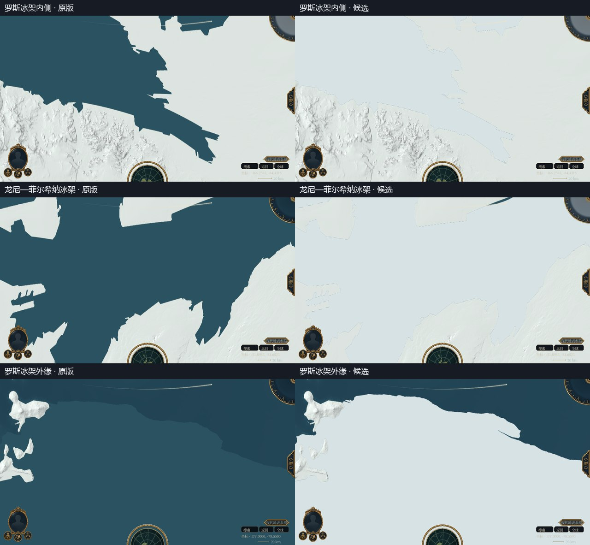
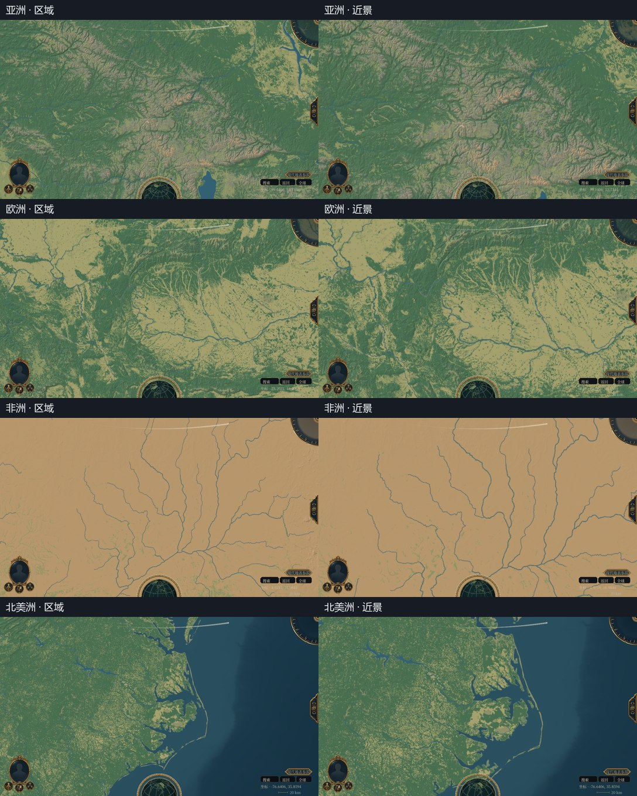
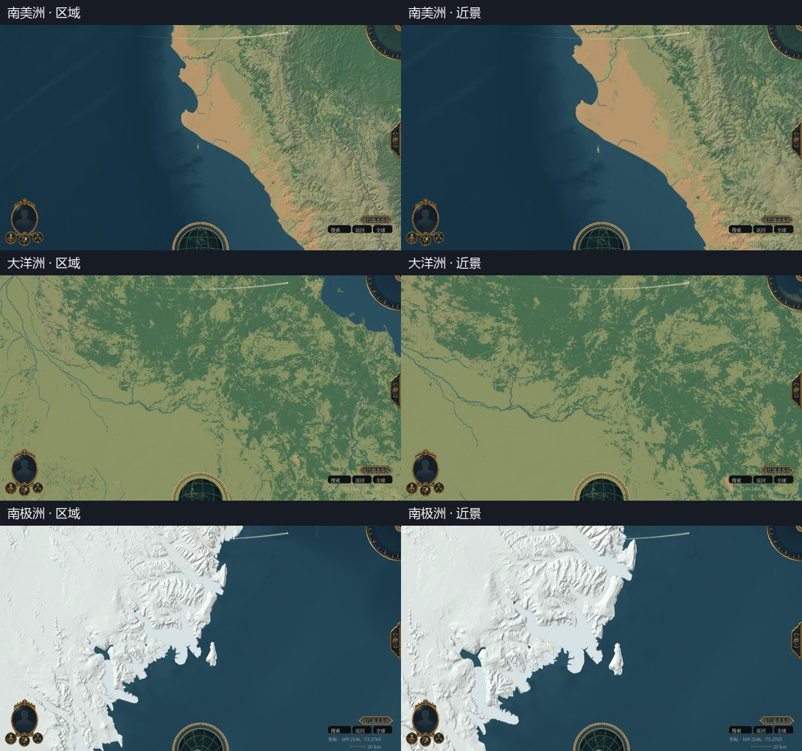
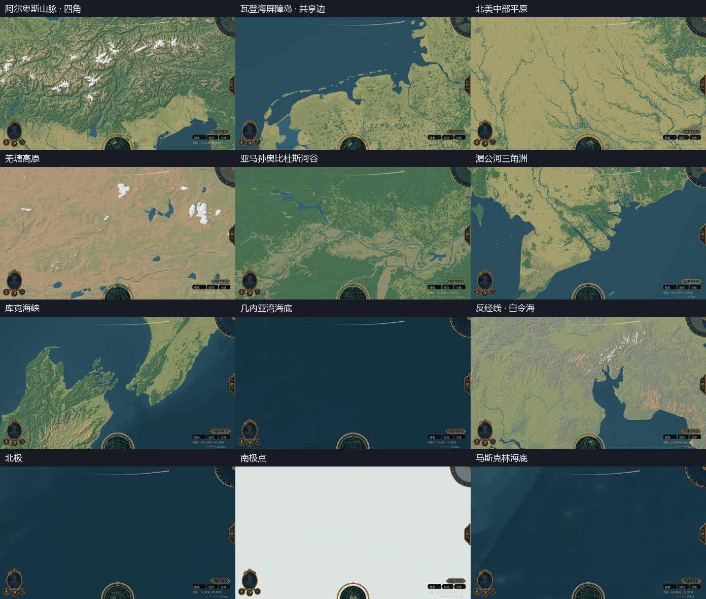
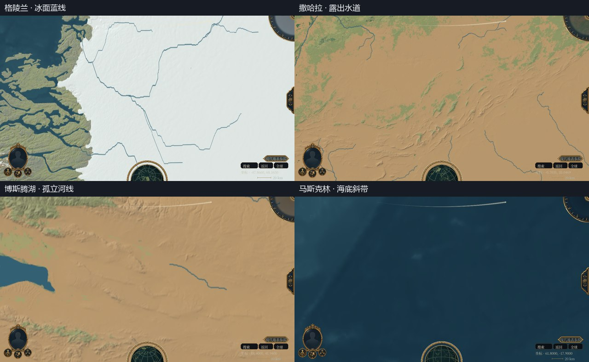
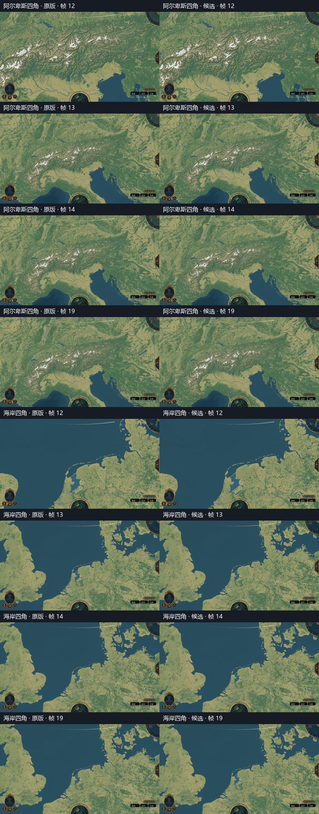
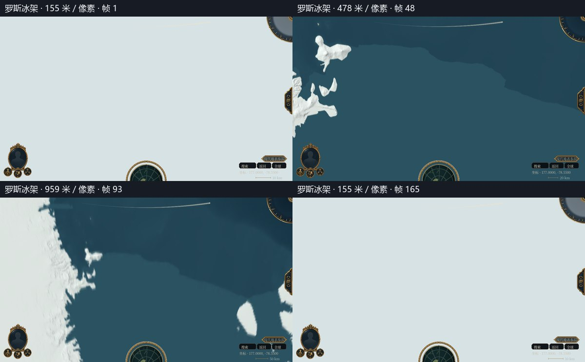
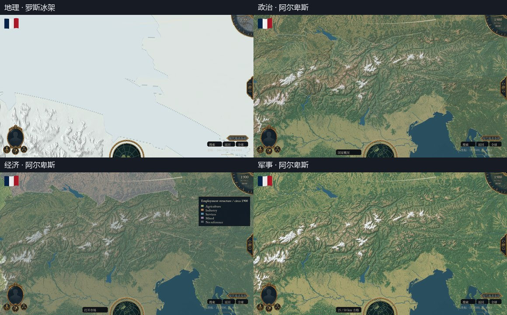

# Z7 地貌细节第二阶段

基线为 [PR #151](https://github.com/ryoumiyahayato/wwo/pull/151) 和私有 Release 的 [原版 7.qpk](https://github.com/ryoumiyahayato/wwo/releases/download/terrain-surface-20261115/7.qpk)。候选沿用 `worldcrs84quad-15s-v2`，表面修订标记为 `SCAR-ADD-7.13-z7-v2`。正式地图采用原资源。用户视觉验收待确认。

## 浮冰架修复

原生成器用陆地、湖泊和冰川掩模配色，缺少南极独立浮冰架面。原记录机位位于 SCAR ADD 的浮冰架多边形内部。全层规则使用 SCAR ADD 7.13 中的冰架、冰舌和冰隆记录。相邻两套资料的接地线有偏移。接地线修正在冰架周围 10 公里内使用 SCAR 实际陆地多边形，且仅覆盖原材质中的水面成分。没有向外海填充冰面。2×2 子像素采样使用全局坐标和相同填充规则。高程帧原样保留，地表颜色以外的地理源和河道拓扑沿用。BC7 改块的编码输入保留原水域通道，压缩可带来量化差。冰架采用现代制图资料。 [SCAR ADD 7.13 中分辨率南极海岸](https://doi.org/10.5285/96ffb7ba-69a9-4ec3-aede-07e746f1555a)

候选遍历全球 32,768 条记录，794 张瓦片的颜色记录发生变化。候选 `7.qpk` 共 1,607,839,799 字节。现有全层解码检查核对 65,280 条共享边，包含反经线回绕。重叠 BC7 块和高程采样一致。共享边重叠包含四角，因此可传递核对 65,024 组对角关系。共享高程最大差为 0 米，复算父级最大高程差为 0.75 米。两极高程填充通过现有检查。Z0–Z6 使用原候选。

| 同机位 | 经度，纬度 | 米／像素 | 实际层 | 结果 |
| --- | --- | ---: | --- | --- |
| 罗斯冰架内侧 | −166.2583，−84.4318 | 340 | Z7 | 深蓝改为浅冰面，局部接地线仍可辨 |
| 龙尼—菲尔希纳冰架 | −51.8965，−81.6525 | 370 | Z7 | 冰面恢复，前缘海水保留 |
| 罗斯冰架外缘 | 177，−78.55 | 430 | Z7 | 冰架外缘与开放海域可辨 |
| 南极半岛西缘 | −66，−72.05 | 405 | Z7 | 核对冰面分布 |
| 埃默里冰架 | 71.7，−69.65 | 415 | Z7 | 核对冰海分界 |



## 随机实拍与地貌专项

随机种子 `2026111607`，截图前冻结机位。按 WWO 规程从 Natural Earth 陆地候选抽取七洲，使用七洲各两档。126 个取样点均仅有 Z7 贡献，权重 1。最终候选重拍南极两档及南极专项。非南极 12 张和其他专项复用此前候选画面，修订范围在南纬 60° 以南。坐标为经度、纬度。实际提交页编号和视口状态见逐帧回执。 [抽样计划](terrain-z7-detail/sample-plan.json)

| 洲 | 抽中 Z/X/Y | 经度，纬度 | 区域／近景，米／像素 |
| --- | --- | --- | ---: |
| 亚洲 | 7/198/26 | 99.140625，52.734375 | 500／375 |
| 欧洲 | 7/144/32 | 23.203125，44.296875 | 525／395 |
| 非洲 | 7/131/50 | 4.921875，18.984375 | 590／440 |
| 北美洲 | 7/73/38 | −76.640625，35.859375 | 550／410 |
| 南美洲 | 7/70/68 | −80.812124，−6.278928 | 605／455 |
| 大洋洲 | 7/230/78 | 144.140625，−20.390625 | 585／440 |
| 南极洲 | 7/248/116 | 169.214610，−73.276462 | 445／335 |





阿尔卑斯四角 11.25°E、46.40625°N，瓦登海共享边 7.03125°E、53.58°N，以及白令海反经线 179.9999°E、66.09375°N 可复现检查。固定 Z7 的山脊、海岸和反经线样本未见矩形或明显色阶硬缝。样本覆盖平原、羌塘高原、奥比杜斯河谷、湄公河三角洲、库克海峡、屏障岛、冰架和海底。两极正中仍可见轻微放射线，暂未定位到具体页或地理源。



## 原问题坐标复验

| 机位 | 经度，纬度 | 米／像素 | 结论 |
| --- | --- | ---: | --- |
| 羌塘积雪 | 89，33 | 430 | 旧版大面积误判未复现。保留第一阶段冰川掩模修复 |
| 格陵兰冰面河线 | −47.866，68.165 | 345 | 蓝线仍可见。融水水道真实存在，此段的持续性及当前色彩强度未证实 |
| 撒哈拉水道 | −0.703125，33.046875 | 425 | 干旱区断续线仍可见。区域存在间歇水系，图上特定河段尚未核实 |
| 博斯腾湖东侧 | 88.4，41.94 | 200 | 孤立蓝线仍可见。已查区域水文资料，具体连通关系待核 |
| 马斯克林海床 | 61.8，−17.9 | 430 | 可辨浅斜带。当地有真实海台地形，GMRT 掩模在抽查位置缺独立测深，条带根因未定 |
| 南极浮冰架 | 见上表 | 340–430 | 确认为独立冰架掩模缺项，已修固定 Z7 |



SRTM15+ 本地母数据为 V2.5.5，标称 15 角秒。Z7 南北采样约 611 米，东西间距随纬度减小。海底格网混合实际测深与推算。现代 HydroRIVERS 静态水系不能确定具体河段的季节或 1900 年流量。WorldCover 2021 v200 只作现代材质参考。1900 年植被、积雪、冰架边缘和水文需另有历史证据。本轮未用锐化或纹理噪声增加地理细节。 [SRTM15+](https://doi.org/10.1029/2019EA000658) · [GMRT](https://www.gmrt.org/services/gridserverinfo.php) · [HydroRIVERS](https://data.hydrosheds.org/file/technical-documentation/HydroRIVERS_TechDoc_v10.pdf) · [WorldCover 2021](https://doi.org/10.5281/zenodo.7254221)

羌塘原规则把高程直接用于扩大积雪，第一阶段已删除该转换。本轮保持材料。三处水道与马斯克林保留原表现，因为现有证据不足以判定应删除哪些具体结构。 [羌塘原修复](https://github.com/ryoumiyahayato/wwo/pull/140) · [格陵兰融水研究](https://doi.org/10.6046/zrzyyg.2022438) · [撒哈拉间歇水文案例](https://hess.copernicus.org/articles/29/1395/2025/) · [博斯腾湖水文研究](https://www.mdpi.com/2073-4441/14/24/4002) · [马斯克林海台研究](https://nora.nerc.ac.uk/id/eprint/144020/)

## 同层接缝与连续缩放

单层用固定 Z7 走过阿尔卑斯四角、反经线和罗斯外缘，各 30 帧。另在阿尔卑斯以起始倾角 15.23° 取 40 帧，连续缩放、平移和旋转。九个地表采样点无固定层缺页。连续画面在抽查位置未见可辨的矩形边缘、贴片或高程裂缝。

原版同机位 530→970 米／像素回放。第 13 帧，阿尔卑斯缺 58 张可见 Z7 页，海岸缺 59 张。完整屏幕一帧从权重 1 降为 Z6。候选使用闲余页向外预取，当前可见页、常规预取圈和直接父层先加载。退层时短暂保留已经就绪的可见 Z7 页。只要有可见子页或父页未就绪，仍避免使用不完整的混合。在当前视口覆盖完整时，Z7 外圈仅调整淡出目标，避免边缘缺页令整幅画面在瞬间变糊。

两处候选各 64 帧。第 13 帧均无可见 Z7 缺页，帧 12–19 的 Z7 权重依次为 1、0.848、0.697、0.545、0.394、0.242、0.091、0。同一帧的九点权重空间差为 0。固定为相同的 970 米／像素，第 13 帧候选与原版的平均亮度差分别为 0.082 和 0.063 个 8 位色阶。阿尔卑斯相邻像素水平亮度差均值由原版 7.84 提高到候选 10.67，随后逐帧向原版 7.84 收敛。海岸值由 5.06 到 6.62，再回到 5.06。海岸快速拉远时画面平均亮度同时因视野纳入更多陆地而增加约 10.5 色阶。



| 动态路径 | 帧数 | 结论 |
| --- | ---: | --- |
| 慢速暖缓存 | 101 | 连续切换并返回。有短暂 Z7 缺页，由 Z6 全幅托底 |
| 快速连续滚轮往返 | 87 | 同步切换，九点 Z7 混合权重一致 |
| 临界倍率反复 | 73 | 目标层保持 Z7，整幅权重变化 |
| 缩放、平移与旋转 | 116 | 连续经过两次 Z6 与 Z7，取样权重无矩形分布 |
| 冷缓存放大 | 107 | 先显示已就绪父层，第 29 帧开始画 Z7 |
| 罗斯冰架快速变倍 | 90 | 155→343→155 米／像素，修复后无超 0.16 的单帧权重变化 |
| 北极自动模式超预算 | 61 | 视口明细页需求 508–764，均完整退到 Z6；常驻最多 256 页 |
| 北极固定 Z7 超预算 | 59 | 最大需要 512 页。固定层观察显示缺页诊断 |
| 罗斯冰架实际跨层 | 165 | Z7 冰面与旧 Z6 的水色互相过渡，仍有明显全幅变化。视口最多需要 345 页，扩张期还出现更粗父层回退，回程恢复 Z7 |

罗斯冰架长路径暴露了两个限制。高纬视野扩张时，256 页预算不足以维持全部细节，短时间内父页也有未就绪的帧。Z6 沿用旧的南极配色，整幅混合仍会让冰架随退层变成海水。Z7 同层接缝与北极稳定降级通过本轮检查。罗斯跨层材质一致性及部分超预算动态留项。



[快速拉远同机位连续对照](https://github.com/ryoumiyahayato/wwo/releases/download/terrain-surface-20261115/z7-detail-rapid.mp4) · [完整滚轮、极区及倾斜连续录像](https://github.com/ryoumiyahayato/wwo/releases/download/terrain-surface-20261115/z7-detail-wheel.mp4) · [取景、每帧状态、页号、混合权重和 RGB 统计](https://github.com/ryoumiyahayato/wwo/releases/download/terrain-surface-20261115/z7-detail-frames.json.gz)

## 正式 Rust 游戏回归

使用正式 Release 构建和独立暂停存档。RTX 3050 Laptop Vulkan，1280×720。四类地图使用同一份 24 次滚轮与 35 帧横向拖动输入。窗口在后台且未获得焦点。表内帧时来自实际呈现间隔，工作集和专用显存为操作结束采样值。地貌页图集 256 页，纹理有效载荷 18,242,688 字节。

| 实际地图 | 帧时中位数／P95 原版→候选，ms | 工作集原版→候选，MiB | 专用显存原版→候选，MiB |
| --- | --- | ---: | ---: |
| 地理 | 6.941／7.329 → 6.941／7.331 | 335.1→315.9 | 454.7→497.8 |
| 政治 | 6.954／7.420 → 6.945／7.339 | 335.2→324.9 | 454.7→465.8 |
| 经济 | 6.936／7.395 → 6.936／7.396 | 335.2→326.0 | 454.7→465.8 |
| 军事 | 6.936／7.370 → 6.941／7.381 | 335.2→326.0 | 454.7→465.8 |

四类地图均能加载和交互。单页解码中位数约 0.08–0.21 ms。视口预取增加了解码次数，地理路径 70→201 次，另外三条 31→194–198 次。采样帧时和工作集未出现明显回退，专用显存采样增加 11–43 MiB。该次实测未测长期峰值。



## 归档与恢复

- [完整全球 Z7 候选](https://github.com/ryoumiyahayato/wwo/releases/download/terrain-surface-20261115/z7-detail-7.qpk) · [候选资源清单](https://github.com/ryoumiyahayato/wwo/releases/download/terrain-surface-20261115/z7-detail-index.json) · [全层校验结果](https://github.com/ryoumiyahayato/wwo/releases/download/terrain-surface-20261115/z7-detail-global.json)
- [SCAR ADD 7.13 输入，CC BY 4.0](https://github.com/ryoumiyahayato/wwo/releases/download/terrain-surface-20261115/z7-detail-scar-add-7.13.json.gz) · [关键实拍原图](https://github.com/ryoumiyahayato/wwo/releases/download/terrain-surface-20261115/z7-detail-stills.zip)
- 原版 QPK、Z0–Z6 和河网拓扑沿用 [阶段一私有 Release](https://github.com/ryoumiyahayato/wwo/releases/tag/terrain-surface-20261115)。已接受版本保留 [正式回退](https://github.com/ryoumiyahayato/wwo/releases/tag/rust-native-windows-20261115)。

将原包的 Z0–Z6 和河网拓扑与本候选组装到一个独立目录，候选保存为 `7.qpk`，候选清单保存为 `index.json`。正式 Rust 后台入口使用 `--play --background --terrain-candidate <候选目录>`。离屏时也可用原库目录及 `--terrain-layer-candidate <候选.qpk>` 单独加载。解压 SCAR 输入后，可用以下命令复建和核对。

```powershell
python rust/strategic-host/tools/build_natural_terrain.py --ice-shelf-candidate <原始7.qpk> <SCAR_ADD.json> <候选7.qpk>
python rust/strategic-host/tools/build_natural_terrain.py --verify <原QPK库> --layer 7 --layer-candidate <候选7.qpk>
```

生成环境为 Python 3.12，Shapely 2.2.0、PyProj 3.8.0、Pillow 13.0.0、ispc_texcomp 1.0.1、zstandard 0.25.0。逐帧录像以固定 20 fps 播放，原始提交时间在回执里。临时 RGBA 帧、中间候选和观察用 EXE 保留在本地。

## 阶段结论

Z7 候选完成冰架修复和全层同级数据复验。两处 530→970 快速拉远已从单帧退层改为整幅过渡。罗斯 Z6/Z7 交界仍有可见的水色变化和超预算短退层，正式候选提升待定。原冰面河线等四处范围内现象和两极细线已列入留项。
