# Z7 全球逐页视觉验收

## 全球 Z7 陆地材质

原规则随海拔上升统一叠加岩色。新规则用 WorldCover 地表类别区分森林、耕地、草地、湿地和裸地，以 SRTM15+ 高程计算坡度、局部起伏和谷脊，与 Natural Earth 冰川范围共同决定陆地配色和坡面明暗。陡峻裸露处偏岩色，低起伏裸地偏沙土色。坡度用随纬度变化的像元间距计算。地表细节来自已有数据的采样。 [WorldCover 2021](https://esa-worldcover.org/en/data-access) · [SRTM15+ V2.5.5](https://catalog.data.gov/dataset/global-bathymetry-and-topography-at-15-arc-sec-srtm15-v2-5-5-81b08) · [Natural Earth 冰川](https://www.naturalearthdata.com/downloads/10m-physical-vectors/10m-glaciated-areas/)

生成器在补湖候选上更新整层陆地颜色，沿用原高程和已解码的水覆盖。陆海混合 BC7 块重新量化。WorldCover 缓存的地表采样约 19.2 角秒，Z7 赤道附近南北采样约 611 米。森林、耕地、湿地等配色基于现代资料，1900 年的覆盖范围另需历史证据。裸地配色使用地类与地形，具体岩性与土壤组成需要对应资料。 [WorldCover 类别说明](https://esa-worldcover.s3.eu-central-1.amazonaws.com/v200/2021/docs/WorldCover_PUM_V2.0.pdf) · [HILDA+ 历史陆地覆盖资料](https://landchange.imk-ifu.kit.edu/hilda)

| 取景 | 经纬度 · 米／像素 | 同机位检查项 |
|---|---|---|
| 洱海 | 100.202°E／25.800°N · 165、390 | 山麓林地、盆地平地与已补绘湖面 |
| 东阿尔卑斯 | 14.765625°E／47.109375°N · 240、515 | 山地林色、陡坡阴影、冰雪与谷地耕地 |
| 亚马孙马瑙斯 | 60.020°W／3.170°S · 140、280 | 林地与洪泛低地。河道宽度沿用原水文资源 |
| 纳米布 | 15.410°E／24.470°S · 155、285 | 实测沙丘起伏、裸露高地与干旱植被。间歇河另列水文问题。 [纳米布沙海](https://science.nasa.gov/earth-observatory/namib-sand-sea-149130/) |

完整全球候选为 1,617,397,662 字节。32,768 页完整解码，13,553 页更新陆地颜色，65,280 条共享边逐块一致。共享边高程误差 0 米，Z6 父层高程归约最大误差 0.75 米。生成器沿用原压缩高程帧和已解码的水覆盖。候选版本为 `terrain-cover-relief-land-v1-20261117`。

**东阿尔卑斯** · 14.765625°E／47.109375°N · 515 米／像素。山麓林地和耕地的区分更清楚，保留山谷的阴影。 [改动前原图](terrain-z7-visual/land-material-alps-before.png)

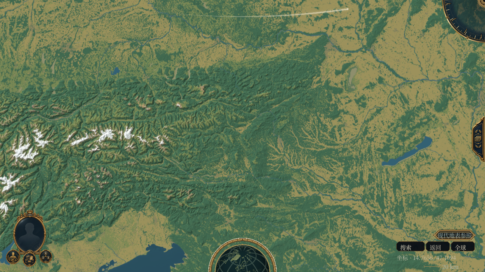

**洱海** · 100.202°E／25.800°N · 165 米／像素。近湖坡面林地与盆地平地分开，已补绘的开阔湖面保留。 [改动前原图](terrain-z7-visual/land-material-erhai-before.png)

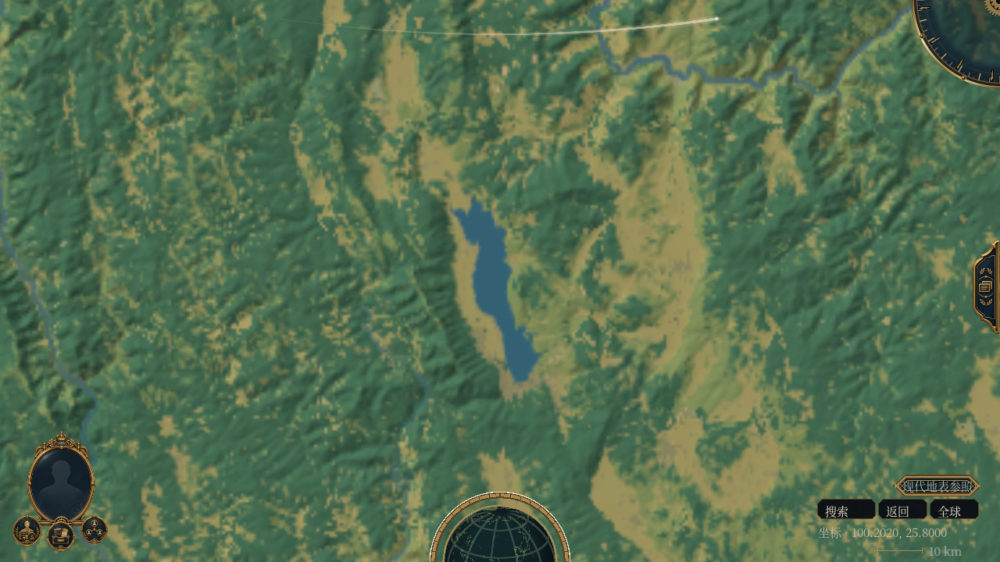

**马瑙斯** · 60.020°W／3.170°S · 280 米／像素。低地与成片林地的色差更容易辨认。窄河线仍需用水文资料处理。 [改动前原图](terrain-z7-visual/land-material-amazon-before.png)

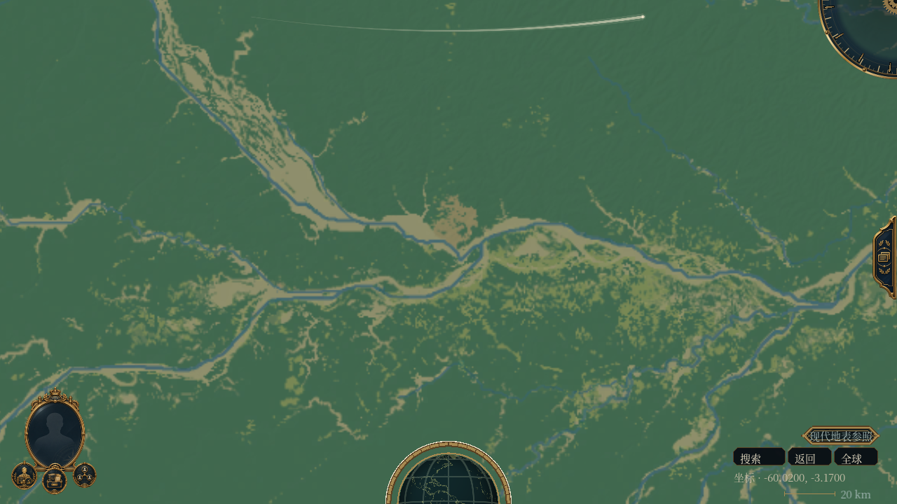

**纳米布** · 15.410°E／24.470°S · 285 米／像素。沙丘走向和岩质起伏来自高程，内陆和海岸地表的配色分界仍可见。 [改动前原图](terrain-z7-visual/land-material-namib-before.png)

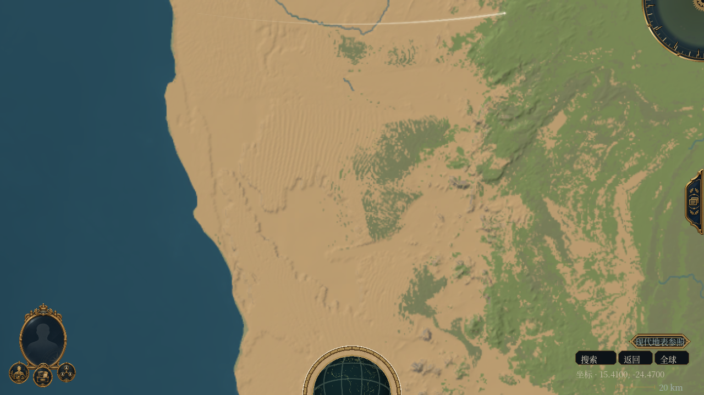

以上为相同 Rust/wgpu Vulkan 宿主的 1280×720 原画面。定点复用已冻结的七洲随机机位，两档各 7 张，便于与上次材质对照。取景均为固定 Z7，权重 1。七洲和阿尔卑斯四角、斐济反经线、南北极的实拍范围内未见新的明显矩形贴片。南极点原有浅十字细线和罗斯冰架前缘原有深蓝斜缺口仍可见。旱地蓝色水线与秘鲁部分河线的常流性仍待水文复核。植被在超出采样尺度的近景仍有颗粒。 [七洲抽样机位](terrain-z7-detail/sample-plan.json)

阿尔卑斯用相同相机和输入采集修复前后各 64 帧，包含 530→970 米／像素拉远、往返、平移和旋转。第 11 帧中心贡献为 Z7 0.85、Z6 0.15，第 17 帧完全回退到 Z6，第 35 帧恢复 Z7。录像复核检查范围内未见逐块淡入，退层时可见整体细节和色调渐变。可见页峰值 109，细节请求峰值 325，常驻页峰值 256，九点逐帧采样无缺页。回读间隔 p50／p95 为 44.71／47.44 → 44.70／47.58 ms。此间隔含帧回读。北极冷缓存 53 帧，可见细节需求峰值 764 页，Z7 需求峰值 512 页，实际九点采样用完整父层，无缺页。 [阿尔卑斯原版录像](https://github.com/ryoumiyahayato/wwo/releases/download/terrain-surface-20261115/z7-land-material-alps-before.mp4) · [阿尔卑斯候选录像](https://github.com/ryoumiyahayato/wwo/releases/download/terrain-surface-20261115/z7-land-material-alps-after.mp4) · [北极页预算录像](https://github.com/ryoumiyahayato/wwo/releases/download/terrain-surface-20261115/z7-land-material-polar-budget.mp4)

**其他原图** · [北美外滩及潟湖](terrain-z7-visual/land-material-north-america.png) · [澳洲东北内陆](terrain-z7-visual/land-material-oceania.png) · [南极沿岸](terrain-z7-visual/land-material-antarctica.png) · [阿尔卑斯四页交汇](terrain-z7-visual/land-material-alps-corner.png) · [南极点原有细线](terrain-z7-visual/land-material-south-pole.png)

正式 Rust 宿主在独立后台 1900 会话执行地理、政治、经济和军事专题的有限回归。两份地貌用同一设备、相机和滚轮输入。全部专题可显示，地图细节图集常驻峰值均为 256 页。

| 专题 | 帧间隔 p95，毫秒 | 进程工作集，MiB | 专用显存，MiB |
|---|---:|---:|---:|
| 地理 | 7.42 → 7.40 | 338 → 383 | 474 → 454 |
| 政治 | 7.36 → 7.44 | 340 → 372 | 474 → 454 |
| 经济 | 7.34 → 7.39 | 340 → 373 | 474 → 454 |
| 军事 | 7.35 → 7.35 | 340 → 373 | 474 → 454 |

RTX 3050 Laptop GPU／Vulkan。工作集增加 32–45 MiB。此处记录一次有界回归，长期驻留情况待测。

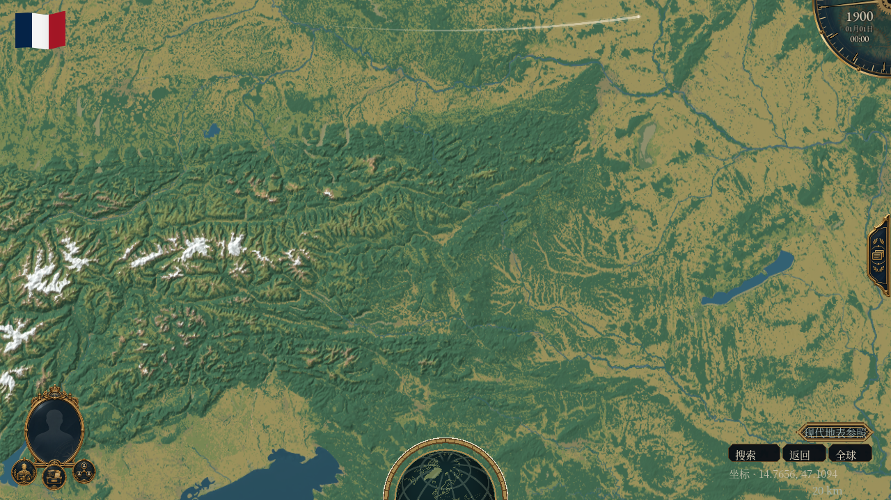

在独立目录以新附件作为 `7.qpk` 和 `index.json`，其余层级及河网拓扑沿用补湖候选。全量逐页视觉账本仍保留，定点和七洲样本未计为整页审核。Z7 用户视觉接受待定。 [全球候选 QPK](https://github.com/ryoumiyahayato/wwo/releases/download/terrain-surface-20261115/z7-land-material-7.qpk) · [资源清单](https://github.com/ryoumiyahayato/wwo/releases/download/terrain-surface-20261115/z7-land-material-index.json) · [两档原图、页表和连续帧回执](https://github.com/ryoumiyahayato/wwo/releases/download/terrain-surface-20261115/z7-land-material-originals.zip)

```text
python rust/strategic-host/tools/build_natural_terrain.py --z7-land-candidate <补湖候选>/7.qpk <WorldCover与DEM目录> <NaturalEarth目录> <独立候选>/7.qpk
```

## 全球陆地水文精修

全球 Z7 共用同一份陆地、海岸和水文施工队列。欧洲首批和维斯瓦河提供了原始取景。陆地专项实拍延伸到东亚、湄公河三角洲、天山、恒河—布拉马普特拉平原、纳米布、乍得湖、落基山、亚马孙、安第斯、澳大利亚墨累河和新西兰南岛。逐页记录继续使用原有坐标和状态。

| 原因 | 已查实的情况与处理 |
|---|---|
| 开阔湖面漏绘 | 母数据只从 Natural Earth 湖面和海陆、HydroRIVERS 等生成水覆盖。部分真实湖泊已在地表分类中呈现形状，水覆盖却仍为陆地。同一规则为有地理和历史来源的湖面补入 Z7。 |
| 河网末段与海岸错位 | 维斯瓦已有同机位修复。河口位置、岸线年代和水文拓扑分别核对，再把有证据的同类河口加入既有记录。 |
| 河宽、汊河和季节性 | 马瑙斯实拍的主河只呈现窄线。需核查该段的实际宽度和汊道。纳米布的查乌查布为间歇河，止于沙丘间洼地。两地的水线需按各自水文事实处理。 [巴西历史图档](https://atom-museuhistorico.museus.gov.br/downloads/mapas-e-plantas.pdf) · [纳米布沙海资料](https://science.nasa.gov/earth-observatory/namib-sand-sea-149130/) |
| 近代调水、筑坝及岸线变动 | 新锡德尔湖 1901 年岸线处于低水位。莫诺湖、奈瓦沙湖、戈恰乌科维采水库和须德海有各自的水位或工程史，留在历史边界专项。 [新锡德尔湖 1901 年资料](https://www.burgenland.at/fileadmin/user_upload/Natura2000_MP__NeusiedlerSee_web.pdf#page=16) · [莫诺湖水位](https://pubs.usgs.gov/of/2015/1108/pdf/ofr2015-1108.pdf) · [波兰国家档案馆](https://katowice.ap.gov.pl/ap/tekst/u-rode-wisy-jezioro-goczakowickie) |
| 材质地类和页边 | 东阿尔卑斯已查到的浅纹跨两页连续。低处草地或耕地、邻坡树冠和坡光共同形成反差，保留地貌颜色。WorldCover 为现代材质参考，约 1900 年地表覆盖另需历史资料。 |

从 HydroLAKES 筛查面积至少 100 平方公里的 1,708 条记录。在单个代表点同时满足现有湖面缺失、落入陆地及原 Z7 Alpha 小于 16 时列为疑点，共 569 条。现代水库、盐沼和季节性湖面也可能满足该条件。该筛查用于定位复核位置。

本次修复采用 10 个在约 1900 年已有记录的开阔水体。用带内环的 WGS84 湖面，在同一全球纹理坐标下执行 4×4 采样。水覆盖用原值与补湖覆盖取较大值，沿用现有湖泊色。触达的 BC7 块重编码，会影响块内量化。现代水面形状用于恢复开阔湖体，近岸工程、湿地和精确的 1900 年水位仍待考证。源资料和许可随每个要素记录。 [几何及历史依据](terrain-z7-visual/z7-inland-water.geojson) · [HydroLAKES 来源与许可](https://www.hydrosheds.org/products/hydrolakes)

| 开阔湖体 | 取景经纬度 | 中心 Z7 页 |
|---|---|---|
| 基姆湖 | 12.463°E／47.871°N | `7/136/29` |
| 图恩湖 | 7.701°E／46.686°N | `7/133/30` |
| 纳沙泰尔湖 | 6.850°E／46.904°N | `7/132/30` |
| 猪苗代湖 | 140.094°E／37.457°N | `7/227/37` |
| 洱海 | 100.202°E／25.800°N | `7/199/45` |
| 阿蒂特兰湖 | 91.190°W／14.689°N | `7/63/53` |
| 托多斯洛斯桑托斯湖 | 72.217°W／41.095°S | `7/76/93` |
| 阿特林湖 | 133.740°W／59.550°N | `7/32/21` |
| 马伊恩东贝湖 | 18.480°E／2.140°S | `7/141/65` |
| 瓦卡蒂普湖北臂 | 168.392°E／44.988°S | `7/247/95` |

完整候选为 1,607,880,723 字节。全层解码 32,768 页，32,768 份高程压缩帧与上一候选一致。65,280 条共享边及受影响页的 64 次对角重叠比较通过。16 页更新颜色与水覆盖。Z0–Z6 及河网拓扑沿用原候选。

**洱海** · `7/199/45` · 165 米／像素 · [同机位修复前](terrain-z7-visual/inland-erhai-before.png)

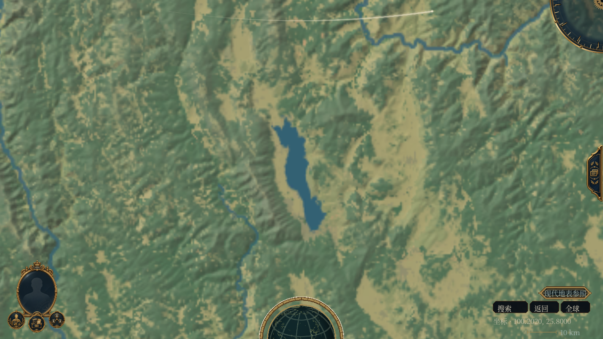

**马伊恩东贝湖** · `7/141/65` · 265 米／像素 · [同机位修复前](terrain-z7-visual/inland-mai-ndombe-before.png)

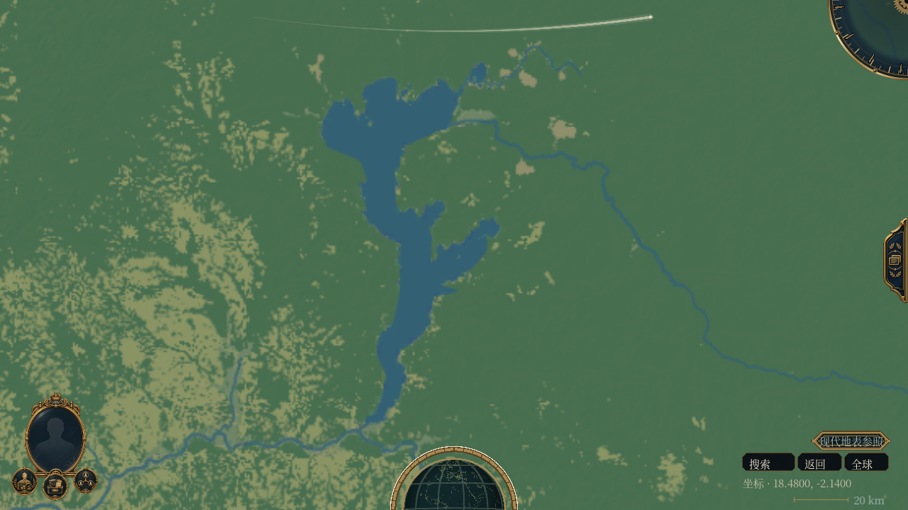

**瓦卡蒂普湖四页交汇** · 168.750°E／45.000°S · 245 米／像素 · [同机位修复前](terrain-z7-visual/inland-wakatipu-corner-before.png)

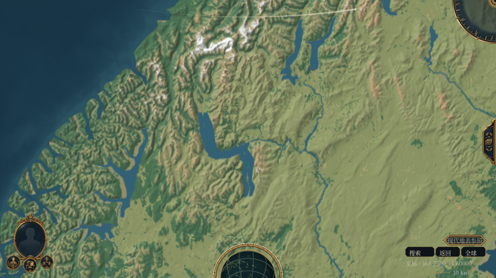

以上为实际 Vulkan 离屏画面。静态取景 Z7 权重为 1，选定页就绪。瓦卡蒂普湖四角静态实拍未见可辨的十字缝。瓦卡蒂普南支仍有浅色细纹，智利湖内和马伊恩东贝北湾有少量浅绿点，待核对岛屿、湿地与像元量化。

**其他陆地原始画面** · [湄公河三角洲](terrain-z7-visual/land-mainland-se-asia-mekong.png) · [纳米布沿岸沙丘](terrain-z7-visual/land-africa-namib.png) · [亚马孙森林与河网](terrain-z7-visual/land-south-america-amazon.png)

瓦卡蒂普湖同机位采集修复前后各 64 个连续帧，包含 530→970 米／像素快速拉远、反向滚轮、平移和旋转。修复后第 10 帧中心 Z7/Z6 权重为 0.85/0.15，第 12 帧为 0.55/0.45，第 20 帧由 Z6 实绘，第 35 帧恢复 Z7。可见页峰值 104，细节请求峰值 316，常驻页峰值 256。九点逐帧采样未记录缺页，复看未见逐块矩形淡入。连续回读间隔 p50/p95 为 40.16/43.86 → 39.23/43.73 ms。该指标包含采集开销。 [修复前录像](https://github.com/ryoumiyahayato/wwo/releases/download/terrain-surface-20261115/z7-inland-water-wakatipu-before.mp4) · [修复后录像](https://github.com/ryoumiyahayato/wwo/releases/download/terrain-surface-20261115/z7-inland-water-wakatipu-after.mp4)

洱海临界倍率往返 50 帧。可见页峰值 110，细节请求峰值 344，常驻页峰值 256。九点采样未记录缺页。790 米／像素时中心为 0.47 Z7 加 0.53 Z6。旧 Z6 缺少同一湖面，拉远后湖面逐步消失，归入相邻层材质差。正式游戏 FPS、工作集、专用显存为 NOT_RUN。 [洱海往返录像](https://github.com/ryoumiyahayato/wwo/releases/download/terrain-surface-20261115/z7-inland-water-erhai-reversal.mp4)

恢复时把附件放入独立候选目录，分别命名为 `7.qpk` 和 `index.json`，其余层和拓扑沿用维斯瓦候选。全层逐页视觉账本保持 830/32,768，尚有 31,938 页未完成。本轮定点实拍未计为整页审查。用户视觉接受待定。 [完整全球 Z7 QPK](https://github.com/ryoumiyahayato/wwo/releases/download/terrain-surface-20261115/z7-inland-water-7.qpk) · [候选清单](https://github.com/ryoumiyahayato/wwo/releases/download/terrain-surface-20261115/z7-inland-water-index.json) · [原图与逐帧状态](https://github.com/ryoumiyahayato/wwo/releases/download/terrain-surface-20261115/z7-inland-water-gpu-evidence.zip)

```text
python rust/strategic-host/tools/build_natural_terrain.py --inland-water-candidate <维斯瓦候选目录>/7.qpk docs/terrain-z7-visual/z7-inland-water.geojson <独立候选目录>/7.qpk
```

## 维斯瓦河口修复

Z7 `7/141/25`，格但斯克湾。原画面在 18.9361°E／54.3180°N 附近断线。HydroRIVERS 末段 `20265844` 到 Natural Earth 海岸相差约 4.31 公里，原 QPK 在断口没有河道覆盖。1895 年开通的维斯瓦导流渠已经通海。1903 年出版的图幅采用 1898 年测绘和 1899 年河口测深，所绘沙丘开口距现代水系末端约 1.9 公里。候选以现代水务中心线接入现有海岸，约 1900 年的岸线仍待重建。 [历史图幅](https://igrek.amzp.pl/TK25_1679) · [波兰水务局](https://gdansk.wody.gov.pl/aktualnosci/675-125-lat-od-przekopu-wisly) · [工程档案及现代线路](terrain-z7-visual/vistula-outlet.geojson)

生成器读取有据可查的河口记录，以 4×4 覆盖采样将现有河水材质接至海岸。宽度采用 400 米，处于同期工程记录的 250–450 米范围内。全层候选保留冰架修复，只更新 `7/141/25` 中 4 个 BC7 块。河网拓扑和高程帧沿用原资源。局部复核中，纯海水 Alpha 保持 255，目标页与相邻页的 4 条边、4 个角重叠逐块一致。

**修复后，区域原图。** 18.984375°E／54.140625°N，272 米／像素。 [同机位修复前](terrain-z7-visual/europe-vistula-mouth-z7-141-25.png)

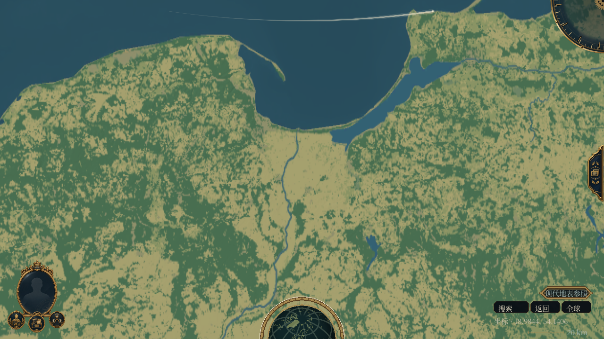

**近景修复前。** 18.943°E／54.335°N，38 米／像素。


**同机位修复后。** 河道延续至海水。近景仍显示底图采样尺度。固定取景均以 1280×720 Vulkan 离屏输出，`selected_ready=true`，Z7 权重 1。

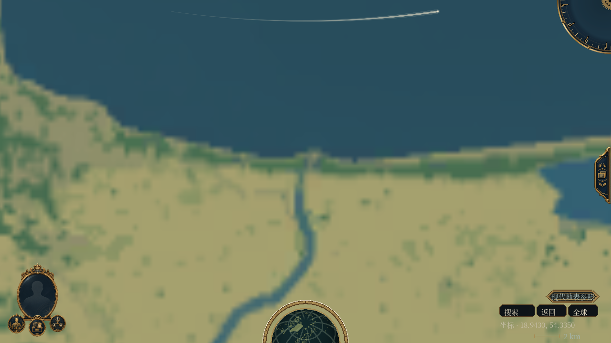

修复前后各采集 58 个真实连续帧。530→970 米／像素快拉远时，候选中心 Z7 权重从 1 降到 0，并在 970 米／像素稳定实绘 `6/70/12`。过渡初始帧出现完整更低层贡献。实际视口 Z7 需求峰值 140 页，细节请求峰值 343，常驻峰值 256。九点采样未标记缺页，复核画面未见逐页矩形贴片。旧 Z6 沿用原河口，拉远后的河口一致性留待 Z6 修复。RTX 3050 Laptop GPU 本次离屏回读间隔 p50／p95 由 40.70／44.61 ms 变为 40.80／44.28 ms。正式游戏 FPS、工作集、专用显存为 NOT_RUN。 [修复前录像](https://github.com/ryoumiyahayato/wwo/releases/download/terrain-surface-20261115/z7-vistula-original-wheel.mp4) · [修复后录像](https://github.com/ryoumiyahayato/wwo/releases/download/terrain-surface-20261115/z7-vistula-final-wheel.mp4) · [机位与逐帧回执](https://github.com/ryoumiyahayato/wwo/releases/download/terrain-surface-20261115/z7-vistula-captures.json.gz)

候选 `SCAR-ADD-7.13-z7-v3-vistula-20261117` 有 32,768 页，1,607,880,702 字节。全层索引检查通过。恢复时将新附件用作独立候选目录内的 `7.qpk` 和 `index.json`，其余 QPK 和拓扑沿用原候选。 [完整 Z7 候选](https://github.com/ryoumiyahayato/wwo/releases/download/terrain-surface-20261115/z7-vistula-7.qpk) · [候选清单](https://github.com/ryoumiyahayato/wwo/releases/download/terrain-surface-20261115/z7-vistula-index.json) · [先前 Z7 候选](https://github.com/ryoumiyahayato/wwo/releases/download/terrain-surface-20261115/z7-visual-7.qpk)

```text
python rust/strategic-host/tools/build_natural_terrain.py --river-outlet-candidate <原候选目录>/7.qpk docs/terrain-z7-visual/vistula-outlet.geojson <含 us10-land.zip 的 Natural Earth 目录> <独立候选目录>/7.qpk
```

原逐页记录保留。本轮实拍关闭 Z7 河口断线这一项，未增加整页审查数量。用户视觉验收待定，正式资源待用户决定。

## 欧洲首批原图

**东阿尔卑斯山脊和山麓** · `7/138/30` · 14.765625°E／47.109375°N · 515 米／像素

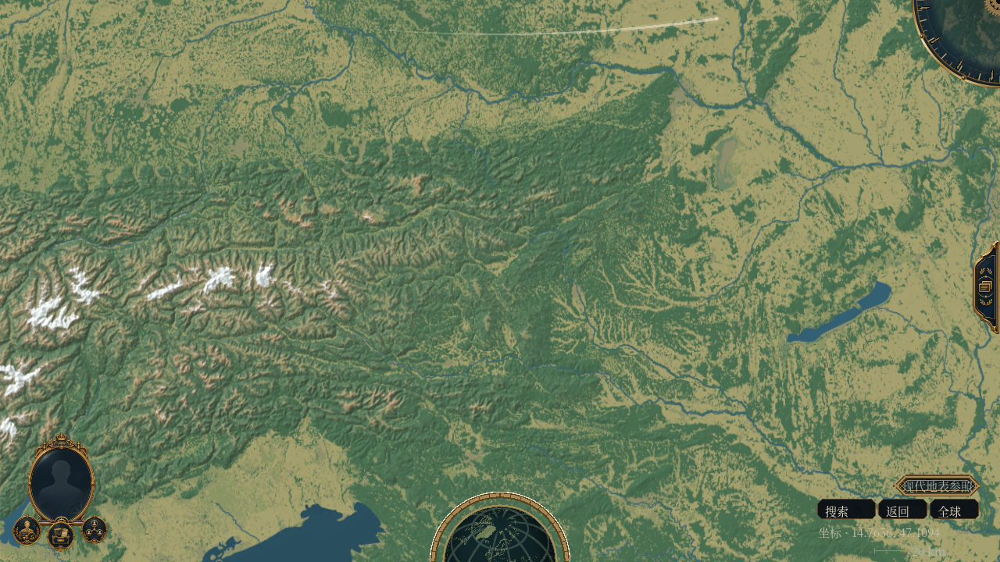

**维斯瓦河与中欧平原** · `7/142/26` · 20.390625°E／52.734375°N · 500 米／像素

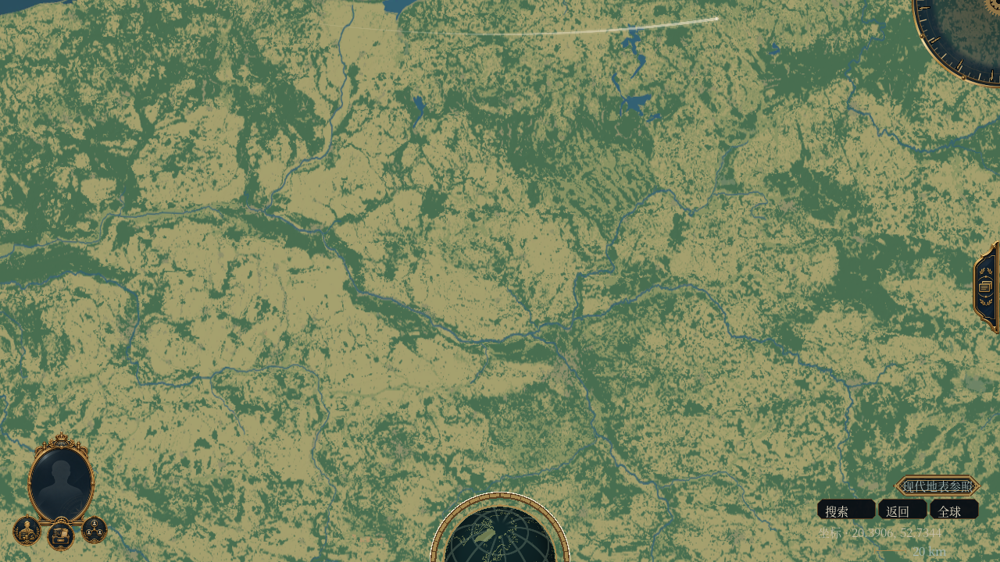

**库尔斯沙嘴及潟湖** · `7/142/24` · 陆地补镜 20.874440°E／55.214423°N · 490 米／像素

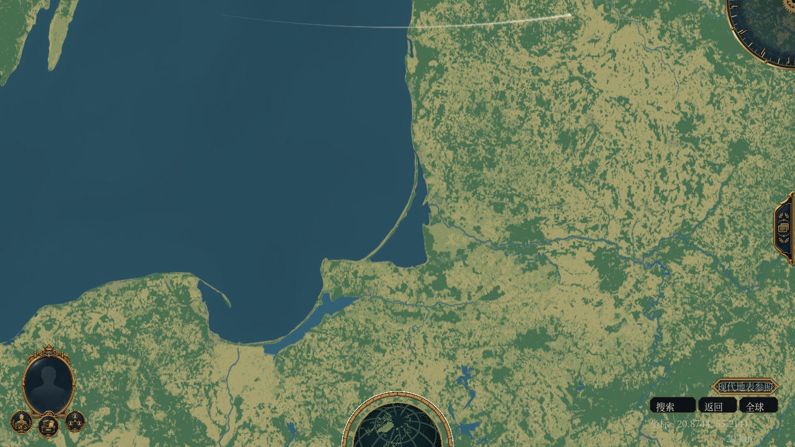

三张均为 1280×720 Rust/wgpu Vulkan 离屏原图。所选层已就绪，目标页实绘 Z7，权重 1。库尔斯沙嘴页的几何中心在海上，两档各加一张页内陆地补镜。陆地、沙嘴与潟湖同时可见。 [库尔斯沙嘴地理说明](https://whc.unesco.org/en/list/994)

### 审查与待核

首批范围为 `X=136…143, Y=24…31`，11.25–22.5°E、45–56.25°N。原图逐张查看，共 62 页、258 图，其中 39 页为纯陆地、23 页含海岸或内陆水体。5 页添加两档陆地补镜。PASS 56，FAIL 1，SOURCE_UNCERTAIN 5。本批的两张纯海页 `7/140/24`、`7/141/24` 留到海洋批次。已审页未见确认的页边硬缝。

| 瓦片 | 实拍现象和证据 |
| --- | --- |
| `7/141/25` | FAIL。维斯瓦河近岸断线，约 18.9361°E／54.3180°N。HydroRIVERS v1 公共矢量中的出口 20265844 距项目 Natural Earth 海岸约 4.31 公里，按生成器河宽缓冲后仍隔约 3.66 公里。候选本地拓扑中同 ID 为末段。原包和候选 BC7 记录相同，18.9354°E 取样列的水域 alpha 从 54.315°N 的 150 变为 54.320–54.330°N 的 0，断口已存在于源栅格。波兰水务史料确认渠道于 1895 年通海。待取得可定位的渠道几何并验证同类源线与海岸错位后，再决定整层修正规则。 [原图](terrain-z7-visual/europe-vistula-mouth-z7-141-25.png) · [波兰水务史料](https://gdansk.wody.gov.pl/aktualnosci/675-125-lat-od-przekopu-wisly) · [河网记录](https://maps.fsc.org/server/rest/services/Hosted/Optimized_Hyrdo/FeatureServer/0/query?where=hyriv_id%3D20265844&f=geojson&outSR=4326) |
| `7/141/28` | 18.8737°E／49.9331°N 的蓝色水体落在本项目 Natural Earth 湖泊多边形内，与上维斯瓦河 Goczałkowice 水库位置相符。水库于 1956 年启用。1900 年旧河道与滩地仍待考证。 [卡托维兹国家档案馆](https://katowice.ap.gov.pl/ap/tekst/u-rode-wisy-jezioro-goczakowickie) |
| `7/139/29` | 新锡德尔湖在 16.7330°E／47.8608°N 呈灰绿。当地资料记录开阔水面浑浊、芦苇带内水色不同。当前色值和生成来源待核。 [布尔根兰州湿地资料](https://www.burgenland.at/fileadmin/user_upload/Bilder/Umwelt/20200520_Burgenlaendische-Feuchtgebiete-und-ihre-Bedeutung-im-Naturschutz.pdf) |
| `7/136/30`、`7/137/30` | 12.3095–12.8171°E、约 47.28–47.30°N 可见浅色窄纹，重叠近景中复现，穿过共享页边。河谷沉积、土地覆盖和着色贡献待定位。 [萨尔茨堡州地形资料](https://www.salzburg.gv.at/themen/wasser/see/zellersee3d) |
| `7/142/30` | 蒂萨河附近约 20.64°E／47.57°N 有较宽蓝色段，点位未落入项目 Natural Earth 湖泊多边形。当地现代水库于 1978 年形成，当前河线是否另受现代数据影响仍待核。 [匈牙利中蒂萨区水务局](https://www.kotivizig.hu/kozep-tisza-videki/tisza-to/a-tisza-to-vizrendszere) |

### 连续缩放

东阿尔卑斯四页交汇，14.0625°E／47.8125°N。两条路径使用同一候选和 256 页图集。复核切换帧未见可见的逐页矩形淡入及缺页黑块。

| 路径 | 连续 GPU 帧 | 画面和状态 |
| --- | ---: | --- |
| 快速拉远 530→970 米／像素、两次反向 | 64 | 实绘 Z7／Z6。第 12 帧拉远和改变取景后，Z7 权重从 0.85 降到第 18 帧的 0，山脊细节随整屏权重变淡。Z7 可见需求峰值 126 页，细节页请求峰值 269，常驻峰值 256。离屏捕获间隔 p50／p95 为 44.25／53.54 ms。 [录像](https://github.com/ryoumiyahayato/wwo/releases/download/terrain-surface-20261115/z7-visual-europe-east-alps-530-970.mp4) |
| 冷缓存连续滚轮尺度往返，970–534 米／像素 | 68 | 初期实绘 Z4→Z5→Z6→Z7。反向时实际整屏退层，清晰度变化可见。Z7 可见需求峰值 84 页，细节页请求峰值 457，常驻峰值 222。离屏捕获间隔 p50／p95 为 44.40／85.84 ms。 [录像](https://github.com/ryoumiyahayato/wwo/releases/download/terrain-surface-20261115/z7-visual-europe-east-alps-wheel.mp4) |

132 帧的九点采样未标记缺页，同帧各点 Z7 权重差为 0。录像按实际帧顺序以 20 FPS 编码。回读间隔包含观测开销，正式游戏 FPS 和显存为 NOT_RUN。 [连续帧机位、实绘瓦片与权重](https://github.com/ryoumiyahayato/wwo/releases/download/terrain-surface-20261115/z7-visual-europe-motion.json.gz)

### 队列与恢复

此前按 `Y=0–7`、X 递增调度，十二批集中在北极。保留原 768 页和全部回执。现有 CSV 增加 Natural Earth 陆地类别、陆地占比、陆地取景和实拍地区。仍按原始编号关联结论。批内略过已审页，混合页按实际陆地交集入队。取景在几何中心落水时增加页内陆地镜头。陆地类别服务施工优先级。页内资料和 1900 年状态仍由人工按证据核对。

后续从欧洲剩余阿尔卑斯及中欧向斯堪的纳维亚和东欧推进，然后依次处理东亚、中南半岛、欧亚其余陆地、北美和南美、非洲、澳大利亚及其余岛岸。极地陆地随后补检，纯海页最后集中处理。当前镜头复用 `SCAR-ADD-7.13-z7-v3`，本批修改仅涉及取景与同一份账本。用户视觉结论待提交。

[累计逐页 CSV](https://github.com/ryoumiyahayato/wwo/releases/download/terrain-surface-20261115/z7-visual-global-pages-b13-review.csv) · [欧洲首批查图索引](https://github.com/ryoumiyahayato/wwo/releases/download/terrain-surface-20261115/z7-visual-batch-y024-x136-europe-reviewed.jpg) · [258 张原始 PNG 及对应回执](https://github.com/ryoumiyahayato/wwo/releases/download/terrain-surface-20261115/z7-visual-batch-y024-x136-europe.zip)

## 已有冰架与运行时修复

基线为 [PR #153](https://github.com/ryoumiyahayato/wwo/pull/153) 合并提交 `8d496fdfa0080f0951df3f38002139bb07964906`。沿用其 Z6 候选及既有 Rust/wgpu 管线。Z7 原包、PR #152 候选和正式回退保留。用户视觉验收未通过。正式游戏继续使用已接受的资源。

## 症状和根因

| 机位，经度／纬度 | 实拍定位和发现 |
| --- | --- |
| 罗斯内侧 −166.2583／−84.4318 | 冰面与接地线之间的海色虚线落在完全覆盖的冰面内。GPU 像素 (700,237) 对应 `7/11/123` 带填充像元 (14,201)。原 RGBA 为 (117,142,142,125)。旧混色重复使用已含海色的 RGB，目标为 (165,183,185)，BC7 解码为 (162,186,186,121)。 |
| 龙尼—菲尔希纳 −51.8965／−81.6525 | 左侧短线与罗斯内侧同因。顶部深色狭缝回投到 `7/94/121`，位于 SCAR 陆地 FID 1069 内，离浮冰 11.475–13.738 公里。旧 10 公里接地范围截断。 |
| 埃默里 71.7／−69.65 | 两处深色孔位于 SCAR 陆地 FID 2172，距浮冰 10.755 和 11.316 公里，分别涉及 `7/175/113`、`7/176/113`。外缘另有真实水道，保留。 |
| 罗斯外缘 177／−78.55 | 长切口像素 (925,246) 对应 `7/1/119`，在 SCAR FID 486 外 665.7 米，保留开阔水。栅格化把高纬局部轮廓显示成阶梯。 |
| 格陵兰 −47.866／68.165，撒哈拉 −0.703125／33.046875，博斯腾 88.4／41.94 | 固定 Z7 存在蓝色折线或孤立线。邻近现代模型河段已核对，实拍线归属、季节和 1900 年状态还没有确定，原地表保留。 |
| 马斯克林 61.8／−17.9 | 左侧斜向深浅带在原版和当前版固定 Z7 实拍均可见，母数据横切也有同位置深度变化。代表性测深格点的来源仍有疑点。 |

混色缺陷在固定 Z7、九点实绘权重 1 时出现，原 BC7 解码已显示。高纬距离使源栅格步进可见。以同一现代几何的 32×32 覆盖积分为参照，4×4 取样把罗斯外缘 10 个混合像元的平均覆盖误差从 0.0764 降至 0.0525，埃默里外缘 7 个从 0.0875 降至 0.0116。有效采样南北仍约 611 米，东西间距随纬度减小。SCAR 边界及 WorldCover 属现代参考。 [SCAR ADD 7.13](https://services7.arcgis.com/tPxy1hrFDhJfZ0Mf/ArcGIS/rest/services/Medium_resolution_vector_polygons_of_the_Antarctic_coastline/FeatureServer/1) · [HydroRIVERS](https://www.hydrosheds.org/products/hydrorivers) · [SRTM15+](https://topex.ucsd.edu/WWW_html/srtm15_plus.html)

## 实施

`--refine-ice-shelf-edges` 对全球完整 Z7 使用 4×4 覆盖。从原色中替换旧海色贡献，保持已有陆地颜色权重。实际 SCAR 陆地参与的接地线范围由 10 公里调整为 15 公里。重编码复用 Z6 的 BC7 精确 alpha 路径。旧的 Z6 和 Z7 重建命令仍能重建各自的历史版本。

完整候选 `SCAR-ADD-7.13-z7-v3` 共 1,607,880,698 字节。32,768 份压缩高程帧与原版一致，32,768 张的 BC7 解码水域通道与原版完全一致。原版相比有 818 张改色，PR #152 相比有 723 张改变颜色记录。65,280 条共享边通过，包含反经线。共享高程最大差 0 米，Z6 父层最大降采样差 0.75 米。Z6 继续使用 PR #153 候选。

## 同机位实拍复验

各图从左到右是原版、PR #152、当前候选。固定 Z7 使用同一相机、同一个 Rust 二进制和 1280×720 输出。原始 PNG 及 GPU 回执可按机位取回。

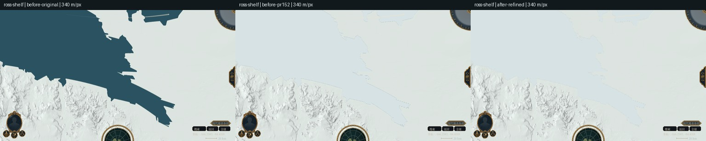

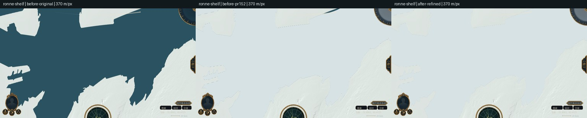


[龙尼原图 BEFORE](terrain-z7-visual/ronne-shelf-before.png) · [AFTER](terrain-z7-visual/ronne-shelf-after.png) · [埃默里原图 BEFORE](terrain-z7-visual/amery-shelf-before.png) · [AFTER](terrain-z7-visual/amery-shelf-after.png)。

四个留项机位的画面见 [格陵兰](terrain-z7-visual/greenland.jpg)、[撒哈拉](terrain-z7-visual/sahara.jpg)、[博斯腾](terrain-z7-visual/bosten.jpg) 和 [马斯克林](terrain-z7-visual/mascarene.jpg)。原图保留在同一归档。

罗斯内侧暗线减弱，例像素 RGB 从 (171,192,191) 变为 (202,217,209)。龙尼顶部狭缝和埃默里两处蓝孔消失，罗斯外缘切口及已核验的开阔水保留。局部淡色轮廓、短线和南极放射细纹仍待定位。固定 Z7 专项的全页目视结论保留在逐页表之外。

| 专项 | 对照证据与剩余疑点 |
| --- | --- |
| 格陵兰冰面线 | 画面选点 48.613627°W、68.195896°N 距模型河段 90092760 约 239 米。该河段流域仅 14.1 平方公里，不能据此归属画面的蓝线。HydroRIVERS 在 60°N 以北使用 HYDRO1k，融水季节待证。 |
| 撒哈拉断续线 | 三处画面选点距模型河段 10027827、10029392、10030242 分别约 142、223、187 米。这些河段同属一个内流网络，上游汇水面积均超过 4,000 平方公里。水道全年有水及 1900 年状态待证。 |
| 博斯腾湖孤立线 | 画面选点 88.954954°E、41.941362°N 距模型河段 40291649 约 198 米。模型下游 40291801 结束于内流网，两个河段的模型平均流量都记录为 0.000 立方米／秒。实拍线的归属及间歇流态待证。 |
| 马斯克林海底条带 | 在 61.355896°E 从 17.388611°S 到 17.624817°S，三个横切点的母格网深度为 −3,179、−686、−3,344 米。中间格点 SID 为 0，其周围两个格点为 51605，外侧所取的两个 3×3 窗全为 0。画面出现的颜色差对应母格网起伏，代表点缺少直接的测线标号，保留地形。 |

HydroRIVERS v1 的季节与历史证据有限。现场画面反投和模型距离记录用于定位。 [HydroRIVERS 技术说明](https://data.hydrosheds.org/file/technical-documentation/HydroRIVERS_TechDoc_v10.pdf) · [模型河段查询](https://maps.fsc.org/server/rest/services/Hosted/Optimized_Hyrdo/FeatureServer/0) · [SRTM15+ 版本与资料来源](https://topex.ucsd.edu/pub/srtm15_plus/README_V2.5.txt)

| 连续路径 | 候选帧 | GPU 回读与实绘 | 录像 |
| --- | ---: | --- | --- |
| 阿尔卑斯 530→970 米／像素，回放含返回 | 64 | 同一帧九点 Z7 权重一致，沿轮次 1→0 | [前](https://github.com/ryoumiyahayato/wwo/releases/download/terrain-surface-20261115/z7-visual-alps-530-970-pr152.mp4) · [后](https://github.com/ryoumiyahayato/wwo/releases/download/terrain-surface-20261115/z7-visual-alps-530-970.mp4) |
| 罗斯外缘自动 LOD 往返 | 70 | 视口 Z7 需求峰值 74 页，Z6/Z7 实绘切换 | [前](https://github.com/ryoumiyahayato/wwo/releases/download/terrain-surface-20261115/z7-visual-ross-front-pr152.mp4) · [后](https://github.com/ryoumiyahayato/wwo/releases/download/terrain-surface-20261115/z7-visual-ross-front.mp4) |
| 反经线，往返 | 48 | 实绘 Z6/Z7，九点混合一致 | [MP4](https://github.com/ryoumiyahayato/wwo/releases/download/terrain-surface-20261115/z7-visual-dateline.mp4) |
| 高纬视口，超预算 | 53 | Z7 可见需求峰值 512，256 页图集内实绘 Z6 | [MP4](https://github.com/ryoumiyahayato/wwo/releases/download/terrain-surface-20261115/z7-visual-polar-budget.mp4) |
| 同时缩放、平移、旋转 | 116 | 实绘 Z6/Z7，九点混合一致 | [MP4](https://github.com/ryoumiyahayato/wwo/releases/download/terrain-surface-20261115/z7-visual-zoom-pan-rotate.mp4) |
| 冷缓存连续放大 | 59 | 按页就绪从 Z4 向 Z7 切换 | [MP4](https://github.com/ryoumiyahayato/wwo/releases/download/terrain-surface-20261115/z7-visual-cold-alps.mp4) |
| 固定 Z7，罗斯冰面跨页及角点 | 32 | 实绘 Z7、权重 1 | [MP4](https://github.com/ryoumiyahayato/wwo/releases/download/terrain-surface-20261115/z7-visual-ross-ice-corner.mp4) |

442 帧候选和 267 帧对照由同一 Rust/wgpu 离屏管线采集。实拍复核片段未见逐块矩形淡入或缺页黑块。超预算路径整幅退到 Z6，清晰度变化可见。阿尔卑斯候选的离屏相邻捕获间隔 p50／p95 为 44.08／45.41 ms，对照为 40.96／44.81 ms。此路径包含 GPU 回读；正式游戏 FPS、专用显存和前台性能本轮为 NOT_RUN。发布录像用 20 FPS 顺序编码，无插帧。原帧的捕获时间、机位、视口需求、页状态、可见贡献和九点采样见 [连续帧回执](https://github.com/ryoumiyahayato/wwo/releases/download/terrain-surface-20261115/z7-visual-motion.json.gz)。

## 逐页进度

按 Y=0…127、X=0…255 编号，瓦片西缘为 `-180+X×1.40625°`，北缘为 `90-Y×1.40625°`。每个 8×8 批次记录相机、两个倍率、必要覆盖子图、版本、实绘页、混合、页预算和原图路径。逐页结论来自逐图查看。缩略图供查找原图，局部专题独立记录。

累计实际逐页查看 **830／32,768（2.53%）**。PASS 708，FAIL 1，SOURCE_UNCERTAIN 121，NOT_RENDERED 31,938。含北极十二批 `X=0…95, Y=0…7` 共 768 页及欧洲首批 62 页。北极每批 416 张逐页原图，另有极区两档共用实拍。

首批 `X=0…7, Y=0…7` 为 58 页 PASS、6 页 SOURCE_UNCERTAIN。北极辅助图覆盖常规视角最北端的窄带，共用原图在每个相关页记录中列出。北冰洋 `7/0–3/0` 的区域 02/05 与近景 04/08 等镜有淡细纹，`7/2–3/3` 的重叠近景 00 有短纵暗纹。


短纵暗纹的取景重叠点为 175.657834°W、84.915815°N。实绘为 `7/3/3`，距页西边 22.47 个纹素。两幅 GPU 原图的暗点同为 RGB (27,58,75)。暗纹沿线跨越 BC7 块内部。原版、PR #152、当前版三张相邻页高程及颜色记录相同。横切 QPK 深度为 −1,834、−2,079、−2,320、−2,305、−1,841 米，暗纹随深度变化。独立的 GEBCO 2024 北极服务在该点返回 TID 11（多波束测深），该点落在狭长测深带边缘。WWO 母数据在测线与周边的合成依据仍待核实。 [GEBCO 北极服务](https://www.gebco.net/data-products/gebco-web-services/web-map-service#test-wms-layers-for-polar-regions) · [TID 编码](https://www.gebco.net/gebco-tid-grid)

第二批 `X=8…15, Y=0…7` 为 64 页 PASS。Y0 画面右侧的斜纹位于目标页外，已按 135.60–134.95°W、89.52°N 登记到待审的 `7/31–32/0`。


第三批 `X=16…23, Y=0…7` 为 64 页 PASS。`7/19/0` 的区域 02 镜中，像素 (795,550) 的斜纹反投到相邻批次 `7/30/0`（136.87125°W、89.52991°N）。


第四批 `X=24…31, Y=0…7` 为 61 页 PASS、3 页 SOURCE_UNCERTAIN。斜纹位于 `7/29–31/0`，包括 `7/30/0` 区域 02 镜的 136.69454°W、89.54786°N 和 `7/31/0` 近景 00 镜的 135.67308°W、89.24543°N。复核范围没有跨页硬缝。`7/32/0` 另在第五批。

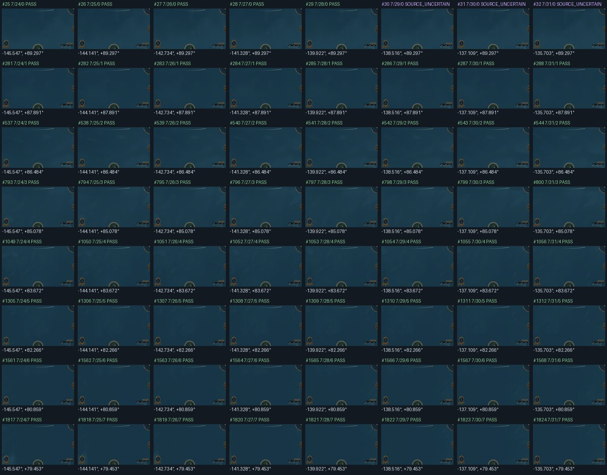

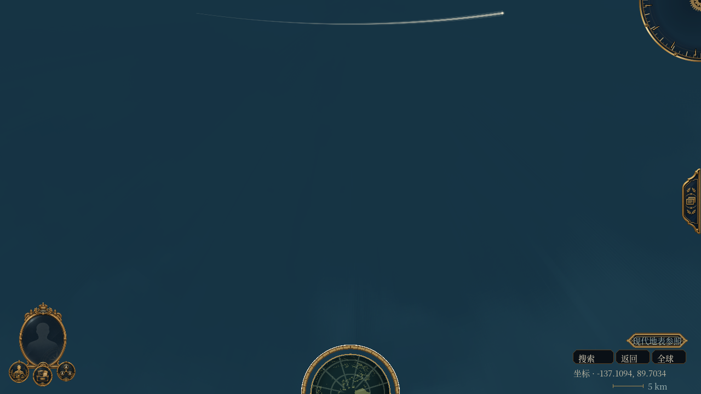

第三批 `7/19/0` 区域 02 镜中，横切斜纹的四个 GPU 像素 (792,517)、(796,517)、(800,517)、(804,517) 的 G 值为 55、52、52、54，WGS84 反投对应 SRTM15+ 深度约为 −3,142、−4,016、−4,000、−3,427 米。斜纹跨多个 BC7 块，三版 QPK 原始记录一致。四个代表点在 SRTM15+ V2.5.5 的 SID 小窗为 0，在 GEBCO 2024 北极 TID 格网中为 41（算法插值）。显示变化来自深度格网，细束是否对应实际海底结构仍待核实。 [SRTM15+ 版本说明](https://topex.ucsd.edu/pub/srtm15_plus/README_V2.5.txt) · [GEBCO 北极服务](https://www.gebco.net/data-products/gebco-web-services/web-map-service#test-wms-layers-for-polar-regions) · [TID 编码](https://www.gebco.net/gebco-tid-grid)

第五批 `X=32…39, Y=0…7` 为 62 页 PASS、2 页 SOURCE_UNCERTAIN。`7/32/0` 近景 00 在 (632,466) 与 (620,522) 处可见页内暗纹，反投为 134.54032°W／89.25492°N 与 134.88788°W／89.23273°N。`7/33/0` 西缘内可见弱尾迹，近景 03 位于 133.48145°W／89.04060°N。两页四角及同层边界未见矩形硬缝。部分画面在 89.43°N 还观察到目标范围外 `7/62–65/0` 的类似细纹，等该批逐页复核。

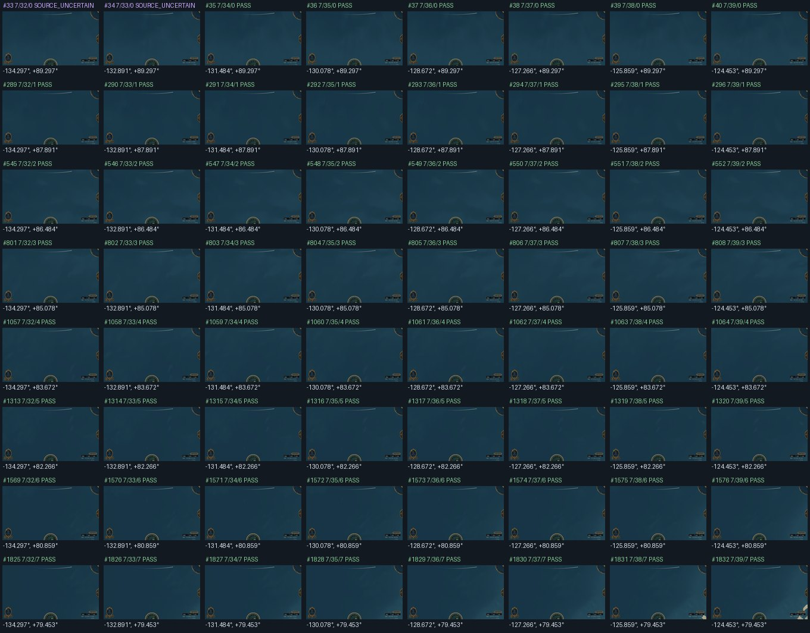

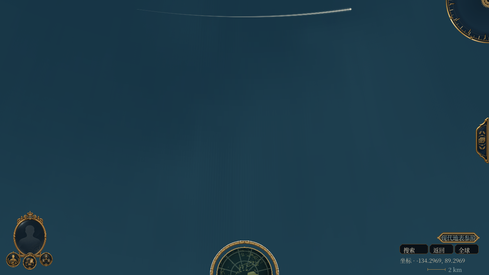

第六批 `X=40…47, Y=0…7` 为 56 页 PASS、8 页 SOURCE_UNCERTAIN。`7/40–47/0` 近景可见低对比细纹，目标页的四边、四角和极点交汇未见硬缝。以 `7/47/0` 为例，近景 00 镜的 (625,500) 回算为 113.63642°W、89.24126°N。相同目标的区域 00 两侧较强的斜纹分别落在 `7/33/0` 和 `7/64/0`。每个页内细纹的坐标和镜号见累计逐页 CSV。

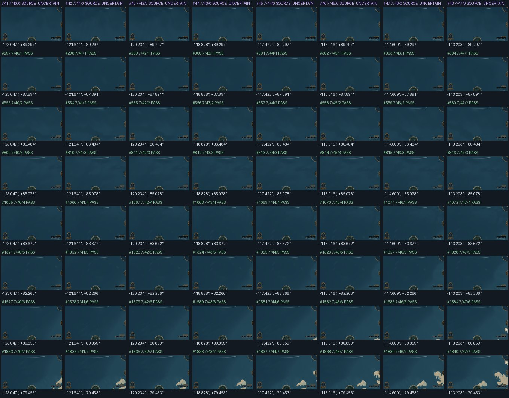

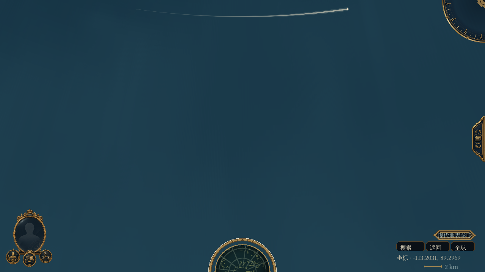

GEBCO 全球 TID 服务在第五批 `7/32–33/0` 的三个疑点返还 41（算法插值），在马斯克林条带与两侧三个疑点返还 40（卫星重力约束插值）。这些代码记录来源类型，现场深度仍待核实。候选仍使用原始高程。 [GEBCO 全球 WMS](https://www.gebco.net/data-products/gebco-web-services/web-map-service) · [TID 编码](https://www.gebco.net/gebco-tid-grid)

第七批 `X=48…55, Y=0…7` 为 56 页 PASS、8 页 SOURCE_UNCERTAIN。`7/48–55/0` 的近景 06 可见淡放射细纹。以 `7/55/0` 为例，像素 (625,408) 对应 102.52041°W、89.42048°N。该批目标页的共享边及极点交汇未见硬缝。`Y=7` 的群岛岸线及水道跨页连续。

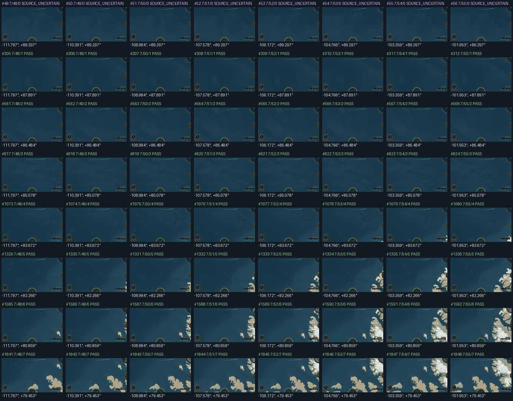

另将第六批 `7/46/0` 近景 00 的四个横切像素反投至约 89.2571°N。由 115.05190°W 向东至 114.86879°W，GPU 的 G 值为 60、61、60、61。SRTM15+ V2.5.5 在同点的双线性深度为 −1,950、−1,825、−1,982、−1,863 米。GEBCO 全球 2026 TID 在四点均为 41（插值），北极区域 2024 TID 均为 11（多波束）。SRTM15+ 的高纬底图使用 200 米极地投影的 IBCAO V4。母格网本身在代表性横切上高低交替，资料版本间的测线标识不同，四点的实地深度及整片细纹成因仍待证。 [SRTM15+ 版本说明](https://topex.ucsd.edu/pub/srtm15_plus/README_V2.5.txt) · [IBCAO V4](https://www.gebco.net/about/committees-and-groups/scrum/ibcao/ibcao-v4) · [GEBCO 来源分类](https://www.gebco.net/gebco-tid-grid)

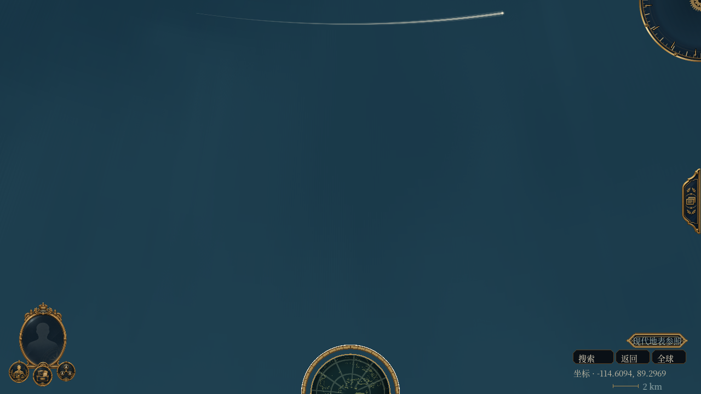

第八批 `X=56…63, Y=0…7` 为 56 页 PASS、8 页 SOURCE_UNCERTAIN。`7/56–63/0` 的暗纹逐页登记。`7/62/0` 的同一条纹出现在区域 00 与近景 06，约 91.42015°W、89.43148°N。`7/63/0` 近景 06 的页内横切位于 (628–640,380)。本批目标页未见硬缝。页外浅色轮廓 `7/66/5` 与 `7/67/5` 留给下一批复核。

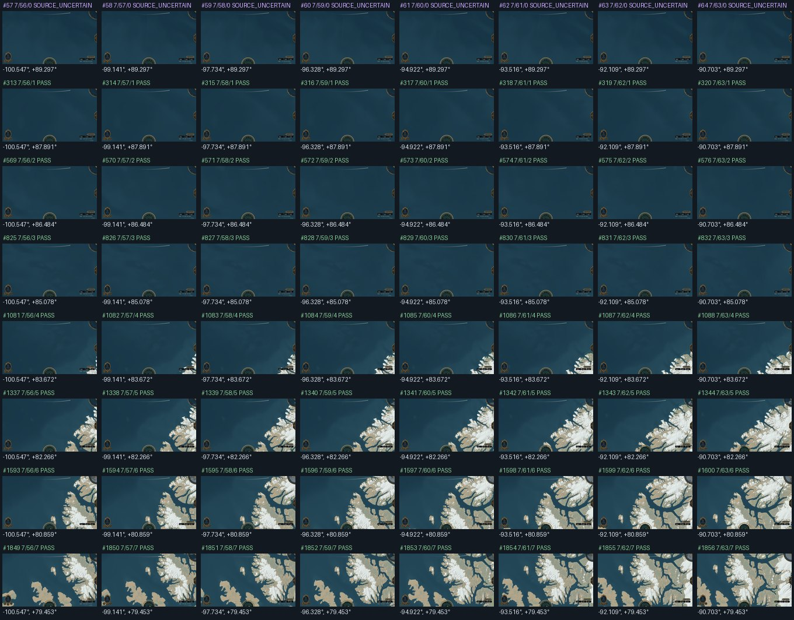

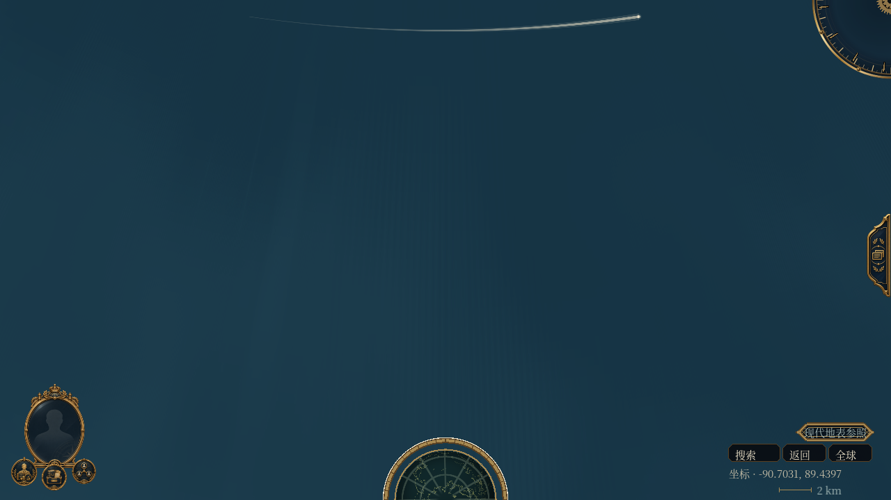

将三个实拍横切反投到 WGS84，并以相同经纬度读取公开 IBCAO V4 200 米原生极地格网。下表为四个代表点由西向东的双线性深度，单位为米。

| 实绘页 | 纬度约 | 当前母格网 SRTM15+ | 原生 IBCAO V4 |
| --- | ---: | --- | --- |
| `7/30/0` | 89.555°N | −3,142、−4,016、−4,000、−3,427 | −3,243、−3,204、−3,169、−3,142 |
| `7/46/0` | 89.257°N | −1,950、−1,825、−1,982、−1,863 | −1,814、−1,834、−1,858、−1,884 |
| `7/63/0` | 89.432°N | −2,951、−3,329、−2,895、−3,431 | −2,849、−2,885、−2,926、−2,973 |

画面暗纹与现用格网的深度起伏对应。原生 IBCAO 在这些代表点连续变化。两格网之间差异的具体处理步骤、实地深度以及其他极区细纹的范围仍待核实。本批保留原高程。 [原生 IBCAO V4 数据](https://catalogue.ceda.ac.uk/uuid/ec1c8283e5e1412a81b341a94033382f/) · [SRTM15+ 版本说明](https://topex.ucsd.edu/pub/srtm15_plus/README_V2.5.txt)

第九批 `X=64…71, Y=0…7` 为 46 页 PASS、18 页 SOURCE_UNCERTAIN。Y0 的八页和 Y1 的四页保留细暗纹疑点。Y5 的峡湾浅白轮廓和 Y7 跨 `7/66–67/7` 的浅青色斑均录入逐页记录。Y7 色斑在两个实拍视角连续跨页，约 85.90–85.68°W、78.99–79.00°N，成因待查。

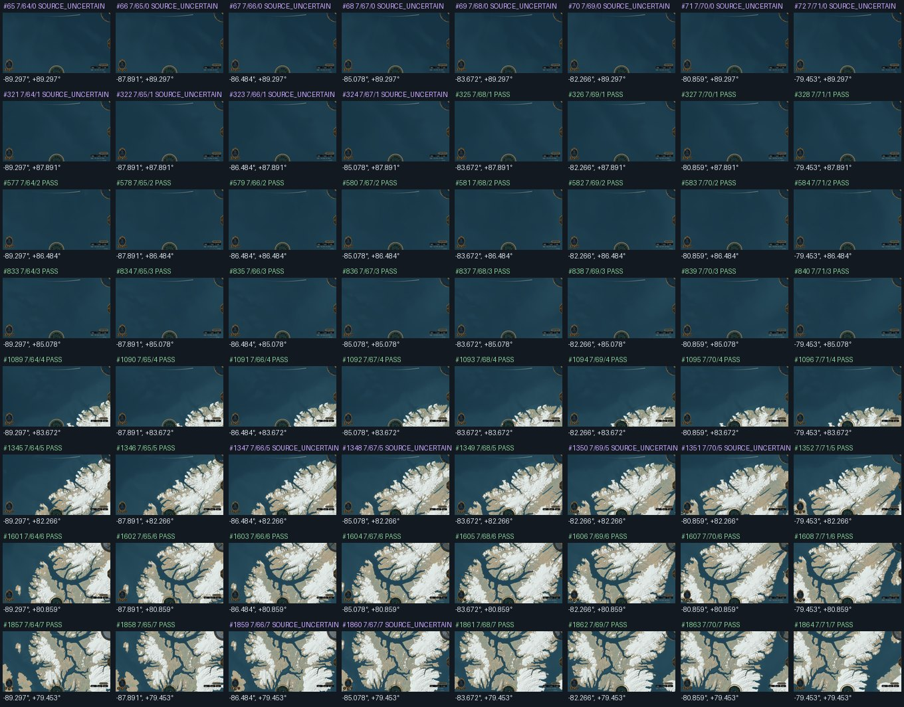

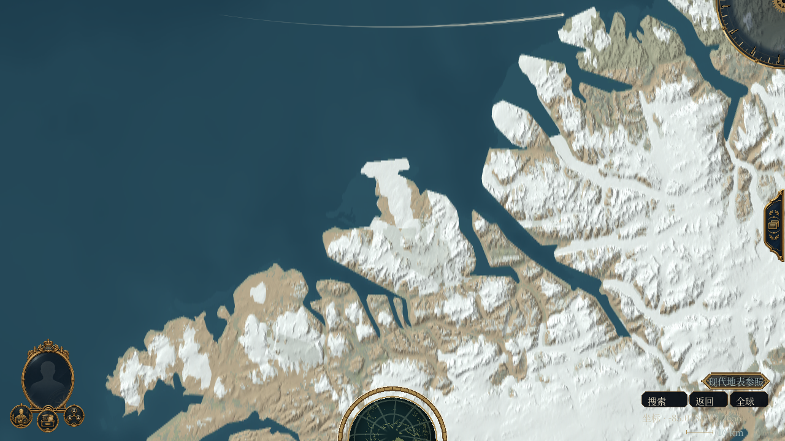

沃顿半岛白色突缘在 `7/67/5` 的一处取样位于 85.254839°W、82.469655°N。QPK 水域通道为 0，高程 +8 米，Natural Earth 标注陆地和冰盖，CanVec 1:50,000 海岸数据也将该点置于岸上。西侧 86.056415°W、82.307785°N 的浅青取样位于 `7/66/5`，水域通道为 255，近岸高程 0 米。加拿大航路指南记载 Alert Point 及东岸为低矮覆冰海岸，邻近水域浅于 100 米。上述取样支持保留陆冰与浅水颜色。峡湾直线轮廓的完整来源及 1900 年岸形仍待核实。 [CanVec](https://open.canada.ca/data/en/dataset/8ba2aa2a-7bb9-4448-b4d7-f164409fe056?res_page=1) · [加拿大航路指南，第 12 章](https://waves-vagues.dfo-mpo.gc.ca/library-bibliotheque/chs-shc-ARC402-eng-202501-41273515.pdf)

第十批 `X=72…79, Y=0…7` 为 42 页 PASS、22 页 SOURCE_UNCERTAIN。疑点包括 Y0 近极暗纹、Y4 北埃尔斯米尔岛外海浅青轮廓、Y6 冰盖斜纹及近岸和冰面线。逐页 CSV 记录对应镜号和坐标。格陵兰冰面蓝折线的旁页证据位于 `7/82/7`，约 63.85–64.59°W、79.62°N，留待该页两档覆盖复核。黑曾湖与钱德勒峡湾之间存在拉格尔斯河，`7/78/5` 实绘的直线感仍需核对河段形状。 [加拿大航路指南，第 11 章](https://publications.gc.ca/collections/collection_2022/mpo-dfo/Fs74-4-2021-12-eng.pdf)

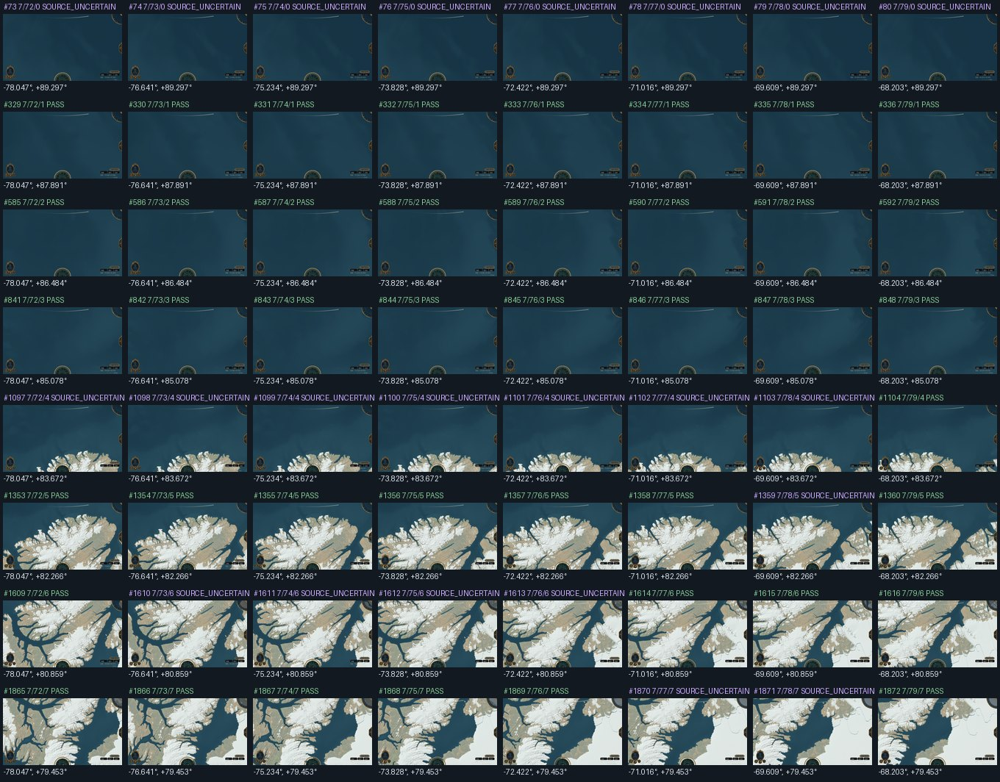

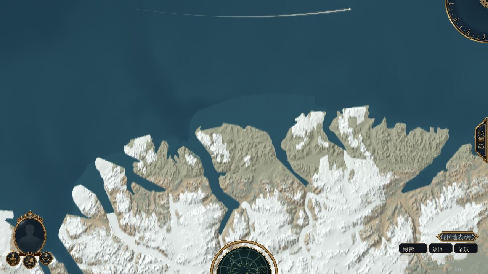

沃德亨特外海的浅青轮廓从 `7/72/4` 延伸至 `7/75/4`。`7/73/4` 在 76.640625°W 的 83.189080°N 与 83.122009°N 两点，QPK 高程为 −86、0 米，水域通道均为 255。SRTM15+ 同点插值为 −90.93、−0.62 米。`7/74/4` 在 75.234375°W 的 83.207372°N 与 83.142333°N 两点，QPK 高程为 −149、0 米，SRTM15+ 为 −149.17、0 米。这四点在 Natural Earth 陆地、湖泊及冰盖多边形之外，原版和候选对应像元一致。海色随深度变化，可见轮廓来自输入格网的近零深度区。1960 年测绘描述沃德亨特冰架外缘约在 83°12′N，记录与部分轮廓邻近。格网是否沿用了历史冰面高程及当代实测水深仍待核实，本批保留原数据。 [1960 年沃德亨特冰架取芯研究](https://www.cambridge.org/core/journals/journal-of-glaciology/article/ice-core-studies-of-ward-hunt-ice-shelf-1960/EB841F473CD3E5F1BADEB359A0357542) · [SRTM15+ 版本说明](https://topex.ucsd.edu/pub/srtm15_plus/README_V2.5.txt)

第十一批 `X=80…87, Y=0…7` 为 45 页 PASS、19 页 SOURCE_UNCERTAIN。北极细纹、冰坡细线及格陵兰冰面蓝折线分别登记。洪堡冰川附近的蓝线从 `7/81/7` 东缘约 64.800285°W、79.599651°N 起跨入 `7/82/7` 和 `7/83/7`，两档固定 Z7 图均可见。线形连续通过共享边，未见页框。

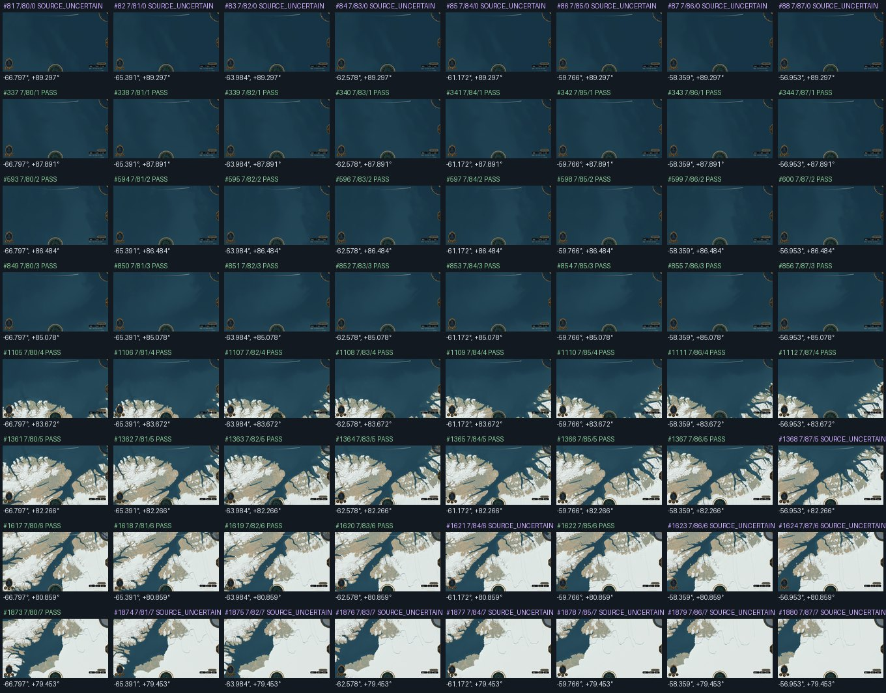

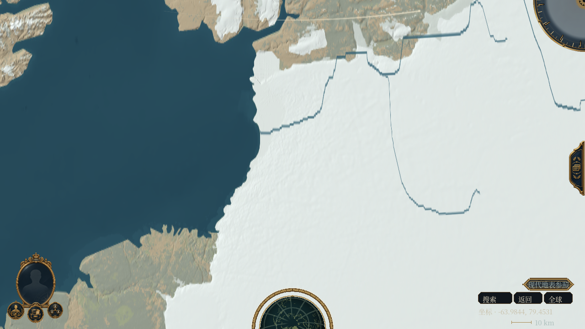

近景 00 的 GPU 像素 (651,271)、(626,278) 对应 `7/82/7` 带填充纹素 (157,97)、(103,100)。两点的经纬度为 63.844299°W／79.642639°N 和 64.140930°W／79.626160°N。原包与候选的解码水域值均分别为 105、97，邻侧无覆盖的抽查纹素为 0。两点距模型河段 90013935、90014073 分别为 0.00528°、0.00509°，各有两枚子采样落在既有 0.006° 缓冲内。模型栅格化已在 QPK 中形成这两处蓝线。该纬度的 0.012° 全宽约为南北 1.33 公里、东西 0.24 公里，成像宽度随走向变化。2016–2020 年 Sentinel-2 研究确认当地有季节性融水，所查两条模型线的实际位置及 1900 年状态仍待证，本批保留原纹理。 [HydroRIVERS 技术说明](https://data.hydrosheds.org/file/technical-documentation/HydroRIVERS_TechDoc_v10.pdf) · [模型河段查询](https://maps.fsc.org/server/rest/services/Hosted/Optimized_Hyrdo/FeatureServer/0) · [洪堡冰川卫星研究](https://tc.copernicus.org/articles/17/4729/2023/)

[第十一批原始 PNG 及同帧坐标和状态](https://github.com/ryoumiyahayato/wwo/releases/download/terrain-surface-20261115/z7-visual-batch-y000-x080.zip)。

第十二批 `X=88…95, Y=0…7` 为 42 页 PASS、22 页 SOURCE_UNCERTAIN。格陵兰冰盖上的折线在 `7/88–91/7` 两档实拍可见，例点为 55.752473°W／79.849499°N 和 50.724879°W／79.618811°N。另有细线跨 `7/93/6–7`，实拍例点为 48.8459°W／80.9384°N 和 49.0548°W／79.8772°N。目标页及共享边未见矩形硬缝，冰面水线和峡湾冰缘的地理归属仍待核实。保留原 QPK。此前按 `Y=0–7` 从西向东连续取样，因此十二批集中在北极。下一批转往欧洲大陆。

[第十二批原始 PNG 及同帧坐标和状态](https://github.com/ryoumiyahayato/wwo/releases/download/terrain-surface-20261115/z7-visual-batch-y000-x088.zip) · [截至第十二批的累计逐页 CSV](https://github.com/ryoumiyahayato/wwo/releases/download/terrain-surface-20261115/z7-visual-global-pages-b12.csv)。

续拍使用上一版本已验证的 Rust 宿主。先恢复本次索引指定的候选资源。每个取景保留实际 Z7 回执，逐张复核时从原图路径读图。重新索引应同时提供已经归档的上批 ZIP 和原有人工记录。

```text
python rust/strategic-host/tools/capture_z7_pages.py --exe <Rust宿主> --data <只读游戏数据> --terrain-candidate <候选目录> --program-revision <实际程序提交> --out <实拍目录> --natural-earth <现有NaturalEarth目录> --review-region europe --review-index <上批累计.csv> --batch-x 128 --batch-y 24
python rust/strategic-host/tools/index_z7_pages.py --captures <实拍目录> --out <归档目录> --review <历史逐页记录.csv> --review <本批实际目视记录.csv> --natural-earth <现有NaturalEarth目录> --review-region europe --batch-x 128 --batch-y 24 --zip
```

[截至第十一批的累计逐页 CSV](https://github.com/ryoumiyahayato/wwo/releases/download/terrain-surface-20261115/z7-visual-global-pages-b11.csv) · [首批原始 PNG 及同帧坐标和状态](https://github.com/ryoumiyahayato/wwo/releases/download/terrain-surface-20261115/z7-visual-batch-y000-x000.zip) · [第二批原始 PNG 及同帧坐标和状态](https://github.com/ryoumiyahayato/wwo/releases/download/terrain-surface-20261115/z7-visual-batch-y000-x008.zip) · [第三批原始 PNG 及同帧坐标和状态](https://github.com/ryoumiyahayato/wwo/releases/download/terrain-surface-20261115/z7-visual-batch-y000-x016.zip) · [第四批原始 PNG 及同帧坐标和状态](https://github.com/ryoumiyahayato/wwo/releases/download/terrain-surface-20261115/z7-visual-batch-y000-x024.zip) · [第五批原始 PNG 及同帧坐标和状态](https://github.com/ryoumiyahayato/wwo/releases/download/terrain-surface-20261115/z7-visual-batch-y000-x032.zip) · [第六批原始 PNG 及同帧坐标和状态](https://github.com/ryoumiyahayato/wwo/releases/download/terrain-surface-20261115/z7-visual-batch-y000-x040.zip) · [第七批原始 PNG 及同帧坐标和状态](https://github.com/ryoumiyahayato/wwo/releases/download/terrain-surface-20261115/z7-visual-batch-y000-x048.zip) · [第八批原始 PNG 及同帧坐标和状态](https://github.com/ryoumiyahayato/wwo/releases/download/terrain-surface-20261115/z7-visual-batch-y000-x056.zip) · [第九批原始 PNG 及同帧坐标和状态](https://github.com/ryoumiyahayato/wwo/releases/download/terrain-surface-20261115/z7-visual-batch-y000-x064.zip) · [第十批原始 PNG 及同帧坐标和状态](https://github.com/ryoumiyahayato/wwo/releases/download/terrain-surface-20261115/z7-visual-batch-y000-x072.zip) · [八个原坐标 24 张原图及两极图](https://github.com/ryoumiyahayato/wwo/releases/download/terrain-surface-20261115/z7-visual-site-png.zip)。

## 保留项与恢复

格陵兰、撒哈拉、博斯腾水线，马斯克林条带及南北极细纹仍有来源或根因留项。南极 v3 与 PR #153 Z6 的固定暖缓存专项已进行 GPU 衔接复验。Z5 沿用旧冰架材质，待下一层核对。Z7 全层视觉结论仍为未完成，正式地图待用户验收。

[完整候选](https://github.com/ryoumiyahayato/wwo/releases/download/terrain-surface-20261115/z7-visual-7.qpk) · [合用候选索引](https://github.com/ryoumiyahayato/wwo/releases/download/terrain-surface-20261115/z7-visual-index.json) · [全球层和受影响页记录](https://github.com/ryoumiyahayato/wwo/releases/download/terrain-surface-20261115/z7-visual-global.json) · [原始像素及位置](https://github.com/ryoumiyahayato/wwo/releases/download/terrain-surface-20261115/z7-visual-ice-gpu-points-local.json) · [SCAR 输入](https://github.com/ryoumiyahayato/wwo/releases/download/terrain-surface-20261115/z7-detail-scar-add-7.13.json.gz) · [PR #152 候选](https://github.com/ryoumiyahayato/wwo/releases/download/terrain-surface-20261115/z7-detail-7.qpk) · [原版回退](https://github.com/ryoumiyahayato/wwo/releases/download/terrain-surface-20261115/7.qpk)。

从原版 `7.qpk` 和解压的 SCAR 数据重建，按候选索引合用已有的 PR #153 Z6 与基础各层。

```text
python rust/strategic-host/tools/build_natural_terrain.py --refine-ice-shelf-edges --ice-shelf-candidate <原版7.qpk> <SCAR_ADD.json> <隔离目录/7.qpk>
```

GitHub 私有 Release 中候选资产为 1,607,880,698 字节。通过已认证的附件下载入口，远端取回完整 QPK 包头、全层索引和九张分布在全球的瓦片记录，内容与候选一致。整包下载是独立验证，当前阶段仅登记上述远端读回范围。
