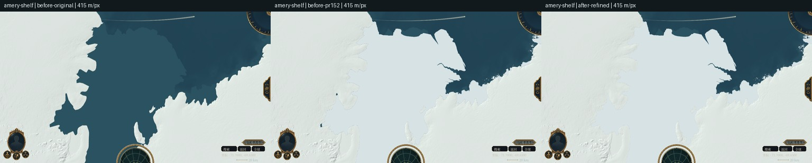
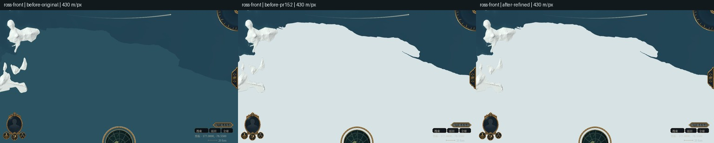
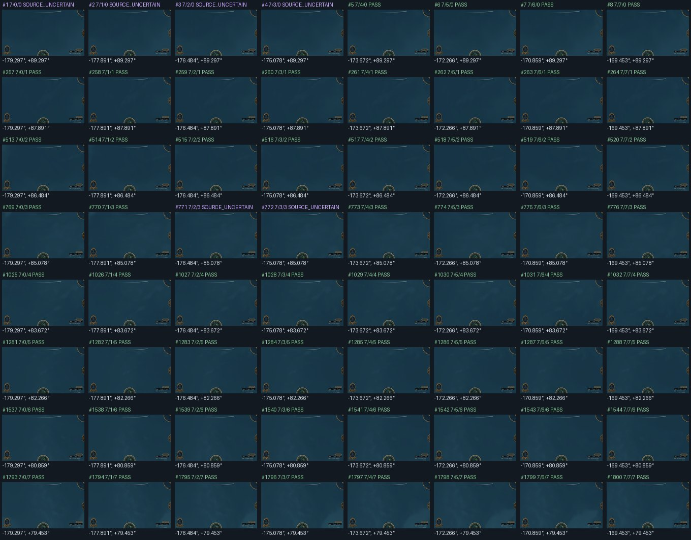
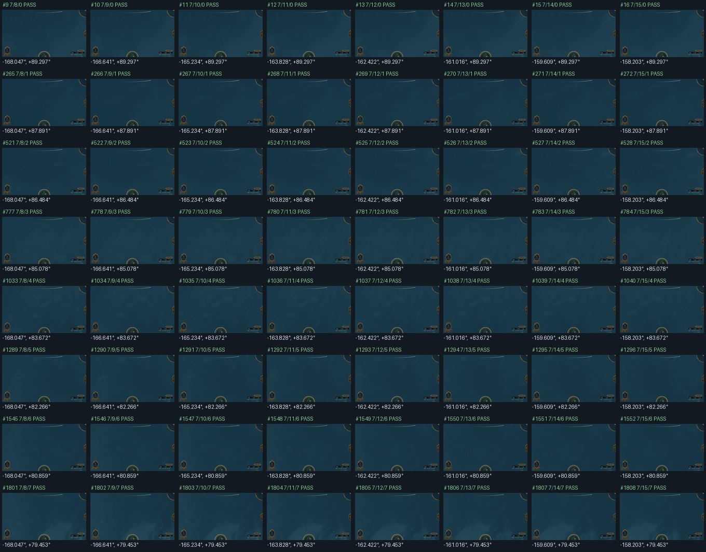
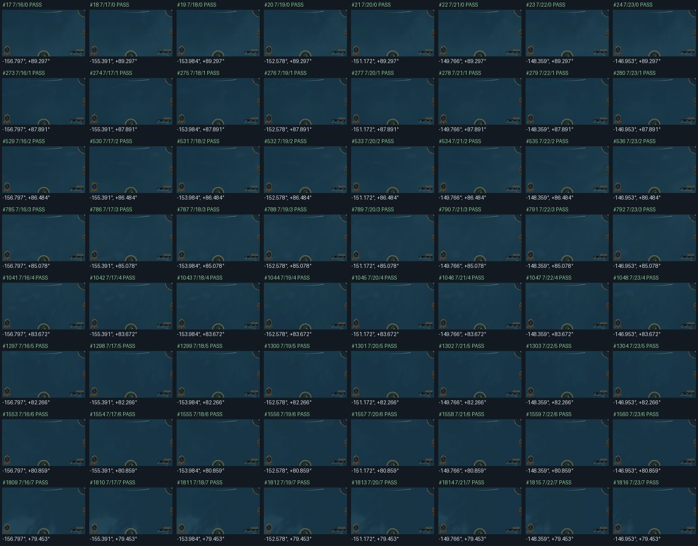

# Z7 全球逐页视觉验收

基线为 [PR #153](https://github.com/ryoumiyahayato/wwo/pull/153) 合并提交 `8d496fdfa0080f0951df3f38002139bb07964906`。沿用其 Z6 候选及既有 Rust/wgpu 管线。Z7 原包、PR #152 候选和正式回退保留。用户视觉验收未通过。正式游戏继续使用已接受的资源。

## 症状和根因

| 机位，经度／纬度 | 实拍定位和发现 |
| --- | --- |
| 罗斯内侧 −166.2583／−84.4318 | 冰面与接地线之间的海色虚线落在完全覆盖的冰面内。GPU 像素 (700,237) 对应 `7/11/123` 带填充像元 (14,201)。原 RGBA 为 (117,142,142,125)。旧混色重复使用已含海色的 RGB，目标为 (165,183,185)，BC7 解码为 (162,186,186,121)。 |
| 龙尼—菲尔希纳 −51.8965／−81.6525 | 左侧短线与罗斯内侧同因。顶部深色狭缝回投到 `7/94/121`，位于 SCAR 陆地 FID 1069 内，离浮冰 11.475–13.738 公里。旧 10 公里接地范围截断。 |
| 埃默里 71.7／−69.65 | 两处深色孔位于 SCAR 陆地 FID 2172，距浮冰 10.755 和 11.316 公里，分别涉及 `7/175/113`、`7/176/113`。外缘另有真实水道，保留。 |
| 罗斯外缘 177／−78.55 | 长切口像素 (925,246) 对应 `7/1/119`，在 SCAR FID 486 外 665.7 米，保留开阔水。栅格化把高纬局部轮廓显示成阶梯。 |
| 格陵兰 −47.866／68.165，撒哈拉 −0.703125／33.046875，博斯腾 88.4／41.94 | 固定 Z7 存在蓝色折线或孤立线。邻近现代模型河段已核对，实拍线归属、季节和 1900 年状态还没有确定，原地表保留。 |
| 马斯克林 61.8／−17.9 | 左侧斜向深浅带在原版和当前版固定 Z7 实拍均可见，母数据横切也有同位置深度变化。代表性测深格点的来源仍有疑点。 |

混色缺陷在固定 Z7、九点实绘权重 1 时出现，原 BC7 解码已显示。高纬距离使源栅格步进可见。以同一现代几何的 32×32 覆盖积分为参照，4×4 取样把罗斯外缘 10 个混合像元的平均覆盖误差从 0.0764 降至 0.0525，埃默里外缘 7 个从 0.0875 降至 0.0116。有效采样南北仍约 611 米，东西间距随纬度减小。SCAR 边界及 WorldCover 属现代参考。 [SCAR ADD 7.13](https://services7.arcgis.com/tPxy1hrFDhJfZ0Mf/ArcGIS/rest/services/Medium_resolution_vector_polygons_of_the_Antarctic_coastline/FeatureServer/1) · [HydroRIVERS](https://www.hydrosheds.org/products/hydrorivers) · [SRTM15+](https://topex.ucsd.edu/WWW_html/srtm15_plus.html)

## 实施

`--refine-ice-shelf-edges` 对全球完整 Z7 使用 4×4 覆盖。从原色中替换旧海色贡献，保持已有陆地颜色权重。实际 SCAR 陆地参与的接地线范围由 10 公里调整为 15 公里。重编码复用 Z6 的 BC7 精确 alpha 路径。旧的 Z6 和 Z7 重建命令仍能重建各自的历史版本。

完整候选 `SCAR-ADD-7.13-z7-v3` 共 1,607,880,698 字节。32,768 份压缩高程帧与原版一致，32,768 张的 BC7 解码水域通道与原版完全一致。原版相比有 818 张改色，PR #152 相比有 723 张改变颜色记录。65,280 条共享边通过，包含反经线。共享高程最大差 0 米，Z6 父层最大降采样差 0.75 米。Z6 继续使用 PR #153 候选。

## 同机位实拍复验

各图从左到右是原版、PR #152、当前候选。固定 Z7 使用同一相机、同一个 Rust 二进制和 1280×720 输出。原始 PNG 及 GPU 回执可按机位取回。






[龙尼原图 BEFORE](terrain-z7-visual/ronne-shelf-before.png) · [AFTER](terrain-z7-visual/ronne-shelf-after.png) · [埃默里原图 BEFORE](terrain-z7-visual/amery-shelf-before.png) · [AFTER](terrain-z7-visual/amery-shelf-after.png)。

四个留项机位的画面见 [格陵兰](terrain-z7-visual/greenland.jpg)、[撒哈拉](terrain-z7-visual/sahara.jpg)、[博斯腾](terrain-z7-visual/bosten.jpg) 和 [马斯克林](terrain-z7-visual/mascarene.jpg)。原图保留在同一归档。

罗斯内侧暗线减弱，例像素 RGB 从 (171,192,191) 变为 (202,217,209)。龙尼顶部狭缝和埃默里两处蓝孔消失，罗斯外缘切口及已核验的开阔水保留。局部淡色轮廓、短线和南极放射细纹仍待定位。固定 Z7 专项的全页目视结论保留在逐页表之外。

| 专项 | 对照证据与剩余疑点 |
| --- | --- |
| 格陵兰冰面线 | 画面选点 48.613627°W、68.195896°N 距模型河段 90092760 约 239 米。该河段流域仅 14.1 平方公里，不能据此归属画面的蓝线。HydroRIVERS 在 60°N 以北使用 HYDRO1k，融水季节待证。 |
| 撒哈拉断续线 | 三处画面选点距模型河段 10027827、10029392、10030242 分别约 142、223、187 米。这些河段同属一个内流网络，上游汇水面积均超过 4,000 平方公里。水道全年有水及 1900 年状态待证。 |
| 博斯腾湖孤立线 | 画面选点 88.954954°E、41.941362°N 距模型河段 40291649 约 198 米。模型下游 40291801 结束于内流网，两个河段的模型平均流量都记录为 0.000 立方米／秒。实拍线的归属及间歇流态待证。 |
| 马斯克林海底条带 | 在 61.355896°E 从 17.388611°S 到 17.624817°S，三个横切点的母格网深度为 −3,179、−686、−3,344 米。中间格点 SID 为 0，其周围两个格点为 51605，外侧所取的两个 3×3 窗全为 0。画面出现的颜色差对应母格网起伏，代表点缺少直接的测线标号，保留地形。 |

HydroRIVERS v1 的季节与历史证据有限。现场画面反投和模型距离记录用于定位。 [HydroRIVERS 技术说明](https://data.hydrosheds.org/file/technical-documentation/HydroRIVERS_TechDoc_v10.pdf) · [模型河段查询](https://maps.fsc.org/server/rest/services/Hosted/Optimized_Hyrdo/FeatureServer/0) · [SRTM15+ 版本与资料来源](https://topex.ucsd.edu/pub/srtm15_plus/README_V2.5.txt)

| 连续路径 | 候选帧 | GPU 回读与实绘 | 录像 |
| --- | ---: | --- | --- |
| 阿尔卑斯 530→970 米／像素，回放含返回 | 64 | 同一帧九点 Z7 权重一致，沿轮次 1→0 | [前](https://github.com/ryoumiyahayato/wwo/releases/download/terrain-surface-20261115/z7-visual-alps-530-970-pr152.mp4) · [后](https://github.com/ryoumiyahayato/wwo/releases/download/terrain-surface-20261115/z7-visual-alps-530-970.mp4) |
| 罗斯外缘自动 LOD 往返 | 70 | 视口 Z7 需求峰值 74 页，Z6/Z7 实绘切换 | [前](https://github.com/ryoumiyahayato/wwo/releases/download/terrain-surface-20261115/z7-visual-ross-front-pr152.mp4) · [后](https://github.com/ryoumiyahayato/wwo/releases/download/terrain-surface-20261115/z7-visual-ross-front.mp4) |
| 反经线，往返 | 48 | 实绘 Z6/Z7，九点混合一致 | [MP4](https://github.com/ryoumiyahayato/wwo/releases/download/terrain-surface-20261115/z7-visual-dateline.mp4) |
| 高纬视口，超预算 | 53 | Z7 可见需求峰值 512，256 页图集内实绘 Z6 | [MP4](https://github.com/ryoumiyahayato/wwo/releases/download/terrain-surface-20261115/z7-visual-polar-budget.mp4) |
| 同时缩放、平移、旋转 | 116 | 实绘 Z6/Z7，九点混合一致 | [MP4](https://github.com/ryoumiyahayato/wwo/releases/download/terrain-surface-20261115/z7-visual-zoom-pan-rotate.mp4) |
| 冷缓存连续放大 | 59 | 按页就绪从 Z4 向 Z7 切换 | [MP4](https://github.com/ryoumiyahayato/wwo/releases/download/terrain-surface-20261115/z7-visual-cold-alps.mp4) |
| 固定 Z7，罗斯冰面跨页及角点 | 32 | 实绘 Z7、权重 1 | [MP4](https://github.com/ryoumiyahayato/wwo/releases/download/terrain-surface-20261115/z7-visual-ross-ice-corner.mp4) |

442 帧候选和 267 帧对照由同一 Rust/wgpu 离屏管线采集。实拍复核片段未见逐块矩形淡入或缺页黑块。超预算路径整幅退到 Z6，清晰度变化可见。阿尔卑斯候选的离屏相邻捕获间隔 p50／p95 为 44.08／45.41 ms，对照为 40.96／44.81 ms。此路径包含 GPU 回读；正式游戏 FPS、专用显存和前台性能本轮为 NOT_RUN。发布录像用 20 FPS 顺序编码，无插帧。原帧的捕获时间、机位、视口需求、页状态、可见贡献和九点采样见 [连续帧回执](https://github.com/ryoumiyahayato/wwo/releases/download/terrain-surface-20261115/z7-visual-motion.json.gz)。

## 逐页进度

按 Y=0…127、X=0…255 编号，瓦片西缘为 `-180+X×1.40625°`，北缘为 `90-Y×1.40625°`。每个 8×8 批次记录相机、两个倍率、必要覆盖子图、版本、实绘页、混合、页预算和原图路径。逐页结论来自逐图查看。缩略图供查找原图，局部专题独立记录。

累计实际逐页目视完成 **256／32,768（0.781%）**。PASS 247，FAIL 0，SOURCE_UNCERTAIN 9，NOT_RENDERED 32,512。已完成四批各 416 张逐页原图，另有极区两档共用实拍。

首批 `X=0…7, Y=0…7` 为 58 页 PASS、6 页 SOURCE_UNCERTAIN。北极辅助图覆盖常规视角最北端的窄带，共用原图在每个相关页记录中列出。北冰洋 `7/0–3/0` 的区域 02/05 与近景 04/08 等镜有淡细纹，`7/2–3/3` 的重叠近景 00 有短纵暗纹。



短纵暗纹的取景重叠点为 175.657834°W、84.915815°N。实绘为 `7/3/3`，距页西边 22.47 个纹素。两幅 GPU 原图的暗点同为 RGB (27,58,75)。暗纹沿线跨越 BC7 块内部。原版、PR #152、当前版三张相邻页高程及颜色记录相同。横切 QPK 深度为 −1,834、−2,079、−2,320、−2,305、−1,841 米，暗纹随深度变化。独立的 GEBCO 2024 北极服务在该点返回 TID 11（多波束测深），该点落在狭长测深带边缘。WWO 母数据在测线与周边的合成依据仍待核实。 [GEBCO 北极服务](https://www.gebco.net/data-products/gebco-web-services/web-map-service#test-wms-layers-for-polar-regions) · [TID 编码](https://www.gebco.net/gebco-tid-grid)

第二批 `X=8…15, Y=0…7` 为 64 页 PASS。Y0 画面右侧的斜纹位于目标页外，已按 135.60–134.95°W、89.52°N 登记到待审的 `7/31–32/0`。



第三批 `X=16…23, Y=0…7` 为 64 页 PASS。`7/19/0` 的区域 02 镜中，像素 (795,550) 的斜纹反投到相邻批次 `7/30/0`（136.87125°W、89.52991°N）。



第四批 `X=24…31, Y=0…7` 为 61 页 PASS、3 页 SOURCE_UNCERTAIN。斜纹位于 `7/29–31/0`，包括 `7/30/0` 区域 02 镜的 136.69454°W、89.54786°N 和 `7/31/0` 近景 00 镜的 135.67308°W、89.24543°N。复核范围没有跨页硬缝。`7/32/0` 另在第五批。


第三批 `7/19/0` 区域 02 镜中，横切斜纹的四个 GPU 像素 (792,517)、(796,517)、(800,517)、(804,517) 的 G 值为 55、52、52、54，WGS84 反投对应 SRTM15+ 深度约为 −3,142、−4,016、−4,000、−3,427 米。斜纹跨多个 BC7 块，三版 QPK 原始记录一致。四个代表点在 SRTM15+ V2.5.5 的 SID 小窗为 0，在 GEBCO 2024 北极 TID 格网中为 41（算法插值）。显示变化来自深度格网，细束是否对应实际海底结构仍待核实。 [SRTM15+ 版本说明](https://topex.ucsd.edu/pub/srtm15_plus/README_V2.5.txt) · [GEBCO 北极服务](https://www.gebco.net/data-products/gebco-web-services/web-map-service#test-wms-layers-for-polar-regions) · [TID 编码](https://www.gebco.net/gebco-tid-grid)

续拍使用上一版本已验证的 Rust 宿主。先恢复本次索引指定的候选资源。每个取景保留实际 Z7 回执，逐张复核时从原图路径读图。重新索引应同时提供已经归档的上批 ZIP 和原有人工记录。

```text
python rust/strategic-host/tools/capture_z7_pages.py --exe <Rust宿主> --data <只读游戏数据> --terrain-candidate <候选目录> --program-revision <实际程序提交> --out <实拍目录> --batch-x 32 --batch-y 0
python rust/strategic-host/tools/index_z7_pages.py --captures <实拍目录> --out <归档目录> --review <已查看原图的记录.csv> --batch-x 32 --batch-y 0 --zip
```

[累计逐页 CSV](https://github.com/ryoumiyahayato/wwo/releases/download/terrain-surface-20261115/z7-visual-global-pages-b04.csv) · [首批原始 PNG 及同帧坐标和状态](https://github.com/ryoumiyahayato/wwo/releases/download/terrain-surface-20261115/z7-visual-batch-y000-x000.zip) · [第二批原始 PNG 及同帧坐标和状态](https://github.com/ryoumiyahayato/wwo/releases/download/terrain-surface-20261115/z7-visual-batch-y000-x008.zip) · [第三批原始 PNG 及同帧坐标和状态](https://github.com/ryoumiyahayato/wwo/releases/download/terrain-surface-20261115/z7-visual-batch-y000-x016.zip) · [第四批原始 PNG 及同帧坐标和状态](https://github.com/ryoumiyahayato/wwo/releases/download/terrain-surface-20261115/z7-visual-batch-y000-x024.zip) · [八个原坐标 24 张原图及两极图](https://github.com/ryoumiyahayato/wwo/releases/download/terrain-surface-20261115/z7-visual-site-png.zip)。

## 保留项与恢复

格陵兰、撒哈拉、博斯腾水线，马斯克林条带及南北极细纹仍有来源或根因留项。南极 v3 与 PR #153 Z6 的固定暖缓存专项已进行 GPU 衔接复验。Z5 沿用旧冰架材质，待下一层核对。Z7 全层视觉结论仍为未完成，正式地图待用户验收。

[完整候选](https://github.com/ryoumiyahayato/wwo/releases/download/terrain-surface-20261115/z7-visual-7.qpk) · [合用候选索引](https://github.com/ryoumiyahayato/wwo/releases/download/terrain-surface-20261115/z7-visual-index.json) · [全球层和受影响页记录](https://github.com/ryoumiyahayato/wwo/releases/download/terrain-surface-20261115/z7-visual-global.json) · [原始像素及位置](https://github.com/ryoumiyahayato/wwo/releases/download/terrain-surface-20261115/z7-visual-ice-gpu-points-local.json) · [SCAR 输入](https://github.com/ryoumiyahayato/wwo/releases/download/terrain-surface-20261115/z7-detail-scar-add-7.13.json.gz) · [PR #152 候选](https://github.com/ryoumiyahayato/wwo/releases/download/terrain-surface-20261115/z7-detail-7.qpk) · [原版回退](https://github.com/ryoumiyahayato/wwo/releases/download/terrain-surface-20261115/7.qpk)。

从原版 `7.qpk` 和解压的 SCAR 数据重建，按候选索引合用已有的 PR #153 Z6 与基础各层。

```text
python rust/strategic-host/tools/build_natural_terrain.py --refine-ice-shelf-edges --ice-shelf-candidate <原版7.qpk> <SCAR_ADD.json> <隔离目录/7.qpk>
```

GitHub 私有 Release 中候选资产为 1,607,880,698 字节。通过已认证的附件下载入口，远端取回完整 QPK 包头、全层索引和九张分布在全球的瓦片记录，内容与候选一致。整包下载是独立验证，当前阶段仅登记上述远端读回范围。
