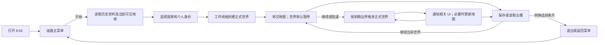
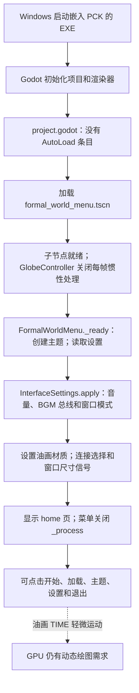
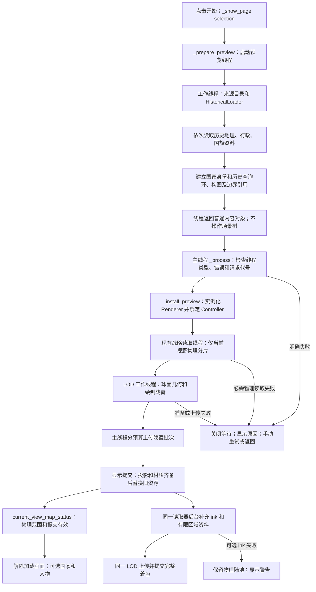
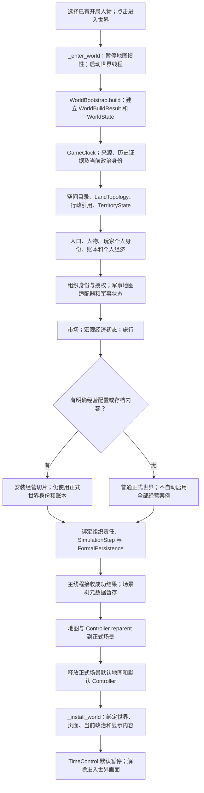
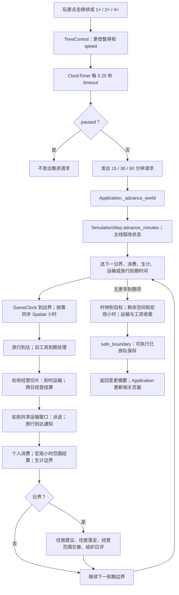
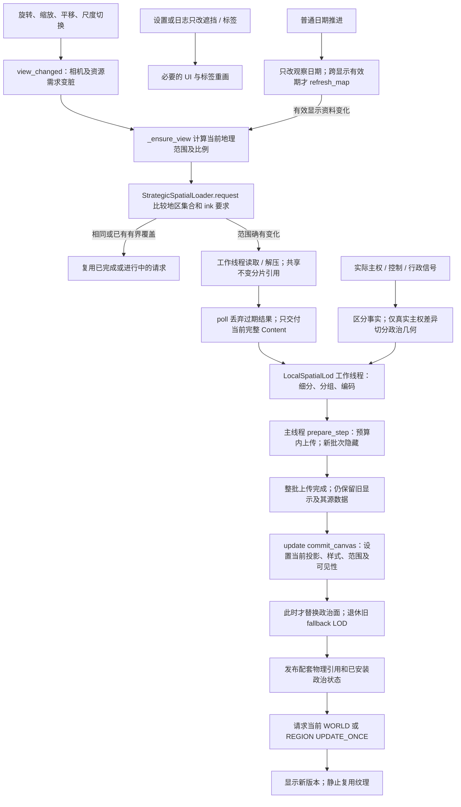
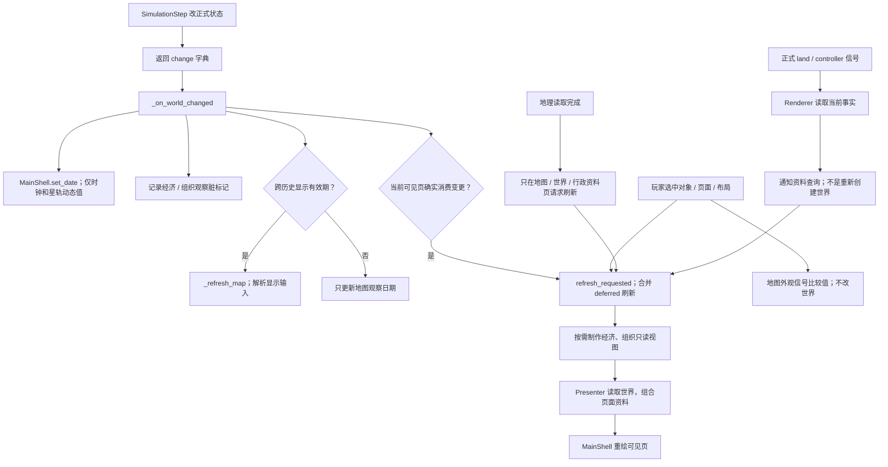
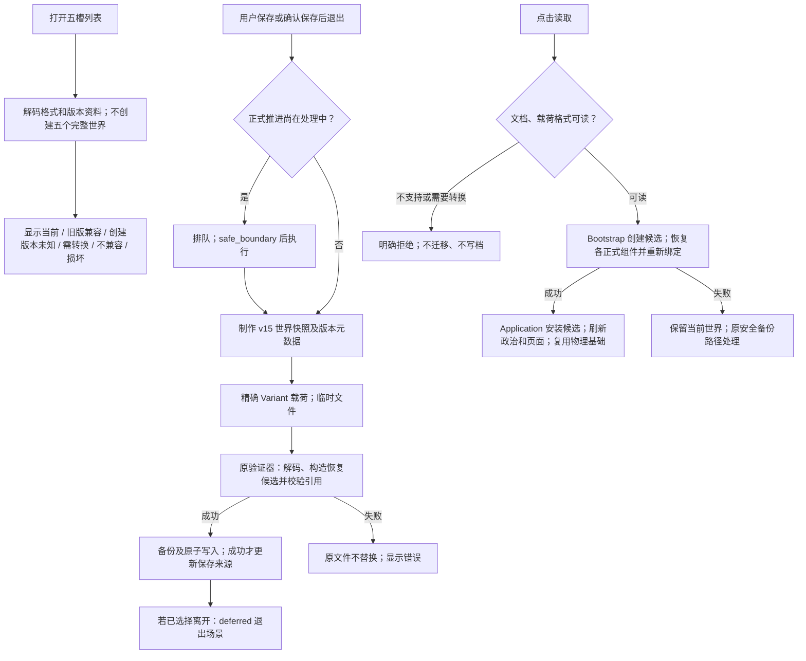
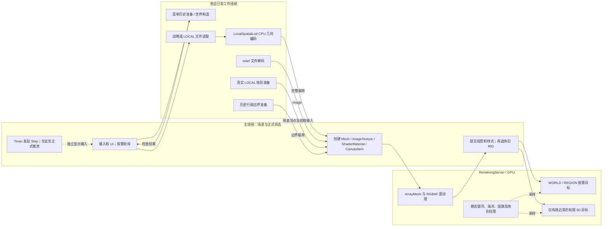

# WWO R34：游戏实际怎样运行

日期：2026-10-17。基线：本机 R33。引擎：Godot 4.6.3 Compatibility。

## 一页总览

玩家打开 EXE 后，先看到巴黎油画菜单。此时没有创建正式世界，也没有开始经济结算。点击“开始”，菜单工作线程读取历史资料和国家身份；地图再按当前视野读取物理陆地。完整自然底图提交后即可选择国家和人物，国旗着色可以随后安装。

点击“进入世界”，另一个工作线程创建正式世界。已有地图和控制器转交给正式场景，不创建第二套有效地球。世界默认暂停。点击继续或倍速，0.25 秒 Timer 才会发出推进请求；真实时间由 GameClock 保存，各领域按其到期边界结算。UI 读取结果；地图只在视角、实际政治或有效显示资料改变时准备相应内容。

保存会先制作快照、验证临时文件及恢复候选，再原子写入槽位。读档先恢复候选世界，成功才替换当前世界。退出时停止推进、离开场景、取消并收尾后台地图任务、释放绘制 RID。下面的箭头都对应当前入口，不把仓库中的研究代码画成常驻系统。

图例：实线是调用或必须等待；虚线是读取共享数据。标有“工作线程”的任务可以与主线程 UI 并行；图中顺序不意味着两个领域自行并发。修改世界的节点写“改状态”；显示、查询不写入世界。本文是源码调用说明，没有启动 R34 游戏、复现画面或测量资源。

## 图一：EXE 到主菜单

- 以上初始化在主线程。MAP_SCENE 的预加载引用不等于已经实例化完整地图。首页 `_renderer` 仍为空；点击开始才进入地图准备。
- 没有正式 GameClock、SimulationStep 或经济世界在首页结算。音频路径只确认应用设置和 BGM 总线静音；当前正式场景未挂一个自动播放音乐的 AudioStreamPlayer，不把声音设置画成后台模拟。
- 油画、字体、主题、Controller 和设置随菜单场景存活。主菜单没有“等待第一帧绘制才允许点击”的阻塞。
- 60 FPS 上限、VSync=1、低处理器模式及 6900 微秒休眠已存在，R34 未改。存在 `TIME` 材质的画面仍可能持续需要绘制，不等于无限帧率。

代码：[formal_world_menu.gd:59 · func _ready](D:/programs/WWO/wwo/scripts/formal/formal_world_menu.gd:59)；[globe_controller.gd:48 · func _ready](D:/programs/WWO/wwo/scripts/presentation/map/globe_controller.gd:48)；[interface_settings.gd:34 · static func apply](D:/programs/WWO/wwo/scripts/presentation/ui/interface_settings.gd:34)；`project.godot:11`、`scenes/formal/formal_world_menu.tscn`。

## 图二：主菜单到国家与身份选择

历史资料先提供身份、国旗构图和输入对象，物理分片才由 Renderer 当前视野提出。两者不是互相等待的线程。首次物理准备不需要 ink；政治升级需要对应物理覆盖先存在。文件读取线程和 LOD 准备线程属于不同阶段，主线程在此期间继续处理 UI，不能把它们称为所有计算同时并行。

工作线程通过返回对象、请求代号和 Mutex 下的阶段文字与主线程通信。主线程每帧只在任务存在时轮询 `is_alive()`；只在线程结束后 `wait_to_finish()`，不是紧循环忙等待。安装阶段无无限 `frame_post_draw` 等待。15 秒文字仍是原有“仍在处理”提示，不作为成功、失败或强制杀线程条件；R34 没有延长它。

首屏不等待全球 456 片、354 份 ink、LOCAL、古迹或经济结算。`ready`/`available_lods` 表示上传资格；物理引用和 `political_cells_installed()` 在显示提交后发布。当前地图状态还检查视野覆盖、LOD、画布脏标记及 REGION 是否就绪，不能只看线程结束。

代码：[formal_world_menu.gd:79 · func _prepare_preview](D:/programs/WWO/wwo/scripts/formal/formal_world_menu.gd:79)、[formal_world_menu.gd:114 · func _read_preview](D:/programs/WWO/wwo/scripts/formal/formal_world_menu.gd:114)、[formal_world_menu.gd:212 · func _install_preview](D:/programs/WWO/wwo/scripts/formal/formal_world_menu.gd:212)、[formal_world_menu.gd:597 · func _process](D:/programs/WWO/wwo/scripts/formal/formal_world_menu.gd:597)；[globe_renderer.gd:233 · static func prepare_source_geometry](D:/programs/WWO/wwo/scripts/presentation/map/globe_renderer.gd:233)；[strategic_spatial_loader.gd:22 · func request](D:/programs/WWO/wwo/scripts/content/strategic_spatial_loader.gd:22)、[strategic_spatial_loader.gd:137 · func poll](D:/programs/WWO/wwo/scripts/content/strategic_spatial_loader.gd:137)；[local_spatial_lod.gd:7 · static func prepare](D:/programs/WWO/wwo/scripts/presentation/map/local_spatial_lod.gd:7)、[local_spatial_layer.gd:366 · func _prepare_step](D:/programs/WWO/wwo/scripts/presentation/map/local_spatial_layer.gd:366)、[local_spatial_layer.gd:569 · func update](D:/programs/WWO/wwo/scripts/presentation/map/local_spatial_layer.gd:569)；[globe_renderer.gd:1561 · func current_view_map_status](D:/programs/WWO/wwo/scripts/presentation/map/globe_renderer.gd:1561)。

## 图三：进入正式世界

这里按 `build()` 的实际先后列出，并非空间、人物和经济各自启动一个线程。普通菜单的新世界 `native_settings` 默认空；只有已有命令行授权的经营配置，或读档包含经营快照，才有 `EconomyR1Slice`。直接正式场景入口还有旧命令行分支，不能把它误写成普通菜单默认路径。

| 对象 | 谁创建、谁持有 | 谁释放或替换 |
|---|---|---|
| 正式状态组件 | Bootstrap 创建；WorldState 持有；Application 持有当前 WorldState | 成功读档换成候选；场景离开后引用释放，不重置磁盘存档 |
| 世界构造线程与结果 | Menu 创建线程，WorldBuildResult 暂存结果 | 主线程取结果并清空线程；场景树元数据消费后移除 |
| Renderer 与 Controller | 国家选择页创建；通过元数据和 reparent 转交 | 正式场景先 free 默认对象；接收同一有效对象；退出时 Renderer.dispose 各资源 |
| HistoricalLoader | 菜单准备；随后转交 Application | 随场景和已交接引用生命周期结束 |
| SimulationStep、Persistence | Bootstrap 或恢复候选创建；Application 持有 | 换世界或退出场景后释放；Persistence 对 Step 使用弱引用 |
| TimeControl 与 MainShell | 正式 tscn 子节点 | 随正式场景退出；Timer 一并停止 |

Renderer 转交采用 `preserve_on_reparent`，其 `_exit_tree()` 在转交期间不 dispose。不是复制两套地图。正式场景 `_assemble_world()` 仅等待一次 `process_frame` 后安装；不等待绘图信号。任何常规地图旋转不会重新创建世界。

代码：[formal_world_menu.gd:558 · func _enter_world](D:/programs/WWO/wwo/scripts/formal/formal_world_menu.gd:558)、[formal_world_menu.gd:583 · func _build_world](D:/programs/WWO/wwo/scripts/formal/formal_world_menu.gd:583)、[formal_world_menu.gd:698 · func _finish_world_launch](D:/programs/WWO/wwo/scripts/formal/formal_world_menu.gd:698)；[world_bootstrap.gd:23 · func build](D:/programs/WWO/wwo/scripts/content/world_bootstrap.gd:23)；[formal_world_application.gd:34 · func _enter_tree](D:/programs/WWO/wwo/scripts/formal/formal_world_application.gd:34)、[formal_world_application.gd:53 · func _ready](D:/programs/WWO/wwo/scripts/formal/formal_world_application.gd:53)、[formal_world_application.gd:77 · func _assemble_world](D:/programs/WWO/wwo/scripts/formal/formal_world_application.gd:77)、[formal_world_application.gd:125 · func _install_world](D:/programs/WWO/wwo/scripts/formal/formal_world_application.gd:125)；[globe_renderer.gd:181 · func _exit_tree](D:/programs/WWO/wwo/scripts/presentation/map/globe_renderer.gd:181)；[world_state.gd:1 · class_name WorldState](D:/programs/WWO/wwo/scripts/world/world_state.gd:1)。

## 图四：时间推进的真实顺序

这不是“TimeControl 直接先运行 GameClock，再随意调用领域”。**SimulationStep 控制时钟推进和边界顺序**。上述到期处理在同一主线程顺序执行，不与地图工作线程共同写领域状态。

### 经营切片仅在实际启用时运行

该小图是 `EconomyR1Slice.settle_day()` 的顺序分组，不声称每个可选服务在每份配置都有非空工作。库存、工资、生产、价格、运输各有正式状态；不由地图颜色生成。本轮不改这些数学或调度。

宏观 `settle_hour_range()` 遍历已跨越小时，只在 24 小时边界做日结：先到货，再各经济聚合单位结算、安排短缺运输和记录有界历史。人口是正式输入及当前住居/活动责任状态，不存在一个由本 `SimulationStep` 每帧启动的全球出生、死亡、家庭全量重算。人物旅行、消费及住居落定有上述真实入口。

军事地图适配器、军事状态和服务在 Bootstrap 创建，存档也保存军事状态。**当前 SimulationStep 不调用军事 `advance_to_hour()`；Application 也没有军事行动调度入口。** 军事服务和独立案例的完整算法不能据文件存在就画成已接入正式自动推进。主权、控制不由普通日历自动编造变化；只有已有显式领域接口改变事实才发信号。

代码：`scenes/formal/formal_world_main.tscn:70`；[time_control.gd:11 · func tick](D:/programs/WWO/wwo/scripts/actions/time_control.gd:11)；[formal_world_application.gd:167 · func _advance_world](D:/programs/WWO/wwo/scripts/formal/formal_world_application.gd:167)；[simulation_step.gd:32 · func advance_minutes](D:/programs/WWO/wwo/scripts/simulation/simulation_step.gd:32)、[simulation_step.gd:40 · func _advance_minutes](D:/programs/WWO/wwo/scripts/simulation/simulation_step.gd:40)；[game_clock.gd:22 · func advance_minutes](D:/programs/WWO/wwo/scripts/simulation/game_clock.gd:22)；[formal_world_economy_simulation.gd:31 · func settle_hour_range](D:/programs/WWO/wwo/scripts/simulation/formal_world_economy_simulation.gd:31)、[formal_world_economy_simulation.gd:163 · func _settle_day](D:/programs/WWO/wwo/scripts/simulation/formal_world_economy_simulation.gd:163)；[economy_r1_slice.gd:583 · func advance_time](D:/programs/WWO/wwo/scripts/world/economy_r1_slice.gd:583)、[economy_r1_slice.gd:1378 · func settle_day](D:/programs/WWO/wwo/scripts/world/economy_r1_slice.gd:1378)；[world_bootstrap.gd:408 · func _configure_military_composition](D:/programs/WWO/wwo/scripts/content/world_bootstrap.gd:408)；[spatial_world.gd:524 · func advance_to_hour](D:/programs/WWO/wwo/scripts/vnext/spatial/spatial_world.gd:524)。

## 图五：地图请求、上传与显示交接

R34 修正处位于 `ELIGIBLE → DRAW → RETIRE`。此前上传结束就 free 旧批次，而新批次还要等 `update()` 提交；存在“旧的已退出、新的仍隐藏”的命令状态。现在旧 RID 的释放在新批次参数和可见性之后。没有额外地球或遮罩，也未把 GPU 上传结束说成 GPU 已经画完一帧。

读取线程此前还把 `retired.cancelled` 设为 true，并清空其 features/shards/line_chunks。旧显示层仍持有这个对象，另一个 LOD 线程也可能读它。R34 改为只读复用其 shard 引用；替换后旧输入自然离场。物理、政治、海岸仍用原数据源，原请求代号和取消规则保留。

| 实际触发 | 读取物理 / CPU 几何 | 政治与 GPU | 旧资源及 SubViewport |
|---|---|---|---|
| WORLD 旋转、缩放 | 重新比较地理需求；同集合不读文件；超出覆盖或换 LOD 才准备 | 原批次更新投影；新需求后台准备 | 保留有效旧几何；新批次提交后退出；目标 UPDATE_ONCE |
| REGION 平移、旋转、缩放 | 相同规则；共享原球面源，使用区域投影 | 只改区域相机参数；按需新 LOD | 不复制另一份全球物理数据库 |
| WORLD ↔ REGION | 可能准备区域样式及相应 LOD | 同一战略层批次换画布和投影 | 0.22 秒转换用已有画面；LOCAL 按独立准入 |
| REGION ↔ LOCAL / 地标准入 | 有覆盖及足够比例才读本地描述、DEM、模型 | RegionView 原有限 3D 目标、共享建筑批次 | 离场释放目标、实例、遮罩；PackedScene 缓存上限 2 |
| 选国家、悬停、选地点 | 不改变地理事实或物理请求 | 悬停轻标记；选择改样式 / 边界重点 | 不重读海岸；必要时更新缓存画面 |
| 政治 ↔ fulfillment / shortage | 读取已有正式经济观察；不重新三角化物理图 | 改已有材质颜色；不是完整产出地图 | 只重绘需要的目标 |
| 普通小时或日期 | 不读 Natural Earth、不解 DEM | 更新时钟和观察日期；有效期资料跨界才全显示输入刷新 | 没有按小时卸载物理地球的设计入口 |
| 土地主权变化 | 受影响单元与相交分片政治准备 | 仍是原物理形状内的政治重切；当前边界配套 | 旧政治面留到完整新面提交 |
| 实际控制 / 行政事实变化 | 有单独事实信号；当前细胞描述可能改变，但不等于主权改了 | R33 保留 `sovereignty_changed` 判定；不擅自改海岸 | 行政覆盖线程、边界显示按已有条件更新；未改领域规则 |
| 地图模式、Rails、Labels | 外观信号比较实际显示状态 | 改样式 / 可见性 | 不由面板打开重新读取所有 GIS |
| 后台内容完成 | `_strategic_content_dirty`，消费当前请求 | 上传隐藏暂存，再完整提交 | 不把完成通知当相机变化 |
| GPU 上传完成 | 不再读取原始资料 | 只使批次有资格提交；R34 将资源退休移入显示提交 | 使用已有信号唤醒一次重画 |
| 日志、设置、页面布局 | 遮挡变化只需标签检查 | 外观状态未变就不重提交全图材质 | MainShell 重绘不等于全图 SubViewport 每帧更新 |
| 新世界 / 读档 | 绑定新的真实空间和政治对象 | 复用已有地理输入；当前政治按新世界刷新 | 取消旧世界行政覆盖工作；请求代号及所属世界检查保留 |

剩余矩形：逐面 RGBAF 编码为 6 texel；每面 6 个连续索引顶点，Shader 用 `VERTEX_ID/6` 与 `%6` 分别寻址面和两扇裁切角点。WORLD/REGION 读同一源顶点，国旗 sampler 独立。CPU ArrayMesh 索引目前为 `indices[i]=i`，没有发现索引与面编号相互交换的源码。Godot Compatibility 的 Mesh 命令不并入普通 2D 矩形批次，使用对应索引缓冲绘制，见[Godot 4.6 GLES3 Canvas 实现](https://github.com/godotengine/godot/blob/4.6-stable/drivers/gles3/rasterizer_canvas_gles3.cpp#L1064)及[索引绘制调用](https://github.com/godotengine/godot/blob/4.6-stable/drivers/gles3/rasterizer_canvas_gles3.cpp#L1313)。这不证明用户驱动上的每个像素正确；本轮没有随机改 Shader。

尚缺错误帧对应的分片/批次、面数据及实际投影输出，不能从五张截图描述锁定剩余矩形的唯一原因。没有把总面积检查或连续索引当作全部 GPU 验收，也没有重制 geom/ink。

代码：[globe_renderer.gd:477 · func _invalidate_projection](D:/programs/WWO/wwo/scripts/presentation/map/globe_renderer.gd:477)、[globe_renderer.gd:525 · func _ensure_view](D:/programs/WWO/wwo/scripts/presentation/map/globe_renderer.gd:525)、[globe_renderer.gd:1509 · func _sync_strategic_resources](D:/programs/WWO/wwo/scripts/presentation/map/globe_renderer.gd:1509)、[globe_renderer.gd:2185 · func _process](D:/programs/WWO/wwo/scripts/presentation/map/globe_renderer.gd:2185)、[globe_renderer.gd:2249 · func _on_spatial_display_changed](D:/programs/WWO/wwo/scripts/presentation/map/globe_renderer.gd:2249)；[strategic_spatial_loader.gd:109 · func _start](D:/programs/WWO/wwo/scripts/content/strategic_spatial_loader.gd:109)、[strategic_spatial_loader.gd:177 · static func _load](D:/programs/WWO/wwo/scripts/content/strategic_spatial_loader.gd:177)；[local_spatial_layer.gd:82 · func begin](D:/programs/WWO/wwo/scripts/presentation/map/local_spatial_layer.gd:82)、[local_spatial_layer.gd:125 · func install_political_content](D:/programs/WWO/wwo/scripts/presentation/map/local_spatial_layer.gd:125)、[local_spatial_layer.gd:194 · func _finish_political_patch](D:/programs/WWO/wwo/scripts/presentation/map/local_spatial_layer.gd:194)、[local_spatial_layer.gd:569 · func update](D:/programs/WWO/wwo/scripts/presentation/map/local_spatial_layer.gd:569)、[local_spatial_layer.gd:295 · func _trim_gpu](D:/programs/WWO/wwo/scripts/presentation/map/local_spatial_layer.gd:295)；[globe_surface_batch.gd:47 · static func encode](D:/programs/WWO/wwo/scripts/presentation/map/globe_surface_batch.gd:47)；`shaders/presentation/map/political_surface.gdshader:104`。

## 图六：世界到 UI；没有把 UI 当世界

`_on_world_changed()` 不是每帧订阅全世界快照。它在一次正式推进后执行。经济观察按天和 `_state_revision` 失效；经营人物页按实际摘要变化更新。不可见的人物/组织页不因地理完成就重建。`_request_ui_refresh()` 用一个 pending 标记合并同一动作的多条通知。

不可见页仍可能有必要的共用工作：时钟、工资/生活通知和页外 HUD 仍更新；第一次经济观察对象为空时会制作它。它们不是在后台绘制整个不可见资料页。经营切片启用时，`native_changed` 当前按“有推进分钟”返回，人物页因此可能每个 Timer tick 查询；这是可确认的宽变更通知及后续查询候选，尚未证明其中每次查询都无用，本轮没有改经营通知语义。

已发现的有界反馈：地图上传完成会请求重画；R34 显示提交后发布物理/政治版本时，还会请求下一次边界/墨层检查。下一次没有新提交就不再发布，因此有终点，不是已证实的无限循环。空闲 `prepare_step` 原本仍可重复发出收尾通知，R34 加入无任务返回，消除该确定重复。

未发现 `Presenter.refresh_ui → 改世界 → 再 refresh_ui` 的正式闭环。Presenter 只读，人物账务展示不执行工资结算。地图资料、政治选择、地理位置和玩家身份保持分开。

代码：[formal_world_application.gd:171 · func _on_world_changed](D:/programs/WWO/wwo/scripts/formal/formal_world_application.gd:171)、[formal_world_application.gd:232 · func _request_ui_refresh](D:/programs/WWO/wwo/scripts/formal/formal_world_application.gd:232)、[formal_world_application.gd:239 · func _refresh_ui](D:/programs/WWO/wwo/scripts/formal/formal_world_application.gd:239)、[formal_world_application.gd:299 · func _prepare_ui_views](D:/programs/WWO/wwo/scripts/formal/formal_world_application.gd:299)、[formal_world_application.gd:310 · func _refresh_economic_map](D:/programs/WWO/wwo/scripts/formal/formal_world_application.gd:310)、[formal_world_application.gd:282 · func _on_place_content_ready](D:/programs/WWO/wwo/scripts/formal/formal_world_application.gd:282)；[formal_world_presenter.gd:5 · static func refresh_ui](D:/programs/WWO/wwo/scripts/presentation/formal_world_presenter.gd:5)；[main_shell.gd:170 · func set_date](D:/programs/WWO/wwo/scripts/presentation/ui/main_shell.gd:170)、[main_shell.gd:218 · func refresh](D:/programs/WWO/wwo/scripts/presentation/ui/main_shell.gd:218)、[globe_renderer.gd:496 · func _on_controller_appearance](D:/programs/WWO/wwo/scripts/presentation/map/globe_renderer.gd:496)。

## 图七：五槽、版本、保存与退出

自动槽 0 不是“每帧自动保存”。当前 Application 在“保存并退出/返回”确认中调用槽 0；手动槽 1—4 由保存界面明确选择，有覆盖确认。既有旧单文件入口仍只通过手动槽 1 查找。

外层仍 `formal_world_exact_variant_v1`，世界快照仍 `formal_world_simulation_v15`。R33 的 `save_metadata` 保留创建游戏版本、最后保存版本、两项时间、原始格式和迁移记录。R34 只把项目构建 ID/标签/顺序改为 R34。以后新世界首存为 R34；R33 创建的兼容档显示旧版可读取；继续保存不重写其创建来源。无版本旧档仍显示“旧版存档：创建版本未知”，不推测 R 编号。

较早顶层格式标为需要转换，但本版无转换器；不支持格式拒绝。元数据匹配后仍需完整候选恢复，不能据元数据断言所有旧档兼容。R34 没有接触真实五槽，也没有重做 R33 隔离实机核查。R33 的核查范围仍见原报告。

读档恢复政治、市场、空间、土地控制、军事状态、人口、人物、账本、个人经济、组织责任，以及存在时的经营和旅行状态，然后重建 Step/Persistence 的引用。不是调用模拟推进来“补齐”存档。新世界装配与一次候选恢复有合法初始化工作；验证器可能暂时持有一个完整候选世界，这是保存成本，不能随意跳过。

退出主线程设置暂停，停止惯性，deferred 切场景或 quit。Renderer 取消并 join 自己的线程、释放 RID；子 Timer 和 UI 动画随节点结束。没有用“保存后退出”删除旧档，没有改五槽布局。

代码：[formal_persistence.gd:339 · func save_to_user](D:/programs/WWO/wwo/scripts/persistence/formal_persistence.gd:339)、[formal_persistence.gd:380 · func _verify_temporary_save](D:/programs/WWO/wwo/scripts/persistence/formal_persistence.gd:380)、[formal_persistence.gd:389 · func load_from_user](D:/programs/WWO/wwo/scripts/persistence/formal_persistence.gd:389)、[formal_persistence.gd:125 · func restore_candidate](D:/programs/WWO/wwo/scripts/persistence/formal_persistence.gd:125)、[formal_persistence.gd:586 · func bind_step](D:/programs/WWO/wwo/scripts/persistence/formal_persistence.gd:586)；[formal_world_persistence_document.gd:18 · static func encode](D:/programs/WWO/wwo/scripts/formal/formal_world_persistence_document.gd:18)、[formal_world_persistence_document.gd:89 · static func decode](D:/programs/WWO/wwo/scripts/formal/formal_world_persistence_document.gd:89)；[formal_persistence.gd:488 · static func details_text](D:/programs/WWO/wwo/scripts/persistence/formal_persistence.gd:488)；[formal_world_application.gd:638 · func _load_world](D:/programs/WWO/wwo/scripts/formal/formal_world_application.gd:638)、[formal_world_application.gd:660 · func _request_departure](D:/programs/WWO/wwo/scripts/formal/formal_world_application.gd:660)、[formal_world_application.gd:704 · func _finish_departure](D:/programs/WWO/wwo/scripts/formal/formal_world_application.gd:704)。

## 图八：主线程、后台和 GPU；谁持有数据

工作线程不能直接 add_child 或创建地图可见 RID。普通图形资源在主线程安装，由 RenderingServer 消费；不能把一次 `ImageTexture` 创建称为 GPU 已完成呈现。模型用 ResourceLoader 现有异步请求，只有 LOADED 才取 PackedScene 并实例化。

| 资源 | 正式持有者及必要用途 | 退出条件与仍有成本 |
|---|---|---|
| 历史政治原环、构图和边界 | HistoricalLoader/MapGeometryContent 与 Renderer 源引用；国家查询、国旗 UV 和边界 | 转交复用；不再持有历史全局显示三角形；Renderer/内容结束后释放 |
| 当前战略源数据 | Loader 当前 Content、Layer 当前 Content；不变 shard 共用引用 | R34 不在读取线程破坏旧对象；后继接管后旧引用退出，允许短暂新旧源共存 |
| 工作线程 CPU 临时几何 | LocalSpatialLod 栈上 faces、分组、PackedArray | 编码后移除 faces，上传逐批 erase payload，整批上传后清 chunks；保留至显示提交的只有现有 CPU 完成记录和特征 ID |
| 当前 GPU 表面和岸线 | LocalSpatialLayer 的批次持有 geometry、Mesh、ImageTexture、Material 与 CanvasItem RID | 政治完整提交或 LOD 完整交接后 free_rid 旧 item，移除字典释放其引用；离场 dispose |
| relief | MapRelief 纹理与资产描述；全球粗/中及一个有效本地窗口 | 超出需求释放；一个替换窗口可短暂并存；dispose join 工作线程并清纹理 |
| WORLD / REGION | 原地图 Renderer 与 RegionView 的缓存视口 | UPDATE_ONCE 后停更；转交同一 Renderer；离场释放，未新增大型视口 |
| LOCAL 地形与拾取 | RegionView 表面 Mesh、真实地面/水面射线数组、索引、遮罩 | 离场 release_landmarks/_release_surface_geometry 清引用；拾取数组有消费者，未因减少行数而删 |
| 古迹与共享建筑 | ResourceLoader、RegionView 实例和 MultiMesh | 出视野释放实例；最多两个近期 PackedScene；原许可限制保留 |
| 正式世界与只读页面 | Application/WorldState 与当前 UI 观察对象 | 按修订更新，离场释放；经营和旅行回指 WorldState 已使用 WeakRef，不重复改成“新增修复” |
| 存档候选及 Base64/Variant | Persistence 保存/读取调用中的局部对象 | 操作结束释放；保留合法验证，不冒充空闲地图资源 |

一个 2048 面批次按当前编码有 256×48 个 RGBAF texel，即 196,608 字节面数据；CPU 顶点数组 98,304 字节、索引数组 49,152 字节。三者是载荷理论量，不是实测进程内存或显存；还没计源多边形、细分临时字典、驱动分配、纹理和多批次。不能据“小 GLB”断言整套显示成本低。

代码：[globe_surface_batch.gd:47 · static func encode](D:/programs/WWO/wwo/scripts/presentation/map/globe_surface_batch.gd:47)、[globe_surface_batch.gd:114 · func upload](D:/programs/WWO/wwo/scripts/presentation/map/globe_surface_batch.gd:114)；[local_spatial_layer.gd:334 · func release_gpu](D:/programs/WWO/wwo/scripts/presentation/map/local_spatial_layer.gd:334)、[local_spatial_layer.gd:751 · func clear](D:/programs/WWO/wwo/scripts/presentation/map/local_spatial_layer.gd:751)；[map_relief.gd:91 · func poll](D:/programs/WWO/wwo/scripts/presentation/map/map_relief.gd:91)；[region_view.gd:288 · func prepare_landmarks](D:/programs/WWO/wwo/scripts/presentation/map/region_view.gd:288)、[region_view.gd:1020 · func release_landmarks](D:/programs/WWO/wwo/scripts/presentation/map/region_view.gd:1020)、[region_view.gd:1050 · func _release_surface_geometry](D:/programs/WWO/wwo/scripts/presentation/map/region_view.gd:1050)；[globe_renderer.gd:181 · func _exit_tree](D:/programs/WWO/wwo/scripts/presentation/map/globe_renderer.gd:181)。

## 主要模块关系表

同名行在下面两表对应；合起来说明启动、调用、依赖、并行、频率、输入、写入、资源和停止条件。未列出的仓库文件不能据此自动视为常驻。

### 调用与执行

| 模块（中文职责） | 何时、频率 | 谁触发；必须依赖 | 与谁并行 | 执行位置 | 状态及代码 |
|---|---|---|---|---|---|
| 主菜单 | 启动；交互；有任务才 _process | 主场景；设置和主题先可用 | 预览/世界工作线程 | 主线程 | 正式启动；[formal_world_menu.gd:59 · func _ready](D:/programs/WWO/wwo/scripts/formal/formal_world_menu.gd:59)、[formal_world_menu.gd:597 · func _process](D:/programs/WWO/wwo/scripts/formal/formal_world_menu.gd:597) |
| 界面设置 | 菜单/Shell ready 及明确操作 | 设置文件；DisplayServer/AudioServer | 无后台计算 | 主线程 | 正式按需；[interface_settings.gd:34 · static func apply](D:/programs/WWO/wwo/scripts/presentation/ui/interface_settings.gd:34) |
| 历史内容准备 | 国家选择或缺内容的读档入口 | 来源目录；地理→行政→显示资料 | 主线程 UI | 菜单工作线程；备用直接入口可主线程同步 | 正式按需；[formal_world_menu.gd:114 · func _read_preview](D:/programs/WWO/wwo/scripts/formal/formal_world_menu.gd:114)、[world_bootstrap.gd:461 · static func prepare_presentation_content](D:/programs/WWO/wwo/scripts/content/world_bootstrap.gd:461) |
| 世界装配 | 新世界或恢复候选 | Bootstrap 的身份、空间、人口、组织、经济顺序 | 菜单 UI 和已有效地图 | 菜单世界线程；直接入口主线程 | 正式按需；[world_bootstrap.gd:23 · func build](D:/programs/WWO/wwo/scripts/content/world_bootstrap.gd:23) |
| 正式场景协调 | ready、动作、一次 Step 完成后 | 已构造 WorldState；Renderer | 地图后台读取与准备 | 主线程 | 正式世界；[formal_world_application.gd:53 · func _ready](D:/programs/WWO/wwo/scripts/formal/formal_world_application.gd:53)、[formal_world_application.gd:171 · func _on_world_changed](D:/programs/WWO/wwo/scripts/formal/formal_world_application.gd:171) |
| 时间控制和时钟 | Timer 0.25 秒；未暂停时推进 | 玩家设置→Application→Step→Clock | 地图后台线程 | 主线程 | 正式世界；[time_control.gd:11 · func tick](D:/programs/WWO/wwo/scripts/actions/time_control.gd:11)、[game_clock.gd:22 · func advance_minutes](D:/programs/WWO/wwo/scripts/simulation/game_clock.gd:22) |
| 正式结算 | 每个推进请求；分解到到期/日界 | Clock、空间、宏观、个人、组织；可选经营/旅行 | 领域内按顺序，不并行改世界 | 主线程 | 正式世界；[simulation_step.gd:40 · func _advance_minutes](D:/programs/WWO/wwo/scripts/simulation/simulation_step.gd:40) |
| 宏观经济 | 跨小时检查；日界实际结算 | 正式经济状态、人口、市场和运输 | 不与经营线程并发写入 | 主线程 | 正式世界；[formal_world_economy_simulation.gd:163 · func _settle_day](D:/programs/WWO/wwo/scripts/simulation/formal_world_economy_simulation.gd:163) |
| 经营生产和市场 | 明确配置/存档启用；到期、日界 | 正式人物、账本、组织、场所 | 与宏观在 Step 内先后执行 | 主线程 | 条件启用；[economy_r1_slice.gd:583 · func advance_time](D:/programs/WWO/wwo/scripts/world/economy_r1_slice.gd:583)、[economy_r1_slice.gd:1378 · func settle_day](D:/programs/WWO/wwo/scripts/world/economy_r1_slice.gd:1378) |
| 人物、人口、住居和旅行 | 用户动作及到期/日界 | 正式个人身份、位置、许可、账本 | 读相同状态，不另起全局模拟线程 | 主线程 | 旅行/住居条件工作；[simulation_step.gd:40 · func _advance_minutes](D:/programs/WWO/wwo/scripts/simulation/simulation_step.gd:40) |
| 组织责任 | 成功日结后的 review | 组织、政治和经济只读视图 | 不与领域状态同时修改 | 主线程 | 正式世界；[simulation_step.gd:40 · func _advance_minutes](D:/programs/WWO/wwo/scripts/simulation/simulation_step.gd:40) |
| 军事对象 | Bootstrap/读档创建 | 正式空间适配和 TerritoryState | 无正式自动时间推进 | 主线程或世界构造线程创建 | 已创建；自动军事推进未接入；[world_bootstrap.gd:408 · func _configure_military_composition](D:/programs/WWO/wwo/scripts/content/world_bootstrap.gd:408) |
| Presenter 和页面 | 可见页收到有效变更；deferred 合并 | 当前世界及所需只读视图 | 地图后台线程 | 主线程 | 正式按需；[formal_world_presenter.gd:5 · static func refresh_ui](D:/programs/WWO/wwo/scripts/presentation/formal_world_presenter.gd:5)、[formal_world_application.gd:232 · func _request_ui_refresh](D:/programs/WWO/wwo/scripts/formal/formal_world_application.gd:232) |
| 地图控制器 | 输入；惯性期间每帧 | 窗口大小和现有相机 | 资源后台准备 | 主线程 | 正式按需；[globe_controller.gd:121 · func _process](D:/programs/WWO/wwo/scripts/presentation/map/globe_controller.gd:121) |
| 地图显示协调 | dirty 时 _draw；有任务/转换才 _process | Controller、政治和有效地图输入 | 读取、LOD、relief、行政任务 | 主线程 | 正式按需；[globe_renderer.gd:2185 · func _process](D:/programs/WWO/wwo/scripts/presentation/map/globe_renderer.gd:2185)、[globe_renderer.gd:525 · func _ensure_view](D:/programs/WWO/wwo/scripts/presentation/map/globe_renderer.gd:525) |
| 分片读取和 LOD | 当前需求变化；资源未完成时 | 索引→分片；源内容→CPU 编码 | UI、relief、行政等独立任务 | 各自原工作线程；上传主线程 | 正式按需；[strategic_spatial_loader.gd:22 · func request](D:/programs/WWO/wwo/scripts/content/strategic_spatial_loader.gd:22)、[local_spatial_lod.gd:7 · static func prepare](D:/programs/WWO/wwo/scripts/presentation/map/local_spatial_lod.gd:7)、[local_spatial_layer.gd:366 · func _prepare_step](D:/programs/WWO/wwo/scripts/presentation/map/local_spatial_layer.gd:366) |
| 区域与近景显示 | 进入覆盖与比例；资源完成 | REGION、真实 DEM、合法地标引用 | DEM 与模型异步准备 | 主线程/GPU；地形工作线程 | 特定尺度；[region_view.gd:288 · func prepare_landmarks](D:/programs/WWO/wwo/scripts/presentation/map/region_view.gd:288) |
| 保存与恢复 | 明确操作；忙时等 safe_boundary | 当前快照/支持格式及领域恢复条件 | 不在推进中并发写世界 | 世界读档线程或主线程；写档主线程 | 正式五槽；[formal_persistence.gd:339 · func save_to_user](D:/programs/WWO/wwo/scripts/persistence/formal_persistence.gd:339)、[formal_persistence.gd:125 · func restore_candidate](D:/programs/WWO/wwo/scripts/persistence/formal_persistence.gd:125) |

### 输入、事实、资源与停止

| 模块 | 读取什么 | 改什么正式事实 | 主要资源 | 什么时候停止 |
|---|---|---|---|---|
| 主菜单 / 设置 | 设置、主题、输入 | 不改世界；只保存显示偏好 | 油画、字体、UI、短暂线程 | 场景离开；线程先结束/取消 |
| 历史内容准备 | 原史料和现有衍生资料 | 不修改原数据或世界政治 | 源环、行政数据、国旗和来源记录 | 准备结束；内容随场景/转交存活 |
| 世界装配 / 场景协调 | 已授权开局资料或保存快照 | 初始化/安装一个正式世界 | WorldState 各组件及引用 | 创建线程结束；世界被替换或场景退出 |
| 时间控制和时钟 | speed、paused、推进分钟 | Clock 合法累计分钟 | 小型计时状态 | 暂停不推进；场景离开 Timer 停止 |
| 正式结算 | 到期时间、当前正式状态 | 按领域规则结算，不由地图计算 | 各领域状态和有限摘要 | 本次目标分钟完成或明确失败 |
| 宏观经济 | 市场、人口责任、价格、库存和运输 | 正式需求、产量、库存、价格及到货 | 市场状态、有界历史 | 本次日界结束；退出世界 |
| 经营生产和市场 | 正式身份、合同、地点、投入、资金 | 实际劳动、生产、交易、运输等 | 经营切片、库存、账本、到期任务 | 未启用不运行；退出世界 |
| 人物 / 人口 / 旅行 | 许可、人物、住居、位置、消费安排 | 实际到达、住居和个人结算 | 当前责任和旅行记录 | 无到期任务时无对应处理；退出世界 |
| 组织责任 | 组织、政治及日结结果 | 责任评议状态 | 责任记录与只读视图 | 日评完毕；退出世界 |
| 军事对象 | 正式空间、军事快照、控制 | 本自动 Step 无军事推进写入 | 地图适配器、状态、服务 | 世界释放；独立案例不属于该入口 |
| Presenter / UI | 当前可见页事实 | 不改领域事实；发出动作请求 | 当前页面快照、字体、通知和少量 UI RID | 页面关闭不再制作其完整资料；场景退出 |
| 地图控制器 / Renderer | 相机、当前政治、显示日期 | 只改选择、相机和显示 | 有效 Mesh、材质、纹理、画布 | 静止停 _process；退出 dispose |
| 读取 / LOD / 图层 | 当前视野所需 geom/ink、已许可几何 | 不改主权、物理来源、DEM | 当前输入、暂存载荷及有效批次 | 请求过期丢弃；上传/显示完成；离场 join |
| RegionView / 地形 / 地标 | 真实高程、已定位引用 | 不产生新城镇或森林事实 | 有限 3D 目标、Camera、地表、实例、拾取数据 | 离开有效近景释放；最终 dispose |
| Persistence | 格式、来源元数据和正式快照 | 只在成功恢复时安装候选状态 | Base64/Variant、临时文件、备份、候选世界 | 操作结束；失败不覆盖原档 |

## 暂停、失焦和运行状态分类

| 情况 | 仍会工作 | 不会自行发生 |
|---|---|---|
| 首页静止 | 输入、原 TIME 油画材质、引擎事件 | 正式经济/军事结算、LOCAL 加载 |
| 世界暂停 | 0.25 秒空 Timer 回调；已有后台任务；UI 动画；若有地图惯性/转换继续到完成 | 不推进 GameClock，不产生工资/消费日结 |
| 世界静止但未暂停 | 正式 Timer 及到期领域计算、时钟 UI；必要通知 | 普通日期不应重建物理地理 |
| 窗口失焦 / 最小化 | 工程未实现自动暂停/失焦限帧分支；树逻辑、Timer 和合法后台任务不据失焦自动停 | 不能宣称最小化一定停止模拟或 GPU；实际呈现/驱动调度待实机确认 |
| 退出 / 换场景 | 取消请求、join 线程及释放资源的收尾 | 不自动导出、重制 GIS、清理旧构建或迁移存档 |

当前确实启动：正式菜单、设置和 Controller。进入选择后按需启动历史加载及地图；进入世界后才创建正式领域与 Timer。经营切片仅在配置或存档需要时启用。军事服务对象会创建，但自动推进未接入。`scripts/vnext/world_runtime.gd` 的独立容器和独立实验场景不是当前主场景调用链；军事案例也是另一入口。`tools/map/build_geographic_foundation.py` 属离线工具，本轮没有运行。GLB 导入脚本不因存在就每帧执行。不能从静态图证明原生引擎、音频驱动或外部任务没有开销。

## 源码确认的负担与本轮处理边界

1. **持续或高频**：首页 TIME 油画；活跃 Timer；推进后的钟面；UI tween、惯性、转换；有任务时的每帧完成轮询。没有项目范围 `_physics_process()` 接入该正式路径，也没有 Thread 完成前的主线程 while 忙等。正式地图本身按需 UPDATE_ONCE，不是静止持续重算所有几何。
2. **视角变化**：球面需求选择、有限读取、细分/分组/编码、主线程预算上传、边界投影、标签与精确拾取。每个 2048 面上传仍可能超过一次 2ms 预算；预算在批次之间检查，不是驱动调用的硬实时上限。
3. **时间推进**：合法消费、工资、运输、日结、组织评议和所需 UI 查询。4×在同样真实时间跨过更多边界；没有把模拟放到后台或改变精度。默认普通菜单不自动启用全部经营案例，不能把其所有文件算成常驻日结。
4. **尺度变化**：RegionView 样式/边界准备、LOCAL 地形及模型资源准入和释放。少量 GLB 会激活整个近景显示组合，不能只数三角形来排除成本。
5. **确定冗余已修**：空闲 LocalSpatialLayer 的无任务收尾；读取器对仍有效源对象的破坏；政治升级先删除旧 RID 的交接空档；显示未提交时已宣布政治安装的状态顺序。未增加新缓存、全局调度器、标记套件或探针。
6. **仍不能确定**：用户风扇唯一原因、真实帧耗时、GPU 驱动行为、所有政治矩形、真实峰值内存和场景重复进入后的驱动资源回收。旧源输入保留到接管可能延长少量/大量分片引用寿命；不变分片共享，仍有界，但峰值不能从源码报减少数字。

如果后续单独授权测量，应分别观察：无交互静止世界是否仍发出物理请求；政治提交边界是否还出现缺面；一次上传创建和驱动提交耗时；候选恢复与日结的合法耗时；两次离场后的资源是否下降。当前没有实施采样，也未新建诊断服务。
