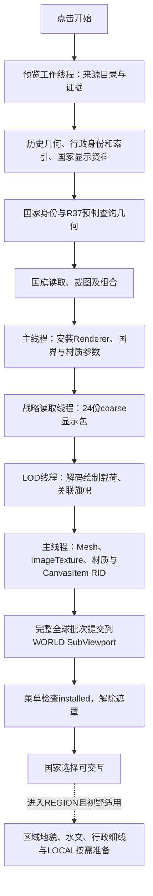

# R46后：法国制图与国家选择加载核查

日期：2026-10-18。对象：本机R46正式源码。此次只读代码、既有日志和GIS，查询公开资料；未启动游戏、采集性能、修改运行代码或地理数据，也未导出R47。

主要发现：诺让有真实曲流，同时存在两套河流轴线共同绘制的代码条件；法国北部存在两套海岸描线；R40省级去重未覆盖法国区、县的完整外环。约11秒的具体耗时分布仍缺当前运行记录。

## 1. R46状态与继承

- R46报告、地貌目录、六份新增地表包、四组水文及1905岸线衍生均存在。项目身份为R46；内部预设指向唯一R46 EXE。
- 交付文件：`D:/programs/WWO/wwo/builds/preview_2026-10-18_benelux_terrain_r46/WWO_1900_Benelux_Terrain_Delta_Surface_Reconstruction_R46_Preview.exe`，855,233,536字节，写入时间2026-10-18 19:44:24（本机UTC+8）。现有R46报告记载导出退出码0；导出日志保留两条`0.001a`数字版本格式警告。
- 两次进程检查均未发现WWO游戏、Godot、Blender或WWO地形制作进程。其他项目的Python进程未触碰。工作区已有大量未提交修改，不能据此判断它们正在施工；此次未覆盖这些修改。未发现正在写入或导出的R46任务。
- R42—R46共用`GeographyLoader.decode_relief → MapRelief → GlobeRenderer._bind_relief → 原物理陆地材质/RegionView`。R43—R46水文共用`StrategicSpatialLoader → LocalSpatialLod → LocalSpatialLayer`，没有法国之外另建的地球。
- 索引实有24份全球coarse、432份medium描述、45份可选水文描述。24份编译包均存在，清单批次相加仍为455；这是静态资源计数，不是本次运行测量。R39的`_world_layer`保留全球coarse；`_region_layer`持有有界medium，回WORLD释放后者。此次未改生命周期或相机。
- 法国仍读`data/presentation/france_surface_r42.json`及其原51份包。Copernicus现代DSM、2021树木分类及原ETOPO的职责未改变；没有新增全国法国水文包。R43以后确实修改过公共地表选择、水网替换和LOD消费代码，不能把当前实现当作R41原样未变。

## 2. 约11秒加载：口径与依赖

用户口径是点击油画首页“开始游戏”至国家选择地球完成，不包括EXE启动和首页停留。11秒是目测，尚非新精确基准。

从原始`local-artifacts/r41_performance/B2、B3、B4/events.json`的`start_clicked → political_interactive`重算，分别为7.506811、7.573566、7.388101秒，中位7.506811秒（报告四舍五入7.507）。这三个样本为后台运行；R41另一次前台BF1为6.753秒。它们可说明历史范围，不能证明R46当前增加了某个精确秒数。

这里的箭头表示前后依赖。预览线程内部各阶段串行；主线程UI可同时响应。战略读取、LOD准备和主线程上传是后续流水阶段，不等于所有工作并行。

| 实际入口 | 首屏工作及等待关系 |
|---|---|
| `FormalWorldMenu._read_preview`，114起 | `HistoricalProvenanceFoundation.load_current`后，依次准备HistoricalLoader、政治目录、身份、查询几何和国旗。不是正式经济世界初始化 |
| `HistoricalLoader.load_current`，24起 | 地理、行政、国家证据和显示文档依次读取；`_collect_display_dates`遍历相关元数据 |
| `AdministrativeLoader.load_current/load_reference_identities` | 首屏读取法国、德国等历史行政身份与索引；不在这里读完所有detail几何。此为已有首屏依赖，未来是否延迟需要保持查询契约 |
| `GlobeRenderer.prepare_source_geometry`，235起 | 首选`historical_reference_1900.display`；只对缺失条目回退`GlobeProjection.source_reference`。未确认当前有条目触发回退，不能把回退当作实测成本 |
| `HistoricalLoader.resolve_map → HistoricalVisualResolver.texture_for` | 所有适用视觉单位解析旗帜。资源加载、`get_image`、透明边裁图、复合旗帜缩放/拼接及ImageTexture创建真实存在；此调用在预览工作线程，不能把所有纹理创建都算到主线程。解析器按visual ID缓存，同一次对象不反复做相同旗帜；新一次菜单对象会重新准备部分显示对象 |
| `_install_preview → refresh` | 场景树安装、政治查询绑定、国界GPU批次等在主线程；R37预制政治分区继续复用。`_prepare_political_ink`只建样式参数，不重新生成全球政治布尔几何 |
| `_sync_strategic_resources`，1503起 | 全球未齐时向`_world_layer`请求coarse；齐备后只在REGION且≤1500米/像素请求medium。现清单455批与R41实测批数一致；未测此次安装时长 |
| `LocalSpatialLayer._prepare_step` | 主线程创建Mesh、线数据ImageTexture、ShaderMaterial与RID；现有2000微秒预算在批次间检查，不能保证单个大批次本身小于2毫秒 |
| `current_view_map_status → FormalWorldMenu._process` | 物理已安装且画布、投影不脏才返回installed，当前`political_pending`固定false，R37编译包的国家着色随全球提交。菜单没有新增固定等若干秒的成功延迟，未找到必须等法国地貌/细水文的门控 |

`WorldBootstrap.build`属于点击进入正式世界后的线程。菜单把已有Renderer/Controller转交正式场景，不能把正式世界初始化时间或EXE→首页时间算进本次11秒。

### 新地貌是否污染首屏

| 检查项 | 源码结论 |
|---|---|
| R42—R46各国家地表目录 | `_sync_relief`在WORLD传入非有限中心；`MapRelief._choose_surface`立即返回空。目录、近档`.bin`不因此逐国读取、解压或上传 |
| 全球地貌 | 原`world`纹理仍读；满足8500米/像素条件时可预热原全球`region`纹理。它与法国等国家近档目录不同，不能混称全国预加载 |
| 新水文 | 公共`data/strategic/index.json`已增至215,156字节，45个补充描述会在首次请求解析并加入描述列表。几何要求`with_ink`、已有物理安装及≤2500米/像素；Renderer首屏coarse需求不要求这些补充 |
| 来源总目录 | `historical_source_registry.json`17,050字节、`historical_fact_evidence.json`2,164,353字节；其中没有`france_r42/british_r43/german_r44/spain_r45/benelux_r46`资源键。国家地表证据在各自目录准入 |
| LOCAL | 首屏普通球体尺度超过LOCAL读取门槛。模型显示还要求REGION、屏内地点和有效尺度；没有场景预加载全部桥梁/古迹GLB的链路。WORLD放大到读取门槛附近的预热条件另论，不等于初始首屏加载 |
| coarse重复安装 | `_sync_strategic_resources`在全球已齐且不需medium时返回；新国家地表不清空全球槽。未找到每增加一个国家就重装24份coarse的路径 |
| 导出包含 | 内部预设为`all_resources`并包含`*.json`、relief `.bin`及strategic `.geom/.display`；研究、工具、日志和builds被排除。旧`political_border_display_r3.json`仍会被包含，现正式读取R39；但制作工具仍引用R3，因此保留原件，建议以后仅收窄发行包含。PCK包含不等于全部驻留 |

R41原阶段标签间隔中位：旗帜与显示资料约3.160秒，安装全球基础约3.023秒。前者还包含Renderer安装及需求建立，后者包含读取、准备、分帧上传和提交，不能分别称为纯旗帜CPU或纯磁盘耗时。

**已证实的成本**是历史/行政索引串行准备、国旗图像处理、24包及大量GPU对象安装、公共索引解析。**未证实**的是这些成本在R46各增长多少、PCK扩大会否影响当前缓存条件，以及哪一项解释目测11秒。本次不指定唯一瓶颈，也未以改遮罩、降国旗或缺块首球处理等待。

最小后续计时：经另行授权后，用R41已有隔离入口，在相同窗口、前台状态、暂停和无保存会话记录一次完整`start_clicked → political_interactive`及已有加载标签；必要时再重复两次。先比较“历史行政”“旗帜与显示”“全球安装”三个区间；只对增长区间临时区分读取完成、CPU准备完成、最后批次上传和画布提交，不增常驻探针。本次未执行。

## 3. 法国海岸：来源、LOD及直线

物理基底是Natural Earth v5.1.2固定版本的现代1:10,000,000陆地；不是10米测绘，也不是1900岸线。R27制作全局简化陆地，再取其真正boundary与瓦片相交；没有取裁切后多边形的整圈边作为海岸。

| 路径 | 当前作用 |
|---|---|
| `tools/map/build_geographic_foundation.py`，60—114附近 | `coasts = land.boundary - 世界框边`；`shore=coasts[lod].intersection(cell)`。coarse1500米、medium300米为制作简化容差，不是测量误差 |
| `data/strategic/physical_1_4.*`、`physical_2_4.*` | 覆盖法国经度两侧的全球coarse；R37 `.display`连同物理陆地持有海岸批次 |
| 对应`physical_1_4_mid_5_1/5_2`及`physical_2_4_mid_0_1/0_2` | 覆盖法国附近的medium；只有有效范围完整后接替coarse，不让两套物理陆地长期叠画 |
| `data/local/paris_northern_france_1900.json` | 另有657份`coast:sandre_*`线，来自BD TOPAGE现代低水岸参考，巴黎300公里范围，制作简化45米。它不替换R27物理陆地 |
| `LocalSpatialLod.prepare → LocalSpatialLayer.update` | 各自把战略海岸和local海岸编为线批次；没有按同一海岸身份的互斥替换。物理海岸权重固定1，local海岸随近档增强，因此可同时显示 |

对法国附近经纬窗口（6°W—10°E、41°N—51.6°N，含邻区）实际读取以上六份coarse/medium `.geom`。海岸与各自瓦片框的**线性重合长度均为0**。这不证明截图每条线都正常，但未支持“这些物理海岸是瓦片闭合矩形”的指控。R37编译沿用该路径；未发现另加一次同源coast的必需绘制。

北部BD TOPAGE与Natural Earth是不同尺度、不同岸线定义，不应同时当作同一精度的海陆边。其平行线、线在另一底图陆内/海外可由来源差异加重复显示解释；不是两个数据文件分别存在就必须删一个原件。下一阶段应统一显示所有权，保留原始资料和拾取职责。

| 地点 | 核查结论与限制 |
|---|---|
| 朗德、阿基坦、比斯开湾 | BRGM确认阿基坦有长距离近直沙岸，Capbreton—Adour多数近直。不能把长直自动判错；源级概化、港口工程与侵蚀另有年代差异 |
| 诺曼底、布列塔尼、卢瓦尔口 | 北部适用范围可叠BD TOPAGE低水线；西部/南部超巴黎300公里的海岸仍主要是Natural Earth。没有把657条全部说成覆盖全国 |
| 吉伦特口、地中海、科西嘉 | 当前自然形状服从NE现代概化；本次未取得精确1900岸线，不能逐段宣布历史正确或量化其真实偏差 |
| 法国地貌支持域/瓦片边沿 | R42 RGBA为高度、阴影、树木和地理支持权重，不生成海岸轮廓。它可能造成材质视觉差异，不能移动原陆地；截图是否有颜色硬边尚未配准确认 |

现代对照可使用[Shom/IGN Limite terre-mer说明](https://services.data.shom.fr/static/specifications/Descriptif_Contenu_ProduitExterne_Limite_terre-mer.pdf)，但其高水基准也不等于TOPAGE低水岸或1900岸线。[IGN海岸监测](https://www.ign.fr/institut/nos-domaines-dintervention/mer-littoral)说明布列塔尼、阿基坦海岸会变化；[BRGM Capbreton—Adour报告](https://infoterre.brgm.fr/rapports/RP-64723-FR.pdf)支持该段近直形态。本次没有拿不同投影截图像素推算公里误差，也没有下载/重制全国海岸。

## 4. 历史行政：省级去重不等于全部层级去重

法国省级使用TRF-GIS年度1900重建，原件`local-artifacts/trf-gis-1900/DEPARTEMENTS_1900.zip`，原CRS RGF93/Lambert-93 EPSG:2154。游戏存相对原点(648000,6862000)米；`LandTopology.to_geographic`逆投影后转球面，不是随相机做屏幕像素配准。[作者项目说明](https://victorgay.netlify.app/project/trf_gis/)明确提供1870—1940逐年数据；年度选择不能证明1900-01-01逐米精度。

原多边形在`data/world_map/historical/france_departments_1900/dep_*_detail.json`；R40单独的`data/presentation/admin_display_r40/france_*_{coarse,detail}.json`只提供绘制线。原多边形继续负责身份、选择和查询。

R39国家线读`political_border_display_r39.json`，以R27实际政治填色分区共享边为依据；不是由TRF-GIS省外缘推断主权。R40对87省移除目录总外缘、按既有政治显示包络相交并逐条扣除已用线；coarse再简化1500米、再次裁包络，detail不再简化。裁切会新增交点/端点，简化会跨过原弯折；不是“所有显示线完全没变”。此次没有再次制作或移动任何线。

定点读取结果：

| 身份/原ID | 原detail与ZIP多边形 | R40显示线 |
|---|---|---|
| `france_aube` / dep10 | 拓扑相等，差面积0 | detail抽样到原边界距离0；coarse线内21点/路径抽样最大约673.5米 |
| `france_marne` / dep51 | 同上 | detail0；coarse抽样883.6米 |
| `france_seine_et_marne` / dep77 | 同上 | detail0；coarse抽样1074.6米 |
| `france_yonne` / dep89 | 同上 | 此R40单元显示线为空，其共享线已归前序单元；不是约讷身份或多边形消失 |

数值为显示衍生与其原GIS的距离，非对真实历史边界的误差。抽样也不是全线误差上界。较远档折角可以由1500米简化解释；未确认每个截图折角是否同一对象。

**明确遗漏：区、县完整外环仍参与绘制。** `france_lower_1900_index.json`指向的区县detail没有`display_lines`；没有对应R40文件时，`AdministrativeLoader.department_geometry`返回原环，`GlobeRenderer._prepare_overlay`1732—1737转而绘制整圈。`spatial_world.request_administrative_boundaries`允许多个层级同屏，且逐单位独立返回，没有在这些环间扣共享边。

诺让调查窗中，`france_arrondissement_102`与`773`的源detail外环精确共享约42,516.7米，102与512共享26,895.8米；它们都能由两个单位各描一次，并与省线再叠。区县间有些简化结果还会形成近似平行而非完全重合的线。该**代码及源几何条件已证实**；未执行实机重现来确认截图中哪一像素由它造成。

R40选中省仍使用同一组内部线，不恢复旧国家外环。LOD由`mpp<450`进入detail、已有detail在<650保持；`_install_overlay_chunk`完成后按同ID释放旧RID。缓存键包含投影基底、mpp、选择、日期、行政修订及物理coast key，未找到仅凭窗口重绘必然重用错误投影的证据。国家macro在对应overlay完整后退出的现有逻辑也保留；不把历史重复国界问题直接宣称本次复现。

下一阶段应在区县显示衍生/共享边提交处处理同级重复和父子共边，保留原多边形和查询。不同政治资料与TRF-GIS不共边、德国SVG配准不足、比利时历史行政覆盖不足仍是独立来源问题。不能用DEM、现代边界或任意吸附修正。

## 5. 诺让塞纳河：对象取证

本次选取3.1°E—3.8°E、48.3°N—48.7°N调查窗，覆盖Nogent及相邻Bassée河段。当前消息没有附带可重新定位的具体截图，所以以下是地理窗口和代码取证，不是已完成逐像素截图归因。

### 游戏实际对象

| 对象 | 源文件/原ID | 类别、年代、LOD | 最终入口 |
|---|---|---|---|
| 欧洲塞纳河 | `data/strategic/europe.json/.geom`，`river:seine`；原`ne_10m_rivers_lake_centerlines.geojson`零起算记录202 | 现代1:10M天然河流轴；版本标签2022-05-13不是观测日。coarse1500米、medium300米简化 | StrategicSpatialLoader → LocalSpatialLod → 战略层river批次 |
| 塞纳河主网络37段 | `data/local/paris_northern_france_1900.json`，`river:sandre_03C0000002000844903:lN:p0` | BD TOPAGE；源更新2025-10-09，提取2026-10-06；35米制作简化，运行再有600/120/0米三档 | LocalSpatialLoader → LocalSpatialLod → local_layer |
| 诺让短水道 | 同文件`river:sandre_03C0000002000819319:l0:p0` | 名称仍为la Seine；更新2024-09-20；范围3.497964—3.502333E、48.494115—48.497511N | 同上 |
| 东侧短水道 | 同文件`river:sandre_03C0000002000815991:l0:p0` | 名称la Seine；更新2024-09-20；范围3.726541—3.729572E、48.551114—48.551795N | 同上 |
| 约讷河4段 | 同文件`river:sandre_03C0000002000827041:l6—l9:p0` | 名称l'Yonne；更新2025-08-21。位于调查窗西南，不统称塞纳河 | 同上 |
| 省/区/县线 | dep10、51、77、89；区102、773、512、893及本窗18县 | 1900年度行政GIS；不是水文轴，即使部分沿河 | AdministrativeLoader → `_prepare_overlay` → administration批次 |
| IGN水面 | 同巴黎文件唯一`water_surface:*` | 有限巴黎地标附近现代水面 | 本调查窗交集为零；不能把这里平行蓝线解释为已安装的IGN双岸 |
| 法国R42纹理 | `france_surface_r42.json`及`.bin` | DSM高度、固定阴影、2021树木分类；无河流中心线或河岸描边通道 | MapRelief → 陆地材质；不会生成第二条蓝色线 |

本窗local实际相交43段：39段la Seine（37+1+1）、4段Yonne。主ID的37个l序号为151—163、166—169、171—179、182—184、187—188、191、193—194、196—197、199。这里列的是分段ID，不是39条独立河流。`max_mpp:200`存在于这些元数据，但当前线批次未按每个水文feature使用该阈值，主要按`MapScaleStyle.physical_weight`与LOD控制，故不能假设它们只在≤200米/像素出现。

### 曲流是否来自原数据

将原`local-artifacts/paris-local-r1/source/rivers-selected.gml`中同ID、同l序号直接与游戏线比较，统一转EPSG:2154：

| 主ID的l段 | 原坐标数 → 游戏坐标数 | 与原线Hausdorff距离 | 游戏路径长/首尾直距 |
|---|---:|---:|---:|
| 157 | 371 → 60 | 32.38米 | 1.38 |
| 160 | 128 → 20 | 35.05米 | 1.45 |
| 161 | 202 → 18 | 31.54米 | 2.82 |
| 162 | 73 → 7 | 29.79米 | 1.23 |
| 163 | 285 → 38 | 35.07米 | 1.53 |

l161（约3.429129—3.456668E、48.473388—48.494826N）的明显回环已存在于官方源线，不是瓦片随机生成。35米左右是现有近似简化结果，不是历史准确度。原GML各LineString分别处理；没有把不相接的分支硬连成一条。此次未发现本窗由多边形外缘误转河中心线的证据。

### 重复与历史差异

1. **两来源同时绘制条件已证实。** 战略`river:seine`在近档没有退出；巴黎源也会绘制。`MapScaleStyle.strategic_weight/physical_weight`在近档都为正。现有`local_chart`只在真实有限LOCAL DEM/水面覆盖内抑制背景河流，诺让没有该覆盖。R44/R46替换列表没有替换塞纳河；R46水文范围南界49.2N也不覆盖诺让。
2. 本窗NE medium与TOPAGE塞纳河union的Hausdorff距离约1697米，coarse约1752米。它比较不同概化、不同支路的线集合，**不是实测河道偏移、每点误差或固定1.7公里错位**。两套线没有精确共线长度，仍表达同一主河，足以产生可见平行、穿交或捷径外观。
3. 本窗四个TOPAGE上游ID之间精确线段重合长度均为0；没有确认其内部是同一段坐标简单复制。短支路可以有独立现实依据，不能当作旧LOD一删了之。Sandre说明旧版CoursEau对象可能重叠，当前项目还未按唯一Tronçon拓扑作显示去重，但这一一般风险不等于本窗已测出重合。
4. [VNF Beaulieu说明](https://www.vnf.fr/vnf/dossiers-actualitess/reconstruction-du-barrage-de-beaulieu-un-projet-dinteret-general/?lang=nl)确认Nogent附近存在河流、分流与Beaulieu航运水道；[公开调查报告](https://www.registre-numerique.fr/barrage-beaulieu/telechargement?rapport=2007)记载相关衍生运河及船闸1886投用。存在年代可确认，**游戏没有单独命名/配准的Beaulieu运河显示要素**，不能据此把任意平行蓝线认证为该运河。
5. [VNF在2011—2012公共答复](https://cpdp.debatpublic.fr/cpdp-petiteseinegrandgabarit/PARTICIPER/QUESTIONS_REPONSES_DETAILF62C.HTM?id=36)说明Montereau—Grande Bosse在1970年代的大型航道改造截弯取直。该下游区域的现代直线不能未经历史核对视为1900河道；也不能把这项工程自动归给Nogent每一个回环。
6. 旧河道、Beaulieu运河与现代排洪/航道的逐段身份仍需1900附近的配准地图和Tronçon属性对应。现有`bnf-seine-1895.txt`是目录检索HTML，不是已完成地理配准的河道。此次未取得可支持米级历史对照的矢量，不伪造历史变化数值。

### 下一阶段精准位置

- 塞纳河及北部海岸：在现有两层的需求/显示所有权处让有效细源接替对应粗源，保留失败回退；跨来源只消除确认相同语义，不删真实分支。相关函数为`_sync_local_resources`、`LocalSpatialLayer.update`及共享LOD水文消费。
- `max_mpp`：明确水文显示语义后，在有限批次准入/分组处使用实际阈值；不能只改元数据假定渲染已执行。
- 区县：扩展既有R40内部线处理到实际同级/上下级关系；不要重制全法国GIS或改成员。
- 1970年代改道：先完成有年代的历史河道对应，再决定历史显示选择；不得剪掉真实曲流来迎合直线印象。

## 6. 故障分类与结论

“已证实”指文件、坐标或代码条件已确认；不表示此次启动游戏复现。

| 地点与现象 | 实际来源 | 代码入口 | 根因分类 | 证据等级 | 是否建议修复 |
|---|---|---|---|---|---|
| 点击开始后约11秒 | 当前预览流水；R41原事件 | `_read_preview/_install_preview/_process` | 六：缺R46受控分段计时 | 尚未确认具体耗时 | 先最小计时，不改遮罩 |
| 国旗处理及全球批次安装 | 旗帜资源、R37/R39coarse | `texture_for/_prepare_step` | 已有确定启动成本，增量未知 | 已证实路径 | 依据计时再优化 |
| 朗德长直岸 | NE；BRGM真实沙岸说明 | R27coast → 战略层 | 一：真实地理＋三：源概化 | 已证实长直形态依据；具体截图未定位 | 不因直而裁弯 |
| 诺曼底等平行海岸 | NE＋TOPAGE低水线 | 两个LocalSpatialLayer | 五：显示所有权重复＋三：不同基准 | 已证实代码条件 | 是，细源/粗源交接 |
| 法国附近瓦片闭合边冒海岸 | 六份实际物理coast | `build_geographic_foundation` | 四：本次未发现 | 尚未确认 | 无证据不重制 |
| 省级粗折角 | TRF-GIS＋R40 1500米coarse | `department_geometry/_prepare_overlay` | 三：显示概化；裁包络另有端点 | 已证实制作规则 | 按明确对象评估，不移史料 |
| 诺让区县线变粗/重叠 | 区102/773等完整环 | `_prepare_overlay`1732起 | 五：共享边重复描绘 | 已证实源与代码条件 | 是，显示级去重 |
| 法德边界与行政外缘不合 | CShapes/R27/R39与TRF-GIS、德国SVG | macro与administration各入口 | 三：来源/配准限制 | 已证实不同依据；具体偏差未逐点测量 | 行政专项，不能用DEM吸附 |
| 诺让l161等大回环 | TOPAGE原GML同ID | `clipped_lines → LocalSpatialLod` | 一：真实现代源曲流 | 已证实 | 保留；历史形态另核 |
| 诺让两套塞纳线 | NE `river:seine`＋TOPAGE主ID | 两层river批次 | 五：跨来源同河重复显示 | 已证实代码条件与几何差异 | 是 |
| 本窗多条短蓝支路 | TOPAGE两短ID、主ID分支 | local_layer | 一/二/六：实际水路及年代待对应 | 来源存在已证实；支路历史身份尚未确认 | 不直接删除 |
| 本窗蓝线是水面岸线 | IGN有限水面不与窗相交 | RegionView水面路径 | 六：不支持该解释 | 已证实当前水面不覆盖 | 不误删水面 |
| 下游现代航道捷径 | 官方记录1970年代改道 | 现代水文输入 | 二：年代差异 | 工程史已证实；逐段游戏对应尚未确认 | 先配准历史图 |
| 法国地貌色边/投影异常 | R42材质、TRF逆Lambert | MapRelief/`to_geographic` | 六：尚缺指定画面及定位 | 尚未确认 | 不增加遮罩 |

未取得每张旧截图的相机、比例尺、选中行政ID与图层开关，因此没有把未定位像素宣布已唯一归因。没有实机新数据，不能宣布11秒、帧率、风扇或RID警告已经改善。

本次正式新增仅此报告及配套清理报告；运行源码、GIS、瓦片、模型、存档、版本身份和构建未修改。清理结果见`docs/maintenance/POST_R46_GENERATED_ARTIFACT_CLEANUP.md`。后续实际修复范围等待用户决定。
