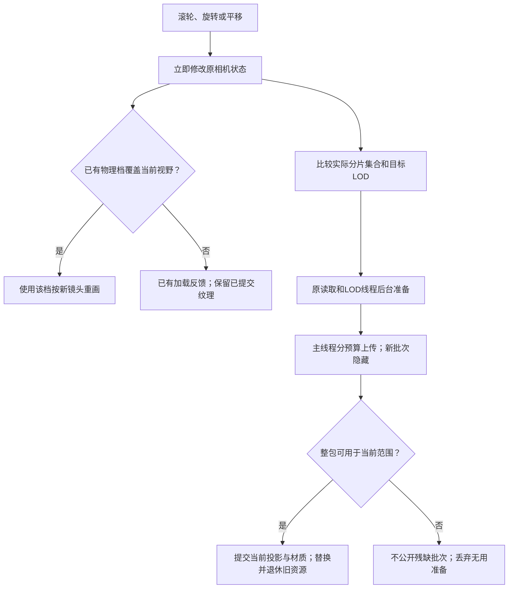

# WWO R36 — Responsive Camera and Progressive Map Loading

日期：2026-10-17。基线：本机 R35。Godot 4.6.3 Compatibility。

本轮将已安装地图的镜头重画与后继资源发布分开。保留完整范围、隐藏上传、参数先提交及旧资源后退休。没有运行游戏或测量帧率、耗时、内存。下文说明源码改动，不把导出结果当作缩放验收。

## 1. R35 为什么会出现比例已改变、画面还不动

实际输入路径是：

`GlobeRenderer._gui_input()` → `GlobeController.handle_input()` → WORLD 的 `zoom` 或 `RegionCamera.zoom_at()` → `view_changed` → Renderer 将相机、需求和画布标记为需要更新。

Controller 原本就会立即修改相机。`_ensure_camera()` 据此计算球体半径并设置既有 Camera3D；REGION 的比例存在 `km_per_pixel`。真正显示新比例，还要由 `_draw()` 更新2D地理批次的投影，并要求目标 SubViewport `UPDATE_ONCE`。

R35 在最后这一步之前检查 `_can_submit_map_view()`。`can_present_physical()` 要求已安装 LOD 等于目标 LOD，且包含目标档的全部分片 ID。粗、中分片 ID 不同。即使旧粗图覆盖相同地理位置，跨档后也会被判为不能重画。`_draw()` 随即停止两个视口更新，保留旧纹理。

此外，原 `_gui_input()` 会在等待期间拦截非滚轮操作，包括本可更新镜头的拖动；0.22秒尺度渐变未结束时也会拦截。滚轮能改变目标，但可见画面仍可能等文件、CPU准备和上传结束才变化。

**这条等待耦合已从源码确认。没有实测，不能认定它是所有卡顿的唯一来源。**

## 2. 相机重画与地图升级现在分别判断

新增两个范围明确的读取入口，仍在原 Loader 和 Layer 内：

- `StrategicSpatialLoader.physical_demand(lod)`：用当前相机的同一地理范围，选出指定档真正需要的分片 ID。粗图与中图分别按原索引选择，不靠名称推算覆盖，也不读取另一档的 geom。
- `LocalSpatialLayer.can_reproject_physical()`：检查实际已发布物理版本能否覆盖这组分片。它不要求旧档等于升级目标档。

Renderer 的 `_installed_view_lod()` 由此选择可重画的已安装档；`_prepared_view_lod()` 独立检查新包是否整批上传结束、覆盖当前视野。`_can_submit_map_view()` 允许两者中的任一有效结果。

`_update_strategic_layer()` 分别传入 `display_lod` 与 `install_physical`：前者决定这帧使用哪一档，后者只允许完整后继资源发布。`LocalSpatialLayer.update()` 用当前真实相机重新设置基底、比例、原点、方向和可见范围。没有拉伸旧截图、挪动经纬度或拿旧投影冒充新投影。

例如欧洲粗图已完整显示时，放大跨入中档，粗图只要仍覆盖当前视野，就继续按新的 REGION 比例重画；中档在原线程中准备。新中档完整并正确提交后，再替换粗图。若在途粗档本身仍能完整覆盖新视野，也允许它先完成并作为有效过渡，不必等所有更细数据。

## 3. 哪些情况仍然需要等待

旧图必须覆盖**当前视野的全部物理范围**。不是只检查鼠标所在点或画面中心；也不因为有一个旧 Mesh，就认定附近都可用。

如果旧中档覆盖放大或小范围缩小时的视野，可以继续使用。如果旧粗档覆盖 WORLD/REGION 的新视野，也可以继续使用。两者都通过原索引按相应 LOD 选择完整集合。

如果当前保留的所有有效批次都无法覆盖新地区，仍保留已有加载提示和上一张已提交纹理，等待合法完整范围。此时不按错误画面进行国家拾取；相机输入仍会更新最新需求。**首次观察完全未加载的地区，仍可能有视觉等待。** 本轮没有为此常驻另一颗全球地球，也没有让缺失分片直接暴露出来。

必要读取或安装失败继续使用原错误、取消和重试入口。没有增加加载成功计时器或无限重试。

## 4. 新资源仍须整批发布

为了让旧图能连续重画，必须防止这种重画顺便公开刚上传的零散批次。

现在批次的 `complete` 只在实际显示提交时设为真。上传结束保留原 LOD 可用信息及 CPU暂存身份，但不把新批次当作已发布。`update()` 在整包可发布的那次提交中，才允许新面可见、设置完成状态并执行原退休流程。

因此：

- 相机使用旧粗图重画时，新中档和政治暂存仍隐藏。
- 海岸、陆地和政治分区不因单批上传次序逐片公开。
- 同范围政治升级完成前，不清空正确物理图。
- `display_installed()` 也检查不存在等待提交的整档或政治暂存，不把“GPU对象已创建”直接当作“已安装”。
- 新请求到来时，`begin()` 按实际已发布物理 LOD 保留前图。即使另一档刚上传结束、尚未发布，也不会误选它并丢掉有效 fallback。
- 取消或失败只清理未发布对象，并撤销其暂存 LOD 资格；有效旧 RID 和物理查询引用保留。

R34 的只读共享源数据、参数先提交、可见性后提交及旧资源最后退休保留。R35 的父画布统一重画和提交后通知保留。没有恢复 CShapes 拼陆地，没有改变国旗 Shader、UV 或面编号。

## 5. 连续滚轮与过期工作

已有机制并非每次滚轮启动一个线程：输入改变脏标记，Renderer 比较实际需求；Loader 只保留一个读取线程和最新请求，相同或被既有窗口完整包含的需求复用。请求代号仍丢弃过期读取结果。没有新增长延迟、防抖计时器或另一套任务系统。

本轮实际减少了以下工作：

1. 当前相机范围的粗、中分片选择按需记住 ID 列表。范围不变时，显示判断不反复遍历索引和计算球面相交。换范围就清除；这不是几何或历史日期缓存。
2. 原 `_sync_strategic_resources()` 在政治安装入口返回 false 后，会再制作一次相同的国旗构图参数。现在一次制作，供两条现有入口复用。
3. 原几何准备可在镜头已离开其覆盖范围后继续上传，直到后继文件读完才被 `begin()` 取代。现在 `discard_uncovered_preparation()` 用当前范围在该准备档的必需集合检查。无法形成当前完整画面的任务取消 CPU准备，并清除其隐藏上传队列；线程仍按原规则结束后加入，不强杀线程。
4. 有用的粗档准备不会只因目标进入中档就被取消，可以先形成完整基础。镜头不必等到玩家完全停止操作才取得进展。
5. 清理未发布状态后，删去旧的空 CPU暂存遍历分支；停止操作且任务排空后，仍按原 `_has_pending_preparation()` 关闭 Renderer 的 `_process()`。

真正跨越分片或来回跨越 LOD 时，仍可能需要取消、读取和准备。没有声称消除所有解码，也没有无限保存所有历史视野。读取线程保留原共享 shard 复用；本轮没有额外常驻原始三角形副本。

## 6. WORLD / REGION / LOCAL

WORLD 和 REGION 仍用同一战略图层、球面顶点和既有投影函数。显示档可以是仍然有效的粗档，投影必须是当前镜头。

进入 REGION 不再等区域样式列表结束才改变观察尺度。区域样式尚在准备时，陆地暂用已具备的同一套国家样式；完成后切回原区域样式。它们只是样式记录，不复制第二份全球几何。绘制目标直接服从 `camera.active`，保留 R35 对 WORLD/REGION 投影目标一致的修正。

原0.22秒渐变仍只在有正确内容可画时开始。正常已有粗图覆盖时，不再等更细文件读完。新的滚轮或拖动会结束尚未完成的装饰渐变，继续处理镜头，不必等它的计时或后台升级。HUD 的输入遮挡规则仍先执行，点击设置面板不会驱动地图。

中止渐变时还会恢复完整离场纹理并主动请求原画布重画。即使只按下鼠标、还没有产生镜头变化，也不会把两张缓存留在半透明的交接状态；可用目标在下一次正常提交中显示。

LOCAL 原准入仍要求已有合法地点、范围和资料。没有在经过尺度边界时同步加载全部 DEM、建筑或古迹。原按需请求、小型视口和离场释放保留；没有虚构当地地形。若完全缺少可用地理覆盖，仍有第3节所述限制。

## 7. 主线程负担：确认与限制

文件读取和 CPU几何编码仍在原工作线程；Mesh、ImageTexture、ShaderMaterial、CanvasItem 创建仍在主线程。现有2000微秒预算在批次之间检查。**一个批次创建本身可能超过预算，源码不能给出其实际持续时间。**

现有面批次上限为2048面；没有基于猜测再缩小批次、增加数倍材质/绘制对象，或改动 `VERTEX_ID` 编码。已过期且不能覆盖当前视野的准备现在可在后继读取结束前停止，避免其继续消耗上传预算。

查到行政需求还受范围、显示层级、单位屏幕大小、选中项及粗细档条件影响。缩放可合法改变这些需求。没有粗暴把连续 mpp 取整来取消应显示的行政资料，也没有把行政或经济算法改成另一套计算。

静止视野继续复用 SubViewport 纹理，只有必要变化才 `UPDATE_ONCE`。材质仍用原参数比较，不在静止时新建 Mesh。源码没有测量到单批驱动提交、LOCAL组合或正式日结耗时，不能把风扇负担归为唯一来源。

## 8. 文件、资源与版本

正式修改：

| 文件 | 实际内容 |
|---|---|
| [strategic_spatial_loader.gd](D:/programs/WWO/wwo/scripts/content/strategic_spatial_loader.gd) | `request()`、`physical_demand(lod)`：同一地理范围按各档判断覆盖；仅缓存 ID选择 |
| [local_spatial_layer.gd](D:/programs/WWO/wwo/scripts/presentation/map/local_spatial_layer.gd) | `can_reproject_physical()`、`can_present_physical()`、`update()`：重画与发布分开；未发布清理；丢弃不覆盖的准备；保留真正已发布前图 |
| [globe_renderer.gd](D:/programs/WWO/wwo/scripts/presentation/map/globe_renderer.gd) | `_gui_input()`、`_installed_view_lod()`、`_prepared_view_lod()`、`_update_strategic_layer()`、`_evaluate_scale()`、`_sync_strategic_resources()`：相机输入、过渡档、尺度切换和原后台链路 |
| [project.godot](D:/programs/WWO/wwo/project.godot) | 构建标签 R36；ID `wwo-r36-internal`；序号36 |
| [export_presets.cfg](D:/programs/WWO/wwo/export_presets.cfg) | 仅现有 Windows 内部预览输出路径 |

新增：本报告。没有删除正式文件。GlobeController、RegionView、GlobeProjection、RegionProjection、LOD编码、Shader和源地理文件未修改；使用原接口。没有新增 Mesh格式、纹理、GLB、相机、SubViewport或全局管理器。

旧有效 GPU批次与隐藏后继只在原交接期间共存，新完整资源提交后退休前图。未增加额外长期地理资源。ID列表随相机需求替换和 Loader.release() 清除。

海洋、极地、太阳、银河、林地、主权及实际控制、历史身份、原GIS/DEM、LandTopology、模型、正式领域算法和 GameClock保留。HUD、菜单美术及黄铜半球仪未改。存档格式仍为原v15，未读取或改写用户真实五槽；新保存来源由 R36 构建配置提供。

没有 Git操作、整体回退、构建清理或 R19/R30 删除尝试。R35、R34、R33、R28、R24及正式Release保留。施工读取中未观察到所改文件有来源不明的并发写入，不据此宣称其他工作线已经停止。

## 9. 唯一预览及待确认项

目标：

`D:/programs/WWO/wwo/builds/preview_2026-10-17_responsive_camera_r36/WWO_1900_Responsive_Camera_Progressive_Map_R36_Preview.exe`

沿用 Windows Desktop Internal Landmark Preview、x86-64、嵌入PCK。正常导出结果在下方补记。没有运行游戏、回归、CPU/GPU/FPS或内存采样、哈希核验、CI、安全审计或诊断服务。

仍需用户确认：连续滚轮是否及时重画、粗到中档是否完整替换、反向滚轮及 WORLD/REGION 交接、首次未覆盖地区的等待、LOCAL进入退出、剩余矩形和弧形，以及实际主线程停顿和风扇负担。没有承诺 FPS、毫秒或内存降幅，也没有宣称历史地图异常全部消失。

### 最终正常导出记录

最终导出退出码 **0**，文件长度 **346,804,536 字节**。引擎日志为 Godot 4.6.3。正常导出日志未出现 SCRIPT ERROR、Parse Error 或 ERROR；保留原 `0.001a` 版本字符串警告。

在补全渐变中断分支后更新同一个 R36 目标文件，没有产生第二个候选 EXE。交付目录附原内部预览许可和来源说明。R35及其他要求保留的构建未覆盖，没有执行构建清理。

没有启动预览、触碰真实五槽或执行额外测试和性能测量。以上仅确认源码保存与正常导出；完成后停止，等待用户实机查看。
