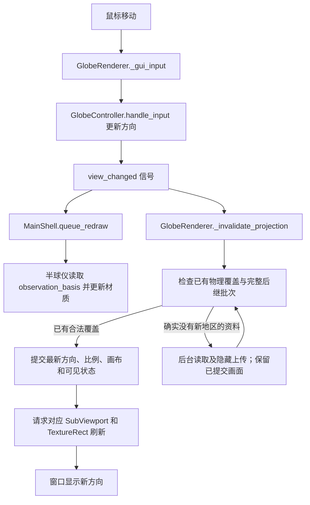

# WWO R38 — Globe Interaction and Startup Recovery

日期：2026-10-18。基线：本机 R37。引擎：Godot 4.6.3 Compatibility。

本轮修改地图刷新、粗档邻域准备、菜单准备线程和静态来源复用。未启动游戏，未操作预览，未采样性能，未访问真实五槽。导出不等于旋转和画面已经通过实机验收。

## 1. 大球和半球仪为什么不同步

两者读取同一个 `GlobeController`，没有第二份方向状态。

半球仪的 `MainShell._update_instrument()` 直接读取 `controller.observation_basis(size)`，将方向写入自己的材质。大球经过独立的物理覆盖判断，再更新地图批次和 SubViewport。

确认的冻结条件是：方向已经改变，但 `_installed_view_lod()` 和 `_prepared_view_lod()` 都不能证明新视野完整；`_draw()` 随即将两个地图视口设为 `UPDATE_DISABLED` 并返回。半球仪仍能更新，大球保留旧纹理。拖动经过新的分片边缘时，即使只缺少一片，也可能进入此分支。原来的请求范围紧贴当前球面视野，连续改变范围还会使在途读取失效。

另确认了刷新请求可能丢失的顺序：`LocalSpatialLayer.update()` 在 `_draw()` 内发布批次，发出 `display_changed`；回调设置新的脏状态并调用 `queue_redraw()`；但本次 `_draw()` 末尾又无条件清掉 `_map_canvas_dirty`。Godot 的 CanvasItem 在正在执行绘制回调时不会递归排入自己的重绘。因此安装后的第二次刷新可能等待下一次输入或其他事件。

这两条是代码条件。没有错误帧的对象记录，不能认定用户每一次冻结都只有同一个原因。

代码：`globe_controller.gd:129`、`globe_renderer.gd:503,883,1650,2258`、`main_shell.gd:140`。下文路径均相对工程根目录。

## 2. 实际刷新修改

- `GlobeRenderer._invalidate_projection()` 在方向变化时唤醒现有 `_process()`。不再只依靠后台完成回调维持更新。
- `_draw()` 保存本次提交前的 `_canvas_revision`。若安装过程中又产生失效通知，保留脏状态，并通过 deferred 调用安排下一次 `queue_redraw()`；不在自己的绘制回调中依靠递归刷新。
- `_request_map_frame()` 在所有投影、父画布、材质和可见状态提交后，再请求对应视口更新，并刷新显示该纹理的 TextureRect。
- 实际拖动、惯性或0.22秒尺度动画期间，已通过完整性判断的目标视口使用 `UPDATE_ALWAYS`。松开后惯性也结束时，恢复 `UPDATE_ONCE` 提交最后一帧，随后由引擎停止更新。没有把 WORLD 和 REGION 永久改成持续绘制。
- `_process()` 在有未提交的相机或显示变更时继续安排绘制；相机稳定、没有准备任务和动画后关闭。

没有修改黄铜半球仪、相机速度、旗帜 Shader、UV 或鼠标操作规则。

截图和窗口变化不是刷新入口的特殊条件。源码只有尺寸变化会调用 `_invalidate_projection()`，没有截屏检测，也没有针对 Computer Use 的分支。截图可能伴随其他事件或恰好发生在后台完成后，但本轮没有证据证明截图直接触发了引擎刷新。

Godot 接口依据：[CanvasItem 源码](https://github.com/godotengine/godot/blob/4.6-stable/scene/main/canvas_item.cpp)、[SubViewport 文档](https://docs.godotengine.org/en/4.6/classes/class_subviewport.html)。前者的 `_redraw_callback()` 在回调结束后才清除 pending_update。没有据此宣称驱动存在缺陷。

## 3. 不让每次跨粗档边缘都重做现有地图

仍严格按真实视野判断发布资格。没有删除 `_can_submit_map_view()`，没有把不完整陆地重新投影成完整地图。

首份完整粗档地图提交后，现有加载器开始准备视野外约15°的邻域。这个邻域不属于首屏完成条件，不读取中档地图。WORLD 后续请求保留已经访问和正在准备的粗档分片，最多是原有24份粗档，不预加载432份中档。

`LocalSpatialLayer.install_political_content()` 新增受限的粗档扩展：只有新集合包含全部已安装粗档、两者均为政治显示包且主权几何没有改变，才复用已有 GPU 批次。后台只解码新增分片；新陆地及其海岸共同隐藏上传，整批提交后才扩大已安装覆盖。已有陆地不清空、不重新上传。空水域分片没有绘制批次时，只发布其已经读完的物理覆盖。

这沿用现有政治补丁上传机制，没有第二个地图加载器或第二颗地球。数据和帧缓存失效时仍保留上一有效显示，错误仍走已有报告路径。

R37原生包将同一物理分片的海岸合批，没有保留批次的 `source_feature_id`。`LocalSpatialLod._prepared_display()` 现在从已经核对的分片ID补回 `coast:<分片ID>`，让增量选择同时包含新陆地和新海岸，不重制资产、不重复安装旧海岸。上传已结束但尚未提交的包也不能被新内容原地替换，避免用旧暂存批次认证较新的覆盖范围。

**限制仍在：**如果玩家迅速转到尚未读取、且不在已有粗档覆盖内的地区，仍需要读取该地区；此时保留旧画面，不展示缺块。本轮不能在未运行游戏的情况下保证任意大幅跳转都没有等待。邻域和已访问粗档会增加同一 LOD 内的资源保留；不是零额外内存。进入其他 LOD、地图退出或场景释放时仍按原生命周期退休，不常驻多套全球精细地图。

代码：`scripts/content/strategic_spatial_loader.gd:26`、`scripts/presentation/map/local_spatial_layer.gd:126`、`scripts/presentation/map/globe_renderer.gd:2342`。

## 4. 国家选择约8秒：实际工作与本轮处理

以默认巴黎锚点（2.33333°E、48.8667°N）、初始完整球面和现有分片相交公式计算，首屏选中17份粗档原生显示包、0份中档包：合计18,156,250字节压缩文件、206,067个面、416个绘制批次。这是对实际索引和代码公式的静态计算，不是运行采样。换初始国家或窗口/视野条件，选择结果可能不同。

首屏后的15°邻域在该条件下变成18份粗档、421个批次；新增显示文件压缩长度74,427字节。实际内存与压缩文件大小不同。

R37 的 `.display` 正在使用：`LocalSpatialLod._prepared_display()` 直接取得预制球面面数据和组件 UV；固定1900年显示不再次执行政治分组、国旗 UV 制作和球面细分。原始 `.ink.geom` 仍用于真正发生主权改变的分片。没有重新制作这456份资源。

仍然需要：历史来源核准、历史国家/行政资料读取、物理查询多边形读取、预制查询边界读取、显示包解压、Mesh/面纹理/材质和 CanvasItem 创建。416个批次的创建仍在主线程按既有预算进行；单个批次内的 Mesh/纹理创建不受批次之间的2毫秒检查打断。这是剩余阻塞候选，没有实测时间分解。

实际修改：

1. 原生显示路径不再遍历随后立即丢弃的旧 `lod_geometry` 绘制坐标。真实物理查询几何仍逐点校验；实际原生包仍检查格式、分片、LOD、来源几何路径、用途和组件 UV 标记，上传时继续检查面数据长度。非原生路径仍验证原 LOD 坐标。仍要解析原 `.geom`；没有把这部分读取说成已经消除。
2. 国家旗帜解析和纹理读取放入原有菜单准备线程，并将 `ResolvedMapContent` 交给主线程。减少安装菜单节点时的同步工作；这项移动本身不等于总读取量减少。
3. 地理组件的旗帜 frame 描述按历史显示内容复用，不在每次相机请求时重建整张字典。内容变更时替换字典对象，保留工作线程持有的旧只读引用。
4. 删除菜单安装中一次重复的 Controller 绑定；`configure()` 仍正常完成绑定。
5. 粗档扩展复用旧 GPU 批次，不因新增一片重新解码和上传已有政治地图。

没有关闭旗帜，没有降低海岸精度，没有将未准备的行政细档、LOCAL 模型或经济结算加入首屏等待。不能据此给出新的加载秒数。

## 5. 进入正式世界约3秒：复用与必要工作

`FormalWorldMenu._build_world()` 创建真实 WorldState。当前 `WorldBootstrap.build()` 仍依次配置历史政治身份、空间与土地行政、人口、人物与个人经济、生产组织、授权、军事初态、市场和正式经济初态；可选经营配置仍只在明确启用时执行。随后创建原有 SimulationStep 和 Persistence。没有删除这些工作，也没有启动菜单日结。

确认原菜单和新世界重复读取并核准同一 HistoricalProvenanceFoundation。本轮让成功加载的 HistoricalLoader 保留该静态来源对象。新世界创建可接受它；已经加载时不再次 `load_current()`。没有现成对象的入口保持原来的创建、核准和错误返回。共享的是静态来源目录，不是人口、账务、军队、主权或世界快照。

原 Renderer、Controller 和 HistoricalLoader 仍通过 SceneTree 元数据转交正式场景。`FormalWorldApplication._enter_tree()` 使用同一个 Renderer，`_install_world()` 在内容对象相同时不再 configure 几何。R33/R37 对初始主权未变时不重切政治面的处理保留。这里没有新增 Renderer、SubViewport 或跨世界的全局缓存。

正常进入还要安装正式 UI、世界引用及开局人物视角。没有运行证据确定这些步骤各占约3秒中的多少。

菜单在等待创建世界前暂时持有这一个来源目录；世界创建成功后清除菜单的交接引用，由 WorldState 继续拥有它。读档沿用原恢复核准流程，并释放可能来自先前选择页的旧来源引用，不把两份来源目录留在正式地图中。这不是无内存代价的优化，菜单阶段会保留可转交的静态目录；没有测量其运行内存。

代码：`scripts/formal/formal_world_menu.gd:590,709`、`scripts/content/world_bootstrap.gd:23,461`、`scripts/formal/formal_world_application.gd:34,77,125`。

## 6. WORLD/REGION 与静止负担

WORLD/REGION 仍使用各自正确投影及原0.22秒过渡。已安装且覆盖新视野的粗档可立即按新方向提交。目标范围缺少数据时仍等待正确内容；本轮没有永久保留第二套全球粗档来伪造无等待的 REGION→WORLD 返回。

无用户输入时，尚未结束的文件读取、LOD 准备、GPU 分预算上传、邻域准备、行政显示和 relief 读取仍可结束。完成后不因相机静止反复启动相同任务；相同或已包含需求继续复用。Loader 的请求失效代号、错误处理和完整批次退休规则保留。

拖动时主要提交相机/比例、可见状态和必要视口帧。没有按鼠标移动重新编码已安装的球面或国旗。新增邻域或真的切换 LOD 时才准备相应内容。相机稳定且任务结束后 Renderer 关闭 `_process()`，视口恢复按需。模拟暂停不代表后台读取必须中止；GameClock 和各领域正式结算未修改。

保留 project.godot 原60帧上限、VSync及低处理器模式。不能从源码判断风扇负担的唯一来源。单批 GPU 创建、初始416批安装、合法领域结算、其他程序和实际驱动行为均没有采样归因。

## 7. “返回主菜单”的实际页面

| 页面/状态 | 当前处理 |
|---|---|
| 巴黎油画首页 | 原首页；不新增返回按钮 |
| 正常地图准备 | 原 `_set_loading()` 仍创建并显示“返回主菜单”，这是此前仅删除选择页按钮后仍会看到它的来源。本轮正常态隐藏 |
| 国家/人物选择 | 保留“进入世界”，不恢复正常态返回按钮；Escape/Backspace 原导航仍在 |
| 地图准备失败 | 解除遮挡，显示具体错误、“重新准备地图”和仅此失败态的“返回首页” |
| 长时间准备 | 沿用原15秒后的恢复入口，名称改为“取消准备”；只取消请求，不终止线程。没有增加等待时长或以计时器判定成功 |
| 点击进入世界后的加载 | 沿用世界创建流程，不显示地图准备的返回按钮；世界创建失败解除遮挡并报告 |
| 正式世界系统菜单 | 保留合法“返回主菜单”，经保存/不保存/取消确认，暂停推进并 deferred 切回油画场景 |

正式退出路径为 `FormalWorldApplication._request_departure()` → `_leave_world()` → `_finish_departure()`。它清除场景转交元数据，切换到正式菜单场景；地图退出时仍释放批次、视口子节点及结束工作线程。本轮未发现足以认定“正式世界点击返回一定失败”的代码条件，也没有实际点击验证。若用户反馈指向这个入口，仍需说明所点页面、确认选项以及出现的错误，而不是删除合法退出能力。

没有修改 `MainShell` 美术和黄铜半球仪。

## 8. 保留、文件与交付

未修改 Natural Earth/CShapes/历史行政 GIS、DEM/DSM、LandTopology、主权与控制算法、R29林地、海洋极地、太阳、银河、古迹建筑及正式领域数学。R37 组件 UV 和所有原生显示资产保留。政治矩形和异常弧形没有被本轮新增 Shader 判断“修复”；是否仍出现需要实机画面。

存档快照和五槽格式不变。构建标签 `WWO R38 — Globe Interaction and Startup Recovery`，ID `wwo-r38-internal`，顺序38；R33元数据机制读取这些实际配置。不读取、不写入用户存档。

实际修改：

- `scripts/presentation/map/globe_controller.gd`：提供实际拖动/惯性状态。
- `scripts/presentation/map/globe_renderer.gd`：刷新请求保留、目标视口/消费者刷新、交互连续绘制与闲置停止、frame复用、首屏后邻域需求。
- `scripts/presentation/map/local_spatial_layer.gd`：同一粗档的增量分片和配套海岸隐藏安装，复用已有GPU资源。
- `scripts/presentation/map/local_spatial_lod.gd`：恢复原生海岸批次的分片标识，使增量筛选保留新海岸。
- `scripts/content/strategic_spatial_loader.gd`：粗档邻域/已访问分片需求复用；原生路径去掉未使用旧绘制坐标遍历；原生来源与用途检查。
- `scripts/content/historical_loader.gd`：持有已核准的静态来源对象。
- `scripts/content/world_bootstrap.gd`：可复用已有静态来源，其他入口仍按原流程加载。
- `scripts/formal/formal_world_menu.gd`：后台读取旗帜显示资料、转交结果、世界来源复用、正常态返回按钮与失败恢复。
- `project.godot`、`export_presets.cfg`：R38构建身份与独立内部预览目标。
- 新增本报告。没有删除正式文件，没有重制地理衍生数据。

唯一预览目标：

`D:\programs\WWO\wwo\builds\preview_2026-10-18_globe_interaction_r38\WWO_1900_Globe_Interaction_Startup_Recovery_R38_Preview.exe`

导出结果：已使用原 Windows Desktop Internal Landmark Preview 预设完成导出，退出码0，日志结束于 savepack 完成。最终 EXE 长度405,458,472字节；目标目录只有这一份EXE和原有九份许可/来源说明，没有独立PCK或临时预览。没有启动EXE。导出日志未出现 SCRIPT ERROR、Parse Error 或 ERROR；仍有原 `config/version=0.001a` 的Windows数值版本警告，未借此修改正式版本规则。R38存档构建身份来自本轮 build_label/build_id/build_sequence。

R37、R36和正式 `builds/windows/` 保留，本轮没有清理构建。R19/R30未处理。R35/R34/R33/R28/R24的旧预览目录已在此前按用户后续清理要求删除，不能声称它们本轮仍有完整EXE；其正式历史施工文档仍保留。

待用户确认：连续拖动和松手惯性是否连续；边界附近及快速大幅旋转是否仍等待读取；REGION返回WORLD是否正确；国家选择与进入世界的分别等待时间；正常/失败准备及正式世界返回入口；政治矩形、弧形及静止负担是否仍出现。没有运行R38，因此不声称上述画面已经验收。
