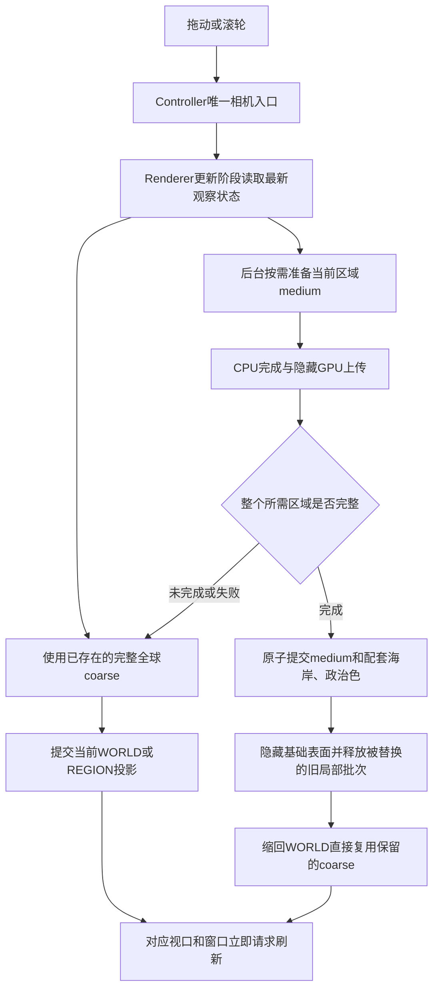

# WWO R39 — Map Runtime Architecture Repair

日期：2026-10-18。基线：本机 R38。引擎：Godot 4.6.3 Compatibility。

本轮实际修改相机写入、全球/区域资源所有权、更新与绘制阶段、历史国界来源。没有启动游戏，没有执行自动回归、性能采样或哈希计算。没有访问真实五槽或改动正式结算。

## 1. 确认了什么错误

1. 相机改变后，旧 `_can_submit_map_view()` 要求新视野的分片集合齐全。缺一片就让 `_draw()` 关闭两个地图视口。Controller 和半球仪已经更新，大球仍显示旧纹理。等待后跳变不是相机速度慢。
2. 同一个战略 Layer 同时负责 coarse 和 medium。`begin()/clear()` 与 `_trim_gpu()` 按局部替换退休旧批次，因而 medium 可使原 coarse 消失。返回 WORLD 又请求、解码、上传 coarse。
3. Renderer 的滚轮、尺度退出、定位和初始构图会直接写 Controller 或 RegionCamera。WORLD 滚轮先改变半径，再尝试强制保持旧鼠标锚点；反算接近地平线时不稳定。REGION 进入用鼠标锚点，退出通常用中心，关系也不同。
4. `_draw()` 同时发起资源需求、安装显示、发出失效通知，再用下一次绘制补救。R38的递归失效修正仍在处理这条职责交叉。
5. WORLD国界、RegionView复制的国界、区域 `country` overlay、玩家国家独立加粗批次是不同的绘制入口。旧替换判断未覆盖所有副本。
6. 旧国界来自原始CShapes共享线及其1500米/80米简化；实际填色来自已经简化、再与物理陆地相交的政治分区。两者不是同一条显示边缘。

没有认定所有故障只有一个原因，也没有把未取得的错误帧归因于驱动或截图软件。

## 2. 相机现在由谁修改

| 操作 | R38写入处 | R39入口 |
|---|---|---|
| 拖动、惯性、右键旋转 | Controller | 继续由Controller负责 |
| WORLD鼠标锚点缩放 | Controller改zoom，Renderer反写私有方向 | `GlobeController.zoom_world_at()` |
| WORLD/REGION进出 | Renderer分别写方向、zoom、区域active | `GlobeController.update_observation_mode()` |
| 区域、地点、行政区定位 | Renderer调用RegionCamera写入 | `GlobeController.focus_region()/enter_local()/leave_local()` |
| LOCAL锚点修正 | Renderer直接加origin | `GlobeController.offset_region()` |
| 菜单构图与缩放复位 | 菜单/Renderer直接赋zoom | `initialize_framing()/set_world_zoom()` |

没有新增 CameraState。原 Controller 拥有最终观察模式和方向；RegionCamera 继续保存当前区域投影的基底、origin、bearing、比例和有限范围，写入由Controller组织。停用模式的字段不是另一份有效观察方向。Renderer只读取当前模式并提交参数。0.22秒过渡仅是显示淡入，不改变观察中心。

### WORLD缩放计算

设鼠标下有效点在当前观察空间为 `p=(x,y,z)`，`z>0`。缩放后的屏幕偏移除以新半径得到 `(u,v)`。新目标使用：

`target = normalize(u, -v, z)`

Controller用从 `p` 到 `target` 的最短四元数旋转更新姿态，再归一化。不再用 `sqrt(1-u²-v²)` 强迫锚点位于新球盘，也不除以接近零的深度。比例不变时目标就是原点；接近地平线时旋转修正趋向零，锚点逐渐退让。鼠标已经在球盘外时不做锚点姿态反推，但仍可以缩放。没有限制纬度或禁止越过极点。

旧 `RegionProjection.restore_world()` 已无调用者，删除该反算入口。没有用另一组示例阈值替换它。

### 尺度进出

WORLD进入REGION以视口中心的地理点、当地比例和bearing建立区域投影。退出也使用区域中心，按当地比例恢复球面半径。退出姿态直接取 Controller 的 `observation_basis()`：这与黄铜半球仪读取的是同一个观察基底，不再另算一份退出方向。

`RegionCamera.zoom_at()` 的放大、缩小都执行有限范围约束。原来只有 `factor<1` 执行。范围约束只限制区域投影，达到退出比例后由Controller切回WORLD，不重置经纬度到零。

代码：`scripts/presentation/map/globe_controller.gd:134,159,178`，`region_camera.gd:127`。半球仪文件未修改。极点跳变的数学风险已移除；连续操作效果仍需实机确认。

## 3. 全球基础与区域细化怎样持有

只有一个现有 `StrategicSpatialLoader`。Renderer使用两个现有 `LocalSpatialLayer` 实例分别拥有两个精度层级；它们不是两套地图引擎。没有新增相机、地球场景、SubViewport或另一份地理坐标。

| 内容 | 所有者与生命周期 |
|---|---|
| 完整24份coarse及配套政治/海岸 | `_world_layer`。首次完整提交后，国家选择与转交的正式世界会话持续使用。进入REGION/LOCAL不会清掉它 |
| 当前视野medium与最多两个区域补充包 | `_region_layer`。只在所需比例、范围内读取。整组完成才能显示；范围不适用时显示正确投影的全球coarse |
| 新medium暂存与旧medium | 沿用Layer的隐藏上传、完整发布与fallback退休。不会把新分片逐片公开 |
| LOCAL地形、建筑和古迹 | 原LocalSpatialLoader、local_layer和RegionView。保持原准入与退出规则 |
| 静态旗帜、历史身份与查询 | 沿用原HistoricalLoader、PoliticalLayer和R37预制查询；不建立新全局缓存 |

`strategic_layer` 现在只是当前实际显示精度的引用，不是第三份几何。同一时刻只显示正确的一套陆地表面。medium满足当前整个视野时，先按最新投影提交medium，再隐藏coarse；coarse的GPU资源继续存在。退回WORLD先提交coarse，再清理无用medium。隐藏的基础批次同时释放区域relief采样引用，避免长期保留旧区域纹理。

`LocalSpatialLayer._trim_gpu()` 继续负责所属Layer内部的旧批次退休。由于medium不再拥有coarse，局部退休不能销毁全球基础。整个地图退出、返回首页隐藏地图或正式场景释放时，两层都正常清理；菜单转交正式世界继续使用原Renderer。

普通视角和比例变化不重读已完成的全球基础。真正主权变化分别通知两个现有层级，仍仅准备受影响的政治分片；未显示的层级可暂存完成结果，在切回时安全提交。实际控制与法理主权仍区分。

代码：`globe_renderer.gd:1440,1532`、`local_spatial_layer.gd:866`、`scripts/content/strategic_spatial_loader.gd:432`。

## 4. 为什么不必再等局部资源才能转动

新的 `_can_submit_map_view()` 只保护第一次全球基础安装，不再检查新medium是否齐全来阻止整屏。首次失败仍明确提示并走原重试/退出处理，绝不以空地球宣布成功。

`_process()` 现在按顺序轮询后台、推进有预算的上传、计算资源需求、更新观察位置、提交显示。`_commit_map_view()` 提交投影、材质、可见性和视口帧。`_draw()` 只画标签、地点、比例尺等已有显示，不发起地理读取或改变LOD。

提交前清除旧脏状态；提交回调产生的新脏状态保留给下一更新阶段。因此不再需要 `_canvas_revision` 和绘制回调内的 deferred redraw补救。行政显示完成只刷新相关显示，不重做物理几何。

尺度淡入期间只保留离开目标的旧纹理；当前目标始终可以使用全球基础更新。避免旧目标在批次移走后继续重画成海洋。取消淡入时不提前显示另一个过期画布。

静止、任务已结束且没有显示变更时关闭Renderer `_process()`；实际拖动、惯性和短动画期间保留必要视口更新，结束后恢复 `UPDATE_ONCE`。没有永久打开两个视口的持续重绘。

代码：`globe_renderer.gd:854,894,2059`。这里说明代码条件，不能据导出推断某台机器已经没有停顿。

## 5. 国界与行政线实际改了什么

### 一份国界，不再三处重建

- 删除RegionView的国界复制和独立旗帜样式字典，也删除只为这些复制服务的prepare_step、游标和preparing状态。
- 删除REGION overlay的 `country` 生产路径、`_country_overlay_paths()` 和替换完成判断。行政、当前主权和实际控制overlay保留。
- 删除独立玩家国家粗线副本。国界按政治双方和有效期分组；玩家国家强调直接修改同一批次样式。
- 一组国界RID随当前WORLD/REGION画布转移。各组件仍各自成线，没有连接不相连的岛屿或行政单元。

未确认 LocalSpatialLayer 当前正式路径会绘制审计所称的额外 `boundary` 国家线。它的实际种类主要是陆地、海岸、水系和交通，不能把候选路径写成已经发现的重复。

### 填色与国界共用显示依据

新增 `data/presentation/political_border_display_r39.json`，由原工具执行：

`python tools/map/build_political_border_display.py --from-ink`

输入是现有24份coarse `.ink.geom`、旧共享国界及其detail、CShapes快照及本机原始记录。先按历史显示参考合并既有墨层三角形，再选择实际填色边缘。没有改政治分区或物理填充。

独立简化的国家面之间存在未知细缝。仅取两个面完全相交的边，会漏掉有历史依据的边界。因此使用旧CShapes共有边确认“这两个来源相邻”，在快照声明的0.08°简化容差及四位小数舍入范围内，选择实际墨层的现存边段。按R27相同源优先顺序选择边缘。匹配范围仅用于离线对应，不参与屏幕遮挡，不移动顶点，不给未知土地分配国家。无法找到实际陆地边缘时不补连线。

新文件155,715字节，364条线、3,805个点；生成数据有225组源双方/有效期组合。运行时还会按真实显示身份合并或略去同一身份内部线，并保留原阿拉伯地区有来源的显示前沿。没有再制造一套80米detail去偏离实际填色。

对三组来源线做了局部米制近似坐标比较：旧国界与实际墨层边缘的Hausdorff距离，德比约3.444公里、德法约6.752公里、比法约8.410公里。这是对应整条显示几何的最大距离，使用50°纬度附近的平面近似；不是所有边界的固定偏差，也不是历史测绘精度。与审计中个别点3—5公里的结果不是同一个统计量。

### 资料差异仍然存在

法国行政来自TRF-GIS年度历史GIS，源为Lambert-93，资料明确不能证明1900年1月1日逐日测绘精度。德国行政来自无地理CRS的SVG：总图1871—1918，另有符腾堡1900和巴登1890。总图以11个城市控制点配准，南部以5个城镇点仿射配准。实际SVG画布992.13×917.26、含2682个path，不是经纬度测绘。Natural Earth是现代概化海岸。

这些外缘不会因为国界改成同墨层来源就自动共边。本轮没有吸附、移动或重写这些史料；R25的源投影线段采样保留。SVG/GIS自身与CShapes概化面的差异仍可能显示为国界穿过行政外缘，不能宣称所有交叉均消失。

## 6. 日期差异怎样处理

原CShapes快照是1900-03-12，世界开局是1900-01-01。比对本机原始记录的有效期后，确认不是完全同一组记录：

| 源记录 | 3月快照所用记录开始日期 |
|---|---|
| gw_522，吉布提 | 1900-01-24 |
| gw_531，厄立特里亚 | 1900-01-24 |
| gw_552，罗得西亚 | 1900-01-29 |
| gw_5518，东北罗得西亚 | 1900-01-29 |
| gw_5519，西北罗得西亚 | 1900-01-29 |

新显示文件保留快照日期、源记录真实起止日期及差异清单。对应记录尚未有效时，该参考的国旗/政治墨层不套用到开局；物理陆地保留中性。相应国界按相同有效期选择。没有把3月形状称作已核准的1月形状。

没有替这些地区重建1月几何，也没有新增或删除国家事件、行政成员或正式主权。1月原始记录存在，但尚未转换成已接入的旧日期显示分区，所以相应精确早期形状仍缺。有效期只约束资料显示，不运行战争或国家演变。普通已有效国家不会因进入1901年而一律取消旗帜：参考有效期使用源记录真实终止日期。

## 7. 资源数量、代价与删掉的旧状态

以本机index及文件长度核对：

| R37既有预制资源 | 文件数 | 压缩字节 | 原生面 | 原生批次 |
|---|---:|---:|---:|---:|
| coarse | 24 | 19,937,572 | 229,706 | 455 |
| medium全库 | 432 | 37,962,883 | 406,230 | 1,381 |
| 历史查询 | 1 | 569,174 | — | — |

456份显示包共57,900,455字节；含查询文件为58,469,629字节。medium全库不会常驻。

本轮选择现有coarse作为正式全球基础，没有另做精度较低的地球。它比旧默认巴黎17片多7片、多23,639个原生面、多39批次，显示文件压缩长度多1,781,322字节。这会增加常驻几何需求，不能说“没有内存影响”。文件长度不是运行内存或显存。

每批仍需要自己的面数据纹理、Mesh和材质。国旗Texture2D由已有ResourceLoader/PoliticalLayer共享；不能为减少批次数随意合并不同旗帜采样器。未强行压到某个Mesh数量。455批的首次GPU创建仍有成本，2毫秒预算在批次之间检查，不能中断单批创建。首屏24片也比原部分视野多，所以没有承诺7—9秒变成某个数字。

减少的实际工作：WORLD粗档不再随medium退休、返回时不重读和重传；WORLD相机转动不改变全局粗档需求；固定1900年政治几何继续使用R37预制结果；退出时清理旧区域，不累计历史medium；失效区域准备仍用已有代号取消，不能用旧上传认证新范围；国界不再复制和在区域overlay重复裁水；静态历史来源沿用R38转交复用。准备payload在上传后继续按原规则释放，必要的物理查询多边形保留。

删除或合并的旧处理：`WORLD_LOOKAHEAD_KM`、`_world_read_ahead_started`、粗档访问累积/增量补丁、`_political_install_pending`、滚轮同帧旧锚点缓存、`_canvas_revision`、绘制内deferred重绘补救、RegionView复制样式/边界及其准备状态、country overlay路径、玩家国界额外副本、无调用者的restore_world反算。

保留：单一战略读取线程、R37原生显示与UV、GlobeSurfaceBatch/GlobeBoundaryBatch、当前政治变化的局部补丁、区域/LOCAL的fallback和generation、隐藏上传与完整后退休、行政源投影采样、原错误重试和保存机制。这些承担不同职责，不因名字带pending/ready而删除。

## 8. 文件、预览与未确认事项

修改：

- `scripts/presentation/map/globe_controller.gd`
- `scripts/presentation/map/region_camera.gd`
- `scripts/presentation/map/region_projection.gd`
- `scripts/presentation/map/globe_renderer.gd`
- `scripts/presentation/map/local_spatial_layer.gd`
- `scripts/presentation/map/region_view.gd`
- `scripts/content/strategic_spatial_loader.gd`
- `scripts/content/geography_loader.gd`
- `scripts/formal/formal_world_menu.gd`
- `tools/map/build_political_border_display.py`
- `project.godot`、`export_presets.cfg`

新增：本报告及 `data/presentation/political_border_display_r39.json`。没有删除正式文件。原R3国界、detail和原始GIS保留作来源与可再生成资料，正式Renderer不再将它们作为独立的第二国界绘制路径。

构建标签 `WWO R39 — Map Runtime Architecture Repair`，ID `wwo-r39-internal`，顺序39。存档格式未变，真实五槽未读写。黄铜半球仪、HUD、海洋极地、太阳、银河、林地、模型和正式模拟算法未修改。

唯一预览：

`D:\programs\WWO\wwo\builds\preview_2026-10-18_map_runtime_r39\WWO_1900_Map_Runtime_Architecture_Repair_R39_Preview.exe`

导出完成，退出码0。EXE为405,611,680字节。导出日志未出现脚本解析错误；原有Windows数字版本字段 `0.001a` 仍产生格式警告，R39构建ID、标签和顺序已写入项目配置。许可与来源旁文件沿用R38。保留R38，不覆盖正式 `builds/windows/`。未清理构建，也未处理受限制的R19/R30。

待用户实机确认：欧洲/美洲往返拖动、球面边缘滚轮、德国/比利时多次进出REGION、淡入期间继续操作、国旗矩形和弧形是否还出现、行政线可读性、两段实际启动时间以及正常退出。没有运行证据证明全部矩形、所有卡顿或风扇负担已经消失。LOCAL拾取、单批GPU创建和合法世界初始化仍可能有成本；本轮不凭源码给出耗时比例或唯一风扇原因。
