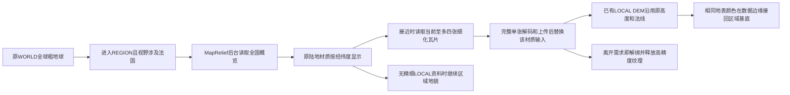

# WWO R42 — France Terrain and Surface Reconstruction

法国本土和科西嘉新增连续REGION地貌材质：真实DSM地势、固定山体阴影、中性高程色阶和2021树木覆盖参考。资源已接入正式地图的原物理陆地批次，不是独立展示场景。没有新增建筑、第二套陆地Mesh或相机。

本轮没有启动游戏或测量性能。下文的“已接入”指正式代码和资源交付；最终图像、拼接观感和操作流畅度仍待用户实机确认。

## 资料与实际精度

| 输入 | 年代、坐标及类型 | 本轮使用方式 | 限制 |
|---|---|---|---|
| Copernicus GLO-90公开COG | 主体2011—2015，可能含更早填补；DSM；EPSG:4326 / WGS84-G1150，正高EGM2008 / EPSG:3855 | 纬向原3角秒，先提取6角秒平均值，按实际仿射变换配准为1/512度显示格网 | 含植被/建筑，不是DTM；采样不等于测量精度；不是1900年地面 |
| ESA WorldCover v200 | 2021全年，EPSG:4326，原约10米分类 | 16倍分类概览的值10二值提取，再面积平均为树木覆盖显示参考 | 含人工林和树木种植园；不是林冠百分比、历史森林、木材产量或军事隐蔽 |
| 原ETOPO 2022 | 原60角秒；既有WORLD 1024×512、REGION 4096×2048 | 保留全球远景和法国新资料之外的基底 | 旧REGION约9.8公里纬向格网，不作为精细山坡 |
| 原巴黎IGN RGE ALTI窗口 | 当前服务参考，原产品标称1米；API资料不保证该窗口原始调查精度；IGN69 | 保留63×63、约33×50米的游戏显示格网 | 仍是有限窗口，不延伸为全巴黎或全法国LOCAL |

本轮采用新的法国连续高程来源。原始资料和研究提取文件留在 `local-artifacts/france-surface-r42/`；运行包不包含GeoTIFF、Python或GIS环境。完整来源、许可、署名与生成方法见[地表来源说明](../../assets/maps/relief/FRANCE_R42_SOURCE_AND_USAGE.md)。

非树木类及无效分类像素不增加树木色面，继续显示中性地貌；这不产生“零森林”事实。1900年法国全国林地调查仍未取得，本轮没有创建历史林业权威层。

## 法国覆盖清单

“连续”是区域级材质覆盖。概览约1.74公里纬向采样；细化约217米纬向、约137—165米经向采样，不代表拥有同等精度的实测裸地或LOCAL三维地形。

| 地区 | DEM来源 | 地形贴图 | 林地资料 | REGION覆盖及可表达地貌 | LOCAL精度 |
|---|---|---|---|---|---|
| 巴黎盆地、法国北部 | GLO-90 DSM | 概览＋按需细化 | 2021树木类参考 | 已生成并接入；低地、浅河谷、邻近丘陵 | 原埃菲尔附近IGN有限窗口；其余保留区域参考 |
| 诺曼底／布列塔尼 | 同上 | 同上 | 同上 | 已生成并接入；半岛、丘陵及海岸相邻地势 | 未新增精细DEM Mesh |
| 卢瓦尔与法国西部 | 同上 | 同上 | 同上 | 已生成并接入；流域、低地和高地过渡 | 未新增精细DEM Mesh |
| 阿基坦 | 同上 | 同上 | 同上 | 已生成并接入；盆地、河谷与实际树木分类差异 | 未新增精细DEM Mesh |
| 中央高原 | 同上 | 同上 | 同上 | 已生成并接入；连续高原起伏、山脊和切割河谷 | 继续显示区域材质；没有复制山峰GLB |
| 罗讷河谷 | 同上 | 同上 | 同上 | 已生成并接入；河谷与两侧山地高差 | 未新增精细DEM Mesh |
| 法国阿尔卑斯 | 同上 | 同上 | 同上 | 已生成并接入；真实山脊、谷地、山地至低地过渡 | 未把瑞士高程复制到法国；没有全山地LOCAL Mesh |
| 法国侧比利牛斯 | 同上 | 同上 | 同上 | 已生成并接入；山脉连续，资料带延伸到邻区后渐退 | 未新增精细DEM Mesh，不沿政治国界造断墙 |
| 普罗旺斯／地中海岸 | 同上 | 同上 | 同上 | 已生成并接入；沿海坡面、丘陵与水文参考 | 原古迹模型及参考基座保留 |
| 科西嘉 | 同上 | 同上 | 同上 | 已生成并接入；岛屿中央山地与海岸坡面 | 未新增精细DEM Mesh |

上述法国区域不再只有粗ETOPO作为REGION地貌来源。未经施工的其他国家仍使用原资料；地理过渡带只是相邻资料衔接，不是邻国全国建设。现代地势不改变1900年阿尔萨斯—洛林主权。

## 生成、拼接与实际材质

`tools/map/build_france_surface_r42.py`从公开提供方取得法国及相邻过渡带所需数据。Copernicus的PixelIsPoint半格偏移和50°纬度处经向采样变化由源仿射变换处理；不按文件名直接硬拼。重叠输出像素对有效样本取平均，缺失边缘不混入零；真实负高程留在研究配准数据中。

固定高程、双向光照hillshade及树木分类均离线制作。阴影采用实际米制坡向和3倍制图坡度增强，不改DEM高度。高程色阶为中性地貌颜色，不根据高度认定草原、裸岩、积雪或森林。对数高程颜色在海平面以下取零，不是用于查询的高度数据。

每张细化瓦片核心为2°×2°，核心1024×1024，加四周32像素真实邻域后为1088×1088。相邻瓦片从同一配准格网采样；导数先取得邻区，后截取。重叠带在各自核心达到完整权重，再在外沿退回全国概览。瓦片不是自然边界。

四通道为线性数据：R对数高程、G阴影、B现代树木分类、A地理支持权重。离线生成整条BOX降采样Mipmap，zlib压缩打包。运行时解压为Compatibility可用的RGBA8纹理；磁盘压缩不是显存压缩。没有每国家、每行政区或每森林多边形创建独立地貌Mesh和纹理。

Shader从当前投影反算经纬度采样，使用原Natural Earth陆地三角形裁切海岸。没有用UV外包矩形覆盖海洋，没有屏幕噪声、随机山峰或随机植被。地理支持权重在法国之外的地理邻带渐退，不读取政治所有权。

## 跨尺度和LOCAL交接

复用 `GeographyLoader → MapRelief → GlobeRenderer → LocalSpatialLayer` 和 `RegionView`。资源线程只读有界显示包；每次poll最多创建一张完整ImageTexture。新材质不改变已有LOD完整性判断，不给相机添加等待条件。

MapRelief只在REGION、视野与法国地理带相交且比例合适时读取法国目录及概览；WORLD没有这项需求。4500至2500米/像素逐渐进入全国材质；750至300米/像素逐渐启用细化。四张以外的可见地面继续显示完整概览。近距离不因没有LOCAL测绘而退回空白地面，但它仍是区域级参考。

巴黎原LOCAL网格新增规范化调查UV，颜色按相同经纬度读取法国材质；边缘阴影回接区域阴影，中心使用原真实法线。原有alpha边缘过渡继续保留，不压零高度、不加侧墙、不扩大调查范围。没有通用地形高度配准或新增精细高程，因此不能宣称所有DEM边界、尤其吉萨的矩形观感已经解决。

模型可见后退出同位置常态定位符号和悬停环；明确选中时保留4像素强调环。原地点ID、拾取矩形、资料卡与建筑布局不变。没有调整半球仪。

## 资源、启动与已有问题

资源最终数量、长度及驻留上限见下方交付统计。全国全部细化文件不会同时驻留；最多全国概览＋四张当前细化，另有一个在途解码任务。旧需求结果在GPU创建前丢弃。不再需要的纹理从MapRelief、隐藏批次材质和LOCAL材质解绑。退出地图沿用原dispose/clear释放，没有新CanvasItem、RID池或SubViewport。法国材质完全覆盖的像素跳过将被覆盖的旧ETOPO纹理采样；WORLD不采样法国纹理。经济地图继续按原较低地貌权重调制阴影。

R39的24份全球coarse、当前有界medium、唯一相机及R37政治预制包保留。地理、政治、满足率和短缺模式共用同一物理地球；政治和经济输入仅继续参与原来的最终显示混合。未修改主权、控制、行政成员、产出、军事、GameClock、SimulationStep或存档格式。

没有在菜单预读法国高精度纹理、LOCAL模型或树木。静止时没有新增定时器或持续重绘；纹理完成才请求原按需画布更新。同一瓦片需求复用已安装或在途任务；离开后不无限缓存访问过的法国瓦片。旋转WORLD不等待法国材质。

R41约7.51秒国家选择中位数、WORLD帧时间回退和工作集记录仍只是旧测量。本轮没有新的启动、CPU、GPU、显存或风扇数据，不能声称改善。新纹理上传仍是主线程操作，单次1088×1088纹理创建是否产生可察觉长帧需实机观察。

R41退出时一个CanvasItem RID及资源引用警告没有明确定位，本轮未修改其所有权，也未宣称已消失。新增材质采用现有生命周期解绑；没有为此重写地图核心。

## 文件与交付

修改：

- `scripts/content/geography_loader.gd`：独立法国来源准入；有界原生Mip数据解码。
- `scripts/presentation/map/map_relief.gd`：法国REGION材质需求、全国概览、最多四张细化及退休。
- `scripts/presentation/map/globe_renderer.gd`：原陆地与LOCAL材质绑定、完成后刷新、现代资料提示、有限符号调整。
- `scripts/presentation/map/region_view.gd`：调查范围、共享纹理绑定及解绑。
- `scripts/presentation/map/local_spatial_lod.gd`：非林地DEM同样提供地理采样UV，不改变高度和三角形。
- `shaders/presentation/map/political_surface.gdshader`、`local_terrain.gdshader`：原几何上的地表组合和LOCAL颜色衔接；未改国旗面编号或UV。
- `project.godot`、`export_presets.cfg`：R42构建标签、ID、序号和唯一内部目标。

新增：本报告、来源说明、`france_surface.gdshaderinc`及Godot UID、离线生成脚本、`data/presentation/france_surface_r42.json`及清单所列51份地表包。没有删除R41正式文件或既有模型。制作时移除了8份仅有域外邻边、没有有效核心的本轮草稿包；不属于旧构建清理。

唯一内部预览：

`D:\programs\WWO\wwo\builds\preview_2026-10-18_france_terrain_r42\WWO_1900_France_Terrain_Surface_Reconstruction_R42_Preview.exe`

R41、R40、R39及正式发布保留。未读写真实五槽，未Git提交或推送。只做离线处理、资源导入和Windows导出，未运行游戏、自动回归或性能采样。

用户需要查看：法国各地形区与科西嘉的实际层次；树木分类与海岸的显示位置；细化边沿和反复缩放；巴黎LOCAL边缘的颜色交接；模型选择；WORLD旋转及国家选择等待是否保持。法国之外的吉萨贴片、史料行政错位及旧RID警告仍保留未解决状态。

### 交付统计

| 项目 | 实际交付 |
|---|---:|
| 地表显示包 | 51份：1份1152×896概览、50份1088×1088细化（含边沿） |
| 显示包磁盘长度合计 | 121,991,391字节，约116.34 MiB |
| 运行清单JSON | 59,787字节 |
| 同时需要的完整Mip纹理数据 | 概览5,505,000＋至多4×6,313,256＝30,758,024字节，约29.33 MiB |
| 研究来源提取 | 151份GLO-90地理单元、27份WorldCover三度单元；实际URL和提取参数在制作目录 |
| 唯一R42预览EXE | 527,895,056字节；内嵌PCK，无额外游戏EXE |

纹理数据长度是静态资源量，不是实际显存或工作集。解码临时数组、驱动对象、原有全球地貌和地图GPU批次另计；没有测量它们的总占用。

Godot 4.6.3正常资源导入结束；GlobeRenderer及其地图依赖、GeographyLoader的原生`--check-only`局部解析均返回0，没有启动场景。Windows内部预览导出返回0。导出仍提示原`config/version="0.001a"`不是合法Windows数字版本号；R42专用build_label、build_id及build_sequence已经更新，未改正式快照格式。没有以导出结果替代画面验收。

预览目录同时保留既有模型许可旁文件，新增法国来源说明及Copernicus许可PDF。制作目录和测试资料没有打入游戏；本轮没有新增测试配置或性能探针。R41原有高负载配置仍默认关闭。
