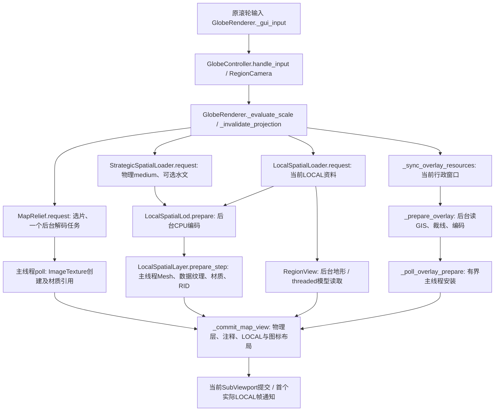

# R54 — Map Runtime Performance and Resource Optimization

日期：2026-10-19。Godot 4.6.3 Compatibility。**本轮减少了行政重复刷新、地貌目录复制和屏外边界提交，修复了一个控件泄漏及LOCAL失败重试分支；没有证明所有巴黎无响应均已解决。首次模型长帧仍列为未解决。**没有新增地理内容、修改原始GIS或领域算法。

## 一、根因与源码修改

### 1. 实际基线与运行路径

核对R34运行结构、R39、R41、R42—R53实际报告、R46后法国专项及当前源码。R53预览和正式衍生资源存在。R48实际只做故障整改，没有完成奥匈/意大利扩库；R49欧洲俄罗斯也未建设。R50西伯利亚、R51中亚/远东、R52高加索/北欧与芬兰、R53阿拉伯/北非已接入。没有将提示词当作已完成工程。开工时没有本项目的地形生成、导出或游戏进程。

Controller仍是唯一相机权威。GeographyLoader读取准入资源；MapRelief持有有界纹理。StrategicSpatialLoader组织物理/水文分片；LocalSpatialLod只做CPU准备；LocalSpatialLayer拥有批次及RID。RegionView负责已有LOCAL场景。GlobeRenderer消费发布结果。MapSymbolAtlas继续共享图集。正式时间、人口、经济和军事仍在原模块，没有另建管理器。

| 实际尺度 | 触发工作 | 线程/约束 |
|---|---|---|
| WORLD→REGION 5500米/像素，退出7000 | 相机投影交接 | 主线程，沿用R39 |
| 原全球region地貌预热8500、释放11000 | 全球参考纹理 | 一个解码线程，非全国细片 |
| REGION概览通常≤4500 | 当前地理域概览 | 一次一个解码；最多两概览 |
| REGION medium≤1500 | 当前物理分片 | 后台读取/编码，主线程有界上传 |
| 水文概览≤2500；detail通常≤500 | 全部相交必要分片；细片总数超过4则保持概览 | 不参与首个全球coarse完整条件 |
| 地貌细片≤750，300—750渐退 | 当前2×2地理邻域 | 四有效细片；替换时至多一后继 |
| 行政一级≤6500、二级通常≤1400、三级≤300、四级≤80 | 当前玩家行政身份且当前窗口内 | 还有最小屏幕尺寸过滤；选择例外 |
| 行政detail<450；已安装detail在<650保持 | 原GIS显示LOD | 原始拾取/成员不变 |
| LOCAL进入≤200，退出≥280 | 当前合法LOCAL覆盖 | 不代表所有模型在200准入 |
| 巴黎约12米档观察到地形、城市、铁塔、北站和桥梁 | 各自元数据准入 | 细档模型/地形首次安装仍可能长帧 |

这些阈值存在邻近触发，不能仅凭阈值宣布同时阻塞。实际序列和耗时见第二部分。

### 2. 已确认的问题及处理

| 文件与函数 | 证据及机制 | 实际修改 |
|---|---|---|
| `map_relief.gd::request` | 每次开始解码都在主线程`_assets.duplicate(true)`，复制整个已准入目录。法国已有1037条元数据。源诊断中request最长24.1ms，外层_sync_relief最长46.6ms | 只复制目录外层；内部asset记录在GeographyLoader中只读，目录准入只增改工作线程自己的外层字典。仍只有一个任务，不增加纹理缓存 |
| `globe_renderer.gd::_sync_overlay_resources` | 只要旧窗口包住新窗口便永久沿用。宽视野窗口能带到很近尺度，导致处理大量屏外区县 | 旧窗口边长超过新加边窗口两倍时重新收缩。仍保留当前视野、邻边及原LOD；未隐藏全部行政线 |
| 同文件`_poll_overlay_prepare / _install_overlay_row / _commit_map_view` | 原来每帧只安装一行，每个单位完成都_invalidate_appearance，连物理材质、地貌、模型及图标一起重新提交。R53巴黎180米快照有500请求、445待安装 | 改为批次间检查2000µs预算；保持每个单位原子发布。一次处理结束只置已有行政dirty并更新注释画布。单个Mesh创建仍不可中断，不宣称严格≤2ms |
| 同文件`_prepare_symbol_layout` | 每次布局深复制当前行政身份；源诊断最长109.9ms，并非只有图标GPU成本 | 在当前行政需求行附带一次身份快照，后续布局复用。只保留当前窗口，没有全球地点缓存。首都/行政中心身份和原选择入口保留 |
| 同文件`_prepare_boundary_batches / _draw_boundaries` | 全国宏观边界无CPU屏外批次拒绝。源诊断此函数曾达13.3ms | 按原边界点建立保守球面包围帽；包括边段余量和屏幕线宽余量。只跳过完全屏外批次；不删几何、不改国界 |
| `local_spatial_layer.gd::update / set_local_coverage / set_reference_window` | 每次相机提交都遍历隐藏水文的相同LOCAL采样参数；已存在的覆盖/引用变更入口已负责解绑 | 隐藏采样器仍在覆盖变化时清理；新可见批次在显示时初始化。已有地貌窗口通过原setter更新，不每帧重复完整设置 |
| `historical_visual_resolver.gd::texture_for` | 单组件livery别名先get_image再创建相同ImageTexture | 复用已裁边组件纹理；多组件组合和国旗解析保留。未取消旗帜 |
| `globe_renderer.gd::_init / _ready`，`formal_world_application.gd::_enter_tree` | 正式场景会在_ready前free占位GlobeRenderer；其属性已new一个未挂树CivilianFacilityLayer。该Control无父节点，留下CanvasItem及脚本资源。R53比较三轮均出现1 RID、ObjectDB及1 resource警告 | 控件在_init立即挂入父节点。占位父节点提前销毁也能回收。设施外观、半球仪和正常实例不改。最终退出结果见下 |
| `region_view.gd::_poll_surface_preparation / _update_surface_demand` | 当前地形线程空/无效结果会保持CPU未就绪，下次刷新可能再派发同一失败任务。原_build_key只比路径/投影，取消后返回同键也不能区分旧代数 | 使用已有_build_key附带已有generation；过期结果丢弃。当前无效结果通知一次，保留REGION回退，当前会话不反复重试该失败输入。没有新管理器或重叠ready标记 |

最后一项执行了两个局部强制输入检查：当前线程返回null后停止；旧线程取消后以同路径/投影返回空字典，不污染新需求，也不把取消误记为当前失败。`local_failure_check.log`记录`R54_LOCAL_FAILED_WORKER_STOPPED=true`，退出0。它证明失败处理分支，不是巴黎945ms实机根因复现。

行政完成现在只触发已有行政dirty；LOCAL复用已有generation并写入已有build_key。没有新增永久dirty/ready/pending状态组。

### 3. 行政、水文、图标和资源生命周期

R48已将法国下级共享线制成`admin_display_r48`；省线仍读取R40衍生。AdministrativeLoader把原多边形用于拾取，把display_lines用于描线。R54不再去重一次，不修改源坐标。下表源边数与视野提交段数口径不同：源边包括整个单位，GPU段经过投影细分/裁切；不能直接相减作为本轮去重收益。

| 最终快照 | 请求单位及层级 | 原多边形边数 | 既有显示衍生边数 | 已安装GPU批次/段 | 尚待安装行 |
|---|---|---:|---:|---|---:|
| paris0_180（181.97米/像素） | 500（1级19、2级72、3级409） | 45,730 | 15,295 | 500/13123 | 0 |
| paris0_3（2.80米/像素） | 15（1级2、2级5、3级1、4级7） | 1,283 | 292 | 15/15 | 0 |
| nogent_30（30.06米/像素） | 33（1级5、2级8、3级20） | 4,769 | 1,465 | 33/472 | 0 |

同级共享边和部分父子外缘使用既有衍生规则。未重新测得全法国所有层级的残余重边率，不能宣布全部历史边线问题解决。当前单位的完整路径保存在最终采样`administrative_demand.json`。

塞纳河显示所有权仍由`_local_river_replacements`和`replacement_key`控制：完整BD TOPAGE局部层可见后，战略NE塞纳主轴在合法局部盘内退出；外围继续显示。原源几何仍可能为同一个已合并战略批次准备少量粗轴，只在shader中抑制局部重复，因此不能写成CPU重复准备已全部消失。没有删除真实曲流、独立河道或运河。其他水文仍使用现有display_replaces与原子发布，不改变水文精度。

图标仍是一个共享图集，WORLD/REGION上限24/160，标签上限40；只处理已请求地点和当前行政单位。未发现图标每帧上传PNG。后台完成、模型呈现会使布局失效，但本轮已去掉行政逐单位导致的整张地图失效；没有取消R47图标和R41拾取。

| 最终采样点 | 模型实例/Mesh/材质 | 地点候选/准入图标/标签 | REGION河流批次/LOCAL河流批次 | 地貌纹理数 |
|---|---|---|---|---:|
| paris0_12 | 21/6/5 | 32/22/20 | 39/47 | 4 |
| nogent_30 | 0/0/0 | 5/3/2 | 39/47 | 4 |
| oman_100 | 0/0/0 | 0/0/0 | 11/0 | 5 |
| world_after_tour | 0/0/0 | 26/9/7 | 0/0 | 1 |

回WORLD后，REGION批次0、行政批次0、模型根0，地貌只剩`world`；全球455批次仍持有。表中模型Mesh/材质不包括地图地形和所有全局材质。每个水文批次可包含多条源线，不能当作河流数。全引擎Mesh/Material/RID总数未取得。

MapRelief维持一个解码任务、两概览、四有效细片、一个后继，另有原world/region及一个native窗口；未永久增加槽位。过期图像在ImageTexture创建前丢弃。隐藏/fallback材质在覆盖和窗口setter中解绑。GLOBAL24份coarse不随REGION退出销毁；回WORLD释放REGION medium。模型PackedScene缓存上限仍为2，返回主菜单清空。没有随旅行距离增长的新缓存。

源诊断中`MapRelief.poll`曾达62.0ms，包含ImageTexture创建；LocalSpatialLayer.begin曾达176.1ms，含旧批次退休；行政CPU_prepare_overlay最长1.796s、水文/物理_load最长2.551s、LOD.prepare最长2.274s发生在后台。后台总时长不等于单帧阻塞。地图几何CPU准备仍在工作线程，Mesh、材质和RID安装仍在主线程；旗帜仍沿既有预览准备路径，只减少单组件回读/上传。未取得驱动级GPU调用栈、单纹理GPU耗时及全引擎有效RID总数。

### 4. 启动与WORLD

用户的11秒是**点击油画菜单开始→国家选择地球完整可交互**的目测，不包含EXE启动、首页停留。R41同口径7.507秒是旧版、旧样本参考，不能算作R53基线。

`FormalWorldMenu._read_preview`串行准备provenance、HistoricalLoader地图、行政索引、国家身份、预制边界及旗帜显示。主线程安装Renderer后，StrategicSpatialLoader读取24份coarse，LocalSpatialLod消费编译包，LocalSpatialLayer主线程创建455批Mesh/数据纹理/材质/RID，再提交画布、解除选择遮罩。进入正式世界另行WorldBootstrap，不混入国家选择计时。菜单与世界仍复用同一Renderer。

| 起止事件区间 | R53 A_full2秒 | R54最终秒 |
|---|---:|---:|
| start_clicked → 正在读取地图资料 | 0.039 | 0.027 |
| 正在读取地图资料 → 正在读取历史地图资料 | 0.235 | 0.207 |
| 正在读取历史地图资料 → 正在读取历史行政资料 | 0.081 | 0.083 |
| 正在读取历史行政资料 → 正在读取国家显示资料 | 0.418 | 0.383 |
| 正在读取国家显示资料 → 正在准备历史国家 | 0.215 | 0.216 |
| 正在准备历史国家 → 正在准备历史范围与边界 | 0.017 | 0.017 |
| 正在准备历史范围与边界 → 正在读取国家旗帜与显示资料 | 0.017 | 0.017 |
| 正在读取国家旗帜与显示资料 → 正在安装全球基础陆地、海岸与国家着色 | 3.210 | 1.873 |
| 正在安装全球基础陆地、海岸与国家着色 → 全球基础地图已安装 | 2.833 | 2.674 |
| 全球基础地图已安装 → political_interactive | 0.004 | 0.002 |

快照在WORLD记录的mpp仍为RegionCamera保留值，不能把其中5500误作球面实测尺度；WORLD实际需求使用_strategic_mpp。

这些是已有阶段标签之间的墙钟区间；旗帜标签区间还含resolve_map和安装交接，GLOBAL区间含读取、CPU编码、GPU安装和首帧提交，不能细拆为纯GPU毫秒。没有增加永久探针。本次未取得每张旗帜及455批各自的精确安装时间。

首屏快照仍只有`world`纹理、6项原基础元数据和455全球批次，未打开各国高精度目录、LOCAL模型或亚洲全部细片。可选水文不阻止全球完成。历史身份、选择和必要国旗不延迟到玩家点击后补齐；本轮不改遮罩或删全球覆盖。单组件纹理复用消除了确切重复上传，但启动差异也受OS/驱动缓存和同机其他项目影响，不能把全部秒数变化归因于这一项。

WORLD继续按相机交互实时提交；静止后使用原UPDATE_ONCE/DISABLED。未降低球面更新频率，未恢复整屏_can_submit_map_view冻结；该函数仍只保护首次初始化。半球仪代码未改。

## 二、有限实测与前后对照

### 5. 条件、样本与计时口径

设备i7-13700H，20逻辑处理器；Windows11 IoT Enterprise LTSC 10.0.26100；OS可见内存16,886,784,000字节。实际渲染RTX3050 Laptop GPU、驱动572.83，Godot4.6.3 Compatibility。所有原生比较窗口/viewport1280×720、VSync1、上限60、高负载关闭、原图层和相机输入。A/B均为Windows release内部预览，没有用Debug/Release混算。

使用R41原隔离启动方式、进程计数器和GPU WMI采样，外部观察节点留在`local-artifacts/r54_performance`。Start调用原菜单处理，滚轮/拖动调用原_gui_input；每处定位一次，随后走原滚轮。法国→德国→巴黎首次/重复→诺让→英国→阿曼→法国；巴黎从600逐档到约3米/像素再返回800。每档固定输入间隔0.06s，至少等待0.25s；资源等待最多4s。**路径耗时含这些人为等待，窗口结束不自动等于所有可选资源已完成。**待安装数另列，不能把27秒路径耗时称为单纯游戏加载时间。

主比较：R53 `A_full2 / A_short3 / A_short4`；R54 `B_final_full / B_short2 / B_short3`。启动/WORLD各三样本；完整近景、跨区、时间对照各一条路线，路线内巴黎进入两次。B_short2/3来自最终失败分支防护前的同一R54优化候选；其WORLD路径不进入该分支，其余运行代码和配置相同。最终完整路线复核最终EXE。

`A_full1`是入口摸底，逐档focus_region会退出LOCAL，不纳入近景对照，也不纳入三样本启动统计。`D_full_diag`使用有临时函数计时的编辑器引擎，前台激活失败，只用于调用路径，不混入帧率表。`B_render_diag`是追加的短巴黎提交诊断，路径不同，不替代完整比较。临时函数计时已从正式源码移除。

原生比较前台采样占比见下表；不是每一瞬间保证前台。未清理系统或驱动缓存。开工时同机另有Image-to-CAD等项目进程；没有终止它们。本轮比较未并发启动两个游戏，也没有让导出与主要采样并发，仍有系统负载和缓存顺序影响。

| 原生样本 | 运行时间（UTC+08） | 启动秒 | WORLD中位/P95/P99/最大毫秒 | 前台占比 | 退出 |
|---|---|---:|---|---:|---:|
| A_full2 | 10-19 11:15:27—11:18:05 | 7.070 | 37.23/65.07/76.72/86.09 | 99.7% | 0 |
| A_short3 | 10-19 11:18:05—11:18:32 | 6.956 | 29.85/37.68/42.54/44.37 | 100.0% | 0 |
| A_short4 | 10-19 11:18:32—11:19:02 | 7.013 | 35.91/60.85/66.51/82.60 | 98.1% | 0 |
| B_final_full | 10-19 11:34:52—11:36:46 | 5.498 | 33.19/48.20/52.12/54.73 | 99.5% | 0 |
| B_short2 | 10-19 11:24:29—11:24:53 | 5.363 | 27.31/39.71/51.40/61.93 | 100.0% | 0 |
| B_short3 | 10-19 11:24:53—11:25:17 | 5.427 | 26.19/35.63/43.96/57.03 | 97.7% | 0 |

两个完整路线的实际目标尺度有小幅差异（例如约12米档受原LOCAL锚定/滚轮步长影响），近景表视为同路径、同尺度范围的近似比较。最终驱动仅在三个快照额外保留已请求行政描述及图标/批次计数，统一结束后写入文件；没有增加逐帧全局枚举。`run.json`中的paused是入口状态，G阶段以events中的clock_begin为准。另一次入口摸底启动为9.552秒，未混入三样本组，也未称为冷启动。

帧时间是观察节点相邻_process间隔，含脚本、渲染提交/等待及调度，不是GPU计时器。P95/P99使用线性分位数；三样本汇总为各样本统计量的中位数，不把所有帧拼成一条有偏长样本。原始frames/events/process/gpu保留；Windows GPU值是按PID计数器合计，不等于Godot逐纹理显存。

### 6. 实际对照

| 场景 | R53基线 | R54结果 | 变化 | 是否可比 |
|---|---|---|---|---|
| 点击开始→国家选择（三样本中位） | 7.013s | 5.427s | -1.586s | 同配置；缓存/负载顺序有限制 |
| 进入正式世界（三样本中位） | 2.002s | 1.693s | -0.309s | 同入口；领域初始化未改 |
| WORLD旋转中位帧时间 | 35.91ms | 27.31ms | -8.60ms（-24.0%） | 相同180步拖动；三统计量中位 |
| WORLD旋转P95/P99 | 60.85/66.51ms | 39.71/51.40ms | 见逐轮表 | 同上 |
| REGION法/德路线耗时 | 13.762/9.120s | 7.405/6.418s | 路线等待减少 | 近似；含固定等待，非纯安装秒数 |
| 巴黎近景首次路径 | 27.891s | 17.995s | -9.896s | 近似；单条完整路线 |
| 巴黎近景重复路径 | 27.397s | 16.019s | -11.378s | 近似；单条完整路线 |
| 诺让行政/水文路径 | 9.950s | 3.674s | -6.276s | 近似；单条完整路线 |
| 跨地区后再次进入法国 | 9.926s | 4.555s | -5.371s | 近似；单条完整路线 |
| 进程峰值工作集 | 1451.00MiB | 1373.22MiB | -77.79MiB | 同路线；不等于泄漏量 |
| GPU按PID专用内存峰值 | 427.12MiB | 419.12MiB | 计数器采样 | 近似；非逐资源GPU计时 |
| 返回主菜单工作集 | 675.96MiB | 634.32MiB | 见引用/退出结果 | 最近0.5s进程样本，非泄漏判定 |

| 完整路线帧间隔 | R53中位/P95/P99/最大ms | R54最终中位/P95/P99/最大ms |
|---|---|---|
| france | 29.09/61.21/119.50/176.15 | 16.73/40.91/78.06/117.49 |
| germany | 17.09/53.27/119.08/189.52 | 16.77/42.33/84.47/196.81 |
| paris0 | 20.14/85.87/132.33/870.88 | 16.87/79.25/125.74/150.13 |
| paris1 | 27.63/94.95/137.83/184.12 | 16.81/86.07/118.56/158.63 |
| nogent | 28.68/60.26/141.22/215.75 | 16.74/80.89/107.11/218.94 |
| france_return | 24.75/60.65/141.91/160.02 | 16.71/59.17/95.61/104.63 |

约12米目标请求→首个含完整模型快照：首次2.176→0.783s，重复0.802→0.797s。这是快照时间上界，含输入和等待，不是单个GPU上传耗时。

早期R54完整路线B_full1在巴黎首次模型档仍记录945.419ms，R53对应为870.880ms；最终复核较快不能抹去这一记录。最后新增的失败防护在正常数据分支没有改变模型或上传方式，不能把峰值消失归功于它。B_render_diag短路径首次模型档也未重现该峰值。冷/暖缓存、读取/销毁、渲染提交中的具体占比仍未分离。

| 同位置时间状态 | R53中位/P95/P99/最大ms | R54最终中位/P95/P99/最大ms |
|---|---|---|
| 暂停 | 16.86/45.64/51.18/59.13 | 16.83/38.54/45.72/49.54 |
| 1倍 | 16.87/42.25/46.55/72.58 | 16.92/36.18/44.86/46.55 |
| 4倍 | 16.94/45.98/54.25/69.84 | 16.88/31.06/40.12/45.59 |

R53时钟最终为{'day': 1, 'hour': 23, 'minute': 45, 'month': 1, 'weekday': 0, 'year': 1900}；R54为{'day': 1, 'hour': 21, 'minute': 15, 'month': 1, 'weekday': 0, 'year': 1900}，均随后暂停。各观察窗口按墙钟结束，实际tick数有差异，不能把它作为完全相同模拟工作量的微基准。

GameClock在地图A—F阶段暂停。1倍/4倍各只观察约数秒，使用原15分钟tick，未调用保存和长期模拟。没有跨日结算样本，所以不能由这次结果排除日结成本；也不能用正式模拟解释暂停时的长帧。FormalWorldApplication的_advance_world等领域调用未修改。

| 完整路线资源观测 | R53 | R54最终 |
|---|---:|---:|
| 峰值Private bytes MiB | 1929.72 | 1823.69 |
| GPU专用内存采样峰值MiB | 427.12 | 419.12 |
| GPU共享内存采样峰值MiB | 73.24 | 80.59 |
| 全路线CPU机器百分比均值 | 6.08% | 5.55% |
| GPU最忙3D引擎采样峰值 | 29% | 43% |
| 菜单节点数 | 18 | 18 |
| 菜单Resource监视值 | 152 | 152 |
| 正常退出的旧警告 | 1 CanvasItem RID + ObjectDB + 1 resource | 未出现 |

CPU/GPU采样是约0.5秒进程计数器和约1—数秒WMI采样。路线总时长和队列驻留不同，不把全程均值当成单个函数优化收益。Godot总对象/资源监视值也不是全GPU对象清单。

工作集返回主菜单未回到EXE初始值，不能据此宣称泄漏。当前纹理/批次引用、缓存和Windows分配器需分别看待。最终正常退出未再报旧RID/ObjectDB/resource警告，确认上述控件生命周期修正有效；没有屏蔽警告。

### 7. 仍未解决及验收边界

- P0：有限暂停缩放中没有复现持续Windows未响应或死锁，全部比较进程正常退出。不能宣称所有用户近景无响应已被本轮证明修复。已处理当前无效LOCAL结果重复派发风险；旧原生0xc0000005没有新栈，未判为同一根因。
- P1：首次模型附近仍有接近一秒长帧；法国/诺让部分极值和P95也未一致下降。最重首次长帧未精确定位到单个Mesh、纹理、模型实例或驱动等待。追加短诊断未复现该峰值；其frame_pre/post_draw墙钟也不是GPU计时器。不以猜测删模型、降纹理或批量预加载。
- P2/P3：本次路线的行政队列和重复进入有改善，WORLD三样本下降；资源请求仍随真实视野变化。行政准备代数增加不等于泄漏，本轮没有精确累计全部过期任务/取消耗时，不能填造零。LOD或窗口退出仍可能重建；收缩窗口时部分旧行政批次仍会退休，重复路径变快不等于零重建。
- P4：启动有可比较实测，但不是冷启动保证。GLOBAL455批安装、必要历史/国旗处理仍有成本，没有合并重做全部物理批次。
- P5：控件孤儿RID已定位并修正。未取得全RenderingServer RID枚举、完整GPU显存分配或驱动栈，进程工作集没有被当作精确泄漏判据。

用户仍需查看原出现问题的画面、连续滚轮及长时间跨地区操作；本轮无GUI视觉验收，不能仅凭导出证明地貌、河流、图标全部像素正确。未新增常驻性能面板、监控服务、地图引擎或全球缓存。

### 8. 文件、构建与保护

实际修改：

- `scripts/presentation/map/globe_renderer.gd`
- `scripts/presentation/map/map_relief.gd`
- `scripts/presentation/map/local_spatial_layer.gd`
- `scripts/presentation/map/region_view.gd`
- `scripts/content/historical_visual_resolver.gd`
- `project.godot`（build_label/id/sequence；原0.001a存档识别不变）
- `export_presets.cfg`（仅内部预览输出路径）

新增本报告、排除打包的R54临时驱动/采样/汇总记录及唯一预览目录说明。正式地理资产新增0、删除0；没有删除旧预览。临时函数计时涉及的其他文件已恢复原内容。执行了局部解析、LOCAL失败分支局部检查、正常资源导入和Windows导出；没有全量测试、CI、哈希核验、Git提交或推送。

所有游戏会话user://均为独立`WWO_R54_Perf_20261019_<标签>`目录；没有调用真实五槽、保存、转换或恢复。测试目录的文件检查只针对本轮独立目录。原五槽未读取后重存。R53、R52、正式Release与R19/R30未覆盖或清理。

唯一Windows x86-64内部预览：

`D:/programs/WWO/wwo/builds/preview_2026-10-19_performance_r54/WWO_1900_Map_Runtime_Performance_R54_Preview.exe`

文件长度1,347,992,440字节。`Windows Desktop Internal Landmark Preview` release导出退出0；保留内部古迹许可边界，随附R53来源声明与HydroSHEDS许可。仅更新同一R54候选路径，没有多份候选EXE。最终源码解析/局部检查、导入和导出成功；最后完整原生会话退出0。原`0.001a`无法直接写作Windows四段数字版本的两条导出提示仍在，没有因此改存档识别。

本轮到此停止，不建设新国家，不自动进入R55。
