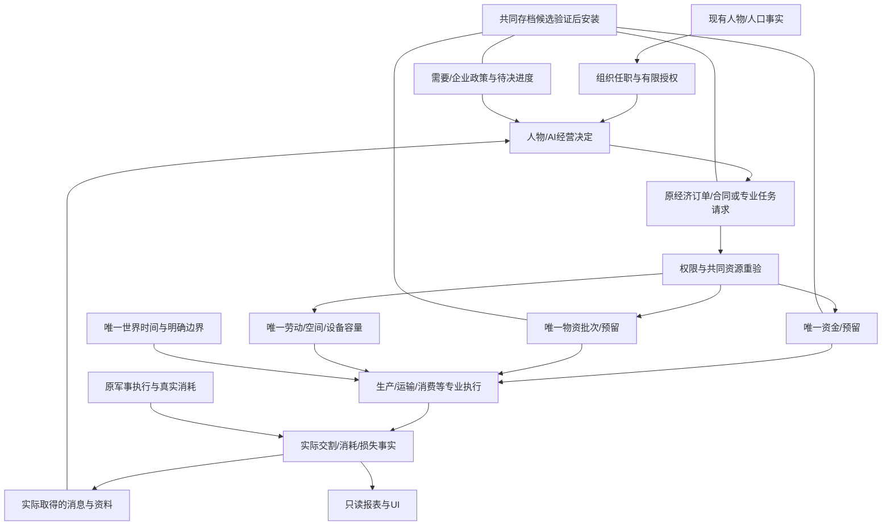

# WWO 经济活动与机制分层研究

2026-10-13｜研究方案 v1｜中文完整报告

本报告研究八款已发行游戏及 Capitalism Lab 的银行、金融和宏观扩展，提出 WWO 的经济活动目录与初步架构。它补充同目录阅读入口所链接的组织研究和军事活动分层草案。**竞品事实、仓库静态事实、较新实验作者说明、WWO 建议分别标明；没有实施、恢复旧实验或验证游戏运行。** 活动数量是本次分解的结果，不是内容数量指标。

## 1. 核心结论与范围

建议借鉴不同游戏解决问题的方式，组合为三个闭合关系：

1. **生活与生产**：真实居民收入和库存 → 可负担的购买 → 实际交付及消费 → 劳动与生产条件 → 工资、经营收入和新的需求。
2. **经营与组织**：有权人物取得有限信息 → 提出政策、订单或投资 → 以组织现有预算和资产承诺 → 专业执行者消耗真实资源 → 经营结果和回执返回 → 换人继续承担原组织义务。
3. **战争与经济**：部队需要与实际损失 → 有来源的采购及资金申请 → 企业生产、运输、交接 → 真实装备使用和消耗 → 新需求。战争不保证所有商品涨价，也不自动为军方增加支付能力。

这三条关系需要有限资金、批次和责任连续性。它们不能直接由“国家市场有需求”“组织已经批准”“AI 会补货”替代。研究中发现，《Victoria 3》2021 年开发说明明确采用无商品库存的流量式市场；《The Guild 3》有维持市场供给的外来商人和补货系统。它们有值得借鉴的需求与地域设计，但这些经济边界与 WWO 的实物要求不同，详见第 2 节。[Victoria 3 官方开发日志 #9](https://store.steampowered.com/news/posts/?enddate=1628180040&feed=steam_community_announcements)、[The Guild 3 官方 EA 0.9.8 更新](https://steamcommunity.com/app/311260/discussions/0/2266943550297867173/)

本轮处理机制覆盖、计算分层、角色操作和接口边界，**不配平全部价格、工资、损耗或金融参数**。1900 年产业和基础商品、单位映射、战斗地块尺度仍由后续内容研究决定。现实资料填入游戏抽象单位时必须说明转换，不通过跑模拟倒推出“现实基础值”。

### 1.1 已确认约束

- 人物视角不等于永久固定职业；身份、任职、玩家控制对象可能变化。世界活动目录广泛保留，当前身份只限制当前参与。
- 机制可以产生决策处境，但机制数量不等于好玩。机器负担、信息负担和 UI 操作量都需要控制。
- 商品最小固有属性先为**单位重量、基础每日损耗率**。商品 ID、单位名称是标识与量纲，不是额外性能系统；市场价格不写成商品固有属性。
- 运输方式另有损耗。商品与方式的组合公式、方式损耗按日还是按程尚未定。“运输时效”在本任务中关注最后可交付、可用数量，ETA 另列。
- 品牌、品质和渠道是候选经营扩展，不提前扩大最小商品表。例示“苹果重量为 1”不意味着锁定一单位等于一千克。
- 独立经济十五类算法继续作为主体研究。较窄原生宿主能力不替代它；军事实验保持边界。不能创建第二套人物、人口、库存、资金、全局时间或存档。

### 1.2 证据分级

| 标记 | 含义 | 不能外推到 |
| --- | --- | --- |
| G：游戏资料 | 官方开发日志、手册、支持页、开发者产品说明；社区维护页另标 | 已阅读源码、最新所有补丁公式、AI 完整资金闭合或已实测体验 |
| C：实际代码 | 本工作区适用 `AGENTS.md` 与指定窄范围接口静态检查 | 用户本地较新未提交实现、运行正确性、性能和整合成功 |
| R：作者交付说明 | 独立经济、军事和较新宿主报告/交付收据 | 本次亲自执行其测试、全部源文件已检查或已正式接入 |
| P：方案 | 本报告的 WWO 对象、流程、分期、验收建议 | 游戏既有机制或 WWO 已有实现 |

没有把用户提出的玩法例子当作竞品已验证事实。没有用论坛玩家评论替代开发者说明。网页读取受限时，使用同一开发者在 Steam 发布的原文；仍无法确认的内容明确保留。

## 2. 八款游戏：实际机制、问题与迁移边界

### 2.1 Capitalism Lab：产业链、经营杠杆与委托

**G：核实内容。** 官方站点刊载的入门攻略（署名 Stylesjl，属于官方收录攻略，并非源码或公式规范）说明，企业可向竞争者购入半成品、销售产出、设置内部销售限制，并在农场、原材料点、工厂和零售间配置供给。零售竞争结合价格、品质和品牌；广告、研发和更好的投入品对应不同改善方向；库存填满后，采购需求会下降。它强调按实际销售观察瓶颈，而非把补仓需求当成稳定最终需求。官方经营界面另支持把指定企业交给 COO，并保留授权范围。[官方收录 Gameplay Basics](https://www.capitalismlab.com/beginners-guide-gameplay-basics/)、[Assign Firm Manager](https://www.capitalismlab.com/improvements/interfaces/assign-firm-manager/)

**解决的问题。** 玩家面对“买还是自己造”“扩工厂还是扩销售”“降价抢量还是提高差异化”“把哪些经营事项交给经理”。同一产业投入关系把竞争、合作和长期投资联系起来。官方零售增强页还说明位置客流与连锁经营效果；宏观页把收入、就业与消费需求关联。[Retail Simulation Enhancement](https://www.capitalismlab.com/new-content/retail-simulation-enhancement/)、[Enhanced Macroeconomic Simulation](https://www.capitalismlab.com/new-features/enhanced-macroeconomic-simulation/)

**P：适用 WWO。** 经营政策包含目标库存、报价规则、采购范围、开工和扩产提案；经理对限定企业和预算作决策，不能直接修改库存。生产链需实际投入、劳动、设备能力和输送。研发首先是一项持续占用资金、专业工时及设施的活动，不是一个花钱立刻加效率的按钮。

**P：不直接采用。** CEO 固定为玩家、全图经营信息、单一综合评分和官方攻略中的效率奖励不适合作为 WWO 人物制度。纵向一体化不自动降成本：它可能降低外购风险，也增加资本占用、工资、维护、协调、运输和滞销损失。集团内部交接可有内部管理计价，但合并口径不能把同一产品每过一家子公司都加一次外部收入。银行和宏观扩展的独立边界见第 4 节。

### 2.2 X4: Foundations：物料瓶颈与装备使用闭环

**G：核实内容。** Egosoft 产品页说明，势力动态建站并响应经济与军事威胁。其官方站点链接的 X Community Wiki 手册（社区维护，引用页面对应 5.10 时代说明）明确：造船、改装受船厂/码头所需物料和建造槽位限制，缺料或槽位占用会进入等待；武器有有限消耗弹药。[Egosoft 产品说明](https://www.egosoft.com/games/x4/info_en.php)、[手册：Purchasing and Upgrading Ships](https://wiki.egosoft.com/X4%20Foundations%20Wiki/Manual%20and%20Guides/X4%3A%20Foundations%20Manual/Purchasing%20And%20Upgrading%20Ships/?language=en)

**G：重要反例。** 同一手册的补给页区分再武装所需物资与修理，所述修理无需资源。不能把“X4 有造船物料约束”写成“它所有维护和势力财务都严格闭合”。本轮也没有取得足以核实 NPC 势力完整现金、破产和外部货币来源的官方证据。[手册：Resupply Ships](https://wiki.egosoft.com/X4%20Foundations%20Wiki/Manual%20and%20Guides/X4%3A%20Foundations%20Manual/Resupply%20Ships/)

**解决的问题。** 经济产出有具体最终用途；缺某一中间品会卡住设备交付；装备损失和弹药使用会引出补充需求。玩家可以改变瓶颈，而非只向不变的收购终点卖货。

**P：适用 WWO。** 军需采购引用实际消耗、损失和库存目标；工厂与船坞排队占用容量；消耗者与买方可以不同，但资金、所有权和交付地点必须明确。战争会影响用途、通行和购买者能力，从实际结果产生需求变化。

**P：不直接采用。** 太空装卸、遥控全舰队、游戏修理规则不迁移。物理造船链本身不证明 AI 使用有限财政；WWO 的军方和供应商仍需独立的资金、履约与信息约束。现实军需的生产周期和商品清单本轮不锁定。

### 2.3 Offworld Trading Company：机会成本、价格竞争和财务压力

**G：核实内容。** 官方 Gameplay 介绍和官方托管 Wiki 说明，维生与建造物资可以自产或市场购入；钢厂可购铁而不自建矿山，有限领地和生产配置促使玩家按市场机会调整链条；终局涉及购买竞争者股份。官方介绍把负债与股票收购压力联系起来。游戏也包含黑市和黑客，但这些不是本报告的采用对象。[官方 Gameplay](https://www.offworldgame.com/game/gameplay)、[官方托管 Wiki：Gameplay](https://wiki.offworldgame.com/index.php/Gameplay)、[Resources](https://wiki.offworldgame.com/index.php/Resources)

**证据边界。** 官方 Gameplay 全文打开受限，本项该页内容来自检索返回的官方正文；可打开的 Wiki 为主要补证。这里没有验证其所有难度、DLC 或具体债务公式。也不能凭“可以买卖市场资源”推断所有交易都对应有限资金的独立 NPC。

**解决的问题。** 稀缺生产位置、投入结构与市场变化形成时间敏感的机会成本；经营困难不只表现为利润少，还可能失去控制权。

**P：适用 WWO。** 真实供应中断、投产延迟、替代采购和财务承压可产生竞争；借款、股份买卖和收购应有不同责任。玩家与 AI 比较预期收益、现金缓冲与履约风险，而非永远选择售价最高的货物。

**P：不直接采用。** 快节奏比赛、全局即时市场、将负债变成无来源支付能力以及收购等于立即出局的规则不迁移。生产干扰由 WWO 真实停工、断供、通行或权限事件产生；不因这款游戏存在黑客而新增相同玩法。

### 2.4 Patrician III：城市库存、批量成交与有成本的贸易路线

**G：核实内容。** Steam 随游戏提供的官方手册第 4、8 章说明，城镇库存短缺提高报价，售入降低价格、购出提高价格；每次交易量改变平均成交价。商船、商会仓库、船员工资、航行磨损和自动贸易路线形成经营约束；城镇不同社会群体有不同需要，手册也有竞争者信息。[Patrician III 官方发行手册，印刷页 12–13、20–26](https://store.steampowered.com/manual/33570)

**解决的问题。** 玩家需考虑“运到何处、何时、卖多少”，不能以第一单位报价无限出售。长期贸易网络有运维代价，空驶和库存占用也会影响利润。

**P：适用 WWO。** 批量报价必须说明适用数量；同一买方/卖方交易应逐笔更新真实可用量，或按一次完整深度计算；贸易路线是带保留量、限价、停靠和异常处置的委托政策。观察“库存可覆盖多少实际消费”比一个全局短缺标签更有解释力。

**P：不直接采用。** 手册的全城统计可见性和固定平衡价不作为 WWO 的人物知识或固有商品价格。历史背景、城镇抽象和贸易难度参数不照搬。手册没有证明竞争者所有现金来源、每名居民购买和市场结算均闭合；本轮不声称已验证该内部实现。

### 2.5 EVE Online：区域订单、交付地点与运输责任

**G：核实内容。** CCP 支持文档说明，市场经纪系统使用买卖订单：卖单对应所在站点，买单可声明收货范围；创建或修改时按订单规则撮合，改价有费用。公司名义订单所得进入公司交付仓，访问取决于角色。快递合约将物品交给承运人，承运人缴纳押金，实际交付返还押金；失败、超期、目的地变化有各自规则。[Buy and Sell Orders](https://support.eveonline.com/hc/en-us/articles/203218932-Buy-and-Sell-Orders)、[Corporation Orders and Market Deliveries](https://support.eveonline.com/hc/en-us/articles/203280351-Corporation-Orders-and-Market-Deliveries)、[Courier Contracts](https://support.eveonline.com/hc/en-us/articles/203218982-Courier-Contracts)

**解决的问题。** 市场价格、物品所在地点和实际提取运输分开；物品属于公司不意味着每个成员都能取走；运输失败可保留赔偿与追偿责任。

**P：适用 WWO。** 买到并不等于远处可用；买方、付费账户、货主、保管者、承运者、收货资格分别记录。囤积必须实际买到、保有库存并付出资金和损耗；跨区套利需真实装卸、路线、容量及风险。合同的押金是受限资金，不是承运收入。

**P：不直接采用。** 这些规则主要服务多人市场，不证明单机 AI 会自然囤货、抢资源或形成战时需求。WWO 要有自己的有限信息行为规则。不能把玩家故事中的涨价幅度当成普遍规律，也不照搬 EVE 特定撮合执行价、技能费用或资产安全机制。上述来源不是 EVE 全部货币来源的审计。

### 2.6 Coffee Inc 2：门店决策、经理委托与三张报表

**G：核实内容。** Side Labs 产品页确认选址、室内设计、定价、城市差异、高管委托、财务报表及 IPO/收购。开发者提交的 App Store 描述进一步列设备、菜单、新产品、营销、员工和公司部门，并把个人财富与企业发展分列。版本历史可确认 13.0 增加 Business Line of Credit、15.0 增加咖啡种植园；15.4 的说明加入破产前四周偿付困难期与恢复机制。[Side Labs 官方产品页](https://www.sidelabs.com/coffeeinc2/)、[开发者 App Store 描述与版本历史](https://apps.apple.com/us/app/coffee-inc-2/id1573482724)

**解决的问题。** 同一行业中，位置、服务配置、产品和营销提供不同经营路径；委托减少连锁门店操作量；收入、资产负债和现金流分别呈现，可解释“业务看似增长却无现金”。

**P：适用 WWO。** 服务业可在地点和专业工时上争取顾客，企业岗位能委托日常事项；报表按玩家实际取得的资料编制，个人与企业账户分离。未来可增加租约、门店工资、设备维护和产品政策，构成持续经营负担。

**证据边界与不直接采用。** 本轮没有核实客人收入与购买、租金、工资、品质、装修、营销之间的具体函数，也没有证明竞争 AI 拥有闭合库存和资金。上述 WWO 租约、收入分组和服务能力是方案，不当作 Coffee Inc 2 已验证算法。App Store 玩家评论提出的功能不纳入事实；Coffee Inc 2+ 为另一版本，不能混同。现代咖啡连锁内容只借鉴决策结构，不照搬 1900 年资料。

### 2.7 The Guild 3：人物经营、分区市场和生产组织

**G：核实内容。** 开发者 EA 0.9.8 发布说明把原统一市场改为代表若干村庄/城区需要、库存和价格的市场，支持跨市场贸易；同一市场经济可覆盖多个场所，不能将每个摊位视为独立生成库存。0.9.12 系列发布说明明确低阶业务向高阶业务提供中间产品，生产订单受材料与储存空间限制。2021 年 DevDiary #15 明确区分王朝 AI、NPC、运输任务和市场补货系统；所述预算管理部分当时仍在开发。[官方 EA 0.9.8 发布说明](https://steamcommunity.com/app/311260/discussions/0/2266943550297867173/)、[官方 EA 0.9.12 系列与 DevDiary #15](https://store.steampowered.com/news/posts/?appids=311260&enddate=1613725600&feed=steam_community_announcements)

**解决的问题。** 人物职业、经营地点、生产和运输能相互连接；分区市场让地点选择有经济后果；有限订单而非无限生产，可以在缺料、缺工或仓满时切换行为。

**P：适用 WWO。** 同一人物的职业资格、组织岗位和实际劳动份额相互约束；产业之间使用真实中间品；市场身份与实际摊位/仓库分开。自动化应是接收同样反馈的经营委托，而非绕过玩家所需条件。

**P：不直接采用与核实缺口。** 为维持市场供应设置的外来商人和补货 AI 不等于已证明完全封闭的供给来源。WWO 若需要境外贸易，应显式记录世界外来源、数量、资金及边界。**本轮没有可靠核实“农场→磨坊→面包”这条具体 The Guild 3 配方**；后文用该链条作 WWO 假设案例，不归到竞品事实。早期 EA 更新可证明当时已发布的改变，不能保证 2026 年版本的每个细节一致。

### 2.8 Victoria 3：收入分布、需要替代与局部价格

**G：核实内容。** 官方 2021 年日志 #13 把 Pop 财富、收支、需要和消费联系起来：财富水平影响消费结构；多种商品可满足同一需要；替代还受偏好、禁忌等影响。消费结构并非简单按职业固定。官方日志 #9 用生产/消费买卖量和市场可达性形成价格，明确不保有逐件商品库存，并放弃固定全世界货币供给。2023 年日志 #102 确认 1.5 已加入 Local Prices 与 Companies，部分企业进一步改为实际行动主体在当时仍属未来方向。[官方日志 #13](https://steamcommunity.com/games/529340/announcements/detail/2965045886379003737)、[官方日志 #9](https://store.steampowered.com/news/posts/?enddate=1628180040&feed=steam_community_announcements)、[官方日志 #102：1.5 后计划](https://store.steampowered.com/news/posts/?enddate=1701961361&feed=steam_community_announcements)

**解决的问题。** 工资、利润分配、税收、就业和商品供给能改变不同阶层的生活；不需要模拟每个居民独立逛店，也能展现收入分布与产业变化。需要替代避免一个固定购物篮决定所有消费。

**P：适用 WWO。** 以地区、可支配现金/收入、需要、资格、工作和知识等足够区分的居民组承担背景消费；保留具名人物和合同例外。税收减少实际可用资金，公共采购或工资将资金转给具体接收者。居民愿意消费不等于存在有付款保障的订单。

**P：不直接采用。** 国家玩家权限、基准商品价、无库存流量结算和短缺效率惩罚不替代 WWO 的批次、交付和实际投入消耗。财富指数可以是显示/行为摘要，不能代替资金账户和债权。这里只按日志标明版本与历史设计；没有声称其 2026 年所有公式、贸易系统或企业所有权仍是旧实现。

### 2.9 对比：迁移机制，不迁移未核实的经济边界

| 游戏 | 最有价值的借鉴 | WWO 必须额外保障 | 应保留的差异 |
| --- | --- | --- | --- |
| Capitalism Lab | 产业链、产销瓶颈、委托、长期投资 | 实际资金/工时/产权、内外部交易口径 | 玩家不固定 CEO；无全知企业观察 |
| X4 | 设备制造与军事用途、物料/槽位等待 | 有资金来源的采购和真实维护材料 | 不照搬资源免费修理；不假定 NPC 财政已闭合 |
| Offworld | 有限能力的机会成本、市场竞争和收购压力 | 债权人、贷款来源、有限成交 | 不加入黑客；不采用瞬时全局市场 |
| Patrician III | 城市库存、批量价格、有成本路线 | 数量报价、运输交付、信息传播 | 固定平衡价不是固有商品字段 |
| EVE | 订单地点、公司权限、快递责任 | 单机 AI 行为、所有权/保管权分离 | 多人竞争不自动转化为 AI |
| Coffee Inc 2 | 门店差异、委托、报表和偿付压力 | 顾客支付能力、服务能力、成本来源 | 部分用户例举细节和 AI 公式未核实 |
| The Guild 3 | 人物经营、中间品、分区市场 | 外来供给明确边界、资金和库存来源 | 自动补货不视为自然产业闭环 |
| Victoria 3 | 异质需要、替代、收支与地方经济 | 真实库存/付费订单、分组足够信息 | 历史流量市场不承担实物批次职责 |

## 3. WWO 现有材料：复用与缺口

### 3.1 C：窄范围实际代码检查

已阅读本检出根 `AGENTS.md`；本次不做仓库整体审计。组织、人物和命令等已在既有组织完整报告第 3 节检查，本报告追加经济服务、个人钱包和日结入口的窄检查。

| 代码定位（仓库相对路径） | 实际静态证据 | 本方案中的作用/限制 |
| --- | --- | --- |
| `scripts/formal/formal_world_economy_service.gd` | 绑定权威小时来源；`settle_hour_range` 在跨日时结算；保存市场、路线、shipment 等聚合事实并生成只读观察 | 证明此检出存在外部时间注入与经济恢复接口；不是最新十五算法实现 |
| `scripts/vnext/economy/market_economy.gd` | 明确不拥有人物、个人资金或 Runtime 时间；`settle_day` 重复日不重结、非顺序日拒绝；共享 Spatial 窗口须准备后才能日结 | 边界值得保留；目录中存在代码不等于当前正式入口使用它 |
| 同上 `routes`/运输说明 | 路线是隔离 Alpha 夹具或商贸网络；未来应向 Spatial 提交运输需求并持有引用 | 不能将经济路线再当一份独立物理容量 |
| `scripts/vnext/economy/personal_wallet.gd` | 以人物 ID 保存有限个人金额，提供扣入和恢复检查 | 静态存在的钱包不是推荐再造一套跨模块资金账 |
| 既有组织报告列出的组织/人物/存档接口 | 分版本记录现有服务、继承、组织关系和恢复约束 | 接口可能已在用户本地改动；先核对现有源码，不能按云端旧行号施工 |

适用工程约束包括稳定 ID、模拟不进入 UI、旧时间按旧上下文结算、拒绝全世界每帧/每小时深扫、恢复验证以及不得声称未做的运行测试。此研究没有修改上述代码，也没有用旧云端经济初始化覆盖较新本地实验。

### 3.2 R：独立经济十五类算法是主对接材料

`PROGRAMME_FINAL_REPORT.md` 与 `DELIVERY_RECEIPT.json` 描述一项独立经济交付：同一物资、订单、FIFO、shipment、整数 `CashAccounts`，真实家庭需要和替代消费、劳动/工资、共享空间边、供给合作、有限已有资金借贷、两币中介和真实企业份额。状态标记是有限人工样本中的 `ALGORITHM_SUITE_V0_COMPLETE`，不表示现实校准或正式 WWO 集成。

| 已有类别（R） | 可保留的事实/方法 | 本轮提出的关键差异或缺口（P） |
| --- | --- | --- |
| 库存与商品撮合 | 真实可用库存、承诺、在途责任；接受时重验 | 批次损耗、到货可用量、部分退货与长期容量规则待源码核对 |
| 需要和消费 | 每人每日需要；已知候选、单位满足成本/日期贪心；耐用品目标 | 不扩写成任意效用最优化；异质家庭分组、服务和住房另设计 |
| 生产和企业计划 | 通用配方、实际劳动小时；客户请求沿局部链传播 | 明确无付款请求/已承诺订单；扩产、研发、停产不是已有全部能力 |
| 价格 | 原 N2 固定/原 N4 敏感性，价格影响真实接受 | 保留实验模型身份；不宣布一个统一自适应价格已普遍优于固定价 |
| 劳动 | 已知岗位、技能/地点/名额、实际工资和未付责任 | v0 一个 cohort 一个岗位，剩余工时闲置；不默认兼任已支持 |
| 物流和供应关系 | 共享边/FIFO/运费；近期实际交付影响考虑顺序 | 合作评分不清掉未结合同；更细空间/日内中断需适配 |
| 信用 | 有限已有资金双边贷款、到期利息 | **没有据此证明银行吸储、中介或贷款创造存款** |
| 货币 | 有限两币中介，每币账、原子多腿 | 不能以汇率显示重算余额；大规模换汇、跨银行结算待研究 |
| 信息 | 收到且观察时刻不在未来的消息 | 报表不是另一个全知世界；现场查看是否立即取得资料须有渠道 |
| 资产 | 有限真实企业份额、预留、交割、现金股息 | 并购后的组织/合同/债务承接、破产与清算尚需新增设计 |

作者报告的原日内顺序为：消息/价格生效 → 到货/旧义务 → 劳动/工资 → 信用/证券 → 生产 → 家庭采购 → 企业采购 → 发运 → 消费 → 日终。金融活动先于食品采购是该实验的模型假设，不能称为福利最优规则。模型给出的信用、换汇、股票投资结果有改善也有退步；本报告不把“功能更丰富”写成“人人消费增加”。

报告中的旧 summary 字段 `arrears` 含尚未到期的未付工资；真正成熟未付由 auditor 分列。WWO UI 与违约处理必须区分应计、未到期和逾期，不能把发薪延迟都称为欠薪违约。交付收据用于恢复独立代码与证据，不等于运行世界存档已经接入共同世界。

### 3.3 R：较新宿主、军事与未核验接口

较新 `ARCHITECTURE(4).md`、`SAVE_FORMAT(2).md` 说明 `WorldState` 只持组件引用，领域计算在各组件，`GameClock` 为唯一分钟时间，候选恢复验证后整体安装，个人账户/持有批次有原收据引用。它还说明旧页面和窄原生能力不覆盖全部十五算法。**这两份是作者文档，本次未取得并检查对应全部最新源码。**

军事 2026-10-12 作者说明已有实际报告、有限自主命令、Task6 运输/库存与责任接替，工程、会合、转装等仍有限；明确未编译、试跑和验证，也未接入正式宿主/存档。它们提供对接需要，不提供集成成功证据。

因此，不写成“现在只需连接函数”。至少还需核对：人/subject/cohort 映射；`CashAccounts`、宿主 Ledger、军用 Task6 的唯一资源后端；单位与批次粒度；分钟/秒投影；运行态恢复；各自哪些字段是缓存、外部引用或权威事实。第 12 节列出只读核对清单。

## 4. 银行、贷款、通胀：必须分开的模型

### 4.1 G：Capitalism Lab 银行扩展实际说明

Banking and Finance DLC 的 Bank HQ、贷款、存款和资本要求页说明：银行有自己的资本与经营账户，存款为负债、贷款为资产，通过存贷款利差经营；可调整利率与贷款风险配置，借贷受授信和贷款/存款等约束。银行资本要求使用游戏简化的“权益/总贷款”，不能冒称现实风险加权资本规范；资本不足会限制新贷款，提款可形成流动性压力。个人与企业可持定期或储蓄存款，提前支取定期有利息规则。[Bank HQ](https://www.capitalismlab.com/banking-dlc/bank-hq/)、[Bank Loans](https://www.capitalismlab.com/banking-dlc/bank-loans/)、[Bank Deposits](https://www.capitalismlab.com/banking-dlc/bank-deposits/)、[Bank Capital Requirements](https://www.capitalismlab.com/banking-dlc/bank-capital-requirements/)

**Realistic Money Supply 选项须同时启用 City Economic Simulation 与 Banking and Finance DLC。** 其官方说明的主要边界是公共投资者资金池：IPO、增发和债券融资从池中取得资金，池会随储蓄/GDP 变化，耗尽时不能继续融资。这不是逐个投资者闭合现金账的证明，更不能据此确认银行贷款是否凭记账创造存款。[Realistic Money Supply](https://www.capitalismlab.com/banking-dlc/realistic-money-supply/)

### 4.2 P：WWO 首阶段采用“已有资金出借”边界

独立十五算法已采用 funded credit，建议第一阶段保持这一语义；加入银行时先做**可清楚对账的资金中介**，不悄悄换成信用创造。银行发展不是 MVP 的前置条件，双边贷款可以先保留。

| 事项 | funded credit 建议语义 | 不能误记为 |
| --- | --- | --- |
| 吸收存款 | 存款人结算资金转入银行托管/经营结算账户；银行同时欠存款人对应债权 | 银行营业收入，或存款人的第二份现金 |
| 发放贷款 | 银行现有可支付资金转给借款人；同时形成贷款资产与借款负债 | 未转出仍能再次支付的现金 |
| 应计利息 | 按合同产生利息债权/应付；到账再改变结算现金 | 自动现金流入，或本金偿还的利润 |
| 偿还本金 | 借款人真实现金付银行，贷款本金同步减少 | 银行收入；双方各减一份贷款却不转钱 |
| 提取存款 | 银行用实际可支付资金偿付，存款债权同步减少 | 永远保证立即提款，或再给存款人复制余额 |
| 违约 | 已到期未偿付/合同事件；债权、担保与后续处置仍存在 | 贷款记录自动删除，或所有未付款都已违约 |
| 注资/分红 | 所有人或公司实际转资；分红必须有可支付额并满足明示规则 | 资本比例提高便产生资金，或把存款本金发成利润 |

银行余额表与玩家可支付额须区分：`settlement_cash` 是能实际付出的结算资金；`deposit_claim` 是客户债权；`loan_receivable` 是尚待收回贷款。客户能否直接用存款支付、跨行如何清算，是下一阶段产品选择。首版建议先提款/结算后支付，避免把“客户债权”和“银行现金”都当成独立可同时用的资金。

**资本充足不等于流动性充足。** 银行可能权益为正而资金在未到期贷款中，无法应付立即提款；也可能现金暂时够付，但贷款损失已使权益为负。应分别检查可支付余额、到期支付责任、贷款回收/损失、权益和明确适用的限制。参数可先符号化、只做案例，暂不设置现实比例或政策。

### 4.3 P：若后续改为贷款创造存款

另一种模型是在放贷时同时新增银行贷款资产与客户存款负债，广义货币可以扩大；实际跨行/提现仍受结算资金、流动性、资本、清算和信用损失约束。它不是“无限钱”，也不是现有 funded credit 的无损重命名。

若采用这一模型，必须专门定义可支付存款、转账/跨行最终性、基础结算资金与存款货币区分、偿还时何种余额被消灭、违约损失及倒闭处理。现有多币现金守恒验收要改为“普通转移守恒 + 明示发行/回收事件”，而非删除核对器。**此处只是备选架构，既不是 CapLab 内部源码结论，也不是本轮采用决定。**

### 4.4 G/P：通胀、Inverse Inflation 和货币政策

CapLab 官方说明，普通通胀影响商品、土地、建筑、工资和经营成本；Inverse Inflation 使用购买力归一化，界面/模拟中的资金及贷款数字随购买力尺度调整。其中央银行自主处理货币政策；即使 City DLC 的市长能处理税收与开支，也不能直接控制货币政策。宏观页的指标与周期是游戏模型，不能外推为现实必然规律。[Inflation](https://www.capitalismlab.com/new-features/inflation/)、[Enhanced Macroeconomic Simulation](https://www.capitalismlab.com/new-features/enhanced-macroeconomic-simulation/)

WWO 建议首先把以下概念分开：

| 概念 | 提议表示 | 应避免 |
| --- | --- | --- |
| 某商品相对涨价 | 当地观察到的报价/成交价相对其他商品变化 | 自动判定所有货币贬值 |
| 总体价格水平 | 对明确地区、时间、篮子和权重计算指数 | 让缺少报价的商品默认为零价；用单一粮价替代通胀 |
| 名义资金/债务 | 原币种、原最小货币单位的账面和合同额 | 因通胀直接扣现金或把旧债改成新金额 |
| 实际购买力 | 已知价格下可购篮子/服务的估计，另列基期 | 当作第二份可支付余额 |
| 汇率 | 具体换汇报价；兑换须真实双方币余额及清算 | 仅改汇率就重新换算并写回各币账户 |
| 指数化合同 | 若明确签订，按约定指数和时点调整责任 | 所有旧工资、贷款和租金默认为自动指数化 |

第一阶段可显示由实际观察派生的价格指数、实质工资和购买力，不添加驱动一切的“宏观倍率”。若使用 Inverse Inflation 风格显示，优先仅做只读换算，保留账本名义原值。若要改变全世界计价单位，必须把现金、应付、预留、限价、债权、股本等相关金额按明示迁移整体转换；它属于数据/制度变化，不能作为日常 UI 缩放。

中央银行、存款货币发行、发行约束和政策传导可以后续独立研究。只增加一个利率滑块不构成宏观经济；让任意地方官调世界货币量，也违反岗位权限边界。

## 5. 经济活动目录：62 项候选，不是 62 个独立系统

下表均为 **P：WWO 内容与机制建议**。每项是有意义的行动或经营过程；同一订单、人物、账户和任务服务多项活动。尚未完成的活动保留为目录，不宣称加一个通用计时器就能支持它。

“策略”表示决定未来政策或提出请求；“过程”按有效区间持续结算；“交割”在条件满足时采用一次；“事件”响应真实变化。角色列只是常见参与者，不能理解为限定世界只有这些职业。AI 与玩家均使用同一许可和资源约束。

### 5.1 居民生计与消费（E01–E08）

| ID / 活动 | 常见主体与前提 | 动作与真实后果 | AI 需要知道/比较 | 计算与机制 |
| --- | --- | --- | --- | --- |
| E01 安排基本消费 | 人物/家庭；实际人数、需要和可用资金 | 比较已知可得品；购买形成订单，到货持有后消费；保留未满足量 | 收入到账、在手/在途、已知价格与到货可用量 | 日级策略 + 批次消费；需要/库存/资金 |
| E02 替代与压缩消费 | 同上；有明确可替代关系 | 在满足价值、实际成本和可得性间选择；不能把不同商品重量相加当营养 | 候选满足单位、偏好和资格；不可见商品不直接购买 | 策略；需要/信息/交易 |
| E03 耐用品补充与保养 | 家庭；实际持有、损坏或目标缺口 | 购买、修复、更换；已经拥有的不反复按每日消耗购买 | 持有状态、修理成本/时间和替代品 | 事件/过程；资产/维修专属状态 |
| E04 储粮与释放储备 | 家庭/食堂；库存容量和资金 | 实际购入与保管，按批次损耗；释放是使用原库存 | 预期缺口与消息、保管成本、腐坏和资金占用 | 日级策略 + 损耗过程；库存/物流 |
| E05 生活升级或降级 | 家庭；收入和财富变化持续发生 | 调整消费目标；不凭工资职位直接送奢侈品 | 已实现收支与生活满足，必要的延迟记忆 | 低频策略；需要/家庭政策 |
| E06 承租住房或营业空间 | 租客；有真实房产与租约名额 | 支付押金/租金，取得限期使用权；产权保留 | 地点、可支付租金、工作/店铺可达性 | 合同 + 到期事件；住房/租约新增 |
| E07 购买服务 | 顾客；提供者、服务能力和实际时间 | 接受教育、诊疗、修理等明确服务；付费与实际履行分开 | 资格、排队、费用、可达到场时间 | 预约/过程；服务专属能力 |
| E08 储蓄与家庭资金安排 | 家庭；已有资金/应付 | 保留现金或申请真实存款；资金留给未来支出 | 未到期工资、债务、必要支出和流动性 | 策略/交割；资金/债权 |

### 5.2 企业日常经营（E09–E15）

| ID / 活动 | 常见主体与前提 | 动作与真实后果 | AI 需要知道/比较 | 计算与机制 |
| --- | --- | --- | --- | --- |
| E09 接受经理任命与预算 | 雇员/任命者；岗位、授予范围 | 生效后可对限定企业作决定；预算授权不增加余额 | 授权期限、科目、权限与组织资料渠道 | 事件；任职/授权 |
| E10 设定库存和采购政策 | 采购/经理；企业实际责任 | 计算未覆盖缺口，限额发单；在途/未发承诺避免重复补货 | 已承诺交付、消耗目标、订单期限和供应历史 | 日级策略；企业计划/订单 |
| E11 报价与销售政策 | 销售/经理；合法可售库存或明确预售资格 | 发布有数量/期限的报价；成交再扣库存和记收款责任 | 已知市场、剩余量、成本及现金需要 | 策略/撮合；市场/资金 |
| E12 选址、租店或迁址提案 | 创办者/经理；资金、场地权、批准 | 调查并签约/施工；搬运和停业有代价 | 真实人口组、可达性、租金、劳动力和竞争者的已知信息 | 低频提案 + 过程；空间/租约/建造 |
| E13 营销与渠道建设 | 经营者；有广告/销售服务提供者 | 支付并履行传播/渠道服务，改变被哪些人知道与偏好 | 覆盖、渠道能力、存货供给与效果报告 | 过程/反馈；信息/候选品牌扩展 |
| E14 门店产品和服务配置 | 店长；设备、原料、员工和资格 | 改菜单、服务组合、营业安排；不同选择占用同一能力 | 顾客群可支付能力、服务时间、投入和损耗 | 策略/过程；配方/服务能力 |
| E15 成本削减、停业或复业 | 经理/所有者；限权与合同约束 | 调整未来开工，承担工资、租约和未完订单；不删除旧责任 | 现金缓冲、可取消事项、承诺与恢复费用 | 事件 + 残留义务；合同/企业状态 |

### 5.3 生产、研发与设施（E16–E23）

| ID / 活动 | 常见主体与前提 | 动作与真实后果 | AI 需要知道/比较 | 计算与机制 |
| --- | --- | --- | --- | --- |
| E16 开工生产批次 | 生产主管/工人；投入、可用劳动、设备 | 预留并按规则实际耗用，完成有效产出；不能凭订单先入库 | 材料/工时/容量、有效配方和责任期限 | 区间/批次；生产/库存/劳动 |
| E17 调整产品组合 | 主管；可用配方和转换能力 | 改未来批次，停机换线成本明示；已加工材料不回滚 | 真实/预测需求、库存、转换费用和交期 | 策略 + 边界事件；企业计划/生产 |
| E18 委外加工或购买中间品 | 采购/生产；已知合格供应商 | 付费交付投入、承接产出与损失责任；自产/外购均有来源 | 到货可用量、制造成本、延迟和供应历史 | 订单/物流；生产/合同 |
| E19 调整开工和班次 | 主管；岗位权限与劳动合同 | 改未来使用工时；工资和实际劳动来自同一时间份额 | 工人资格/身体/所在地、设备和材料 | 日级策略 + 可中断过程；劳动/生产 |
| E20 新建或扩大设施 | 所有者/授权经理；地块使用权、项目资金 | 材料、工时、施工能力投入后增容量，分段在建资产 | 投产期、工期风险、上下游与实际可负担额 | 专属建造过程；空间/资产/资金 |
| E21 设备维护、修理与报废 | 保管/技术人员；设备状态、零件 | 耗工耗件恢复能力或明确拆解产出；报废减少实际可用资产 | 状态、维修条件、停工代价、旧设备处置 | 事件/过程；维修/库存 |
| E22 工艺研究、试验与许可 | 技术岗位；专业工时、设施和投入 | 研究记录/试验累积形成资格或已获许可，不保证到期必成功 | 已知技术、当前试验、预算、证据与风险 | 专属研究过程；技术/合同 |
| E23 品质检查与不合格处置 | 技术/收货人员；明确规格和检测能力 | 接受、降级、返工、退回；责任按合同处理 | 实测结果、样本覆盖、原批次和验收标准 | 事件/过程；候选品质扩展/批次 |

### 5.4 市场竞争与交易（E24–E29）

| ID / 活动 | 常见主体与前提 | 动作与真实后果 | AI 需要知道/比较 | 计算与机制 |
| --- | --- | --- | --- | --- |
| E24 发布或修改限量订单 | 买卖者；许可、库存/资金预留规则 | 指定数量、限价、地点、期限；修改费用若有则真实支付 | 已知报价和剩余需求；不从 UI 创建新资源 | 策略/事件；市场/预留 |
| E25 成交与分批交付 | 经纪/当事人；双方条件和可用量 | 锁定条款，建立付款与交货义务；是否现场交割由合同决定 | 有效报价、部分履约、可支付与可交付量 | 原子接受 + 交割；订单/资金/库存 |
| E26 跨地区贸易和套利 | 商人；实际已知市场/路线/资金 | 购货、发运、售出；利润承担运费、损耗、资金和变价风险 | 有效数量与全程成本，消息可能过时 | 策略 + 物流；市场/空间/货币 |
| E27 囤货与择时出售 | 商人/企业；仓位、资金和采购资格 | 真的买入并持有；供应变化、腐坏和融资成本可能亏损 | 有限消息、库存期限、后续买方支付能力 | 策略/损耗；库存/风险 |
| E28 签订长期供货或联合采购 | 企业/社团；明确授权与合同 | 约定数量/窗口/价格规则，未来履约保留责任 | 合作历史、产能和资金；预测不视为保证 | 合同 + 窗口事件；企业计划/组织 |
| E29 切换供应商与履约协商 | 采购/双方；真实订单状态 | 新单选择另一来源，旧单按取消/赔偿条款处理 | 已收到的延迟、损失、品质和价格报告 | 事件/策略；供应关系/合同 |

### 5.5 保管、运输与损耗（E30–E36）

| ID / 活动 | 常见主体与前提 | 动作与真实后果 | AI 需要知道/比较 | 计算与机制 |
| --- | --- | --- | --- | --- |
| E30 接收、保管与清点货物 | 仓库员；货物实际到场、接收资格 | 接受唯一来源批次或发现差额；变保管不必变产权 | 交付凭据、数量、损耗阶段、应收责任 | 交割/事件；库存/授权 |
| E31 安排装卸与承运 | 调度/承运人；货、车船、工时和场地 | 预留能力、装货，车辆与货物各有实际所在地 | 容量、其他占用、取送点和装卸条件 | 过程/共同分配；库存/空间/劳动 |
| E32 选择运输方式与路线 | 调度；有权且已知可行选项 | 比较成本、有效到货量、期限和风险，承担真实运力占用 | 已知通行、重量、时间/方式损耗和需求期限 | 策略 + 运输过程；空间/损耗 |
| E33 中转、分载与改派 | 调度/收货组织；到齐和权限 | 转装/分批引用原货物；释放原承诺按条款处理 | 在途真实份额、已交付量和新收货资格 | 边界事件/过程；库存/责任 |
| E34 温控、包装或保护运输 | 仓储/承运；真实设备材料和能力 | 耗资源改变后续保管条件；不追溯恢复已损失数量 | 商品条件、成本、容量和预计可用量 | 可选专属过程；设备/运输条件 |
| E35 腐坏、遗失与交付差额处置 | 保管/双方；真实损失事件 | 扣实际数量一次，调整未完义务与责任，必要时补运 | 本地已知损失、保险/合同及可补来源 | 损耗过程 + 事件；库存/合同 |
| E36 退货、追偿与保险申请 | 当事人；原单、承保或责任依据 | 货物真实返回或受理资金责任，赔付由有限资金支付 | 证据、期限、责任、损失；申请不是赔付 | 合同/交割；风险扩展 |

### 5.6 劳动、岗位与报酬（E37–E42）

| ID / 活动 | 常见主体与前提 | 动作与真实后果 | AI 需要知道/比较 | 计算与机制 |
| --- | --- | --- | --- | --- |
| E37 招聘与应聘 | 雇主/人物；真实岗位、资格和可知公告 | 接受雇佣合同，占名额；到岗/工作另判 | 已知工资、地点、资格、生活成本和现有责任 | 事件/匹配；劳动/信息 |
| E38 排班、实际工作与计薪 | 主管/工人；到场、能力和可用工时 | 分配一份劳动，产生真实产出或服务及应计工资 | 工作条件、班次和未付责任 | 区间/到期支付；劳动/资金 |
| E39 培训与专业资格 | 雇主/人员；教师、设施和学习时间 | 耗费专业工时及资金，保留实际学习/资格变化 | 能力差距、未来用途、本人时间 | 专属过程；成长/劳动 |
| E40 兼任、兼职与利益冲突处理 | 人物/任命者；资格和制度许可 | 共享可用时间，申报/限制冲突或回避决定 | 所有活跃任职、实际占用和关联利益 | 事件/约束；组织/劳动 |
| E41 离职、死亡与接替 | 人物/组织；状态事件/合法任免 | 停止未来新权限，处理应计工资、未完任务和交接 | 当前职务、组织合同、已收到资料 | 边界事件；任职/合同/人口 |
| E42 欠薪、谈判与停工 | 员工/组织；已到期未付或真实争议 | 形成协商、减工/停工等合法后果；未付责任保留 | 到期金额、组织已知状况、渠道和风险 | 事件/持续后果；合同/劳动 |

### 5.7 信用与银行（E43–E49）

| ID / 活动 | 常见主体与前提 | 动作与真实后果 | AI 需要知道/比较 | 计算与机制 |
| --- | --- | --- | --- | --- |
| E43 申请、批准与取得双边贷款 | 借贷双方；已有可出借资金和权限 | 实际转款并形成本金/利息责任；获批但未转款不能支付 | 收入、抵押如有、到期支出和有限授信信息 | 原子交割 + 合同；既有 funded credit |
| E44 付息与偿还本金 | 债务人/债权人；合同到期与资金 | 应计与实际支付分列；本金减少与转款一致 | 到期顺序、可支付额和其他义务 | 到期事件/交割；资金/信用 |
| E45 展期、逾期和违约处置 | 双方/合法管理者；明确合同事件 | 新协议不擦掉旧来源；追偿、重组或损失另记 | 未偿本金、证据、担保和法定权限 | 合同事件；信用/资产 |
| E46 存款与提款 | 存款人/银行；银行真实可支付资金 | 债权与结算资金同步变动；存入不是收入 | 期限、利息、流动性和已知银行状况 | 原子交割；银行新增债权 |
| E47 银行授信与放款 | 银行有权员工；许可、资金和额度 | 审核风险/限额，再按选定模型发放；审批不创造无来源钱 | 已知借款情况、存款到期、集中风险 | 策略 + 交割；银行/既有信用 |
| E48 设置存贷期限与利率 | 银行管理者；合同和权限边界 | 改未来报价；旧合同按原条款，浮动条款另按约定 | 资金成本、收款风险、竞争报价和到期结构 | 低频策略；银行政策 |
| E49 银行流动性、资本与停业处置 | 管理者/出资人/有权机关；真实状况 | 回收、借入、注资或限制业务；结算和未偿债权不丢 | 现金、到期支付、贷款损失、权益分别观察 | 事件/专属处置；银行/组织状态 |

### 5.8 股权、收购与不动产（E50–E54）

| ID / 活动 | 常见主体与前提 | 动作与真实后果 | AI 需要知道/比较 | 计算与机制 |
| --- | --- | --- | --- | --- |
| E50 增资、发行股份或债券 | 企业有权机构/投资人；章程和资金 | 新钱到发行人、形成股权或债务；稀释或偿付明确 | 估值依据、投资风险、企业需要和授权 | 原子交割；资产/信用扩展 |
| E51 二级份额交易 | 买卖股东；真实份额与双方资金 | 钱付原卖家，份额转移；企业没有因交易产生销售收入 | 有限企业报告、流动性、其他生活/业务支出 | 预留/交割；既有资产市场 |
| E52 分红与股东决议 | 有权机关/股东；可支付额和制度 | 分红真实扣企业资金；决議可改变任命/政策资格 | 股份、表决权、偿付责任、会议信息 | 事件/支付；资产/组织 |
| E53 收购、合并或业务分拆 | 交易双方/机关；产权和批准 | 按股权交易或资产交易类型接续真实权利与责任 | 控制范围、贷款、工资、合同和保管状态 | 专属重组；产权/组织/合同 |
| E54 房产、土地使用权交易 | 当事人；真实标的与合法权利 | 转产权或使用权；租约/抵押/保管按明示规则处理 | 地点、收入、维修和未完责任 | 交割；不动产专属状态 |

### 5.9 公共经济事务（E55–E57）

| ID / 活动 | 常见主体与前提 | 动作与真实后果 | AI 需要知道/比较 | 计算与机制 |
| --- | --- | --- | --- | --- |
| E55 税费、关税与规费处理 | 有权机关/纳税人；适用规则与税基 | 核定、到期、真实收付与欠付分列；税额不是已收现金 | 实际应税交易/收入、征收信息和职权 | 事件/窗口；公共合同/资金 |
| E56 公共采购、工资与补助 | 行政有权岗位；财政账户和预算 | 真实资金流给受益者/供应商，交付和支出科目明确 | 组织任务、有限库存、支付能力和需求 | 订单/到期支付；组织/资金 |
| E57 许可、检查与公共服务经营 | 有权岗位/经营者；制度与实作能力 | 明确的许可/检测结果改变未来资格；服务依靠真实人员设备 | 已取得证据和辖区，不由全知数值直接处罚 | 专属任务/事件；组织/信息 |

### 5.10 战争与军需经济（E58–E60）

| ID / 活动 | 常见主体与前提 | 动作与真实后果 | AI 需要知道/比较 | 计算与机制 |
| --- | --- | --- | --- | --- |
| E58 需求报告、军需采购与配给 | 指挥/军需/企业；真实需要与授权 | 请求、批准、付款、生产、运输、接收逐段；缺款/缺货保留原因 | 本地库存、已知耗用、在途责任和财政 | 事件/订单；军事/经济/组织 |
| E59 依法征用或军民产能转换 | 有权机构/企业；明确法律和资格 | 转控制/使用，补偿责任和转换成本保留；资源不增加 | 实际权属、可用量、合同、被影响民需 | 边界/专属过程；制度/资产/生产 |
| E60 装備使用、损失与补充 | 军事单位/保管/军需；真实资产 | 战斗/维护先产生消耗损失，经济采用一次并更新缺口 | 已收到实际损失报告与现有承诺 | 专业过程 + 唯一采纳；军事/库存 |

### 5.11 经济信息与监督（E61–E62）

| ID / 活动 | 常见主体与前提 | 动作与真实后果 | AI 需要知道/比较 | 计算与机制 |
| --- | --- | --- | --- | --- |
| E61 查价、询货与取得业务资料 | 人物；在场、通信或资料访问渠道 | 获得带来源/观察时刻的报价、库存范围或记录，可能过时 | 可支付查询成本、资料访问许可、消息有效性 | 事件/传递；信息/组织 |
| E62 报表、交接、审计与责任汇报 | 会计/经理/机关；有权且实际记录可取得 | 编制已知收入/利润/现金流/责任；交接知识分批到达 | 数据覆盖、对账差额、未完单与迟到回执 | 增量/低频；信息/派生报表 |

### 5.12 活动并不等于全部支持

可以先支持 E01、E02、E10、E11、E16、E18、E24、E25、E30–E32、E35、E37–E38 和 E61–E62 中已有机制能承担的窄行为，并做 E09/E41 的岗位接续。这里是一个组合出的实物经营循环，不是为每项建立新模块。E43–E44、E51 先保留独立实验语义和对账；银行、建造、研发、租赁、复杂服务、公共规制及重组另有分期。

个别活动可以只有调查/提案入口，但必须显示“已提案、待批准/未支持执行”，不能在目录中出现一个完成倒计时就算机制完成。不同商品、空间和职业内容增加后，活动的实际覆盖才增加。

## 6. 初步架构：少量新增政策，复用事实与责任

### 6.1 权威事实与对象关系

下面的名称为 **P：语义接口草案**，不冒称现有类名。优先给现有十五算法对象加必要稳定引用/适配，不另造平行订单、时间和库存系统。

| 对象/事实 | 应由谁唯一负责 | 最少保留内容 | 边界 |
| --- | --- | --- | --- |
| 人物、人口组与身体 | 现有人物/人口事实源 | person/cohort 引用、资格、身体、真实人口与活跃身份 | 经济不复制人物；死亡不能只在工资表删一行 |
| 组织、岗位、任职和授权 | 现有组织事实源 | org/office/appointment/grant ID、范围与有效时段、代理/汇报 | 不因任职自动转产权或得到全部知识 |
| 经济主体 | 既有经济主体绑定 | person 或 org、地区/place、账号/库存/政策引用 | 一个组织可多个设施，不等于多份组织身份 |
| 设施与工作能力 | 领域资产/空间事实源 | facility/asset ID、place、合法所有/使用/保管者、能力/占用 | 产能、设备和人时不能被多个生产者重复使用 |
| 库存批次、预留与在途 | 共同物资后端 | goods、批次来源、量、地点/保管、权属、预留、损失处理进度 | 组织不存另一份预算库存；视图不能逆写 |
| 资金、预留与收付 | 共同资金后端 | 币种、账户、可用/预留、唯一收付引用 | 报表不保存另一份现金；权利额度不是账户额 |
| 订单/合同与责任 | 既有业务对象加引用 | 当事人/签发者、标的、数量、期限、条款、剩余义务与交割引用 | 接受、付款、运输、收货、终止彼此分开 |
| 生产/劳动/运输任务 | 对应专业模块 | 原任务 ID、执行者、输入/容量预留、有效区间、进度和终止原因 | 一个组织命令可引用多个专业任务，不重算结果 |
| 知识与回执 | 共同信息渠道/域内资料源 | 来源、observed/received 时刻、覆盖、引用、可信/有效范围 | 不把消息晚到改成货物尚未到；不把未知写成零 |
| 政策与待决机会 | 按主体保存，新增薄记录 | NeedPolicy/FirmPolicy/DecisionSchedule，版本和下一边界 | 显示焦点不重置间隔或历史 |
| 存款与银行状态（后续） | 银行专业扩展，引用共同资金/信用 | DepositClaim、银行经营政策、提款/流动性责任 | 不维护独立银行世界 Clock 或虚构贷出资金 |

MVP 新增可控制在**经营政策、待决机会、必要的任职授权绑定**这几类薄记录；已有 Order/Contract/Shipment/Labor/Inventory/Cash 的能力以核对后的源码为准。银行阶段另增存款债权和银行规则，房地产阶段另增标的/租约事实。不能用一个无约束 `GenericObligation` 取代所有专业业务。



图中 CHECK 是共同边界的概念，不建议新建掌握所有领域算法的总管理器。权限由组织重验，数量和付款由资源端口重验，专业可执行性由专业模块判断，宿主只组织推进与采用。

### 6.2 有限预算和任职的字段例子

以下是示意结构，`budget_limit` 为后续确定的配置值，未填假数。字段名待本地接口核对；任职与授予仍引用已有组织对象。

```text
FirmPolicy:
  subject_id, facility_scope
  target_stock_by_goods, supplier_candidates_from_received_information
  quote_rule_ref, production_plan_ref
  policy_version, effective_at

BudgetGrant:
  grant_id, organization_id, appointment_id
  account_ref, currency_id
  allowed_actions, facility_scope, expenditure_categories
  window_start, window_end, budget_limit
  delegation_allowed, valid_until, revoked_at

BusinessResponsibility:
  原Order/Contract ID
  obligor_subject_id, counterparty_subject_id
  issuer_person_id, issuer_appointment_id, issued_at
  terms_ref, original_quantity, accepted_quantity
  delivered_quantity, lost_quantity, unresolved_quantity
  payment_claim_refs, reservation_refs, task_refs, receipt_refs

DecisionSchedule:
  subject_id, acting_person_id
  pending_reasons, next_allowed_at, last_attempt_at
  policy_version, unresolved_request_refs
```

不要把 `BusinessResponsibility` 例子又实现成同步复制全部订单字段的第二本总账。应在原业务对象中保留这些责任或用稳定引用投影。货损和金额以专业记录为准。

预算窗口的可用许可建议为“上限 − 已承诺占用 − 已计入该窗口的实际支出”，但各项不能重复包含同一交易。可退、可取消或未发出订单何时释放额度，须按条款；实际消耗或已交付不因取消回退。**许可同时还受原账户真实可支付额约束**。同一 manager 把订单拆小、换人签署或转交代理也共享原窗口额度。

### 6.3 公共与专属扩展

| 共用部分 | 行政扩展 | 军事扩展 | 企业扩展 | 社团扩展 |
| --- | --- | --- | --- | --- |
| 成员、岗位、任职、有限授权、信息渠道、任务/责任引用、账户/资产控制范围、组织状态 | 辖区、税费法源、公共预算科目、许可和公共服务 | 命令/回执链、编制、装备使用、任务与行动间隔、真实补给 | 设施/生产/采购销售政策、雇佣、股东决议和经营报表 | 会费、章程、活动筹办、捐赠用途和委员授权 |

上述组织类型共享制度骨架，不共享全部权限。军官指挥权不能自动批准企业贷款；财政拨款权限不能自动取得私人仓库；股东产权不能直接控制所有下属人员的每小时任务。跨域配合以真实采购、雇佣、征用或使用合同实现。

### 6.4 任免、代理与未完责任

- 任命先验证岗位、资格、任命权限、有效边界及兼任限制。代理是有期限、范围和来源的任职/授予，不复制原职位全部权力。
- 上级可以授予的子权限不超过自己有权授出的范围；预算、辖区、设施和动作交集限制下级。汇报关系不等于资产所有权。
- 兼任共享人物真实工时；涉及本人/关联企业的采购、授信、工资或财产时，可要求回避/额外批准。MVP 可用少量明确冲突规则，不建泛化伦理评分。
- 离职、死亡和失势先结算旧区间、停止未来新动作资格，保留应计工资、原签发者和组织合同。个人财产/个人债务由既有人物继承规则接续；组织财产不进入离职经理的个人遗产。
- 已接受组织订单继续存在；未接受提案是否撤回、在途授权凭据是否可执行，按明确签署/撤销条款判断。不能一律随任职失效，也不能一律永久有效。
- 分裂/合并/解散后，未完合同、保管物、债权和任务需要显式承接/清算。首版可只支持暂停新业务、保留责任、指定合法管理者；不能用删除组织 ID 完成解散。

## 7. 信息与 AI：真实行动主体，有限观察

### 7.1 谁知道、提出、批准、执行和收到什么

| 阶段 | 权限/信息 | 实际动作 | 结果和认知分开 |
| --- | --- | --- | --- |
| 观察/查阅 | 在场观察、已收到报价、组织档案访问、真实通信 | 取得特定覆盖和时点资料 | 资料可缺失或过时；权威世界有事实不等于人物知道 |
| 提出 | 能提出申请不等于能支出 | 生成采购、用工、扩产、贷款等提案 | 提案不预支资源，预测收益不入账 |
| 批准/承诺 | 当前任职、授权范围、预算和必要共签 | 订单接受/资金和库存等共同预留 | 获批不等于装货/生产；资源不足可拒绝或等待 |
| 专业执行 | 原任务执行者、身体/位置、设备和工时 | 生产、运输、收款或服务，按区间改变实际事实 | 已执行部分保留，不因回执晚到重新执行 |
| 交付与采用 | 实际收货点、数量与资格；付款条件 | 更新真实库存/资金/剩余责任 | 无消息不是行动失败；到货不是所有上级已知 |
| 汇报/交接 | 有能力的报告者、资料渠道、合法收件人 | 经信息路径发送带来源的回执 | 超期未收可列“结果未确认”，不能直接销毁货物/债权 |

玩家界面使用人物知识；调试或审计工具可以读取权威世界，但不能把其查询结果泄入行动候选。经理在本地查账可能较快，远处工厂资料须有人和渠道；范围、延迟与费用待场景定义。成本不必每条消息都收货币，但查询时间、设备、工作和可信覆盖不能被默认为全知。

### 7.2 最少 AI 行为环

AI 使用现实存在的主体、资金、库存和产能。行为环只做局部有限选择，不假装找到全世界最优解：

```text
收到新信息或客观到期事件：合并到原主体的 pending_reasons
到达允许决策边界且无等价未完请求：
  读取已知候选、真实自身状态和当前任职许可
  先列到期责任与必要支出，再列经营/投资提案
  比较少量可行选择：可用量、交期、现金、风险、目标
  提交一个/有界若干请求给原业务端口
  保留 last_attempt_at、下一边界和等待条件
  根据实际回执或有意义新条件重试
```

“必要支出优先”是建议行为目标，可允许不同性格/组织采用不同预算规则；不能宣称它一定最佳。独立实验的金融先于采购序列应在整合讨论中明确保留或改版，并记录模型差异。不能只改变一方顺序来改善其结果而声称整体模型没变。

AI 比较的是已知、可能过时的收益与风险。它可以判断错误，但不能从未来战果、全图库存或世界真值反向补单。价格竞争有真实成本底线/资金约束，也可接受短期亏损；不会因为“竞争模式”就无限降价、无现金购买或创造顾客预算。

重要供应中断可以提前唤醒有限候选检查，但事件唤醒不意味着无限频率发单。没有新信息/资源/权限或到期变化时，失败重试须受原间隔和次数/待决规则限制。窗口结束并不删除未结债务或运输任务。

### 7.3 居民组：保留决定行为的差异

背景居民建议按实际可达地区、家庭/经济主体、收入与现金处境、需要/偏好、资格/职业、工作时间以及知识等分类；仅在这些因素对当前模型足够相同时合并。不能把所有工人平均为一个有平均工资、平均现金和平均偏好的代表人。

例如，总现金足够不表示每户都买得起住房；同样平均食物价格不代表所有地区能得到食物；有一名有证书工人不能令整个 cohort 拥有资格。因此聚合需要保存模型所需的分布/分组或拒绝等价主张，不能靠事后随机生成一组个体补历史。

具名人物、签约者、产权持有人、特殊知识、伤病、任务和债务承担者保持稳定身份。人口组细化时从既有人口、现金、库存、责任和时间份额中分配；细化不产生工资、资金和全新技能。某一组里的具名人物亲自工作时，要扣出对应人时；不能其背景组仍全员生产。

独立报告只证明一个同质有限样本拆分结果相等，不证明任意异质群体等价。本方案不承诺采用“无限具名化”；激活需要客观规则与准入上限，不因玩家看一眼就永久创建大量活跃对象。

### 7.4 竞争可形成的处境与不能保证的结果

有真实库存、资金和用途后，两个企业可能争同一工人、原料或船期；军需订单可能挤出民需；商人可能先囤后亏；高售价可能因无人负担而没有订单；供给中断可能使企业停工、裁减未来班次或申请借款。银行可能拥有贷款资产却无法即时提现。

这些是可由模型产生的处境，不是每局必须出现的剧情，也不保证更高总福利。必须允许没有足够预算/信息的 AI 不行动、维持小规模或失败；不能为“热闹”自动填入缺失资金、投产或需求。

## 8. 分层计算、共同边界与存档

### 8.1 三条轴独立

沿用组织/军事 v2 的区分：**S 模拟精度、A 人物权限、U 界面展开**分别选择。商人能看见仓库，不自动开启更精确的损耗模型；经理权限更大，不意味着持有更多物资；UI 展示一笔订单，不代表世界只有这一笔任务。

| 层 | 负责计算 | 常见频率/触发（建议） | 必须保留 |
| --- | --- | --- | --- |
| 物理与交割事实 | 库存、现金、人时、容量、消耗损失、真实到达和义务 | 有效区间、专业事件、到期交割 | 来源、预留、处理进度、唯一 ID、未完责任 |
| 经营与居民策略 | 目标库存、消费/报价/用工/采购、信用和投资选择 | 常规日级/更低频；真实异常可唤醒 | 有限候选、信息版本、决策间隔、待决请求 |
| 地区汇总与报表 | 产销、缺口、收支、价格指数和已知统计 | 事实变更增量/受控周期 | 明确口径、资料覆盖、观察时间，不逆改账 |
| UI 与操作 | 浏览、筛选、提案、委托和收据说明 | 用户请求/数据变更 | 显示缓存可重建；不推进经营或重抽结果 |

只展示摘要没有模型误差；无损表示转换需保留足够统计、身份和分配；改变价格算法、需求曲线、交通或损耗模型属于模型改变。不能将后三者都称为“自动细化”。非线性约束和异质预算通常不能从均值还原。

### 8.2 日级策略与日内过程的取舍

建议策略可日级，而运输、工作、生产与损耗按真实有效区间结算。若工人在午间死亡、设施受损或路线断开，先以旧条件结算至边界，之后只使用新条件；不能今天开头把整日劳动/到货/工资全部结完，晚上事件再倒扣。

两种兼容方式不能含混：

- **保留原实验日结语义**：日内变化在明确下一边界生效，适合先对接和做旧结果比较。接受其响应延迟，界面需说明。
- **改为可中断过程**：拆出实际劳动、生产、运输的区间与完成事件，策略仍日级；原日内业务次序及整日结果可能改变，属于新模型版本，另设对照。

推荐先建立接口映射并保留原基线，再在有限场景改为第二种。不能同时声称“所有原日级输出完全不变”和“所有日内变化即时影响”。已历区间不用未来消息或新任权限重算。

### 8.3 同一时刻与共同容量窗口

建议为共同世界制定以下稳定顺序；它是方案，不是当前所有模块实现：

1. 结算到边界之前的旧有效区间，将已实际完成的工作/消耗/运输结果采纳一次。
2. 应用在该边界生效的人物状态、任免、物理条件和制度事件。必须有明确排序键/优先级，不能靠 UI 点击或容器遍历顺序。
3. 处理到期责任、真实交付和消息送达；业务阶段采用稳定版本规则，信息不能早于原观察/真实事件。
4. 收集在同一容量窗口竞争的资金、物资、劳动、设备、路线请求；按公布的优先/公平/合同规则一次最终分配，避免先调用的模块吃完全部。
5. 重验新的许可与接受条件，接受未来行动；保存下一边界及未完占用。
6. 在所有共同资源采用完成后提供安全存档点；中途请求保存则排队，不保存半个交割。

原十五算法的业务阶段顺序应作为最初可测试的版本，不为了美观直接抹成上述六条。对接时要明确“到期工资、还款、同刻采购”等在其内部何处执行；排序变化会影响现金分配，不能伪称无差异。

同刻撤权和命令处理需要约定：新决定按边界后当前权限；此前已合法接受的合同按其有效/撤销条款；此前签署但还未接受的凭据须核验授权版本和是否撤销。报告到达不会重新创设此前已经发生的交易。

### 8.4 时间尺度、推进与随机

较新宿主作者文档采用分钟，军事实验有秒级边界。建议一个权威时间可精确表达所有采纳事件，例如细粒度整数时间并提供分钟/日投影；这需要本地讨论和迁移，不是已实现事实。若保留分钟，只能明确接受相应量化模型，不静默舍去军事实验秒差，也不维护各自会漂移的世界时钟。

领域可以保存 `last_settled_at`、`next_event_at` 和合同期限，它们是进度，不是第二个时间所有者。暂停、加速、进入页面、换控制人物、读取报表不改变模拟步长和随机次数。随机若需要，用稳定事件/原任务身份与保留抽样状态；连续刷新不重抽，分段推进不能多抽一次事故或品质。

### 8.5 损耗、FIFO 与“有效到货量”

实际配方和消费必须扣来源批次；FIFO 是当前独立实验的已述方法，需检查已有批次时间与权属定义。若以后改为按有效期限选择，属于可讨论模型改变；首次集成不悄悄替换。

建议运输报价/决策同时提供：预计装出量、到货时间、预计最终可用量区间、费用和消息时点。**承诺最终数量取决于实际条件，不因预测自动把损失补回来。** 同重量商品可能因基础日损耗和运输条件有不同可用量；晚到也可能超出实际需要期限。

可以抽象写为：

```text
usable_at_arrival = LossModel(original_batch, elapsed_intervals,
                             goods_daily_loss, mode_loss_with_unit,
                             actual_conditions, prior_loss_progress)
```

这里没有选定 LossModel。若采用独立乘性生存率，商品损耗与方式损耗才可相乘；若存在相互作用需另定义。按程损耗不能每天重复扣，按日损耗不能每次装卸整程再扣。仓储、运输、装卸和战损的覆盖区间必须明确，避免同一暴露期由经济和军事扣两次。

无事件区间的分段推进应与一次推进等价；整数舍入余量/累计暴露按原批次或稳定物理份额保留。拆成十张销售单不能减少腐坏，存读档不能清掉舍入余量。损失后释放/调整哪些预留、如何承担缺交数量应交给原合同规则，而不是直接把订单标成功。

囤积面包尤其不能无限等待上涨：它占资金、仓位并持续损耗；拿走市面货物可能使可得量下降，但若顾客缺钱或需求改变，卖价不一定上涨。这里“面包”是机制例子，不提供基础损耗率。

### 8.6 成本边界和长期记录

禁止所有人物逐帧或每小时深度扫描全部市场。优先按下一个到期/完成时刻、受影响库存/企业/地区、已知候选和消息订阅增量推进。价格/候选缓存可重建，但缓存不能隐瞒真实过期知识和业务责任。

有限候选和活跃任务容量要明示，超限可等待/拒绝或放慢世界时间，不能删除债务、忽略已接受订单或少算背景消耗。长期历史可按口径归档、只读压缩；开放责任、当前权属、追偿期限内证据与源引用继续有效。存档和全世界核对仍随状态量增长，不能拿局部候选计数不变宣称总体常数成本。

本轮未量测 Godot 性能，也不将独立 Python 人工样本的运行数字外推到全球社会模拟。之后应分别量测策略查询、物资/资金结算、运输、人口分组、信息、持久化与归档；显示帧率和模拟吞吐另列。

### 8.7 存档与恢复

复用共同宿主的候选恢复和安全采用，不创建经济专项世界存档。应保存现有业务状态、稳定身份、资金与预留、批次和权属、劳动/设备占用、在途份额、处理时刻、待决机会、知识来源/送达进度、合同剩余责任。银行加入后同样需要存款/贷款对称引用和未完提款。

恢复只重建事实和可重建缓存，不再次发工资、还款、分红、下订单或补到货。验证所有开放责任能找到原主体/资源/任务；已解散组织可保留清算主体，不能靠丢弃引用让恢复通过。无法安全迁移的旧档应明确拒绝，不猜旧库存、所知或欠款。

## 9. 军事、经济、组织如何共同采用事实

| 边界 | 请求/事实从哪里来 | 谁负责专业计算 | 谁采纳/保留 | 禁止双算 |
| --- | --- | --- | --- | --- |
| 军需报告 | 部队实际需要与已收到消息 | 军事生成/传播需要，经济决定可行供货 | 组织权限引用 + 原经济订单 | 一条报告不直接增加部队库存 |
| 生产交付 | 企业真实投入和劳动 | 原经济生产 | 共同物资后端、原批次和任务 | 军事不再把“批准采购”转成装备 |
| 运输/装卸 | 货物、承运任务和路线 | 原空间/运输模块；专业装卸规则 | 同一货物份额、责任和地点 | 港口到货不等于远处前线到货 |
| 作战耗用/战损 | 实际行动结果 | 原军事算法 | 提交带事件 ID 的 consume/lose/transfer 变化，由共同资源端口采用一次 | 经济不再用军需量/报告另扣一次 |
| 维修 | 真实设备、零件、人员与任务 | 原维修/专业模块 | 实际消耗、恢复/拆解结果 | 不从装备状态系数生成无来源零件 |
| 资金支出 | 有权采购或工资/合同到期 | 原信用/工资/采购规则 | 唯一资金后端和收据 | host Ledger、CashAccounts 不能各扣一份 |
| 责任接替 | 合法任免事件 | 组织验证权限，专业任务判断可继续 | 原任务/订单 ID 与新负责人引用 | 换人不复制订单、库存和旧知识 |

`consume/lose/transfer` 是建议资源变化语义，不是本次确认的实际 API。最终要么让 Task6 等直接适配同一资源后端，要么把专业结果转为唯一采用的变化；不能长期并行保存互相镜像的真实库存。共同后端的选型先核对现有源码，宿主只连接与推进，不包办专业算法。

经济主体的实际所在地引用 Spatial/人物/设施唯一位置。人物岗位所在组织、住所、办公地点不等于身体所在地；军舰搭载和运输中的货物也需保留实际附着关系。角色可以知道远处企业而不能在那里即时执行。

军事需求的“想要”、财政批准、供货合同、出厂、装运、到港、前线接收和投入使用逐段返回。钱未到、货未到、报告未到是不同状态。组织授权可让某人提出/批准某段，不让其同时掌握所有物资或绕过执行链。

## 10. 贯穿情境：逻辑验证，不是已跑测试

所有人物、地点与商品都为设计示例；不提供调好的数字。本节检查因果与边界，不声明玩法、运行正确性或性能已经通过。

### 10.1 企业雇员被任命经理，获得有限预算

甲在企业已有雇佣关系，企业资产和账户属于该组织。合法任命者把甲任命为某厂经理，授权指定科目、币种、设施范围、期限和窗口额度，允许甲对日常采购作决定。

1. 任命在边界生效；甲可以查阅获准业务资料，远处库存报告仍待真实送达。任职不会把企业资产转入甲个人持有，也不会支付一个“预算现金包”。
2. 甲收到原料报价与缺口报告，提出采购。组织查额度；原账户查真实可支付额；原库存/供应商查可供量。任何一项不足时，申请被拒或等待并保留原因。
3. 接受订单保留同一预算窗口承诺占用，不能拆单绕上限。货物发运、损耗与收货按实际状态；是否预付/货到付款采用明确合同条款。
4. 企业拥有新材料与原付款/交付义务，甲收到回执后调整未来政策；回执未到不会再次下等价补单。甲亲自参与车间劳动需扣其同一时间份额。
5. 甲离职，个人未来新权限停止；组织订单、债务、在途材料和未付工资保留。接任者查原资料并取得有限接替授权，不复制甲的知识与采购记录。

**验收焦点：** 额度与现金分开；订单接受、发货与实际消费分开；换人、拆单、重开页面不能刷新预算。经理管理行动与实际劳动是否占不同工作安排仍需按现有人物时间接口核对。

### 10.2 军官接替前任并承接未完命令

乙军官负责某单位，有一批军需采购和在途运输，战斗已经消耗部分弹药，但上级尚未收到全部报告。乙失能后丙依法代理。

1. 先采纳边界前乙和单位的实际动作、耗用、运输进度；任免只影响边界后的新资格。
2. 原军需订单、运输任务和货物份额不变，丙引用同一任务承接责任；单位实际库存/位置仍来自原事实源。
3. 丙收到本地资料与合法交接报告；未到的远方结果列“未确认”。丙不能假设旧补给失败而复制采购，也不能因成为军官知道全部商人库存。
4. 发现部队真实短缺，丙提出新的有来源需求，扣除未交承诺；采购须经有效财政/军需授权。军衔不自动带企业付款权。
5. 原货到港后只有港口入库；继续陆运并在合法前线点接收，才进入单位可用库存。报告晚到不改变已经发生的交接时刻。

**验收焦点：** 不重算战斗；实际耗用被共同库存采纳一次；代理有期限/范围；旧签署凭据按撤销条款判断；不得把“缺回执”当“无货”。

### 10.3 行政岗位换人，公共资产和责任保留

丁任地方岗位，管理公共仓库/采购科目，已经签了设施修理合同和工资安排；戊接任。

1. 组织身份、公共仓库产权、账号和原采购合同保留；丁仅失去未来岗位权限，其个人债务/财产不混入公共账。
2. 戊取得该岗位允许的资料访问/预算控制，先查看原承诺、期限和来源。仓库钥匙/保管权的实际交接可另有过程，任命不表示其人已到仓库。
3. 到期支付由原组织承担，若余额不足形成未偿责任或按规则协商；不会因换人被日结忽略。旧合同执行到哪一步继续按原任务记录。
4. 戊可在权限范围内重新安排未来采购；取消旧合同须遵守已履行部分和损失/补偿条款，不能倒退维修进度或恢复已耗材料。
5. 如果组织暂停/解散，保留合法清算管理者与开放责任；不得删除仓库或债权以腾出预算。

**验收焦点：** 公共资产属于原组织；任免是权限变化；责任、收据和未完任务保留；支付与批准各有事实。

### 10.4 产业链、囤货与战时需求

将“农场→磨坊→面包”设为 WWO 后续可能采用的配方链，**不是已核实的 The Guild 3 具体实现，也不是锁定 WWO 全部商品设计**。农场生产需要土地、人员和时间；粮食成为磨坊投入、面粉成为烘焙投入。生产阶段实际转化不能跳过中间品。

商人买下部分面包，居民可购量下降，但商人付出真实现金、仓位与每日损耗。军方若也需食品，须从其真实需要、采购资格和支付能力提出订单；企业扩产还受磨坊产能、燃料/其他投入、劳动与运输约束。价格变化可能来自短缺、当地购买能力下降或运输成本，不能硬编为“战争涨价”。

同集团拥有三段链条不代表全部变便宜；闲置磨坊、追加工资、维护和运输仍真实。若面包滞销或腐坏，减少可售量并保留融资/工资责任，不能通过改品牌或等涨价恢复数量。

### 10.5 银行与购买力

在 funded credit 模型中，家庭把闲钱转入银行，持有存款债权；银行将可贷结算资金借给企业，保留贷款资产。家庭申请提款时，银行必须拿出实际现金；贷款还未到期可能无法立即满足，不能让家庭与银行同时把同一笔资金用于两次采购。

企业销售形成收入和应收/到账，支付工资、采购和利息会形成不同利润和现金流。贷款本金到账不属营业收入，偿还本金不属经营成本利润；会影响现金和负债。股东间卖股份的钱到原股东，不到企业；发行新份额的钱才可能到企业。

当本地食物报价上涨，家庭同额名义现金可买数量减少；不直接扣名义现金，也不把所有外币账户按新汇率重写。若合同明示指数化才调整对应责任。银行资本和即时支付能力分别呈现，UI 不用一个“银行健康”分数掩盖区别。

## 11. 最小范围、两阶段与验收

### 11.1 MVP：一个有限地区中的实物经营循环

**目的：** 证明人物权限、有限信息、实际生产消费和共同资源能连续工作，不追求一版覆盖八款游戏全部内容。

范围建议为：已有具名人物加少量背景组；少量真实设施和配方；居民需要与已知替代品；有限现金/库存；实际劳动工资；限量订单；共享路线/容量、运输损耗与有效到货；一名经理的限额授权与换人；一条军需消耗—采购—交接链；同一安全存档恢复。

选择这些商品和数字只作可核对夹具，不当作现实校准。旧十五算法的贷款、两币和份额可先在其既有独立样本保留；MVP 不必全部启用，但不能破坏共同账户语义或重造简化替代内核。基础工资、结算方式和日内顺序以明确模型版本固定。

**准入条件：** 本地较新源码已只读核对；唯一人物/库存/资金/容量后端及时间边界明确；已有接口能保留业务身份和运行态。若这些条件未成立，只完成设计核对，不应把研究报告当施工令。

**排除首版：** 自主银行货币创造、复杂中央银行、完整保险/清算、任意并购分裂、完整房地产市场、任意科研/建造及世界规模通用最优规划。相应活动目录保留；UI 可显示明确未支持的提案范围。

### 11.2 第一后续阶段：经营深度与信用中介

在 MVP 因果和恢复稳定后，增加少量真实经营差异：当地顾客组与服务能力、租约/门店、长期供货、经理委托和兼任冲突；一个有明确投入和成果规则的研发/扩产流程，而非全面科技树。

银行可按 funded credit 先增加存款负债、实际结算现金、贷款资产、到期结构、提款等待和损失/注资责任。多币、股权复用原实验；新增投资行为先检验生活/经营预算竞争。品牌/品质可选单个行业试验，存货归属仍沿原批次。

**退出条件：** 每个新增机制有真实成本、信息入口、异常和未完责任；三张报表口径能对上；至少能解释一次资金耗尽、缺工/缺料、提款困难和换人接续。不能只验总利润增长。

### 11.3 第二后续阶段：区域扩展与制度经济

增加异质居民组、更多地区与有限交易网络；开展公共采购/税费、股权与资产重组、有限破产/清算、跨组织责任接续。信用创造、跨银行最终结算、货币政策属于另行论证的可选方向，不自动纳入。

在客观规则下细化关键主体/任务，保留背景分组；检查更多对象、金融合约和较长时间带来的信息、存储和模拟成本。真实产业内容和 1900 年数据在此逐步充实，但用户看见更多商品不会自动改变模型精度。

**退出条件：** 异质聚合的范围与误差有证据；开放责任和档案规模有成本测量；模型改变与基线结果差异明确；角色变换不带来免费信息/资源/冷却重置。先选少量实际制度，避免一次实现万能法律框架。

### 11.4 关键不变量

1. **唯一身份与位置**：人物/人口、组织、设施、任务和批次稳定引用；身体/附着实际位置唯一，岗位/住所不覆盖它。
2. **数量有来源**：实际库存只能由明示初始输入、实际产出、交付转移或回收增加；按商品及合法配方核对输入/产出/消耗/损失，不能跨异类直接相加叫质量守恒。
3. **同一资源不重复使用**：可用量扣预留；真实工时、设备/运输容量在窗口内分配一次；不可兼做两份满额劳动。
4. **资金与责任分别核对**：每币种普通转款多腿一致；funded credit 不创造结算钱；发行/回收若后续采用必须单列授权事件。
5. **授权不造资源**：职位、预算、批准、授信额度和预计收入不增加可支付余额或可用货物。
6. **产权、保管和控制分开**：授予/接任/到场不自动转产权；同一实际货物不同时位于源仓、在途和目的仓。
7. **义务连续**：旧签发者、原任务、已执行部分、未偿工资/债务和运输责任不因换人、取消、分裂、破产或读档丢失。
8. **知识不早于事实或渠道**：未来信息、全知审计数据不能进入普通决定；无消息不是失败，未知库存不是零库存。
9. **旧区间按旧上下文**：新任职、新报价、身体状态和线路条件从明确边界生效；不倒改已过工作和损耗。
10. **一次接受、一次采用**：订单、交割、工资、分红、损耗和战损有稳定去重引用；恢复、刷新和重复请求不重放。
11. **口径分离**：需求不等于付费订单；成交不等于到货可用；收入、利润、现金流、存款、借款本金和股权交易款各有定义。
12. **精度与视角独立**：焦点、暂停/加速、页面和订单拆分不改变成本、频率或抽样；无足够信息不能声称表示转换无损。

### 11.5 验收案例（建议未来执行，当前均未执行）

| 案例 | 构造与操作 | 应接受的结果/需要核对 |
| --- | --- | --- |
| V01 预算有额度但缺现金 | 经理获授权，组织余额低于请求 | 原端口拒绝/等待；无新增现金/库存；原因明确 |
| V02 拆单与换人 | 同一窗口多单、新代理继续申请 | 共享额度扣承诺/支出一次，无冷却/额度刷新 |
| V03 抢同一库存/工时/运力 | 两企业和军方同窗口提出请求 | 公布规则最终分配，未得方等待；无负可用量和双工 |
| V04 中间品不足 | 最终客户出订单，但磨坊/中间品不足 | 链条等待或真实外购；不能先造面包再补材料 |
| V05 大批量与拆小批报价 | 同一市场同一已知条件成交 | 按选择的报价/深度规则无重复首单位价格；订单拆分不绕容量 |
| V06 到货、可用、回执分离 | 运输已到合法点，远方经理尚未获讯 | 库存只在实际点；经理显示未确认而非失败；无重复补单 |
| V07 腐坏与分段 | 相同原批次分别跨多个无事件时间段推进 | 与整段同等损耗；按程扣一次；舍入和读档不创造余量 |
| V08 中途死亡/停工/断路 | 在工作/运输区间中间插入真实事件 | 先结旧段，后段条件改变；应计工资/在途保管仍存在 |
| V09 军官接替 | 原命令未完、报告迟到、消耗已发生 | 原任务/货物连续；新权限合法；耗用只采纳一次 |
| V10 行政岗位换人 | 原公共采购、仓库与到期工资未完 | 组织资产/责任不转个人；新负责人按渠道交接 |
| V11 银行存贷与提款 | 存款后银行出借，客户随后提款 | funded credit 下不双花；现金不足可等待；存款为负债 |
| V12 资本与流动性反例 | 分别构造有权益无现金、有现金但资产损失 | 两种风险区分，不用同一“健康度”掩盖 |
| V13 收入、利润与现金流 | 预收、赊销、借款本金、股东二级交易、分红 | 按明示口径分类；不把投资/存款/贷款都当收入 |
| V14 相对价格、通胀和汇率 | 一地食品涨价/跨币报价变化 | 不重写名义余额与旧债；指数化只按明确合同 |
| V15 知识与控制切换 | 换人物、开报表、暂停加速 | 无新知、无任务重启/重抽/冷却刷新；旧责任保留 |
| V16 同质与异质分组 | 同质分拆和有不同预算/资格/地区的组 | 前者在充分状态下可一致；后者不以均值强称等价 |
| V17 撤权与在途凭据 | 同刻任免、旧签署、已接受和未接受单 | 按版本条款稳定处理；遍历/点击顺序不决定权限 |
| V18 部分履约后取消/解散 | 已付、已运、已耗一部分后停止新业务 | 不回滚实际事实；保留返还、赔付、清算和收货资格 |
| V19 存档往返与坏引用 | 含订单预留、在途损耗、应付及消息的候选恢复 | 相同续接；坏引用拒绝安装；不重放支付/到货 |
| V20 长期开放责任与容量 | 增加未结合同/队列，不先删除历史 | 记录实际成本、等待和准入；不能用删债务保持性能 |

验证层次应分开：不变量正确性、行为/分配后果、证据完整性、现实合理性、性能与可玩性。一次逻辑走查不能证明其余层全部通过；总消费或总利润更高也不代表每个主体改善。

## 12. 本地 Codex 只读核对清单与少量决定

### 12.1 先核对这些实际接口

本次文档不授权直接编程。建议本地端只读取用户最新未提交研究树，保留现有状态，不从云端文档分支检出覆盖它：

1. **十五算法**：`world`、原 `economy/cash/payment_policy/network`、`credit/currency/assets` 的实际源；订单生命周期、FIFO/批次、预留、资金多腿、工资成熟时刻、主体/人口映射、运行态恢复；哪些 hook 只是选配。
2. **组织**：最新 `OrganizationState/AuthorizationCheck`、任职/代理、职责和资产控制引用；确认是否能表达有科目、币种、窗口和范围的授予，旧签署凭据如何撤销/续接。
3. **军事**：session/resolver、decision/information、structure、Task6/logistics、operations、LAND/SEA 交付与变更；查权威资源是否还能只在军事实验内部成立。
4. **共同世界**：WorldState/Step/Clock/Spatial/Ledger/Bootstrap/Persistence 的最新源码；唯一身体位置、carrier 附着、容量窗口收齐、候选恢复安装、安全保存和秒/分钟边界。
5. **人物活动**：实际工时、行动资格、身体变化、学习/管理工时、具名/背景组转换；防止玩家亲自工作和背景自动工作重复。
6. **信息/UI**：获取资料的地点/渠道、未来时刻拒绝、权限访问范围、未知/未确认表示、只读报表和当前控制人物锁。

产出一份短差异表即可：`现有代码事实与定位 → 可复用约束 → 尚缺语义 → 推荐取舍`。不要把本报告的示意字段写入代码后再反称原本已有，也不要自动恢复旧实验或改动未提交研究。

### 12.2 真正需要决定的五组取舍

| 取舍 | 建议起点 | 改选会影响 |
| --- | --- | --- |
| 日结兼容还是可中断过程 | 先保留十五算法基线，再对有限劳动/运输引入可中断模型 | 业务次序、工资/消费结果、接口和对照；无法同时保证全部旧输出与全部即时响应 |
| 银行与货币边界 | 先保持 funded credit；银行中介后置；指数只读 | 贷款创造存款需清算/资本/货币发行模型和新不变量，不能仅改贷款函数 |
| 商品/运输损耗量纲与组合 | 最小商品属性不扩写；先确认按日/按程和覆盖区间，再选公式 | 囤货、装卸、长途运输、批次舍入/预留和到货承诺 |
| 具名化、异质分组与激活 | 具名/签约例外稳定保留；背景按足够差异分组，客观有界激活 | 现金/资格/需要分配与长期状态成本，不能仅做 UI 展开 |
| 角色更换与经营委托 | 控制权只切输入；保留政策进度，按真实渠道交接 | 自动行为、个人时间、旧签署有效性、岗位代理与 UI 信息 |

现实商品清单、产业工艺、基础数据映射和战斗尺度是后续内容决策，不在本轮凑成待选参数长表。定价/品牌/质量模型可按行业逐个选择，不必所有行业套同一评分函数。

### 12.3 当前阻塞与证据限制

- **实现核对限制**：未取得并逐项检查最新本地未提交军事、十五算法和宿主源码。仅靠云端旧接口与作者说明不能保证适配签名、权威归属及恢复闭合。
- **竞品限制**：没有实测八款游戏或阅读其源码；X4 手册为官方链接的社区维护资料且版本较旧；Victoria 3 和 The Guild 3 的部分证据是明确标年的历史日志；Coffee 的具体顾客/品质/收入和竞争 AI 函数、Guild 的例举面包配方未核实。
- **数值限制**：商品损耗/方式组合、真实单位映射、1900 年产业和金融制度资料未确定；保留符号和来源格式，不填假数。
- **验证限制**：情境和验收为设计建议；本次没有运行军经、Godot、世界恢复或性能测试。独立交付的人工样本只说明其作者报告范围，不替代本轮验证。

这些限制不阻碍交付可讨论架构，但阻止声称“已有完整整合，可以直接实施”。下一项工作应是上述窄源码核对和少量机制决定。

## 13. 数据准备与来源登记

### 13.1 最小商品与附属模型

建议分开固有定义、行业能力、市场报价和实例状态：

```text
GoodsDefinition（候选最小固有字段）
  goods_id, unit_id
  unit_weight: 待资料/游戏单位映射
  base_daily_loss_rate: 待资料；明确时间单位与保管基准

TransportModeDefinition
  mode_id, carrying_weight_unit, loss_rate, loss_rate_unit
  loss_model_ref: 待决定，不能默认为按日

RecipeDefinition
  recipe_id, inputs, outputs, labor_requirements, facility_requirements
  units_and_time_basis, source_refs, assumptions

MarketQuote（运行/观察事实）
  quote_id, seller/buyer_ref, goods_or_spec_ref, place_ref
  price, currency_id, quantity_scope, validity, observed_at, received_at

OptionalProductSpec / BrandRecord（后续行业扩展）
  专业规格/等级/检测与品牌认知的独立引用
  不把每批实测品质或每城售价写回 GoodsDefinition
```

对食品可另有满足需要的关系，不称单位重量必然等于营养；耐用品/设备另有资产状态；服务另有执行能力。新增类别要服务明确决策，不将所有现实属性提前放入一张商品大全。

### 13.2 现实基础数据记录格式

```text
ParameterEvidence
  parameter_id, applies_to, historical_region, valid_period
  source_title, source_url_or_bibliographic_ref, source_page/table
  source_value, source_unit, conditions
  abstraction_unit, conversion_rule, converted_value
  uncertainty_range_or_note, assumed_parts, confidence_reason
```

上述数值均待后续调查。缺少资料时可保持“未知/未采用”或给明确夹具值，不能把夹具标为现实数据。对不同历史地区和条件，保留区间或来源差异，不能先取世界平均再称普适。机制校验通过和数值现实性分别验收。

### 13.3 游戏来源登记表

以下记录本次实际使用的网页资料与证据范围；查阅日为 2026-10-13。默认不据页面导航或版权年推断每项功能的精确版本。部分 Steam 新闻链接包含同时期其他游戏公告，引用的是表内指定开发日志正文。

| 编号 | 游戏/资料与链接 | 版本/DLC与证据性质 | 支持与限制 |
| --- | --- | --- | --- |
| G01 | [CapLab：Gameplay Basics](https://www.capitalismlab.com/beginners-guide-gameplay-basics/) | 官方站点收录、署名 Stylesjl 攻略；当前页未锁精确构建 | 产业/产销/价格品质品牌和研发方向；不是源码/完整预算证明 |
| G02 | [Assign Firm Manager](https://www.capitalismlab.com/improvements/interfaces/assign-firm-manager/) | 官方界面说明 | 委托企业范围；不当 WWO 任职/劳动实现 |
| G03 | [Retail Simulation Enhancement](https://www.capitalismlab.com/new-content/retail-simulation-enhancement/) | 官方功能页 | 地点客流与零售经营差异；不证明居民现金闭合 |
| G04 | [Enhanced Macroeconomic Simulation](https://www.capitalismlab.com/new-features/enhanced-macroeconomic-simulation/) | 官方功能页 | 收入/就业/需求与宏观指标；游戏周期规则不当现实定律 |
| G05 | [Bank HQ](https://www.capitalismlab.com/banking-dlc/bank-hq/) | Banking and Finance DLC，官方功能页 | 存贷款、经营、风险、流动性；不证明贷款创造存款 |
| G06 | [Bank Loans](https://www.capitalismlab.com/banking-dlc/bank-loans/) | 同上 | 商业银行授信与借款；不迁移具体数值 |
| G07 | [Bank Deposits](https://www.capitalismlab.com/banking-dlc/bank-deposits/) | 同上 | 定期/储蓄与个人存款；不证明 WWO 已有存款 |
| G08 | [Bank Capital Requirements](https://www.capitalismlab.com/banking-dlc/bank-capital-requirements/) | 同上 | 简化权益/贷款比；不冒称现实监管规范 |
| G09 | [Realistic Money Supply](https://www.capitalismlab.com/banking-dlc/realistic-money-supply/) | 同时需要 City Economic Simulation + Banking and Finance DLC | 公共投资者资金池和融资耗用；不是逐个出资人的闭合账 |
| G10 | [Inflation](https://www.capitalismlab.com/new-features/inflation/) | 官方通胀功能说明，含 Inverse Inflation | 购买力尺度/中央银行权限；不证明 WWO 应扣名义现金 |
| G11 | [X4：Egosoft 产品页](https://www.egosoft.com/games/x4/info_en.php) | 官方产品说明 | 势力建设/经济与威胁响应；宣传概括不等于财务审计 |
| G12 | [X4 手册：购船与改装](https://wiki.egosoft.com/X4%20Foundations%20Wiki/Manual%20and%20Guides/X4%3A%20Foundations%20Manual/Purchasing%20And%20Upgrading%20Ships/?language=en) | 官方链接的 X Community Wiki，社区维护，所述 5.10 时代手册 | 缺料/槽位和弹药；不保证最新所有 DLC 细节 |
| G13 | [X4 手册：Resupply Ships](https://wiki.egosoft.com/X4%20Foundations%20Wiki/Manual%20and%20Guides/X4%3A%20Foundations%20Manual/Resupply%20Ships/) | 同上 | 再武装与无资源修理的区别；版本明确 |
| G14 | [Offworld：Gameplay](https://www.offworldgame.com/game/gameplay) | 官方介绍；全文打开受限，读取到官方检索正文 | 经营选择、债务与收购压力；不引用未读公式 |
| G15 | [Offworld 官方托管 Wiki：Gameplay](https://wiki.offworldgame.com/index.php/Gameplay) | 官方托管 Wiki，版本未锁定 | 生产/购入/股票目标；不证明所有对手有限现金 |
| G16 | [Offworld：Resources](https://wiki.offworldgame.com/index.php/Resources) | 同上 | 商品/产线分类补证；不迁移火星参数 |
| G17 | [Patrician III 官方发行手册](https://store.steampowered.com/manual/33570) | Steam 分发的 64 页官方 PDF，无精确补丁标识 | 城市库存、成交量/均价、路线与船务成本；本次未实测 AI 财务 |
| G18 | [EVE：Buy and Sell Orders](https://support.eveonline.com/hc/en-us/articles/203218932-Buy-and-Sell-Orders) | CCP 官方支持，页标更新 2020-03-10 | 站点/范围、撮合、改单费用；不普遍化特定执行价 |
| G19 | [EVE：公司订单与交付](https://support.eveonline.com/hc/en-us/articles/203280351-Corporation-Orders-and-Market-Deliveries) | CCP 官方支持，页标更新 2024-08-29 | 公司交付仓与角色访问 |
| G20 | [EVE：Courier Contracts](https://support.eveonline.com/hc/en-us/articles/203218982-Courier-Contracts) | CCP 官方支持，页标更新 2021-08-23 | 承运、押金和交付/失败区别；不移植资产安全机制 |
| G21 | [Coffee Inc 2：Side Labs 产品页](https://www.sidelabs.com/coffeeinc2/) | 开发者产品说明 | 选址/装修/定价/委托/三张报表/股权 |
| G22 | [Coffee Inc 2：App Store](https://apps.apple.com/us/app/coffee-inc-2/id1573482724) | 开发者描述/版本历史；13.0 信用额度、15.0 种植园、15.4 偿付困难期；与 2+ 区分 | 仅开发者段落和日志；不采用玩家评论中的愿望/公式 |
| G23 | [Guild 3：EA 0.9.8 发布说明](https://steamcommunity.com/app/311260/discussions/0/2266943550297867173/) | 开发者署名，2020-04-29 已发布更新 | 分区市场、外来商人补供；不推为当前全地图精确规则 |
| G24 | [Guild 3：EA 0.9.12 系列/DevDiary #15](https://store.steampowered.com/news/posts/?appids=311260&enddate=1613725600&feed=steam_community_announcements) | 开发者原文，2020-11/12 更新和 2021-01-20 日志 | 中间品/生产切换与补货 AI；日志中开发中预算不作已发布实现 |
| G25 | [Victoria 3：日志 #13](https://steamcommunity.com/games/529340/announcements/detail/2965045886379003737) | 官方 2021-09-02 开发日志；检索取得完整正文，普通打开未展全文 | 财富/收支/需要与替代的历史设计，非 2026 公式保证 |
| G26 | [Victoria 3：日志 #9](https://store.steampowered.com/news/posts/?enddate=1628180040&feed=steam_community_announcements) | 官方 2021-08-05 开发日志原文；论坛读取受限，Steam 同文可读 | 无商品库存与非固定货币总量、地域可达性 |
| G27 | [Victoria 3：日志 #102](https://store.steampowered.com/news/posts/?enddate=1701961361&feed=steam_community_announcements) | 官方 2023-12-07 发布后计划，确认 1.5 改动 | 已加入局部价/Companies；后续计划不能冒作当时完成 |

### 13.4 WWO 材料登记

| 材料 | 本次读取方式 | 证据范围 |
| --- | --- | --- |
| 根 `AGENTS.md`、第 3.1 节指定脚本 | 工作区只读静态检查 | 云端检出实际接口与约束，不等于最新本地源码 |
| 同目录 `organization-research.md`、`organization-summary.md`、`military-activity-layering.md` | 既有本轮组织/军事研究，阅读入口关联 | 组织共性与 v2 分层约束；保留其证据边界，不重写为实现规格 |
| `PROGRAMME_FINAL_REPORT.md`、`DELIVERY_RECEIPT.json` | 提供的独立经济作者材料 | 十五算法能力、有限人工样本、模型代价和交付恢复；没有本次重跑 |
| `PROGRESS_ZH(20261012-140341).md`、`README(4).md` | 提供的军事作者材料 | 较新有限任务/报告/工程/运输；作者明确最新未试跑验证 |
| `ARCHITECTURE(4).md`、`SAVE_FORMAT(2).md` | 提供的较新宿主作者材料 | 组件引用、分钟 Clock、候选恢复、原生窄范围；没有全部最新源码核验 |

本次交付只增添研究报告、简短摘要并更新阅读入口；既有三份组织/军事正文保留。没有修改游戏源码、配置、测试、存档，没有启动旧实验，没有创建 PR 或合并。文档发布与 Library 保存的成功状态由交付回执另行确认，正文不预先宣称。


