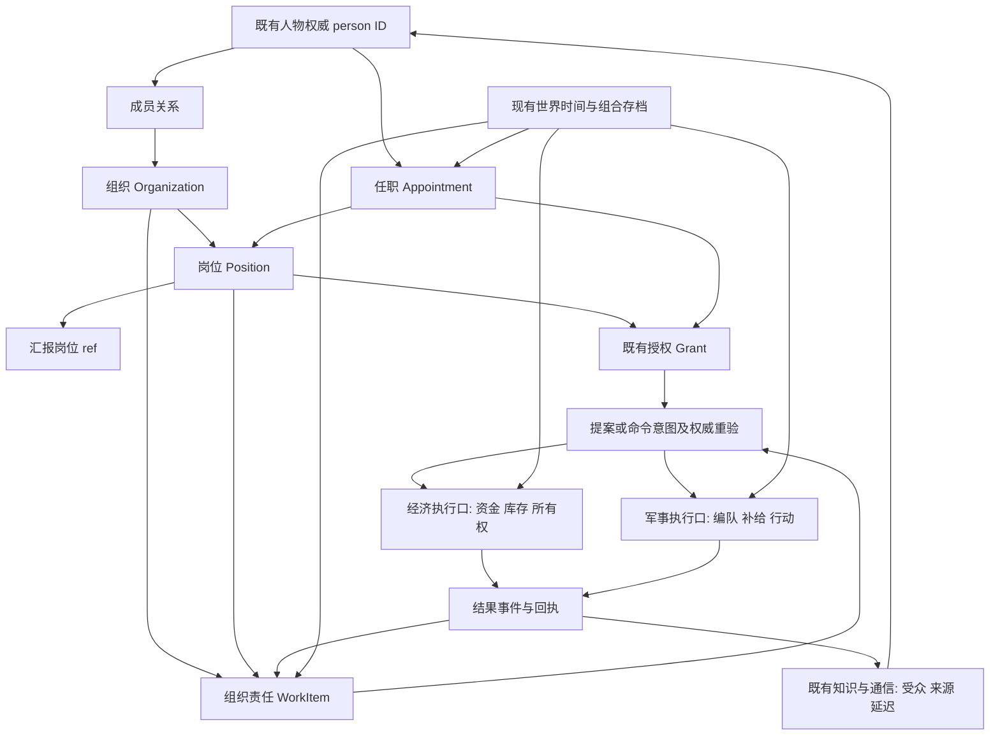

# WWO 组织机制研究与初步架构

研究日期：2026-10-13。版本：机制、数据与规则驱动的三算法共享世界方案 v2。交付性质：研究与设计文档，未实现。

## 1. 机制主轴与体验检验：人物在有限授权下把事情办成

最新设计原则：**机制本身不自动产生玩法，现实复杂度也不应全量逐人逐件搬入游戏。** 首先补足制度、资源、信息和执行的因果链，在机器负担内抽象，再用人物参与检查体验。普通成员、中层、领导只是参与差异示例，人物身份、任职和玩家控制焦点可以改变，不能限定为仅升职。当前权限限制参与，不删去世界活动目录。后续113项的覆盖/精度/操作/界面取舍见[军事活动覆盖与分层计算草案](military-activity-layering.md)。

本版修订共享资源、人口/有效能力、任职交接和时间合同；模型固定与粗细转换约束以该补充报告为准。三个职业原型和10–20分钟例子用于检查因果链，不证明机制已好玩、不是固定剧情或最终内容上限。

建议 WWO 的组织玩法围绕一个问题展开：**别人交给我一件事，但信息、资源、权限和个人目标并不完全一致，我怎样把它办成，代价由谁承担？**

循环为：进入组织并获得工作或使命 → 观察有来源和时效的有限信息 → 在执行、调查、协商、请求资源、调整方案、拒绝或退出之间选择 → 消耗既有时间、物资、预算与关系机会 → 收到可解释的进度和结果 → 改变关系、声望与任用机会，获得或失去职位和权限 → 接到新的责任。权限不足不是简单的灰按钮，而是产生“找谁、拿什么交换、是否缩小承诺”的选择。

最终目标是组织、经济、军事共用一个人物与空间世界；组织原型必须能经经济取得真实资源、让军事按实际资源执行，再按带时效回执更新责任。最新算法依据第8节近期作者材料，云端旧代码仅作历史接口参照。

第一版只做三个有用的冲突：**目标与资源不匹配；个人利益与组织目标不一致；任职变更但事情尚未结束。** 派系投票、复杂董事会、全国官僚链和全社会逐人计算先后置。组织机制的价值应能在一个采购、守备或救济任务里证明，不需要先完成一套制度百科。

### 1.1 可玩的最小原型

以一家小型运输或制造企业的一个补给任务为首个纵向原型：一处据点、一个明确目标、经理岗位、一个批准者、两三个关键联系人、两种可比较方案，普通工作人员用现有劳动力或执行能力聚合。玩家从雇员获得临时负责资格；面对预算有限、供货期限不同的报价，可自行调查、请求追加预算、分批采购，或拒绝不可能的承诺。结果必须由经济执行接口决定，任务层只记录目标和责任。

可操作画面只需要“当前职责卡”“已知情况与地图”“关键联系人”“可选方案与进度”。不用权限编辑器做主界面。点击“分批采购”时看到授权范围、预计成本、信息日期和可能的延误；缺失信息显示“尚未确认”，并给出调查或保守方案。申请预算收到“已提交、预计回复时点、当前可做事项”，不是一个无反馈的等待框。

军事和行政各用同一基础做一个独立样例，不要求同时建设三个完整职业：军官承接守备任务，选择继续、缩小目标或请求支援；行政代理人接手救济案，选择优先区域、核验或上报缺口。企业突出成本与履约，军事突出风险、时间和补给，行政突出公平、管辖与持续责任。协会、工会、政党等可以用成员身份、职务、任务与共同预算表达，但目标可以是组织会议、互助或争取支持，不能默认所有组织都逐利或能强制下命令。

### 1.2 普通成员、中层、领导怎样各自好玩

| 阶段 | 真正有趣的决定 | 看到的信息与权力 | 新的代价与反馈 |
| --- | --- | --- | --- |
| 普通成员 | 接哪项任务；花时间补证据还是按现有报告行动；协商范围或拒绝；把成果交给谁 | 本人使命、工作现场与联系人；能提出请求，不能任意调组织库存 | 时间与个人收入、可靠性记录、同事信任；一次合理拒绝也可能保住声望 |
| 中层负责人 | 将有限预算给哪项任务；选可靠但慢的人还是快但需监督的人；是否向上暴露问题；承担还是转交未完成事项 | 所辖任务、范围内资源报告和下属回执；能作范围内承诺与委派 | 成本、协调负担、下属与上级的不同评价；成功不必讨好每个人 |
| 组织领导 | 在两个组织目标间定优先级；授多少裁量权；选能力强的异见者还是可信的熟人；是否保留、收缩或终止业务 | 汇总报告与争议；任命和额度决策，仍无自动获得全世界真相 | 放权提升效率但扩大风险；收权提高把握但损失机会；制度调整影响将来而非追改过去 |

升职改变的是**责任对象和决策尺度**：成员处理自己的做法，中层处理多人的依赖，领导处理方向与任用。升级后旧的常规工作由 NPC 或聚合执行，不要求玩家逐条签字。获得新岗位也可能失去现场信息和自由时间；这比把工资和按钮数量同时乘二更有意义。

### 1.3 三个 10–20 分钟体验示例

以下为设计样例，真实分钟是用户操作与阅读时长，游戏内时间可跨数小时或数日；没有要求所有职业同节奏。报价、预算、期限均为未经校准的示例数据。

| 操作阶段 | 企业雇员／代理经理 | 军官接任 | 行政岗位代理 |
| --- | --- | --- | --- |
| 0–3 分钟 | 看到任命与补料职责：两日内补足一批原料；已有仓库报告为昨日 | 看到接任公文：前任守备任务仍在执行，补给报告晚六小时 | 看到救济案交接：两区需求、已付款合同、待答复申请 |
| 3–7 分钟 | 点击核实供应或查旧报价，发现便宜方案来货更晚 | 点击查看已知路线、向后勤问询；地图显示报告时间，不给全知敌情 | 点击核验一项需求或询问办事员；区分已确认与上报数量 |
| 7–12 分钟 | 选 600 单位分批采购，或申请追加额度采购更快方案；不能拿公司现金自付私事 | 选择维持守备、依法调整可调整部分，或向上请求撤离许可；无法凭职务制造弹药 | 选先保底两区、集中救急或请求增援；涉及私人关联供应商需回避审批 |
| 12–17 分钟 | 推进到下一决策点，可同时培训或联络；看到订单已接受、在途或需补充材料 | 推进中收到部分回执；没有回执的单位保持“状态未确认”，可另发问询 | 看到支出已确认而运输尚未送达；同一请求不用反复点击批准 |
| 17–20 分钟 | 收到交付与成本差异，履约证据影响下一次任用；升职不是必然奖励 | 看到守备进度和损失报告、上级对调整的反应，历史责任仍归原签发人 | 收到需求覆盖与未满足原因；换任后继续保留案卷，不把公物划到个人名下 |

不要用等待消息填充游戏：允许继续其他人物行动、设定“推进至下一相关回执／截止前”并在重要变化时中断。推进只是调用现有时间入口，不能偷偷跳过执行成本。重复工作在已授范围内自动运行；额度、目标、证据或风险发生实质变化才升级成玩家决策。

避免无信息惩罚：已知风险、未知项和求证途径在选择前可见；结果分清“方案质量”“执行条件变化”“信息延迟”。NPC 可以误报或隐瞒，但 MVP 不做无迹可循的随机背叛。NPC 不应因玩家没打开收件箱便停止履行已经收到并接受的任务。

## 2. 已发行游戏：选六个机制来源，不照搬六套系统

每项将“游戏公开机制”与“WWO 建议”分开。开发日志记录当时的设计口径，不代表 2026 全部细节；已发行补丁或发行说明能增强证据，仍不推断其内部数据库或算法。下文不引用长段原文，也不把营销文案当精确状态机。

### 2.1 Crusader Kings III：职位分配同时是一项关系决策

**来源**：官方 [Dev Diary #17：政府、封臣管理、法律与继承](https://forum.paradoxplaza.com/forum/developer-diary/ck3-dev-diary-17-governments-vassal-management-laws-and-raiding.1352640/)（2020-03-10）。这是发行前日志；[官方周年页面](https://www.paradoxinteractive.com/games/crusader-kings-iii/anniversary)确认其已发行游戏与扩展语境。Wiki 页面请求被拒绝，故不据其补充当前版本细节。

**公开机制**：封臣有各自义务；提高义务会碰到关系和强制手段的代价；强大封臣期待进入内阁；继承分配会改变头衔与上下级关系。日志同时提供封臣、直辖与继承视图。这里不沿用早期“义务三档捆绑”等数值细节，也不声称某个合同永远绑定岗位或人物。

**解决的问题与冲突**：领导不能只任用最能干者，还要处理重要支持者的期待；个人死亡并不等于所有制度对象消失。任命本身会改变关系与政治风险。

**适用 WWO（建议）**：给玩家两个任用候选及其已知履职证据、支持关系；把稳定岗位和临时任职拆开。交接可带来新选择，组织目标持续存在。

**不适用**：1900 年企业经理与行政职务不能普遍世袭；中世纪封地不应直接等同股权、行政管辖或部队控制。WWO 的人物信息范围也不能照搬大地图管理视角。此处借鉴任用冲突，不照搬封建法。

### 2.2 Mount & Blade II: Bannerlord：有组织归属，也有可独立行动的队伍

**来源**：TaleWorlds 官方 [2019-12-05 王国决策日志](https://www.taleworlds.com/en/Games/Bannerlord/Blog/132)、[2017-10-05 影响力与军团日志](https://www.taleworlds.com/en/Games/Bannerlord/Blog/28)、[2019-07-18 家族成长日志](https://www.taleworlds.com/en/Games/Bannerlord/Blog/119)；发行后的 [WS 1.2.5／BL 1.4.5 补丁说明](https://www.taleworlds.com/en/News/602)。TaleWorlds 全文多次返回 403，本次依据搜索引擎收录的官方摘要；只采用摘要明确支持的机制，细节置信度低于成功读到的支持手册。

**公开机制**：家族属于王国，家族首领提出或支持王国决策；影响力用于影响决策和聚集军团，军团维系有成本。正式补丁说明确认王国投票、AI 组军限制与家族成员最多两个队伍岗位等功能。**2026 年 BL 1.5.0 Beta 的新控制选项不作为正式版既有机制使用。**

**解决的问题与冲突**：同属一个王国并不意味着所有队伍恒定同步；聚集力量需付出影响力和维系成本。成长给玩家带来指挥或参与决策的新尺度。

**适用 WWO（建议）**：军官以组织中的任职获得某些编队的指挥权；编队仍是军事对象。临时协同、支援和资源竞争让中层有事可做；NPC 可按任务自主执行。

**不适用**：不要把影响力货币设为支付军费、采购和行政授权的万能替代物；不照搬个人战斗作为所有晋升的必经途径，也不默认家族是企业或社团的组织基元。

### 2.3 EVE Online：把能看、能拿、能代表、能授予分开，并给普通成员可贡献的目标

**来源**：CCP 官方支持 [Roles and Grantable Roles](https://support.eveonline.com/hc/en-us/articles/203278741-Roles-and-Grantable-Roles)（更新 2024-08-29）、[Roles Listing](https://support.eveonline.com/hc/en-us/articles/203217712-Roles-Listing)（更新 2024-02-05）、[Corporation Projects](https://support.eveonline.com/hc/en-us/articles/9583433729308-Corporation-Projects)（更新 2024-11-12）。全文可读。

**公开机制**：可授予某角色的权限与持有该角色不同；查询仓库与取走物品分开；项目管理权限不自动包含用于奖励的公司钱包权限。公司项目给成员目标、贡献记录与奖励，包含交物、制造、作战等类型；自由形式项目可能手工追踪，不是所有贡献都自动识别。

**解决的问题与冲突**：加入公司不等于能拿全部财产；领导能设目标但要另有支付能力；普通成员可以在不持管理职务时贡献并获得反馈。

**适用 WWO（建议）**：成员、任职、授权、预算承诺分别判定；任务从执行模块回执确认贡献。领导选择谁值得放权，成员选择承担什么任务，有限授权可成为晋升试用。

**不适用**：不做一个几十种角色勾选的管理产品；现实玩家组织的信任与叛变不能直接当作单机 NPC 的完整行为模型。WWO 不用全权限 Director 作为默认领导者；领导也受章程与既有资产约束。

### 2.4 Dwarf Fortress：岗位让工作链运转，任命不等于任务完成

**来源**：Bay 12 官方 [2007 开发记录](https://www.bay12games.com/dwarves/dev_2007.html)（08-30 记载经理验单、办公室与记账精度；只作机制起源证据）；社区 [Manager](https://dwarffortresswiki.org/index.php/Manager) 与 [Bookkeeper](https://www.dwarffortresswiki.org/index.php/Bookkeeper) 补充目前页面描述。经理页自标 v53.16 并提醒部分内容可能未更新，不能将旧 DF2014、23a 页面和现版混成一套。社区 Wiki 为次级证据。

**公开机制**：经理允许通过工作单组织生产，验单本身需要人有时间和办公条件；记账员改善库存信息的精确度。具体生产仍需要工人、材料和工作场所。经理页也说明一些旧式 Workshop Profile 选项已移除。

**解决的问题与冲突**：把“指定负责者”“组织工作”“实际生产”“知道库存”拆开；管理本身会有瓶颈，批量和条件式工作单减少微操。

**适用 WWO（建议）**：有职务却没有资源或信息支持时，玩家可协调而不是直接失败；常规任务自动推进，缺资源才升级。观察报告的质量或时效可以形成调查选择。

**不适用**：不复制全堡垒逐人搬运与家具要求；不把每份审批模拟成必须等角色走到桌前。用现有劳动、空间、时间能力表达可执行性，避免“官僚动画”拖慢人物游戏。

### 2.5 Victoria 3：企业权利、资产与人物关系不是同一件事

**来源**：官方 [Dev Diary #147：Everything Companies](https://forum.paradoxplaza.com/forum/developer-diary/victoria-3-dev-diary-147-everything-companies.1747321/)（2025-05；全文可读），[2025-06-17 Charters of Commerce 发行说明](https://www.paradoxinteractive.com/media/press-releases/paradox-interactive/master-global-trade-in-new-victoria-3-pack)（确认已发行的贸易、投资、产业与殖民特许权）。开发日志 #110 全文抓取失败，不作为核心事实证据。

**公开机制**：特许权扩展公司的经营范围；公司总部与地区总部展示所属资产；日志介绍 Executives 作为公司负责人并连接利益集团，且明确更强的公司政治威胁属于未来工作。发行说明确认特许权已发布，未单独核实负责人全部最终数值。因此不把日志的未来政治功能写成现成实现。

**解决的问题与冲突**：授权改变“能做什么”，公司资产说明“拥有什么”，负责人表达“谁在代表它”；资源和特许机会集中还是分散构成战略选择。

**适用 WWO（建议）**：企业模块持有所有权和收益账；组织层持有任职及受限经营授权。负责人可能兼有工会、社团或政治关系，使私人立场与组织经营目标产生张力。

**不适用**：WWO 不是国家视角直接给所有企业分配特许权；利益集团是政治聚合，不应强制每名雇员属于某个正式组织。首版不借此扩大到跨国殖民或股份证券模拟。

### 2.6 Suzerain：信息通过人和报告到达，决定必须有可理解的代价

**来源**：Torpor Games [官方新闻稿汇总](https://www.torporgames.com/press-releases) 中 2025-11-11 主游戏与 Rizia 发行说明及 2023 年主游戏介绍；[社区 Decision 页面](https://suzerain.wiki.gg/wiki/Decision) 仅用于确认存在具体预算与政策决策样例，未作为完整算法说明。

**公开机制**：玩家扮演领导者，通过内阁和重要人物谈话作出决策；报告、新闻、资料库反馈世界变化；不同人物与阵营有不同立场。Rizia 提供资源取舍与战争等内容。2026 公告中的未发行新作品和 Galmland 不纳入已发行机制研究。

**解决的问题与冲突**：领导权不是无成本命令器；政治与个人关系把政策选择变成有对象、有风险的决定。反馈有载体，玩家能把结果和先前承诺联系起来。

**适用 WWO（建议）**：用少量关键联系人、带来源报告和责任卡呈现冲突；同一规则触发不同人物的请求、抗议和任命机会。选择后显示直接变化与待确认影响。

**不适用**：不复制固定总统任期与大体量分支剧情；不假定 NPC 真有该游戏文案暗示的通用智能或逐人政治算法。WWO 事件应主要由状态变化触发，而不是为每种组织写一套固定故事树。

### 2.7 本次采用的组合

第一版取 EVE 的受限授权与贡献目标、Dwarf Fortress 的工作单与执行边界、Suzerain 的人物报告与后果表达；任用冲突借 CK3，军事协同借 Bannerlord，所有权分离借 Victoria 3。**这是 WWO 的设计组合，六款游戏并没有共同实现下文的统一数据模型。**

## 3. 仓库只读结论：哪些东西真的存在

### 3.1 检查边界与版本口径（云端旧检出，仅代码参照）

已读检出中的`AGENTS.md`。本次约束包括：Godot 4.6.3、稳定 ID、权威人物状态重验、行动时间按边界结算、避免每帧全社会遍历、存档恢复验证一致性。

静态检查涵盖人物身份、旧组织服务、vNext 组织／授权、关系与通信、军事桥接、两套可见经济入口、Formal 组合与存档。未做全项目审计，也未运行游戏、测试或导出。这份检出只证明其可见代码阶段，**不能证明用户本地未提交实验不存在，也不能证明云端是最新完整实现**。

按机制阶段区分：旧 Alpha／v2.3 人物生活切片有较丰富的关系和通信；vNext 形成分域基础；当前入口为 Formal 世界组合；`experiments/war_resolver` 为独立战斗算法实验。它们不能因为名字接近便默认互通。

### 3.2 实际代码证据与含义

下列路径均相对仓库根；行号为本次检出定位。表中“事实”只表示静态代码存在，不表示玩法已经过真机验收。

| 接口／对象 | 实际代码证据 | 对方案的限制与复用方向 |
| --- | --- | --- |
| 旧人物数据 | `scripts/core/models/character_data.gd:1` 有职业、public_position、organization_ids、skills、qualifications、drives 等 | 不另造组织专用人物。旧公开职位是表现字段，不能作为授权依据 |
| 旧组织服务 | `scripts/organization/organization_service.gd:90,163,210`：加入可获得入口职位；按岗位 permission 判断；任命写人物公开职位；`organization_data.gd` 有 resources 标量 | 旧组织把加入与入口职位联动，和新基础不同。resources 不能当可结算公司现金／库存；不让两套服务共同持有成员真相 |
| vNext 组织结构 | `scripts/vnext/organization/organization_core.gd:13,429,517,683`：organization、members、positions、appointments；成员和任命分开；每组织每人仅一项任职；岗位 slot_count | 稳定组织 ID；岗位和任职为组织内局部 ID，引用需组织 ID 配对。MVP 保留同组织单任职约束，不偷偷加入兼任 |
| 类别与能力词汇 | `organization_kind_catalog.gd:8`：company、government_body、association、military_institution 等；`organization_capability_catalog.gd:8` 只有 `organization.manage_appointments` | 国家／政体及编队不另立为组织种类。结构层能力注册表当前很小，不将建议操作名说成已注册能力 |
| 范围授权基础 | `organization_authority_foundation.gd:245,318,556,588,639,803`：授权、提案／投票／签署、范围、数量上限、期限、转授权、权力关系、快照 | 已有分阶段授权，勿新造第二个权限框架。数量上限是授权匹配条件，不能据此声称已有累计预算扣减账本 |
| Formal 组合 | `scripts/formal/formal_world_simulation.gd:40,158,219,353,532,1006`：组合人物、组织、授权与军事，校验当前玩家才允许防御；持久化这些域 | 不能照旧文档说组织完全未接 Formal。实际接入是有限切面，不能说全套职业命令都已贯通 |
| 持续责任 | `formal_world_organization_responsibility_service.gd:6,12,197`：以组织为主体的供给连续性监测，按经济结算日查看缺口／关闭案例 | 可复用组织持续责任与案例概念，但只是监測，不等于经理可采购或有任免玩法。其 `generated_simulation_assumption` 也不是历史机构的事实证据 |
| 人物权威 | `scripts/vnext/population/named_person_overlay.gd:14,101,105,129`：身份、人口归属、位置、生存与来源；`player/player_state.gd:21` 可绑定人物权威 | Formal 人物覆盖不是旧版全人物技能模型。应由人物域扩展所需事实并提供只读口，不复制旧 CharacterData 为第三套人 |
| 关系、知识与消息 | `scripts/v2_3/relationship_service.gd:5,121` 有 trust 等及幂等互动；`knowledge_service.gd:5,73` 区分 reported／confirmed 等；`communication_service.gd:5,186,214` 分投递和阅读；vNext `events/event_knowledge_state.gd:25,42` 分事件发生与揭示 | 可复用语义和适配边界，但未证明 v2.3 通信关系服务已接 Formal。vNext 简单事件可知状态也不是完整组织秘密／消息链 |
| 军事接口 | `scripts/vnext/military/military_service.gd:100,164,200,241,279` 有部署／防御／攻击／推进／行动查询；`military_authority_bridge.gd:33` 仅防御授权桥 | 编队、物资、行动进度仍由军事域负责；“AUTHORIZED_AND_EXECUTED” 是桥接调用成功，不应当作整个防御任务已完成 |
| 经济接口 | `scripts/vnext/economy/market_economy.gd:171,175,395` 有价格、库存与快照；`scripts/formal/formal_world_economy_service.gd:6,17,33` 有聚合市场、货运与借用世界时间；`personal_wallet.gd:9,26` 是个人钱包 | 当前已读接口没有证明公司级可结算预算／所有权／采购承诺完整存在。组织层不能以给钱包加钱或写库存的方式补缺；待与独立经济模块确认命令口 |
| 事务与存档 | `scripts/vnext/transactions/world_transaction_coordinator.gd:41` 候选准备、验证、采用屏障；`formal_world_simulation.gd:532,restore_persistent_state` 组合快照；`formal_world_persistence_document.gd:14,20` 精确 Variant 包裹；`vnext/persistence/world_snapshot_store.gd:8` 复用 AtomicJsonFileStore | 可用候选提交方式承载任命和交接，但当前未证明各真实域都注册了事务参与者。不换存档容器、不建组织专属存档系统 |

**重要历史差异**：`docs/vnext/organization_core.md` 与 `organization_foundation_contract.md` 仍描述 v1、未接 Formal；实际 `organization_core.gd` 为 v2 并有 revision、兼容 v1，Formal 已组合并存储组织／授权／军事。故第3节以这份检出代码描述旧阶段，旧文档只作设计演进说明；第8节以近期作者材料描述当前研究方向，二者分别标证据层级，不用任何报告代替源码或运行验证。

`experiments/war_resolver/README.md` 明确标注 NON-PRODUCTION、未接正式世界；事件堆、秒级实验时钟和独立快照是实验接口，不是建议搬到主组织层的新系统。本次随后已读取近期军事／经济作者报告和回执（第8节），未检查其最新源码或运行；对接仍是契约建议。

## 4. 数据化玩法：由状态触发决定，而不是堆事件

### 4.1 三类量必须分开

| 类型 | 例子 | 权威与用途 |
| --- | --- | --- |
| 既有事实量 | 活着与否、当前任职、授权范围、实际库存、已付款、领域行动状态、已投递报告 | 各原属模块持有。决定能否行动或实际结果；组织只能引用与读适当投影 |
| 规则计算量 | 当前可用授权；已知信息下的预计成本／完成时间；某责任是否需关注；下一阶段任用资格 | 从事实与明确规则推导，注明信息基准及规则版本。可缓存但不能变成第二份现金、库存或人物真相 |
| 表现摘要 | “预算吃紧”“前任任务待确认”“办事可靠”与界面排序 | 由事实、计算结果、已知证据生成。不能反向驱动扣款、惩罚或授权 |

“可用资源”不是组织里新增的 resources：它是领域资源可用量、已有承诺／预留与本次授权上限的组合查询。玩家看到的还可能是旧报告，而执行提交时必须再检查权威资源。界面不为了演示确定性而透露未获知库存或敌情。

### 4.2 少量状态与规则

组织先用 active／inactive；需要清算时增加 winding_down，不能把 inactive 同时解释为破产、解散、暂停营业。成员关系先用“存在／离开”，任职用有效区间与代理标记。任务生命周期最少为：

```text
OPEN → ACCEPTED → RUNNING → COMPLETED
       ↘ DECLINED（本次候选人拒绝，组织责任仍可重新分配）
RUNNING ↔ BLOCKED（原因和可行补救）
OPEN／ACCEPTED／RUNNING → CANCELLED（有撤销依据）
岗位空缺或人员失效 → NEEDS_HANDOVER（责任分配状态，不覆盖 RUNNING）
```

重要区分：任务状态、责任交接状态、消息状态各是一回事。没有回执只能把“人物对此结果的认知”置为未确认，不能把军事运行中的行动变成 FAILED。拒绝也是一个申请／指派尝试的结果，原组织责任不因候选人拒绝而凭空消失。

第一版规则只覆盖：任用有效性、操作范围、批准必要性、资源满足与任务重大变化。规则输入来自引用对象和当前世界时点，输出为合法选项、阻塞原因、可请求对象及反馈事件。阈值用配置，例如“预测完工晚于截止时点即建议缩小目标或申请支援”，不添加没有用途的综合“组织实力”“忠诚”“行政效率”分数。

### 4.3 触发冲突和机会

| 状态变化／证据 | 触发的玩家选择 | 可观察后果 |
| --- | --- | --- |
| 可执行报价超出本次授权 | 缩小订单、找批准者或改期限 | 请求送达／批准／拒绝；承诺额度变化；没有授权时不能扣款 |
| 按既有数据预测无法按期完成 | 接受延期风险、补证据、换方案 | 任务标注风险与已知原因，关键联系人反应由相关事实触发 |
| 任职结束，组织任务仍运行 | 接任、请求交接或临时代理 | 所辖任务可见性与可改命令变化，原执行进度保留 |
| 可证实贡献达到岗位要求且有空缺 | 申请职位、接受试用或继续现职 | 出现任用机会；上级可按资格与现有关系作决定，不自动升级 |
| 同一人物是对方组织代表 | 声明利益关联、回避或请求另人批准 | 相关行动被转交／需额外批准；不对所有兼任一律惩罚 |

任用资格、信任和对个人的后果应交给已有的人物／关系／政治责任模块；若当前 Formal 没有相应能力，MVP 先记录可验证的履职证据并提供反馈，不声称已有连续晋升算法。人际变化只对相关关键人物更新，外部声望必须经可知事件传播。

## 5. 支撑这些玩法的最小架构

### 5.1 核心对象与权威归属

优先复用三类已有组织对象和授权基础，只补任务／交接与领域引用。不是建立通用组织管理平台。

| 对象 | 最小字段或关系（建议新增明确标注） | 影响什么选择与后果 |
| --- | --- | --- |
| Organization（已有） | organization_id、kind、primary_place_id、parent_organization_id、active；建议 lifecycle_reason／规则配置引用按需添加 | 加入何组织、在哪工作、是否还能接受新任务；解散／停用对任务处置不同 |
| Membership（已有 member_ids；未来可扩展关系记录） | organization_id＋person_id；若需退出历史再加 joined_at／left_at／basis | 允许接组织成员任务、领取某些报告；不自动成雇员、干部、股东或士兵 |
| Position（已有） | 组织内 position_id、title、slot_count；建议 reports_to_position_id 和角色规则引用 | 明确向谁请求、负责何范围；不是人物技能或“等级” |
| Appointment（已有） | appointment_id、person_id、position_id、requires_membership；建议 effective_from／effective_until、acting、任免依据 | 当前是谁代表岗位、接任从何时生效；代理期限结束撤除相应权力 |
| AuthorityGrant／Delegation（已有基础） | holder、represented_entity、operation、target／spatial／subject scope、limit、valid_from／until、basis、delegable 等 | 决定提出／批准／代表／执行何操作；授权不替代领域资源校验 |
| Responsibility／WorkItem（跨域组织责任记录；军事执行引用现有operations） | organization_id＋local_id、goal_rule_id、goal_args、accountable_position_ref、assignee_ref、issuer_context_ref、deadline_at、execution_ref、lifecycle、handover_state、blocked_reason、revision | 什么要办、谁负责、是否已接、如何补救、谁接手；组织目标和个人尝试分开 |
| Resource／BudgetBinding（组织只保留引用） | asset／account／budget／allocation 外部 ref、可用操作、范围；预算使用量与预留由经济持有 | 哪些方案可请求或承诺；“限额 1000”不代表组织真的有 1000，也不表示每次都能花 1000 |
| Order／Receipt（任务引用＋既有事件／消息） | 指令 intent、签发上下文与 at_time、domain_action_ref；回执 event_ref、阶段、原因与领域 revision | 明确命令是否被接受、是否执行与结果是否已知；避免投递重复造成二次动作 |
| ReportLink（引用已有知识／消息） | 工作项／对象 ref、事实观测时间与来源 ref、允许受众规则 | 谁能看某报告；岗位能请求档案不等于瞬间知道档案全部内容 |

不要求每行都变成独立脚本／数据库表：WorkItem 内放小型 assignee 与 handover 状态即可；Order 是向专业模块发出的意图，Receipt 复用其结果事件；ReportLink 只关联现有记录。预算绑定不保留镜像余额。位置、关系、时间、库存、存档都继续使用原域。

“岗位授权”和“当事人个人特批”须区分：岗位授权可随合法继任者使用；绑定 appointment 的临时特批默认随任职结束失效；绑定 person 的个人许可按授权依据失效，而非强行跟随岗位。执行时不能仅凭字符串中的头衔放行。

### 5.2 共用骨架与领域扩展

| 类型 | 共用机制 | 专属事实继续由原域持有 | 第一版的配置差异 |
| --- | --- | --- | --- |
| 行政机构 | 任职、责任、有限报告、申请／批准、交接 | 政体合法性、管辖、财政、公共资产、行政案件领域结果 | jurisdiction_ref；法律依据与审批者；案卷保存和公物控制范围 |
| 军事机构 | 任职、命令资格、持续任务、回执、代理 | formation:*、补给、行动、损失、战斗与战场控制 | formation_scope；可下达命令类型；继任／失联默认规则 |
| 企业 | 身份、经理岗位、预算权限、履约任务与责任 | employment／劳动、工资、账户、所有权、库存、采购合同、生产与利润 | account／budget／site refs；单笔与周期承诺限额；履约指标 |
| 社团／工会等 | 成员、干事岗位、活动任务、代表与共同资金授权 | 政治支持、专业资格、会员费与利益诉求 | 自愿接受／退出规则、活动目标；没有默认军事强制服从 |

少量配置仅选现有操作、目标判定、报告范围、批准关系与默认交接。目标采用经济／军事可读指标或事件，如交付某量原料、守备到某时点、救济案处理完成；组织层不发明通用“贡献能量”。国家／政体和军事编队仍保持独立 ID，组织只引用它们。

### 5.3 关系图



图中的箭头为依赖／引用，不是拥有关系。“岗位→汇报岗位”只是汇报和请求路径；跨组织母子关系也不天然赋予父组织全部资产和全部命令权。

### 5.4 建议的窄接口（伪代码，不是已实现 API）

```text
known_work(person_id, organization_id, at_time) -> 可知任务与带时效报告
preview_choice(acting_context, work_ref, choice, known_revision)
    -> 预计成本/时间、未知项、需批准者、范围阻塞原因
change_appointment(command, expected_revision, effective_at)
    -> 候选任职＋授权失效＋交接标记，验证后一起采用
submit_intent(command_id, acting_context, work_ref, domain_payload, at_time)
    -> AUTHORITY_DENIED | AWAITING_APPROVAL | DOMAIN_REJECTED | ACCEPTED
consume_domain_event(event_ref, domain_revision)
    -> 幂等更新任务引用／阶段，生成可投递报告
```

预览只用人物已知信息，不能泄露后台真值；提交使用权威人物、当前任职、授权与领域条件。新动作的正式授权可复用 `resolve_authority`，但完整活着／资格／任职有效区间的检查需人物与组合入口配合；已接受组织义务/在途签署命令按其明确的持续/有效期/撤销规则处理，不能一律以发送者现状追改过去。提案批准不是执行结果；岗位更高也不意味着领域判定会成功。

命令关联使用现有行动／事件规范；独立实验的ID与宿主StableId需适配，不擅自改写它们或添加未经登记的StableId类型。岗位／任务局部 ID 用 `(organization_id, local_id)` 引用；实际 schema 字段新增须走未来迁移，本文代码块不是可直接贴入现有严格字段快照的数据。

### 5.5 规则数据示例

下例表示“建议的简化配置／投影”，不是现有 AuthorityFoundation 的完整合法记录。货币单位为账户的最小单位；所有数值为原型假设。

```json
{
  "organization_id": "organization:example_factory",
  "position_id": "workshop_manager",
  "reports_to_position_id": "director",
  "appointment": {
    "appointment_id": "manager_trial_01",
    "person_id": "person:example_employee",
    "effective_from": 480,
    "effective_until": 3360,
    "acting": true
  },
  "grant_projection": {
    "operation": "economy.commit_purchase",
    "target_scope_ref": "factory_site_scope",
    "single_commitment_limit_minor": 600,
    "budget_ref": "economy_budget_record_ref",
    "delegable": false
  },
  "work": {
    "local_id": "restock_01",
    "goal_rule_id": "delivered_material_quantity",
    "goal_args": {"commodity_ref": "existing_commodity_ref", "quantity": 60},
    "accountable_position_id": "workshop_manager",
    "deadline_at": 3360,
    "execution_ref": null,
    "lifecycle": "OPEN",
    "handover_state": "NONE"
  }
}
```

每个字段有玩法用途：scope 限定能采购哪个车间；single limit 让超额方案要协商；budget_ref 让多笔采购累计由经济检查；acting 和 until 使试用与接任有时点；goal／deadline 让速度与价格形成取舍；accountable_position 让换人不抹去责任；execution_ref 让反馈能指向真实采购。没有目标的 organization_strength、十几项新性格数值、全员实时忠诚矩阵不进入 MVP。

## 6. 任免、代理与责任连续性

### 6.1 必须第一版正确处理

- **任命**：授权者、候选人物生存／资格、岗位空位、所需成员身份都重验。提名与确认可以分开，但原型只需一个合法任命者，不强制每次走多轮投票。
- **代理**：明确岗位、范围、开始／结束边界与是否能再委派；代理不必把本人原岗位删掉。受当前同组织单任职约束，MVP 采用“临时授权代理既有岗位职责”，不假装已支持双正式任职。
- **同组织兼任**：首版不开放第二项正式任职；跨组织任职可保留，但只有行动涉及对方组织、本人账户或所代表利益时才触发声明／回避。后来若开放同组织兼任，须改槽位、任职校验和存档规则。
- **上下级**：汇报关系只决定提交／反馈路线。上级修改任务须有对应权限；子岗位授权不超过来源范围，委派期限不长于来源，额度不因层级重复增加。汇报回路拒绝或明确作为非指挥关系处理。
- **免职／离开**：先确定生效时点和待交接项，再关闭任职与随任职授权；离开身份不回收组织已经付出的成本，也不自动取消已生效合同。
- **死亡／失能**：由人物权威触发，停止新签发与个人执行；已接受的领域任务依据领域规则继续／暂停，职责转入待交接。过去签发者与行为记录保留，不把前任错误全部算给继任者。
- **继任**：默认岗位责任可继承；个人委托／个人利益绑定任务需重新接受。任职变化与其授权失效、任务负责人改绑采用一个候选边界，不能出现两人同时独占指挥或“无人却仍可签字”。

人际信任影响任用与合作，不替代正式授权；正式授权也不保证 NPC 愿意、能够执行。首版 NPC 拒绝只使用可解释条件（缺资源、冲突、失能、合法拒绝），复杂政治抗命后置。

### 6.2 分裂、解散与未完成责任

MVP 不开放任意玩家分裂按钮，但不能删除有未完成责任的组织。停用保留结构和责任；禁止新承诺，既有合同和执行按域规则处理。最低限度记录待处置、转交对象或撤销依据，避免存档里留下悬空执行引用。

后续分裂时新组织获得新组织 ID；成员转移、资产产权转移、实际控制移交、命令转交各是一项明确事务，不能复制库存或预算。每个开放责任有“留在原组织／转给继承组织／依法撤销”处置项；原责任 ID 与处置记录可追溯。解散先 winding_down 清算，领域确认债务、合同和资产处置后才 closed；组织墓碑保留历史，不通过删记录免债。没有实现债务领域时，可暂停解散而不虚构“所有债务已消失”。

## 7. 信息、授权、执行与回执链

### 7.1 谁知道、谁提出、谁批准、谁执行

| 层 | 输入与持有者 | 输出 | 不能自动推导 |
| --- | --- | --- | --- |
| 知识 | 现场观察、送达报告、可请求的岗位档案；知识／通信服务 | 人物可知投影、日期与来源 | 有阅览资格不等于已经获知；组织消息也不等于读过 |
| 提出 | 成员、员工或任职者；按任务规则 | 提案／请求，当前已知依据 | 提出资格不含批准、支付或执行权 |
| 批准与代表 | 当前有效授权者；既有提案／范围授权基础 | 可执行的组织意图与签署上下文 | 批准不创造钱、材料、路线，也不转产权 |
| 执行 | 经济／军事／行政领域和实际执行者 | ACCEPTED／BLOCKED／运行／完成的领域结果 | 职务高不等于能亲自执行所有专业行动；接受不等于完成 |
| 返回 | 领域事件→任务关联→按受众与通信送达 | 分阶段回执、新报告、可追溯履职证据 | 没消息不等于失败；消息迟到不追改已经发生的执行 |

签发命令时保存 issuer_person、organization、appointment／authority basis、目标与签发时间。**新请求接受前重验**当前人物权限和条件；旧签署/已接受任务按其操作规定检查有效依据与真实可执行性，但不以新任命追溯改写过去的合法签发。已被领域接受的长任务是否需要持续授权由操作定义决定：一次采购合同继续履约；每日新采购承诺必须重验；军事改变既有命令须当前合法指挥者，前任免职不自动使全军停下。

### 7.2 两种状态必须同时成立

后台任务可能已完成，但玩家只知道“订单已接收、交付待确认”。返回事件不能因此再次执行。反过来，玩家持有旧成功报告不表示任务当前仍满足目标。查询返回 observation_at／received_at 和事实版本；接任可以得到经授权的交接摘要，不能读取前任私人通信和整个世界。

消息过期：保留旧报告并标为过时，提供“核实／问询／按保守方案继续”。重复回执按 command_id／event_id 去重。因离职撤销的是继续查看受限档案的权限，已知的历史记忆不从人物脑中抹去；后续秘密访问可有法律或关系后果。

### 7.3 控制与所有权分离

资产拥有者、保管者、使用／下令者可以不同。它们的权威在经济或军事域：公司拥有机器，经理有安排使用权限，仓库员保管原料；军官指挥编队，不个人拥有编队；行政岗位支配某项公务预算，不把账户当自己的钱包。组织层只解释当前授权为何允许某个操作。

预算限额区分单次授权与周期累计承诺；预留、已支付、退款都在经济账本中更新。授权树中的多个 Grant 不各自产生一份预算。更换经理不重置累计使用量；申请额度不是补足账户现金的动作。

## 8. 三算法最终共用一个世界：近期材料优先，旧代码只作接口演进参照

本轮目标是组织、经济、军事共同构成 WWO 世界。第一节的企业原型用于证明共享世界的决策链，不是另外开发一个组织小游戏。下面以近期作者材料作为当前算法能力的主要依据；第3节云端代码仅证明旧检出的实际接口，不能拿它覆盖最新本地研究。

### 8.1 已读取的近期材料与证据层级

近期六份作者材料的全文已读；其内容描述和验证标签只按作者证据级使用，没有由此核验最新源代码或本地运行。

| 已读材料名称 | 读到的实际内容 | 可支持的结论与限制 |
| --- | --- | --- |
| `PROGRESS_ZH(20261012-140341).md`；`README(4).md` | 10月12日军事研究：身体／岗位／单位区分，Task8、operation_intent、子任务、Information、Task6、LAND／SEA、接续、局部通信、中继、有限工程、会合与改派 | **M 作者报告级**。最新源码修改明确未编译、测试、审计或试跑；未接 Formal 宿主／存档。早段限制与后段新增要按日期读，不能把旧“无转装”当最新限制，也不能宣称新增运行正确 |
| `PROGRAMME_FINAL_REPORT.md` | `research/fifteen-algorithms-v0`：统一库存／订单／FIFO／shipment／整数CashAccounts，加需要、替代、劳动工资、空间边、信用、双币、企业份额；统一日内次序 | **E 作者报告级**。有限合成fixture中的算法结果与核对，不是现实校准、完整游戏或三算法联合运行。旧M5仍PARTIAL、N4仍EXPERIMENTAL，不能用总完成标签抹平 |
| `DELIVERY_RECEIPT.json` | ALGORITHM_SUITE_V0_COMPLETE、research分支、本地恢复收据、source_checks、最终bundle信息 | **E 交付身份／恢复记录级**。恢复标为PASS_LOCAL_RESTORE，simulation_execution明确NOT_RUN；不算本次重新验证算法。恢复源码/配置身份不证明世界运行态load/save |
| `ARCHITECTURE(4).md` | WorldState组件引用；WorldBootstrap；GameClock；OrganizationState／AuthorizationCheck；SimulationStep；Ledger；只读Presenter；DEFEND窄调用 | **H 近期宿主作者文档级**。当前宿主组织职责观察和DEFEND存在，但SimulationStep明确不自动推进军事；不存在完整正式Relationship／Information状态。不能等同最新独立军事算法已接入 |
| `SAVE_FORMAT(2).md` | v15／exact_variant_v1；原子临时验证；WorldBootstrap候选恢复后Application安装；Ledger／个人物资／原生R2接管与货运增量 | **H 持久化上下文级**。宿主军事快照是其现有MilitaryState，不包含最新军事实验全部状态。R2原生适配是较窄切片，不能替代E十五算法模型 |

经济来源包未在本研究中检查源代码；精确方法签名、字段与恢复接口继续待本地核对，不能从作者报告造出已有API。

### 8.2 对接清单：已知与拟新增逐项分开

| 对接项 | 军事提供（M报告） | 经济提供（E报告） | 组织新增／复用（建议） | 共享世界唯一归属及缺口 |
| --- | --- | --- | --- | --- |
| 人物／单位／身份 | person、实际身体、unit_ref、当前岗位与行政归属分别表达；临时配属不换人物 | 具名主体／cohort、人口、工作与需要；同质拆分有报告级守恒证据 | Membership、Position、Appointment引用同一person；不要再造组织人口 | 人物身份与常住人口归属由宿主Person／Population，实际位置由已选空间／人物权威；军事身体只持军事能力事实。**缺**两边person/subject/body映射及死亡/激活合同，异质cohort不假定等价 |
| 组织／职务／命令资格 | `appoint`、`vacate_position`、当前office、现任下级与指挥范围 | 劳动岗位、经营主体、真实企业份额；劳动v0每cohort一个岗位 | 统一组织结构和授权，军事组织适配其node/office；企业经理≠劳动岗位≠股东 | OrganizationState／AuthorizationCheck作为制度唯一权威；研究中的role override必须通过适配引用而非同步双写。**缺**军事node与岗位/任职映射、企业主体与组织映射 |
| 钱／预算／信用／股权 | 不提供独立经济账；军事不凭职位生成物资 | 每币整数CashAccounts、承诺/原子支付、工资claim、信用、换汇多腿、真实份额/股息 | 添加预算约束与任务引用，不增加余额；限额单笔和累计分开 | 经济账务口唯一持现金、预留、信用和份额；宿主Ledger与CashAccounts需选择同一状态后端，另一者只能适配/观察。**缺**组织账户范围、委派额度消费/回收口与原子参与者 |
| 商品／库存／保管控制 | Task6唯一实验库存，cargo/cargo_by_vessel、request_ref、transport_ref、delivery_ref、received_quantity、forwarded_cargo；货物不当承运队弹药 | 库存、FIFO、未发承诺、在途责任、实际收货/消费/生产、共享资金 | ResourceBinding引用批次/账户；任务目标读实际可用交付，不复制物资 | 共同物资账归经济/物流；军事库存与运输占有在整合时必须映射为同一批次的保管/使用投影。**缺**AMMUNITION等实验份额与商品单位映射、完整批次保管/控制字段；不能简单把经济和Task6数值相加 |
| 运输与空间容量 | 实际装船/装卸、航行/陆运、滞留、转装、会合、改派、真实抵达接收；已发生耗时和耗材保留 | shipment、空间共享边、容量/时长hook、真实运费；尚非任意精细路径优化 | 根据已知能力、占用、最终可用量调整任务/资源请求 | Spatial持连接与有效容量；经济持物流物资账与商品损耗；军事持承运军事资产的物理行动。**缺**共享容量单位/同时间窗预留、装卸交接事件与军事战损和物流耗损的分类接口 |
| 意图／批准／实际执行 | Task8、operation_intent、GROUND/LAND/SEA子任务、真实命令队列；决策不直接写结果 | 订单接受时重验真实库存/钱；生产需投入及劳动；有限FirmPlanning | 在现有授权上增加可玩的责任评价、任务跨域关联与交接；军事任务只引用已有operations，不再建平行任务调度器 | 世界路由command/action关联并验证当前人；各域持实际命令/订单。**缺**跨域command correlation、accepted/started/completed/cancelled规范；批准不是领域接受 |
| 信息／回执 | Information保留claims、observed_at；送达才入Knowledge；回执UNCONFIRMED不重执行；转发旧报不刷新观察 | 信息限定已收到且非未来；岗位、供应商、公司消息影响机会 | 组织受众与交接档案规则；反馈履职证据，玩家焦点不被NPC替操作 | 复用军事Information语义扩展共同消息边界，经济消息接同一收件/观察合同；宿主尚无完整正式Information。**缺**知识快照/收件人身份/跨域来源映射，不删旧记忆、不凭任命复制前任Knowledge |
| 时间／频率／次序 | 事件驱动、秒级物理执行与低频决策；86400秒实验会话边界；队列容量有界 | 日内固定顺序、实际劳动/生产/消费/到货；日级策略与小时/运输hook | 任职边界和重大变化触发；日级职责观察，关键交接立即在边界生效 | GameClock唯一世界时间，Step为单一推进者；两域游标是处理进度。**缺**秒级事件与当前分钟宿主的精度/子分钟残余合同，不能假装分钟tick可无损替换 |
| 存档与确定性 | 最新材料明确无正式宿主/存档接入；不能从旧resolver快照推断全部待决任务可恢复 | 作者报告有独立复跑字节/账核对、本地bundle恢复；不等于运行世界save/load | 保存任职、开放责任与跨域refs，持久化幂等键 | FormalPersistence候选恢复唯一安装边界。**缺**经济完整运行态与军事新队列/运输/Information的candidate snapshot/restore；确定性跨域尚未证实 |

关键设计选择：**军事内部已存在组织、任务与信息算法，组织第三算法应提供跨行政、企业、军事的制度归属、授权及责任规则，而不是把 Task8、operation_intent、Information 和 Task6 再写一遍。** 军事仍负责“怎样指挥与执行”；经济仍负责“资源怎样取得、转换与结算”；组织负责“谁以何身份为哪个组织提出、承诺、协调与承担责任”。

首个可玩原型应尽早连接这些真实边界；任一专业口未完成适配时，把该部分称为接口原型或待接入，不能宣称三算法整合完成。

### 8.3 一条跨三算法的可玩流程：机构任命补给负责人，真实补给使守备成为可能

情境：行政机构或军事后勤部门要保障某处守备，委任一名采购/调度负责人。玩家可以先做普通办事员调查报价，任职后决定有限预算用于哪一批供给。武器表、战斗地块尺度、产业配方及商品分类不在本轮定死。

1. **意图**：组织任务写“在期限内交付指定类别可用物资至接收单位/仓库”，引用真实任务与收货地点。人物看到旧库存报告和供货请求；可以核实、缩小承诺、找供应商、提出生产或运输请求。
2. **批准与任命**：合法任命者授特定账户/地点/操作范围，玩家接受负责人职责。机构或公司账户不会因此增资；经济岗位和工资、个人股权不自动改变。
3. **经济取得资源**：报价、有限库存、劳动/配方和真实账户约束订单；取得原料可促成实际生产，再进入已有物流承诺。若没有资金或劳动，任务保持资源阻塞，玩家可换方案/改期限；不设置“补给等级+1”。
4. **经济→军事保管交接**：订单生成可追踪批次和shipment/运输引用；承运舰/队沿既有动作装载。一次共同交接提交只改变同一批次的保管位置/占有，产权是否转移按合同，不能经济标已送达而Task6再独立增加一份货。
5. **军事实际执行**：港口卸货只到港；前线接收还需要LAND和实际接收条件。承运容量、燃料、路线与军事任务占用决定可执行性。军事部队用真实接收弹药/燃料等执行守备，不把在途物资计为立即可用。战斗与消耗由军事，损耗与交付账在共同经济物流权威。
6. **回执与所知**：实际交付/作战结果产生事件，Information按真实通信条件送达。后台完成与人物已知分开；玩家看到“最后报告”“待回执”，可调查或恢复联络。消息缺失不制造损失、不重新执行相同订单或命令。
7. **组织责任结算**：用交付和军事任务的事件证据记录责任完成/不足/延后，连同到达时间与报告时间说明原因。释放额度预留或结算支付要调用经济口；任命/收回特批从未来边界生效。声望/信任通过已知事件影响任用，不追改之前工资或战果。

这条循环中，成员选择求证与执行办法，中层在两个运输方案和任务间分配能力，领导决定授权多少、何者优先、是否认可合理调整；不是多按几次审批。

| 非成功分支 | 真实状态 | 玩家可做什么 | 不得发生 |
| --- | --- | --- | --- |
| 缺现金/原料/工时 | 经济拒绝或订单等待，未得到真实货物 | 请求资金调拨、采购替代、缩小目标/延后 | 批准后直接补库存；额度当现金 |
| 保存或运输损耗致可用量不足 | 起运量、可用交付与损耗由经济物流结算；商品基础日损耗与运输方式损耗的组合待定 | 根据已收到缺口报告追加真实批次或改任务目标 | 组织再扣一次库存；统一损耗率硬套全部物品 |
| 运输未完成/受阻/滞留 | 原cargo、transport_ref和源/目的保管责任保留；已装货不能直接返库 | 改约、继续、返运、请求实际可用承运者，沿已知路线 | 取消岗位/目的便清空货物；改派生成副本 |
| 命令或回执失联 | 未送达命令与已执行但回执UNCONFIRMED分开 | request_report、安排已有侦察/中继，或按保守任务继续 | 无回执当失败、旧报告转发刷新时效、相同命令再执行 |
| 负责人更替 | 新任接同一开放组织责任；原任务/订单/运输历史不变 | 获得依法送达的交接摘要，调用已有continue_transport/任务接替 | 复制前任私有知识；重预留同一在途货物；前任仍可新签发 |
| 作战任务结束而运输未完 | 军事作战目的可结束，物流开放责任仍在 | 合法挂接新的目的/接收请求或真实返运 | 把任务结束等同货物消失或前线自动收货 |

### 8.4 运输术语与最小数据边界（以用户最终澄清为准）

按用户最终澄清，本报告的**“运输时效”指运输历时及运输方式等条件下最终仍可交付的可用运量**，不能只解释成到达 ETA，更不是价格倍率。ETA仍影响任务期限，最终可用量影响补给是否足够，二者都需要作为领域结果/报告引用。

商品自身先只有两个基础值：**单位重量、基础每日损耗率**。价格留在市场报价/交易状态，不是商品固有属性。运输方式另外有自身损耗率。商品与运输方式损耗如何组合、运输方式损耗按日还是按程均未决定；本轮不相加、不相乘、不定义统一衰减公式，不再增加易腐/怕潮/易碎等必填属性。保存条件若将来进入模型，也须由用户另定基础机制，当前不扩展这两个商品基础值。

组织层读取起运数量及单位、运输能力/占用、历时或预计到达、商品和运输方式配置引用、领域结算的损耗与最终可用量，不复制或计算损耗。军事战损/毁失与运输损耗如何分类和避免重复确认，需共同交接契约明示。

用户后续调研基础机制与内容方向，后续协作根据现实资料在游戏抽象单位下填写近似基础参数，例如苹果重量“1单位”、按日记录基础损耗的说明方式；这是单位表达示例，未确定公斤换算或统一单位体系。**不是先模拟出漂亮结果再调平衡**。本轮不填商品表、不定损耗公式、武器表、战争方式或半沙盒半箱庭地块的战斗尺度。

后续填写的最小输入就是商品的上述两值、运输方式损耗率及其量纲/现实依据；组合公式在机制讨论后再定。组织的观察指标是起运/最终可用/未落实数量、真实占用、期限、报告新鲜度和可影响的责任范围，不能据不可控损耗对负责人一律扣分。

### 8.5 有界推进次序与不能同时满足的承诺

独立经济作者报告的日内顺序是“消息/价格→到货/旧义务→劳动/工资→信用/证券→生产→家庭采购→企业采购→发运→消费→日终”。这是实际研究模型的定义。军事是秒级活动/通信事件，宿主是分钟GameClock；三者不能只按顺序各advance一次便称共同世界。

建议保留日级策略与账務核心，给实际过程建立可中断区间/批次阶段。重大断路、失能、损坏或交接在`t`发生时，先结算旧上下文到`t`，再使新条件影响未来。若目前经济只有整日最终结算，就不能同时承诺其旧行为完全不变与全部日内变化即时生效；暂未分段的业务明示日级生效限制，或先补过程接口。这是模型取舍，不是已完成适配。

唯一Step在各域已定事件/到期/有界活动查询中选择下一时点；全部参与域候选准备到该边界，验证后共同采用。真值可决定物理结算/活动调度，人物和NPC决策只用已知；预排未来天气或发现事件不能提前送入Knowledge。预测耗尽/维护完成在新输入出现后按世代失效，不覆盖新损伤。

边界顺序按业务依赖确定：旧段实际变化/已完成交接→外部条件与人物/制度失效→消息/命令应时送达与有效依据检查→收集相关决策和共享资源请求→统一最终分配→接受未来新动作/产生事件→组织责任观察→safe_boundary。同刻伤害从同一初态形成候选，争用按明示优先/稳定顺序；未收齐窗口请求时不得把临时结果永久采用。

推荐唯一世界时点能保留秒级边界，分钟/小时/日期是投影，或用分钟加有界子分钟余量表示同一时间。当前宿主尚未证明有此精度；若不扩精度，明确哪些细功能暂未接入或模型已改变，不截断秒再宣称保留旧行为。各域last_processed只是进度，不是独立全局Clock。

离屏不减少真实成本。UI帧间可以分摊计算，但不改变事件/命令/随机顺序；安全边界前不发布半世界结果。预算不足时放慢游戏时间、限制新细化/任务准入或明示范围，不能切成更有利的离屏战斗公式。具体合同参见[军事活动覆盖与分层计算草案](military-activity-layering.md)第4–8节。

### 8.6 中断、幂等、恢复与确定性

- 关联ID贯穿任命/授权意图/订单/军事动作，domain refs及各自幂等身份保留；同一请求重试复用相关键。跨域引用不是把所有ID格式硬改为一种字符串。
- 预留与实际占有分开：装载前取消可释放源预留；装载后停止保留实际占有，返回必须真实返运。新负责人承接原引用，不重新支付或发货。
- 未来snapshot必须保存开放订单、每币现金/预留、劳动与欠付责任、FIFO/运输占有、军事活动事件与待决机会、命令已执行状态、消息/claims/投递游标、组织任職及交接。研究Git bundle可恢复代码，不能替代运行态snapshot。
- 保留FormalPersistence的candidate→全部校验→安装边界，不设组织save文件或军事实验旁路load。加载不能重新生产、扣款、装船、消费或送达未到期报告。失联和运输中断可以合法恢复在等待状态。
- 经济E的独立复跑证据不外推到三算法世界。未来联合验收应核对稳定事件排序、随机源的原属域、浮点/整数与单位转换、分块推进一致、同刻竞争与异常存档拒绝。规则/配置来源和版本随存档保留；不要求用户用哈希替代现实参数依据。

### 8.7 后续实施前需要的精确材料／问题

建议以下窄范围本地接口核对；先产出差异/缺口清单，不直接启动实现：

1. 军事当前研究树的 `attachment_continuity/session.gd`、`resolver.gd`、`decision/service.gd`、`information/service.gd`、`structure/service.gd`、`logistics/service.gd`、`gameplay/operations.gd`、`gameplay/land_transport.gd`、`gameplay/sea_transport.gd`：确认configure/advance、授权入口、command/receipt schema、持续任务接替、最新snapshot是否仍缺失，以及真实编译/运行状态。不是要求现在重跑实验。
2. 经济来源包中的 `economy_quantity_lab/algorithm_completion/world.py`、`economy_quantity_lab/economy.py`、`goal_cycle01/cash.py`、`payment_policy.py`、`algorithm_completion/credit.py`、`currency.py`、`assets.py`、`network_round6/network_simulation.py`：确认账户、库存/FIFO、承诺/取消/交付、运输hook、日游标、运行态恢复及组织管理范围可引用什么。报告中的方法名称不能直接当API签名。
3. 近期宿主 `scripts/world/world_state.gd`、`scripts/simulation/simulation_step.gd`、WorldBootstrap、FormalPersistence及OrganizationState/AuthorizationCheck真实源码：确认替换旧Formal组合的边界、v15当前字段和安全保存时点。作者文档级结论不提升为代码验证。
4. 明确经济商品单位与军事合成资源份额的转换表、共享空间连接映射、唯一物资/资金后端、事件同刻次序、子分钟时间、实际交接和损耗归属。单位与参数基于现实资料后续填写，不能组织算法私自推测。

这些材料/合同是**实现阶段前置缺口，不是研究交付阻塞**。本轮不下载实现包、不编译最新实验、不改任何算法。

## 9. 三条贯穿验证流程

### 9.1 企业雇员被任命为经理，获得有限预算

1. 经济已有雇佣关系，人物在该企业工作；按组织章程决定是否需要另有成员身份。拥有任命权限的负责人发出代理经理任命，玩家可接受或协商试用期限。
2. 候选提交检查人物有效、岗位空位、任命者权限；从世界边界开始有任职。授予特定车间的采购承诺权限，单笔 600，周期预算 1000；账户真实余额 800。这里全部数值为示例，不是历史货币校准。
3. 玩家收到补料任务和两份报价：慢方案 500，快方案 750。只能直接承诺慢方案；快方案需追加单笔授权，而且批准后仍受账户资金和周期预算检查。
4. 选择慢方案，经济原子预留／承诺 500；组织记录 execution_ref 与 ACCEPTED。后台库存、账户与货运由经济更新；玩家看到订单已接，尚未交付。
5. 若又想承诺 400，单笔虽合法，但周期未用额度 500、现金可用 300，经济拒绝并返回资源原因；组织不再次扣款。玩家可改订、申请真实资金调拨或等待已有款项回流。
6. 交付完成后领域产生回执，任务判定按到货数量，不按点击采购。已知履职证据可影响任用与信任；工资、奖励和职位确认各有合法依据，不能全部自动发放。

### 9.2 军官接替前任并承接未完成命令

1. 前任 A 在合法任职时签发守备至 H24 的命令，Military 已接受 action X；H8 前任死亡／离职。命令签发历史不变。
2. 人物权威采纳实际失效事件（与人物获知时间分开）；停止其新签发，岗位进入空缺／代理。守备 action X 按军事既有规则继续；前任需要亲自执行的部分进入 BLOCKED，不把全部任务一刀切为失败。
3. 上级合法任命 B，从 H8 边界生效。岗位持续责任由 B 接手；前任私人承诺不自动过户。旧 appointment 特批终止，岗位范围授权由当前任职重新计算。
4. B 收到交接摘要：目标、已知补给、未确认报告与 action X。可维持既有命令、请求支援、申请改令；若军事尚无改令 API，原型只提供可用选项并标注能力缺口，不篡改 Military 状态。
5. 原回执晚到仍指向 X 与原签发依据；新岗位可通过合法汇报收到有关组织任务的报告，不能冒充“B 于 H0 下令”。责任评价区分 H8 前后可影响的决定。

### 9.3 行政岗位换人，公物与责任保留

1. 机构 O 的救济职责与案卷 W 绑定岗位 P；公物、账户和已签合同由对应领域所有，A 仅有受限控制权。
2. A 任期结束，B 合法接任。组织 ID、岗位 ID、资产产权、合同执行引用、W 的目标与截止时点均保留；关掉 A 的新签发与受限档案访问权限。
3. B 得到岗位交接档案，可看到已付款与未交付、尚待核验的需求；B 的私人信息范围仍有限。档案送达失败时标“待交接”，不会自动把救济运输标为失败。
4. B 选择先照原方案保底或申请调整，改变未来承诺。既有实际支出与 A 的签发历史不可改写。尚未处理责任继续存在，不能因为人换了便归零。
5. 若机构撤销，W 必须明确转给继承机构或合法关闭；资产转移另由经济／产权领域执行。没有明确接收者时保留 winding_down 和待处置项。

### 9.4 一段完整输入—决策—状态变化—反馈

下面例子使用 9.1 的慢方案，只展示合法因果链，不虚构当前代码能执行该采购。

```text
输入事实（原域）
  person E 有效；任职 M 当前生效；采购范围=车间 S
  单笔授权=600；经济周期预算=1000；账户可用=800
  任务 W 要 60 件原料，截止 H56；已知报价 Q:500、预计 H48 到货
玩家决定
  「采购慢方案」；提交 command C，携带当前任职、Q 与 W 的版本
规则计算
  M 有效且 Q 在范围内；500≤600；经济预算与账户都足够
原子状态变化
  经济: 生成采购承诺／预留500，返回 execution X（不是凭空减库存）
  组织: W=ACCEPTED，execution_ref=X；记录签发者 E 与 H8
  关系: 暂不以点击下单加“成功”，等待履约证据
即时反馈
  「订单已接受，承诺500，预计H48到达；到货尚未确认」
后台执行与后续反馈
  经济在H48确认到货，生成唯一事件 R；组织 W=COMPLETED
  报告按既有渠道H50送达，人物此前只知在途
  「60件已到；在期限内履约」＋可追溯任用证据
  若途中断路: X=BLOCKED；界面到达报告后给换路／延期请求
```

程序内部可以知道完整经济状态；人物界面只显示被允许且已获知的信息。“预算未用 500”“订单承诺 500”必须标账户查询时点；表现用“尚有余地”不能取代经济重验。任务成功也不是绩效 +10 的固定剧情按钮：奖励与关系变化来自明确履约规则，可因不同上级／联系人已有立场产生不同反应。

## 10. MVP、两阶段扩展与验收

### 10.1 MVP：证明这个循环值得玩

范围：一个企业补料并支撑守备的跨三算法纵向原型为主，守备接任与救济交接各一固定起点样例；几个关键人物，工作者与士兵聚合。共用已有组织、任职与授权，只新增组织责任关联/交接规则和跨域执行引用；军事继续用现有operation_intent与子任务，避免平行调度。NPC 的常规执行自动处理，玩家只处理重大取舍。

必须先做的决策链：任命／接受→有限信息→方案预览→权限重验→领域承诺／执行→回执可知→责任交接／任用证据。必须正确处理失效人物、重复提交、预算不能凭空增加、资源不足和存档往返。

可后置：同组织正式兼任、复杂投票程序、完整派系、股票交易、破产清算、任意组织分裂、全社会升迁竞争、欺骗网络和全员通信。已有授权基础支持的复杂对象无需删掉，但第一版不要求全部进入用户流程。

**第一道门槛**：与独立军事／经济作者只核对实际命令与回执合同、资源权威、取消／继任和时点。若公司账户承诺口未就绪，先以明确夹具评审体验，不能宣布正式企业玩法完成。

### 10.2 第二阶段：让中层承担真实协调

增加多任务资源竞争、有限转授权、代理／回避、几名 NPC 的可解释接受／拒绝、任用机会和工作组织差异。正式接入人物关系与消息，缩减需要手动批阅的常规事项；用已知履职证据驱动信任与候选选择。验证两个合法请求争同一资源时不会双花，改变任务目标不会追算过去效率。

### 10.3 第三阶段：让组织连续性与退出产生长期选择

增加有限章程／选举或董事会、跨组织兼任冲突、退出／转投、分裂／解散清算与继承机构；按需要接入政治合法性和所有权转让。只在上述机制能提供新的玩家选择时新增字段。后台组织可按任务、日期边界和变化增量更新，远离玩家的工作汇总处理，不为每位工人创建节点和消息。

### 10.4 关键不变量

1. 人物 ID、时间、库存、所有权、经济账户和存档各有一个权威；组织引用它们，不能复制账本。
2. 成员身份不等于雇佣、任职、股权、知道全部档案或命令资格。
3. 权限授予有依据、范围和边界；汇报层级与母子关系不自动继承全部权限。
4. 岗位与组织责任持续存在，任职者可换；签发历史不可被继任覆盖。
5. 授权额度不是物资／所有权，预算使用与预留不会因换人、多个 Grant 或重试而重置。
6. 命令接受、行动执行、行动完成、报告投递、报告阅读分别可判定；无回执不是失败。
7. 权威提交重验人物与任职、领域条件和版本；过去时段不被新授权或新目标追溯改变。
8. 同一 command／event 重放不能二次花钱、二次执行、二次奖励；存档恢复保持此语义。
9. 离职／死亡／组织停用不删除开放责任和法律承诺；显式交接、撤销或清算。
10. UI 预览与反馈遵守人物已知边界，不能通过失败文案泄露无权获知的真值。

### 10.5 验收案例（未来实施验收，不是本次已通过测试）

| 案例 | 输入／操作 | 必须成立的结果 |
| --- | --- | --- |
| 成员无权采购 | 成员身份成立但没有采购授权，提交订单 | 不扣款、不修改库存；能请求指定批准者 |
| 批准仍缺现金 | 上级批准750，现金只有700 | DOMAIN_REJECTED，明确资源路径；批准状态保留，不伪造支付 |
| 累计预算与双请求 | 同期1000额度，两个合法600承诺 | 只能接受可覆盖部分；另一项明确阻塞，不能按两个独立授权各花1000 |
| 经理接任 | 已承诺500后换人 | 未用预算与执行引用保留，前任新提交拒绝；不重复创建订单 |
| 军官交接 | action X 运行中前任失效 | 原任务按域规则继续／暂停；新任可在授权范围查询与接手；签发人仍为前任 |
| 没消息 | 已完成领域行动，延迟投递 | 后台完成；人物只显示最后已知状态；问询不重复执行 |
| 代理到期 | 到期前后各提交一次新承诺 | 前者依领域规则履约；后者授权失败，历史支出不回滚 |
| 行政资产保留 | 岗位 A→B、公物属于 O | 所有权、合同与未完成案卷不变，控制权限按边界换人 |
| 利益冲突 | 经理采购其所代表另一企业的产品 | 配置触发声明／回避；不因一般社团会员身份阻止无关工作 |
| 重试与回执重复 | C／R 各重复发送或恢复后到达 | 一笔支出、一份行动、一项贡献证据 |
| 无效存档 | 缺失人物／执行引用、授权越界、时点矛盾 | 整体候选拒绝，现有世界保持原状态 |
| 合法存档往返 | 在途订单＋待交接＋未读回执 | 恢复后进度、预算预留、任职边界和知识一致，无重复扣款 |
| 停用组织 | 尚有合同与责任时停用 | 禁止新承诺，开放责任有处置状态；不能删记录免债 |
| 跨三算法资源交接 | 经济批次装入军事承运队，卸港再LAND到前线 | 同一批次只有一份物资账，港口入库不等于单位可射击库存；运输占用与资源引用一致 |
| 可用量不足 | 有起运量、商品基础日损耗/方式损耗配置但组合规则未定 | 正式执行要求明确领域规则；组织读取结果才补需求，不临时自造公式或重复损耗 |
| 同刻与分块 | 交接、消费、任免、报告同刻，整段/分段推进 | 既定排序结果一致；旧时段用旧上下文，新任不追改先前命令 |
| 联合未决恢复 | 在途货物＋已执行未回执命令＋经理换任后保存 | 候选世界完整恢复后安装；无二次扣款/装卸/命令执行；人物仍保留最后所知 |
| 可玩性走查 | 10–20分钟上述样例 | 玩家能指出至少两种有代价的可行方案；知道所用信息与结果原因；不会反复审批常规任务 |

最后一项通过人工体验访谈评估，而不是把点击数或文本数量当趣味指标。其余围绕权威边界、守恒和行为变化写必要测试；本次文档阶段不运行项目回归，也不提供虚假通过数。

## 11. 留给用户的四项关键选择

这些选择不阻塞本报告；下列默认值供讨论，后续实现前再定。

1. **首个职业原型**：建议企业补料，容易验证预算、授权与履约；如果最新经济账户/物流口尚未适配宿主，可先做接口原型评审；不能用旧 DEFEND 桥代替最新三算法整合。希望首个体验更偏职业成长还是临场命令？
2. **命令连续性**：建议已被领域接受的组织命令默认持续，新任负责未来调整；个人亲自执行和个人特殊委托需重新接受。是否希望某些军事命令采用更严格的指挥持续授权？
3. **拒绝与退出代价**：建议可拒绝并给出明确、事前可知的合同／组织后果；军事与行政任务可以比社团更受约束。首版是否需要违法抗命，还是只提供合法协商与退出？
4. **信息表现强度**：建议明确显示日期、来源、未知项和预计区间，隐藏未获知真值；MVP 先无主动欺骗。是否希望后续加入可追查的隐瞒与误报，而不以随机无信息惩罚制造难度？

## 12. 来源与证据边界清单

### 外部来源

- **S1 CK3 官方 DD17**：[机制与继承设计](https://forum.paradoxplaza.com/forum/developer-diary/ck3-dev-diary-17-governments-vassal-management-laws-and-raiding.1352640/)。读到原帖；早期设计，只用于定性共性，不沿用精确数值。官方 [周年页面](https://www.paradoxinteractive.com/games/crusader-kings-iii/anniversary) 提供发行后语境。CK3 Wiki 401，不用未读全文补证。
- **S2 Bannerlord 官方博客／补丁**：[决策](https://www.taleworlds.com/en/Games/Bannerlord/Blog/132)、[影响力与军团](https://www.taleworlds.com/en/Games/Bannerlord/Blog/28)、[家族成长](https://www.taleworlds.com/en/Games/Bannerlord/Blog/119)、[正式版补丁](https://www.taleworlds.com/en/News/602)。只读到官方搜索收录摘要，全文 403；报告限制为摘要支持的定性事实，不据 Beta 推断正式实现。
- **S3 EVE CCP 官方支持**：[角色与授予](https://support.eveonline.com/hc/en-us/articles/203278741-Roles-and-Grantable-Roles)、[权限列表](https://support.eveonline.com/hc/en-us/articles/203217712-Roles-Listing)、[公司项目](https://support.eveonline.com/hc/en-us/articles/9583433729308-Corporation-Projects)。全文可读，支持读／取／授予／贡献的区分。
- **S4 DF**：[Bay 12 历史记录](https://www.bay12games.com/dwarves/dev_2007.html) 全文可读、只作起源；[Manager 社区 Wiki](https://dwarffortresswiki.org/index.php/Manager) 全文可读；[Bookkeeper 社区 Wiki](https://www.dwarffortresswiki.org/index.php/Bookkeeper) 搜索收录描述。版本更新提示保留，次级证据不当开发者说明。
- **S5 Victoria 3**：[官方 DD147](https://forum.paradoxplaza.com/forum/developer-diary/victoria-3-dev-diary-147-everything-companies.1747321/) 全文可读，[发行说明](https://www.paradoxinteractive.com/media/press-releases/paradox-interactive/master-global-trade-in-new-victoria-3-pack) 确认特许权已发布。执行官介绍属日志口径，未来政治威胁明确排除；不声明全部最新版本规则。#110 抓取失败，未用于核心事实。
- **S6 Suzerain**：[Torpor 官方新闻稿](https://www.torporgames.com/press-releases) 全文可读、区分已发行主游戏／Rizia 与未发行公告；[社区决策页](https://suzerain.wiki.gg/wiki/Decision) 仅为搜索摘要补充，不用其内容推导内部算法。

所有网页于本研究期间访问；官方帖子中的公开机制不证明其内部数据结构与执行策略。本报告的玩家任务、字段、状态机、接口、体验分钟与数值都是 WWO 建议，不是声称六款游戏现成实现。

### 仓库证据与交付边界

- **C 实际代码**：第3节给出检查到的对象与入口，第8节仅围绕这些边界提出复用；未读或未联调部分明确保留缺口。
- **M/E/H 近期材料**：第8节六份作者材料全文已读，军事M、独立经济E与近期宿主H分别注明作者报告／回执／宿主文档级；并非本次源码或运行确认。
- **旧文档**：旧 vNext 文档和实验 README 解释阶段，不能证明当前真机行为；实验中的历史测试数量不算本任务测试结果。
- **P 方案建议**：第1、4–11节中的架构建议；第8节明确分隔作者材料与对接推荐，新增字段／操作／迁移均未实现。

重要待确认点：第8.7节列出的最新算法与宿主源码口、共享物资资金后端、身份与单位映射、命令接替与物流交接、秒级/分钟级时间合同、未决消息及执行的整体恢复。它们限制后续实现判断，**不阻塞本次研究和初步架构交付**。部分网站全文抓取受限已在来源中说明。

本版只修改研究文档；没有改游戏源码、运行新实验或声明完成三算法整合。后续本地设计核对与实现应另行区分。
