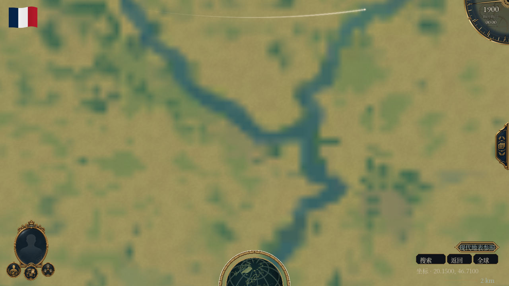

# WWO Rust Windows 游戏

`wwo-map-lab` 是当前原生 Windows 游戏入口。在此目录用 `cargo build --release --locked --bin wwo-map-lab --bin wwo-formal-state` 构建。双击 EXE 或传入 `--play` 开始游戏。EXE 旁需要战略地图的 `data/`。`--data`、`--observe` 和 `--background` 均沿用正式入口。阶段归档包含 `WWO-Country-Records.exe`、Z7 候选 EXE 和运行数据，恢复步骤见 [仓库 README](../../README.md#构建与恢复)。旧地图的独立对照使用 `--map-comparison --data <旧地图目录>`。界面字形更新使用归档项目和 Pillow，运行 `python tools/build_hud.py <R68 项目> <游戏数据目录>`。

正式入口从 `data/maps/regional-2026-11-14/` 读取领土、旗纹和原有专题地图数据。用 `python tools/package_map_release.py <保留的 2026-11-14 区域地图数据目录> <游戏数据目录>` 发布这部分资源。正式入口会检查目录、旗纹资料和地图分片版本，版本不符或缺失时会报告错误。

四种地图模式共用候选资源 `data/worldcrs84quad-z4-v3/`。网格采用 WGS84 经纬度，原点为西经 180°、北纬 90°，X 向东，Y 向南。Z0 为 2×1，每升一级行列翻倍。每张分片的 256×256 个有效样点位于像元中心，四边附带 4 像素的相邻样点。经度在 180° 环绕，纬度在两极钳制。资源按 Z/X/Y 编号，分别保存 BC7 地表及有符号 16 位米制高程。地形、地表颜色、阴影和水系在全球母栅格计算，各级从母栅格降采样。[OGC WorldCRS84Quad](https://docs.ogc.org/is/17-083r4/17-083r4.html)

重建命令为 `python tools/build_natural_terrain.py <原始资料缓存> <Natural Earth 矢量目录> <输出目录>/worldcrs84quad-z4-v3`。复核现有资源用 `python tools/build_natural_terrain.py --verify <资源目录>`。逐级核验覆盖、坐标、编码、瓦片长度、同级共享样点、极区边缘和父子高程降采样误差。启动时按正式版本核对资源。运行时按视野加载，缺页从同库父级采样，相邻页共用边缘和角点的过渡权重。用 `--play --observe <观察请求路径>` 检查正式入口、帧间隔、瓦片加载和驻留状态。旧地图通过独立对照入口查看。

第一阶段覆盖全球 Z0–Z4。此后按全球 Z5、Z6、Z7 逐级生成、验收。逐级记录覆盖、体积、采样精度、资料缺口、跨级渲染和性能，并验证正式世界及专题图层。高于 Z7 先确认资料和性能预算。源数据达不到目标精度的范围回退至已验证层级，并登记缺口。验收前保留发布资源和历史对照。城市施工在全球地貌基础层后启动，人口档依次为 50 万及以上、20 万至不足 50 万、10 万至不足 20 万、5 万至不足 10 万。城市目录记录历史名称、位置、人口年份、统计口径、来源和可信度。具备历史几何的城市另记施工状态。

候选高程沿用 GMT 的 SRTM15+ V2.1 全球 60 角秒网格。海底数据包含估算区，网格间距与测量精度分别记录。海岸、湖泊及冰川使用 Natural Earth 1:10m。HydroRIVERS v1.0 的河段和下游编号保存在 `river-topology.u32`，构建输入为 `HydroRIVERS_v10_shp.zip`。地表覆盖来自 ESA WorldCover 2021 v200。现代覆盖、水文和湖库作为参照，缺口见 `index.json`。[GMT](https://docs.generic-mapping-tools.org/6.2/datasets/remote-data.html) · [SRTM15+](https://doi.org/10.1029/2019EA000658) · [Natural Earth](https://www.naturalearthdata.com/about/terms-of-use/) · [HydroRIVERS](https://www.hydrosheds.org/products/hydrorivers) · [ESA WorldCover CC BY 4.0](https://doi.org/10.5281/zenodo.7254221)

`river-centrelines.qhl` 按 HydroRIVERS v1.0 河段编号绘制屏幕线符号。线符号没有水域面积或通航宽度。旧版地貌包可用 `tools/build_natural_terrain.py --hydrology-candidate <现有QPK库> <地貌来源> <Natural Earth目录> <输出目录>` 生成修正后的 `hydrology-color.qhw` 和 `river-centrelines.qhl`。修复按 Natural Earth 陆地和水域移除旧版河宽像素。WorldCover 用于恢复陆地色调。颜色补页复用原 QPK 页表和高程。

`tools/build_natural_terrain.py --water-geometry <GSHHG全精度压缩包> <候选库>/water-geometry.qwg --measured-river-mask <GRWL_mask_V01.01.zip>` 生成独立 WGS84 页。岸线支持 GSHHG Shapefile 压缩包或 Basemap 的全精度数据 wheel。加入 Landsat 水域需 `pyproj` 和 `tifffile`。GSHHG 提供海岸、湖泊及嵌套岛屿。GRWL 的正值水面提供干流、潮汐水道和连通湖库，零值保留已有水域。已知河岸范围优先。`--documented-river-widths <GeoJSON>` 仅在无观测水面覆盖的河段按米制构造水面。输入中心线需包含 `half_width_metres`、`width_source` 和 `width_epoch`，归档时保留原始 GeoJSON。其余河段使用线符号。局部重算使用 `--water-pages-from <现有QWG>` 和一个或多个 `--water-page X Y`，其余页面从现有包复制。

候选使用 Basemap 2.0.0 随包的 GSHHG 2.3.6 全精度几何和 GRWL v01.01 的 30 米 Landsat 平均流量水域掩膜。岸线和卫星观测均为现代参照。1900 年精确河岸及航道宽度仍待对应历史资料。GRWL 掩膜是中间产品，细小水道和潮滩边界精度取决于资料。[GSHHG](https://www.ngdc.noaa.gov/mgg/shorelines/shorelines.html) · [Basemap 数据及 LGPL-3.0-or-later](https://pypi.org/project/basemap-data-hires/) · [Allen 与 Pavelsky 2018](https://doi.org/10.1126/science.aat0636) · [GRWL v01.01，CC BY 4.0](https://doi.org/10.5281/zenodo.1297434)

## 正式水文资源

正式入口优先读取 `data/worldcrs84quad-15s-v2-hydrology/`，否则读取可用的旧库。在水文目录内恢复下列文件。QHW 按各层 QPK 大小核对配套版本。完整恢复后用 `wwo-map-lab --play` 启动。显式 `--terrain-candidate <候选库>` 仍可指定对照版本。

- `0.qpk` 至 `5.qpk` 和 `river-topology.u32` 取自 [Rust Windows 阶段](https://github.com/ryoumiyahayato/wwo/releases/tag/rust-native-windows-20261115)。
- `6.qpk`、`index.json` 和 `landscape-cover-v2.qsc` 取自 [Z6/Z7 地表阶段](https://github.com/ryoumiyahayato/wwo/releases/tag/z6-z7-surface-20261119)。将 `z6-land-material-6.qpk` 命名为 `6.qpk`。
- `7.qpk` 使用 [Z7 地表归档](https://github.com/ryoumiyahayato/wwo/releases/tag/terrain-surface-20261115) 的 `z7-land-material-7.qpk`。
- 从 [水域接替阶段](https://github.com/ryoumiyahayato/wwo/releases/tag/water-page-handoff-20261120) 下载 `water-geometry-norway.qwg.zst`，解压后命名为 `water-geometry.qwg`。配套 `hydrology-color.qhw` 取自 [水域几何阶段](https://github.com/ryoumiyahayato/wwo/releases/tag/global-water-geometry-20261120)。
- `river-centrelines.qhl` 取自 [河网阶段](https://github.com/ryoumiyahayato/wwo/releases/tag/global-hydrology-20261119)。

Z4 至 Z7 共享水陆位置。复杂几何按视野和移动方向预取。缺页和远景使用 QPK。地表、城市和景观共用水陆状态和接替权重。已有明确边界的历史调查图层优先。实测水域覆盖对应河段时抑制重复的中心线符号。水面轮廓与原河段拓扑可分别追溯。

[水域接替阶段的正式游戏画面与遗留缺陷](WATER_HANDOFF.md)

Z6 和 Z7 的地面材质独立于实例模型。用地分片可用时按地类及坡面混合材质。未知地类用中性土壤，待载地类页使用 QPK 色调和共用材质。观察模式可用 `{"id":"ground","action":"landscape-models","value":"hide"}` 只隐藏景观实例，`show` 恢复。

© ESA WorldCover project 2021 / Contains modified Copernicus Sentinel data (2021) processed by ESA WorldCover consortium.

WorldCover 2021 v200 是现代地表覆盖，用于地貌配色。1900 年政治边界、经济和交通资料采用各自的历史来源。1900 年的地表覆盖尚未重建。

Z5–Z7 的预览使用同一网格和新的全球高程母栅格。原始输入为 GMT 的 SRTM15+ V2.5.5，15 角秒、像元中心配准，统一使用米。将下载文件保存为原始资料缓存中的 `gmt-15s-p-nju.grd`。较低层从同一母栅格降采样，独立的 Z4 预览可继续运行。地表采用 ESA WorldCover 缓存原有的每 3° 562 个样点。湖泊、海岸、冰川和河流沿用相同来源和统一规则。[GMT 高程文件](https://mirror.nju.edu.cn/gmtdata/earth_relief_15s_p.grd) · [SRTM15+ 方法](https://doi.org/10.1029/2019EA000658)

使用 `python tools/build_natural_terrain.py --through 5 <原始资料缓存> <Natural Earth 矢量目录> <输出目录>/worldcrs84quad-15s-v1` 生成到 Z5。通过构建核验并检查 Rust 实机后，以 `--through 6` 和 `--through 7` 续建。每级压成一个可定位瓦片的文件，构建核验解压后的共享高程、颜色、两极边界和父子高程。阶段间复用同一份临时母栅格，Z7 打包后清理临时栅格。运行候选时传入 `--play --data <原有游戏数据目录> --terrain-candidate <worldcrs84quad-15s-v1>`。Rust 只读取当前视野所需的地貌颜色，政治、经济和军事资源继续从原有数据目录加载。

使用 `python tools/build_natural_terrain.py --repack <worldcrs84quad-15s-v1> <worldcrs84quad-15s-v2>` 从完整 Z0–Z7 包生成压缩候选。重打包和复核 v2 需要 Python 的 `zstandard`。每级一个带索引的 `.qpk`，颜色和高程分别存成独立的 Zstandard 帧，压缩等级为 6。保留 BC7 原始块、Alpha 海陆覆盖和 4 像素边缘。16 位有符号米制高程以水平及垂直差分、ZigZag 及字节平面可逆存储。生成时逐瓦片对照原包，并复核全球共享边缘、两极、反经线、父子高程和原有河网。试运行时将 `--terrain-candidate` 指向 v2 目录。

大型生成在输出的父目录写入 `terrain-disk-usage.jsonl`。日志依次记录开工前、任务结束且清理前、清理后的剩余空间。Windows 同时记录 C、D 盘。正常结束、报错或取消时自动清理本次临时目录。分层续建所需的母栅格保留到最后一级成功。预计新增占用超过 10 GB 时先报告。强制终止时由启动端按本次日志定位临时目录，确认进程退出后清理并记录剩余空间。

LOD 使用视口中心的投影比例。将当前纬度的东西、南北采样轴换算为屏幕像素，以两轴均方根求目标层级。相邻等级以半个层级为切换中心，滞回范围为上下各 0.12 级。自动模式优先加载视口及其父级。剩余页用于预取视口外的地貌。视口本身超过固定页预算时使用可完整覆盖视口的较粗层。观察接口的 `viewport_detail_pages` 记录视口包围范围内到目标层的页数，`required_detail_pages` 含预取范围。目标瓦片就绪前显示父级，边缘跟随相邻瓦片就绪状态过渡。`terrain_decode_ms` 记录颜色帧解压，`tile_load_ms` 记录请求到工作线程结果送达的时间。

### Z6/Z7 地表、森林和山地

将 `landscape-cover-v2.qsc` 放在 `worldcrs84quad-15s-v2` 的 QPK 和 `index.json` 同目录。正式入口 `wwo-map-lab --play` 按视野载入 Z6、Z7 的覆盖和高程。复验可用 `--terrain-candidate <QPK库目录>`。按 `G` 进入地理模式，按 `V` 可切换垂直俯视和斜视。已有 `landscape-cover-v1.qsc` 继续支持 Z7 覆盖。覆盖包缺失时，兼容的显卡仍可使用 QPK 高程增强地势。[Z6/Z7 地表归档](https://github.com/ryoumiyahayato/wwo/releases/tag/z6-z7-surface-20261119) · [上一阶段记录](Z7_LANDSCAPE.md)

覆盖包由现有 ESA WorldCover 2021 v200 分类缓存生成。运行 `python tools/build_landscape_cover.py <worldcover缓存目录> <输出目录>/landscape-cover-v2.qsc`，需 NumPy、Pillow 和 zstandard。树冠和岩块按固定 WGS84 区块缓存，实例精度由投影大小控制。树种、林隙和地表纹理为视觉推定。山脊、坡面光照和实例接地使用 QPK 的高程。Z6 色调可用 `python tools/build_natural_terrain.py --z6-from-z7 <原Z6.qpk> <配色Z7.qpk> <输出Z6.qpk>` 重建，并保留原 Z6 高程和水域覆盖。[覆盖来源和许可](https://doi.org/10.5281/zenodo.7254221) · [正式游戏实测及资源恢复](Z6_Z7_SURFACE.md)

### 近景地表候选

用 `wwo-map-lab --play --data <游戏数据目录> --terrain-candidate <QPK目录> --terrain-detail <terrain-detail-v1.qdt>` 从正常游戏入口加载独立候选。候选 QPK 目录或默认正式 QPK 目录中已有同名 QDT 时也可自动发现。自动包缺失或无法读取时沿用原地貌。显式指定的无效包会报错。

用 `python tools/build_terrain_detail.py --output <terrain-detail-v1.qdt> <样区清单.json> ...` 打包有 WGS84 范围和来源记录的样区。首版候选含波河平原、蒂萨河平原、法加拉什山和怀俄明短草原。正式地理地图在近景按视口交集一次加载一个样区。纹理随缩放和覆盖边缘渐隐。QPK 提供底色、海陆遮罩和河湖轮廓。首版候选补充陆地材质，并标注“现代地表参照”。

历史测绘候选可用 `python tools/build_terrain_survey.py <USGS-KMZ> --output <目录> --stem <地区ID> --source <来源URL>` 生成清单，再与原样区用同一打包命令生成独立 QDT。含历史调查数据的包使用新版文件头，Rust 游戏仍能读取已有材质包。用 `--terrain-detail` 指向新包试运行。地理地图只在有效调查覆盖内使用历史水面、林地和耕地，按距离与倍率渐隐。高程和游戏世界数据仍由原有资源提供。密西西比河 Pool 13 来自约 1890 年代、1:20,000 的测绘。25 米为栅格取样间距，湿草甸、沙洲和泥滩在当前候选中使用同一颜色。区域外仍显示现代参考。 [调查来源](https://umesc.usgs.gov/data_library/umesc_metadata/land_cover/umesc_1890s_mrc_lcu.html)

蒂萨河平原的正式游戏同机位画面为 20.15°E、46.71°N、25 米／像素。两图均用完整 Z7，右图启用近景候选。[1920×1080 覆盖边缘](../../docs/terrain-z7-visual/play-detail-tisza-1080p.png) · [候选资源和滚轮录像](https://github.com/ryoumiyahayato/wwo/releases/tag/terrain-surface-20261115)

| 全球底图 | 近景候选 |
| --- | --- |
|  |  |

法国、英国、德国、俄罗斯、清帝国和日本共用一份 1900 年历史资料和模拟规则。选择国家会选定玩家及其开局地点。50 个统计市场共用 Rust 正式时钟。Rust 执行跨日市场结算、统计货运、当地统计市场现货交易、个人库存和消费。巴黎的原开局岗位、劳动合同、工作和有限企业余额下的工资由 Rust 执行。

人物模块沿用正式人物 ID。工作和购买会更新经历。健康与衰老参数属于开发假设。疾病、受伤、医疗、休息、死亡、继承和学校教育尚未接入。地区商户、个人配送、完整企业经营、行政组织、科技、战略军事和 3D 训练仍待迁移。

原生游戏支持手动槽位、保存并退出及重启读档。每个档位保存在 `%LOCALAPPDATA%/WWO-Rust-Candidate/profiles/<配置名>/formal-world`，默认配置名为 `Default`，可用 `WWO_RUST_PROFILE` 指定。存档包含时间、人口、人物、市场、在途货物、账本、库存、合同和工资权益。

## R68 地标和城市 3D

正式地图用 `/` 搜索埃菲尔铁塔、巴黎北站、耶拿桥、威斯敏斯特钟楼、威斯敏斯特桥、Friedrichstraße 车站或吉萨金字塔。定位后可点击模型查看地标 ID 和经纬度。滚轮缩放，右键拖动改变方位，`V` 切换倾斜与俯视。四种地图模式共用地标位置和模型。查询使用地图资料，人物所在地继续由正式世界管理。

GLB 与原有摆放资料随 Rust 源码从 Git 恢复，并编入 EXE。近景按视野解码和上传，桥梁、车站沿用原 GLB 两档网格。读取原件的材质底色、顶点色和法线。桥梁沿用 R68 的显示坐标和桥面基准。

巴黎 Gros-Caillou、威斯敏斯特和米尔班克沿用 [R40 原创城市模块](../../assets/settlements/R40_SOURCE_AND_USAGE.md) 的 18、16 和 4 个摆放点。相同的模块共享 GPU 网格，沿用 8 米/像素切换近远档，并保留资料注明的概念街区比例。搜索 `paris_gros_caillou_miniature`、`westminster_miniature` 或 `millbank_wharves_1900` 可定位。地标与街区沿用地图相对平面。当前原件没有图片贴图。局部地形接地、贴图和动画资源待接入。

## 全球地图验收

无窗口验收使用正式 Vulkan/wgpu 地图管线。运行 `wwo-map-lab --terrain-review --data <运行数据目录> --observe <临时目录/map.json>`。底图库沿用正式入口的默认选择规则。可通过 `--terrain-candidate <QPK库目录>` 指定候选库。`--terrain-level 0..7` 只打开并绘制指定层，缺页显示紫色。超过显存页预算时，响应中的 `exact_view_over_capacity` 标为真，可缩小取景范围。`--terrain-max-level 0..7` 限制自动 LOD 的最高层，并保留父级回退。严格观察单层替换时可另传 `--terrain-layer-candidate <候选.qpk>`，使用该库共享清单及河网资料，原 QPK 保留。

观察请求写入 `--observe` 指定的 JSON。每次使用新 `id`。`{"id":"pose-1","action":"focus","lon":11.25,"lat":46.4,"mpp":1000,"value":"north"}` 设置取景。`terrain-samples` 查询页表，`capture` 带 `label` 写入同目录 PNG，响应在 PNG 保存后写入。响应记录视口、投影、目标层、视图上限和九处像素中心的瓦片 ID 与混合权重。采样由 CPU 投影和实际提交的页表计算，贴近边界时可能与 GPU 投影有浮点差异。`selected_ready` 表示选中页全部上传，自动模式同时等待混合完成。`quit` 退出。该入口不打开游戏档案、不推进世界、不创建游戏窗口。

使用 `python tools/build_natural_terrain.py --verify <QPK库目录> --layer 6 --index-only` 遍历单层全球索引和瓦片记录边界。省略 `--index-only` 会解码该层及必要父页，检查同级边缘、高程、极区和父级误差。加 `--layer-candidate <候选.qpk>` 可在独立路径核对替换层。

每轮验收从亚洲、欧洲、非洲、北美洲、南美洲、大洋洲和南极洲各随机抽取至少一个 WorldCRS84Quad 区块，共至少七个。全洲采用同一个预先确定的抽样 Z。用版本固定的洲界和陆地数据建立候选池，纳入含该洲陆地的瓦片，包括沿海和岛屿。各洲候选按 Z/X/Y 排序后等概率、不放回抽取，优先排除上轮区块。候选不足时记录重复及原因。国家、城市、画面质量和地貌加载结果均不作为筛选条件。

截图前冻结名单。记录抽样种子、随机算法及实现版本、抽样 Z、洲界和陆地数据版本，以及每个区块的 WGS84 经纬度、分片 ID 和两档取景参数。相机中心使用瓦片中心。中心落在该洲陆地之外时，取瓦片内距中心最近的该洲陆地位置，距离相同按经度、纬度排序。每块至少检查区域和近景，记录相机中心、投影、视口尺寸、缩放倍率或米／像素，以及目标 Z。画面异常或资源缺失时保留原样本和失败记录。

每档截图前核对运行时实际用于绘制的资源版本、样本中心分片 ID，以及边缘涉及的瓦片层级。记录加载过程中的短暂父级与稳定后的降级，记录混合过渡涉及的层级及原因。现有 `--observe` 的 `target_level`、`view_max_level` 和各级驻留计数用于辅助判断。需要区分具体分片或混合层级时，按坐标核对运行时页表及渲染采样状态。无法确认实际分片时标记未验证。

每块检查地貌精度、山脉和河流连续性、海岸、地表颜色、瓦片接缝及缩放跨层切换。无对应地物和资料缺口分别记录。报告按洲列出原抽样名单、两档取景参数、实际分片和层级、回退原因、截图及检查结果。异常登记坐标、分片和原因。按全球统一规则修复后，在原样本上复验。

每轮另列 180° 经线、南北两极、同级瓦片边界和不同精度交界的固定专项检查。专项结果单列，七大洲随机样本仍须齐全。

## 本地构建目录

以下目录相对于 `D:/programs/WWO`。

| 用途 | 目录 |
| --- | --- |
| Rust 主线源码 | `wwo-character-integration/rust/strategic-host` |
| Cargo 构建缓存 | `offline-map-sources/natural-terrain/target`，使用 `CARGO_TARGET_DIR` 指向该目录 |
| 当前 Windows 运行目录 | `wwo/local-artifacts/strategic-map-phase4`，随 EXE 保留所需 `data/` |
| 自然地理候选和回退 | 当前 Windows 运行目录下的 `natural-terrain-preview`，同机位交付截图在 `z7-review` |
| 地理输入和来源记录 | `offline-map-sources` |
| 单次临时观察输出 | `%TEMP%` 下的本次会话目录 |

正式构建交付后，用独立档案确认启动、世界推进、地图切换和重启读档。保留当前发布、必要回退及对应数据，清理本次已退出的观察会话、重复打包和可再生构建输出。地貌构建的临时母栅格用于续建，只有当前预定层级生成并核验后才清理。移除已合并的临时工作树前，核对 `main`、远程引用、未提交和未跟踪文件，再用 `git worktree remove`。R68 和未合并的独立工作线保留原工程与资产。

## R68 对照

按 [R68 源码恢复步骤](../../README.md#恢复-r68-源码) 获取旧项目。传入 `--r68` 可进入 R68 对照模式。该模式使用原有存档目录。将本目录 `tools/` 下的两个 `formal_*_bridge.gd` 放到 EXE 旁的 `tools/` 目录。通过 `WWO_R68_PROJECT` 和 `WWO_GODOT_EXE` 指定对照项目和 Godot 4.6.3。原生大厅只读写原生槽。维护工具 `wwo-formal-state` 可读取原版法国 v15 存档的部分领域。
